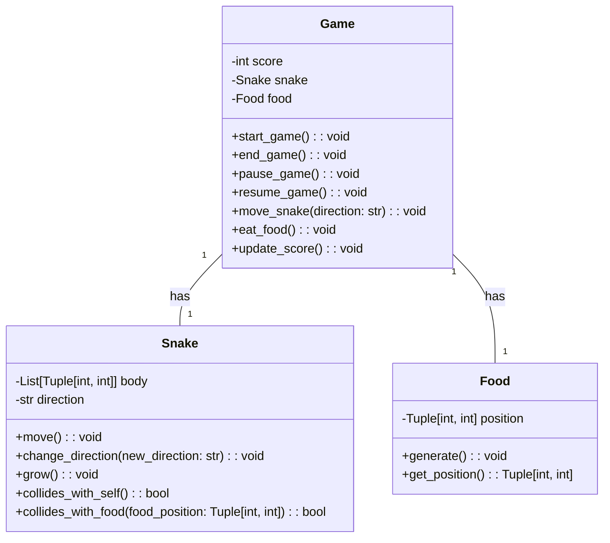
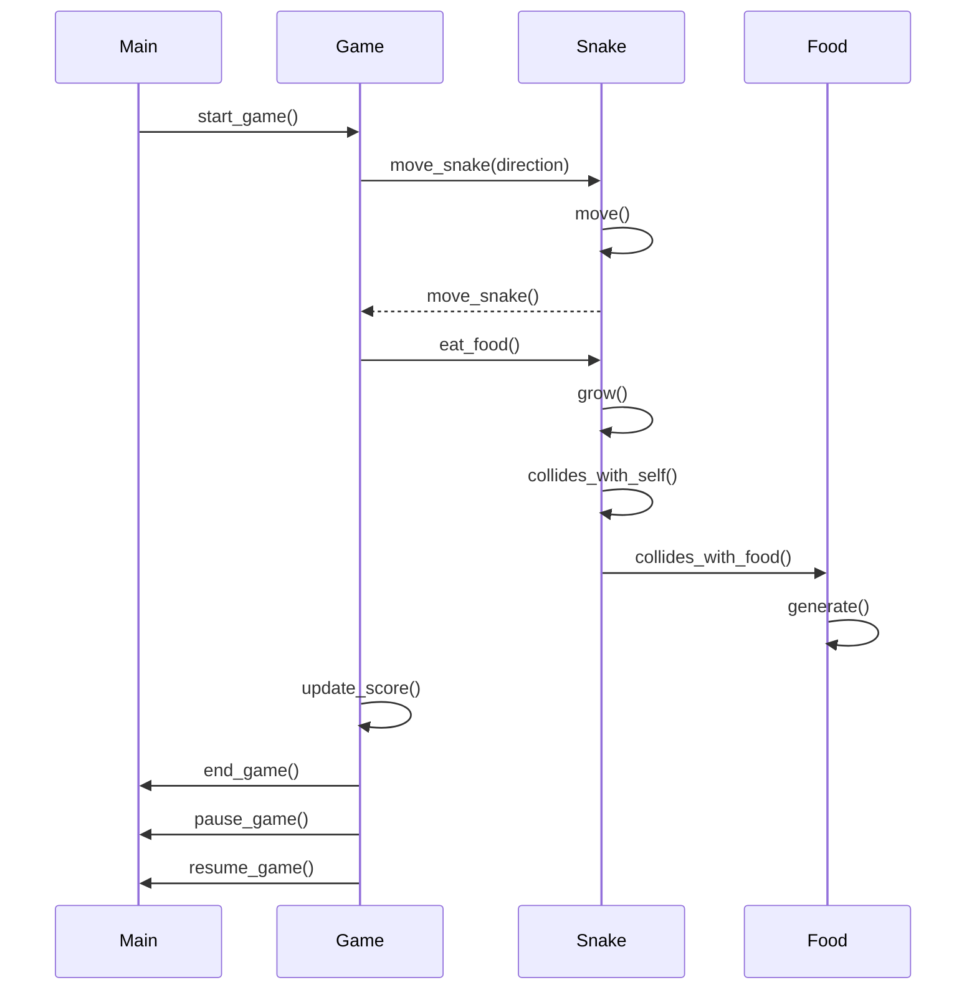

## main.py

```python
"""
main.py
"""

import pygame
import random

class Game:
    def __init__(self):
        self.score = 0
        self.snake = Snake()
        self.food = Food()

    def start_game(self):
        pygame.init()
        self.screen = pygame.display.set_mode((800, 600))
        pygame.display.set_caption("Snake Game")
        self.clock = pygame.time.Clock()
        self.running = True

        while self.running:
            for event in pygame.event.get():
                if event.type == pygame.QUIT:
                    self.end_game()
                elif event.type == pygame.KEYDOWN:
                    if event.key == pygame.K_p:
                        self.pause_game()
                    elif event.key == pygame.K_r:
                        self.resume_game()
                    elif event.key == pygame.K_UP:
                        self.move_snake("UP")
                    elif event.key == pygame.K_DOWN:
                        self.move_snake("DOWN")
                    elif event.key == pygame.K_LEFT:
                        self.move_snake("LEFT")
                    elif event.key == pygame.K_RIGHT:
                        self.move_snake("RIGHT")

            self.screen.fill((0, 0, 0))
            self.snake.move()
            self.check_collision()
            self.draw_snake()
            self.draw_food()
            self.update_score()
            pygame.display.update()
            self.clock.tick(10)

    def end_game(self):
        pygame.quit()
        self.running = False

    def pause_game(self):
        self.running = False

    def resume_game(self):
        self.running = True

    def move_snake(self, direction):
        self.snake.change_direction(direction)

    def eat_food(self):
        self.snake.grow()
        self.food.generate()
        self.score += 1

    def update_score(self):
        font = pygame.font.Font(None, 36)
        text = font.render(f"Score: {self.score}", True, (255, 255, 255))
        self.screen.blit(text, (10, 10))

    def check_collision(self):
        if self.snake.collides_with_self():
            self.end_game()
        elif self.snake.collides_with_food(self.food.get_position()):
            self.eat_food()

    def draw_snake(self):
        for segment in self.snake.body:
            pygame.draw.rect(self.screen, (0, 255, 0), (segment[0], segment[1], 20, 20))

    def draw_food(self):
        pygame.draw.rect(self.screen, (255, 0, 0), (self.food.position[0], self.food.position[1], 20, 20))


class Snake:
    def __init__(self):
        self.body = [(100, 100), (80, 100), (60, 100)]
        self.direction = "RIGHT"

    def move(self):
        if self.direction == "UP":
            head = (self.body[0][0], self.body[0][1] - 20)
        elif self.direction == "DOWN":
            head = (self.body[0][0], self.body[0][1] + 20)
        elif self.direction == "LEFT":
            head = (self.body[0][0] - 20, self.body[0][1])
        elif self.direction == "RIGHT":
            head = (self.body[0][0] + 20, self.body[0][1])

        self.body.insert(0, head)
        self.body.pop()

    def change_direction(self, new_direction):
        if new_direction == "UP" and self.direction != "DOWN":
            self.direction = new_direction
        elif new_direction == "DOWN" and self.direction != "UP":
            self.direction = new_direction
        elif new_direction == "LEFT" and self.direction != "RIGHT":
            self.direction = new_direction
        elif new_direction == "RIGHT" and self.direction != "LEFT":
            self.direction = new_direction

    def grow(self):
        tail = self.body[-1]
        self.body.append(tail)

    def collides_with_self(self):
        head = self.body[0]
        return head in self.body[1:]

    def collides_with_food(self, food_position):
        head = self.body[0]
        return head == food_position


class Food:
    def __init__(self):
        self.position = (random.randint(1, 39) * 20, random.randint(1, 29) * 20)

    def generate(self):
        self.position = (random.randint(1, 39) * 20, random.randint(1, 29) * 20)

    def get_position(self):
        return self.position


if __name__ == "__main__":
    game = Game()
    game.start_game()
```

## 珠三角

PRD 是 `WritePRD` 动作输出的结果。

PRD 的内容包括以下几部分：

| 字段名 | 是否可修改增量 | 字段值示例 |
| --- | --- | --- |
| 原始要求 | 否 | “创造一个贪吃蛇游戏” |
| 搜索信息 | 否 | “” |
| 项目名称 | 否 | 如果想修改，请通过 CLI 命令参数 `--project-name` 进行 |
| 要求 | 否 | “” |
| 产品目标 | 是 | [  “提供愉快的游戏体验”、  “确保流畅且反应灵敏的控制”、  “包含引人入胜的视觉效果和音效”  ] |
| 用户故事 | 是 | [  “作为玩家，我希望使用方向键控制蛇在游戏上面移动”、  “玩家，我希望蛇在消耗食物的同时，能够提高长并速度”、  “作为玩家，我希望看到我的最高分，并与其他玩家进行比较”、  “作为玩家，我希望有不同的难度级别来挑战自己”、  “作为玩家，我希望能够随时暂停并继续游戏”  ] |
| 竞争分析 | 否 | [  “贪吃蛇游戏 X 拥有简洁直观的用户界面”、  “贪吃蛇游戏 Y 提供多种游戏模式和强化道具”、  “贪吃蛇游戏 Z 拥有排行榜功能，可以与好友一较高低”、  “贪吃蛇游戏 A 拥有流畅灵敏的控制”、  “贪吃蛇游戏 B 拥有极具视觉吸引力的图形和动画”、  “贪吃蛇游戏 C 提供可定制的蛇皮”、  “贪吃蛇游戏 D 拥有极具挑战性的障碍和迷宫”  ] |
| 竞争象限图 | 否 | “quadrantChart\n 标题 贪吃蛇游戏的覆盖率和参与度\n x 轴 低覆盖率 --> 高覆盖率\n y 轴 低参与度 --> 高参与度\n 象限-1 贪吃蛇游戏 X: [0.3, 0.6]\n 象限-2 贪吃蛇游戏 Y: [0.45, 0.23]\n 象限-3 贪吃蛇游戏 Z: [0.57, 0.69]\n 象限-4 贪吃蛇游戏 A: [0.78, 0.34]\n 贪吃蛇游戏 B: [0.40, 0.34]\n 贪吃蛇游戏 C: [0.35, 0.78]\n 贪吃蛇游戏 D: [0.5, 0.6]” |
| 需求分析 | 否 | “” |
| 需求池 | 是 | [  [  `P0`,  “当玩家控制蛇时，蛇应该移动流畅且反应灵敏。”  ],  [  `P1`,  “游戏应该有不同难度级别，以满足不同技能水平的玩家。”  ]  ] |
| UI 设计稿 | 是 | 游戏将拥有简洁明了的用户界面。它由一个游戏板组成，蛇会在游戏板上移动，食物也会随之出现。得分和最高分将显示在屏幕顶部。游戏还设有暂停和继续游戏的按钮。蛇和食物的图形都将非常美观。 |
| 任何不清楚的事情 | 否 | “” |

## 类视图和相关图

类视图和动画图都是 `WriteDesign` 的输出的一部分。

类视图与相关图都使用了基于 [Mermaid](https://mermaid.js.org/syntax/classDiagram.html) 的纯文本 UML，语法描述了某个用例下的控制流和数据流。因此，对类视图或同类图的修改，需要同时重写类视图和相关图。

类视图示例：



实例图示例：



## 写入任务

`WriteTasks` 的输出定义了类视图中的类对应的文件名。其中，逻辑分析中的类名引用是 `WriteDesign` 类视图中的类名。

修改 `WriteTasks` 只能改变要生成那些代码文件的逻辑。

```json
"Logic Analysis": [
    ["main.py", "Game"],
    ["main.py", "Snake"],
    ["main.py", "Food"]
],
"Task list": [
    "main.py"
],
```


## 编写代码和 QA
