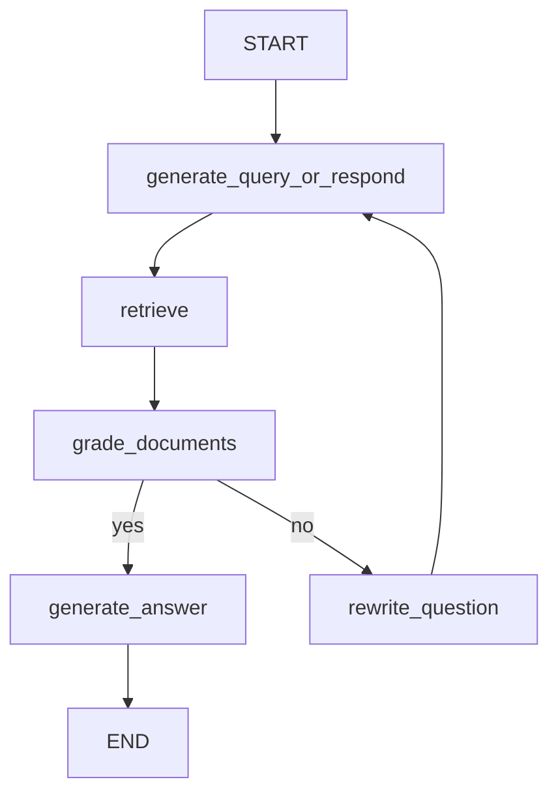

# ---------------------------------------------------------------------------

```python
workflow = StateGraph(MessagesState)

workflow.add_node("generate_query_or_respond", generate_query_or_respond)

workflow.add_node("retrieve", ToolNode([retriever_tool]))

workflow.add_node("rewrite_question", rewrite_question)

workflow.add_node("generate_answer", generate_answer)

workflow.add_edge(START, "generate_query_or_respond")

workflow.add_edge("generate_query_or_respond", "retrieve")

workflow.add_conditional_edges("retrieve", grade_documents)

workflow.add_edge("generate_answer", END)

workflow.add_edge("rewrite_question", "generate_query_or_respond")

rag_agent = workflow.compile(name="rag_agent")
```


代码解释如下：

## 代码解释

### 1. 环境与依赖加载

```python
from __future__ import annotations

import os

import asyncio

from typing import Literal

from dotenv import load_dotenv

load_dotenv(override=True)
```

+ `__future__.annotations`: 使 Python 3.7+ 支持延迟注解解析（避免循环引用等问题）。

+ `load_dotenv(override=True)`: 加载 `.env` 环境变量文件中的内容（如 API key），并允许覆盖已有变量。

### 2. 初始化 LLM 模型与嵌入模型

```python
from langchain.chat_models import init_chat_model

from langchain_openai import OpenAIEmbeddings
```

+ `init_chat_model(...)`: 初始化 `deepseek-chat` 模型（来自 DeepSeek 的对话式大模型）。

+ `OpenAIEmbeddings(...)`: 使用 OpenAI 的 `text-embedding-3-small` 嵌入模型，将文本转为向量用于向量检索。

```python
MODEL_NAME = "deepseek-chat"

model = init_chat_model(model=MODEL_NAME, model_provider="deepseek", temperature=0)

grader_model = init_chat_model(model=MODEL_NAME, model_provider="deepseek", temperature=0)
```

+ `model`: 主模型，用于用户对话处理。

+ `grader_model`: 用于判断文档相关性的小助手模型。

### 3. 向量数据库加载与检索工具构建

```python
VS_PATH = "mcp_course_materials_db"

vector_store = FAISS.load_local(...)

retriever_tool = create_retriever_tool(...)
```

+ 从本地加载一个名为 `mcp_course_materials_db` 的 FAISS 向量库；

+ 使用 `create_retriever_tool` 构造了一个可供 LangGraph 工具调用的 Retriever 工具（用于查找与问题相关的文本块）；

+ `k=3` 表示每次检索返回 3 条上下文。

### 4. 提示词设计（Prompt Engineering）

这些提示词是对智能体行为的指令设计。

#### 系统提示词

```python
SYSTEM_INSTRUCTION = (...)
```

+ 限定助手只能回答“Model Context Protocol (MCP)”技术实战相关问题；

+ 如果不是相关问题，就回复：我不能回答与 MCP 技术实战公开课无关的问题。

#### 评估 Prompt

```python
GRADE_PROMPT = (...)
```

+ 指导 `grader_model` 判断检索结果是否与用户提问相关，输出 `yes` 或 `no`。

#### 重写 Prompt

```python
REWRITE_PROMPT = (...)
```

+ 如果用户问题偏离主题，让模型改写问题，使其更贴近“工具调用 / LangGraph / MCP”等关键概念。

#### 回答 Prompt

```python
ANSWER_PROMPT = (...)
```

+ 给模型一个问题和上下文，引导它用 Markdown、代码块、图片等方式生成结构化答案。

### 5. LangGraph 节点逻辑定义

LangGraph 是有状态多节点的图结构，这里定义了智能体对话的各个节点功能。

#### ✅ generate_query_or_respond

```python
async def generate_query_or_respond(state: MessagesState):

    ...
```

+ 调用 LLM，根据当前消息决定是否要调用 `retriever_tool`；

+ 本质上是一个具备工具调用能力的交互节点（如果上下文不足，模型会自动决定调用检索器）。

#### ✅ grade_documents

```python
async def grade_documents(state: MessagesState) -> Literal["generate_answer", "rewrite_question"]:

    ...
```

+ 使用 `grader_model` 判断：检索到的文档是否与提问有关；

+ 如果是 → `generate_answer`；

+ 如果不是 → `rewrite_question`。

#### ✅ rewrite_question

```python
async def rewrite_question(state: MessagesState):

    ...
```

+ 调用 LLM 改写用户问题，使其更符合 MCP 课程范畴。

#### ✅ generate_answer

```python
async def generate_answer(state: MessagesState):

    ...
```

+ 用 LLM + 上下文生成最终答复；

+ 支持代码块与 Markdown 格式。

### 6. 构建 LangGraph 工作流

```python
workflow = StateGraph(MessagesState)
```

我们将所有逻辑节点通过图结构组合成一个完整智能体流程：



解释如下：

| 步骤 | 节点名称 | 功能 |
| --- | --- | --- |
| 1 | `START` | 起点 |
| 2 | `generate_query_or_respond` | 模型判断是否调用工具 |
| 3 | `retrieve` | 调用检索工具返回上下文 |
| 4 | `grade_documents` | 判断检索结果是否相关 |
| 5a | `generate_answer` | 生成回答 → 终点 |
| 5b | `rewrite_question` | 改写问题 → 回到第 2 步 |

### 7. 编译智能体并生成入口

```python
rag_agent = workflow.compile(name="rag_agent")
```

最终将整个 LangGraph 图编译为可调用的 `rag_agent`，你可以在主函数中这样调用：

```python
await rag_agent.ainvoke({"messages": [{"role": "user", "content": "MCP 是什么？"}]})
```

实际测试效果如下：

---

+ 体验课内容节选自《2025 大模型 Agent 智能体开发实战》(秋招冲刺班)完整版付费课程

体验课时间有限，若想深度学习大模型技术，欢迎大家报名由我主讲的《2025 大模型 Agent 智能体开发实战》(秋招冲刺班)


此外，若是对大模型底层原理感兴趣，也欢迎报名由我和菜菜老师共同主讲的《2025 大模型原理与实战课程》(秋招冲刺班)

**大模型秋招冲刺班开班特惠进行中，直播间享五折特价+全套 SVIP 新班特定福利，合购还有更多**优惠哦~详细信息扫码添加助教，回复“大模型”，即可领取课程大纲 & 查看课程详情👇


**《2025 大模型 Agent 智能体开发实战》(秋招冲刺班)** 为【100+ 小时】体系大课，总共 20 大模块精讲精析，零基础直达大模型企业级应用！
