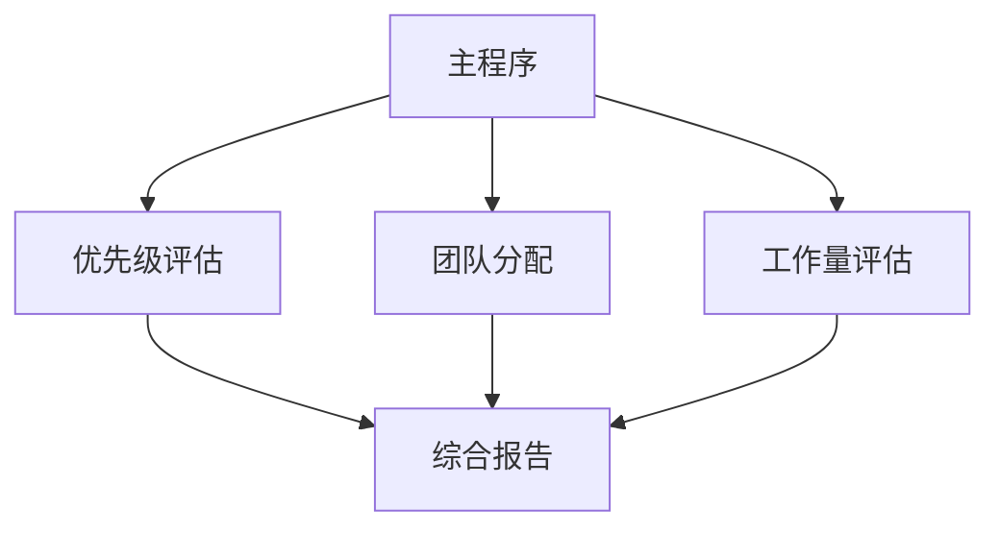
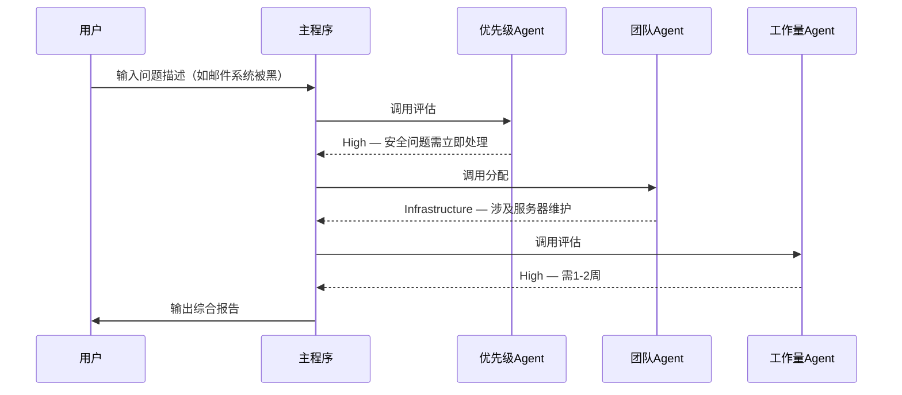

# 支持代理系统架构（基于 OpenAI API）

这段代码实现了一个基于 OpenAI API 的支持代理系统，能够与用户交互并创建技术支持工单。以下是主要模块和它们之间的逻辑关系：

## 模块结构

### 环境配置模块

- 使用 `dotenv` 加载环境变量（API 密钥、基础 URL 和模型名称）
- 初始化 OpenAI 客户端

### 工具函数模块

- 定义了一个本地函数 `create_support_ticket`，用于创建支持工单文件
- 该函数会被 AI 代理在适当的时候调用

### AI 配置模块

- 定义了工具描述（JSON 格式），告诉 AI 可用的函数及其参数
- 创建了函数映射字典，将函数名与实际函数关联
- 设置了系统指令，严格规定了 AI 的行为流程

### 主交互循环

- 处理用户输入和 AI 响应
- 管理对话历史（`messages` 列表）
- 处理函数调用和结果

## Agent 与工具的工作流程

### Agent 角色

- 扮演一个技术支持代理
- 遵循严格的规则收集用户信息（先邮箱后问题描述）
- 在收集完必要信息后自动调用工具函数

### 工具集成

- `create_support_ticket` 是 AI 可以调用的唯一工具
- 工具描述清晰地定义了函数用途、参数和必需字段
- 工具调用是自动触发的，当 AI 判断条件满足时

### 交互逻辑

```text
用户输入 → AI处理 → 
(若需要更多信息) → 继续询问 → 
(若信息完整) → 调用工具 → 
返回工具结果 → 回复用户
```


## 关键特点

- **严格的信息收集顺序**：系统强制先收集邮箱，再收集问题描述
- **自动函数调用**：当条件满足时，AI 会自动调用工具函数
- **对话历史管理**：所有交互都被记录在 `messages` 列表中，用于上下文
- **错误处理**：工具函数中有基本的错误处理机制

这个架构展示了如何将本地功能（创建工单文件）通过工具调用方式集成到 AI 代理中，创建了一个实用的技术支持对话系统。

# 场景 3：编排多代理

repo：`https://github.com/cloudzun/ai-agent/tree/main/Labfiles/06-build-multi-agent-solution/Python`

`requirement.txt`

```text
python-dotenv
```

安装依赖

```bash
pip install -r requirements.txt
```

`agent_triage.py`

```python
import os
from openai import OpenAI
from dotenv import load_dotenv

# --- 1. 配置和初始化 (与之前相同) ---
load_dotenv()
api_key = os.getenv("OPENAI_API_KEY")
base_url = os.getenv("OPENAI_BASE_URL")
model_name = os.getenv("OPENAI_MODEL_NAME")

if not all([api_key, base_url, model_name]):
    print("错误：请确保 .env 文件中已配置 OPENAI_API_KEY, OPENAI_BASE_URL, 和 OPENAI_MODEL_NAME。")
    exit()

try:
    client = OpenAI(
        api_key=api_key,
        base_url=base_url,
    )
except Exception as e:
    print(f"错误：无法初始化 OpenAI 客户端 - {e}")
    exit()

# --- 2. 定义 "代理" 函数 (与之前相同，无需改动) ---

def get_priority_assessment(ticket_description: str) -> str:
    system_prompt = """
    你是一位经验丰富的 IT 支持团队经理。你的任务是评估用户提交的技术支持工单的优先级。
    请从以下选项中选择一个优先级：Low, Medium, High。
    你的回答格式必须是：[优先级] — [简短的理由说明]。
    """
    try:
        response = client.chat.completions.create(
            model=model_name,
            messages=[
                {"role": "system", "content": system_prompt},
                {"role": "user", "content": ticket_description}
            ],
            temperature=0.2,
        )
        return response.choices[0].message.content.strip()
    except Exception as e:
        return f"获取优先级评估时出错: {e}"

def get_team_assignment(ticket_description: str) -> str:
    system_prompt = """
    你是一位 IT 支持工单分派专家。你的任务是根据工单描述，将其分配给最合适的团队。
    可选团队包括：Frontend, Backend, Mobile App, Infrastructure, DevOps。
    你的回答格式必须是：[团队名称] — [简短的理由说明]。
    """
    try:
        response = client.chat.completions.create(
            model=model_name,
            messages=[
                {"role": "system", "content": system_prompt},
                {"role": "user", "content": ticket_description}
            ],
            temperature=0.2,
        )
        return response.choices[0].message.content.strip()
    except Exception as e:
        return f"获取团队分配时出错: {e}"

def get_effort_estimation(ticket_description: str) -> str:
    system_prompt = """
    你是一位资深的软件开发经理。你的任务是评估解决一个技术工单所需的工作量。
    请从以下选项中选择一个工作量级别：Low, Medium, High。
    你的回答格式必须是：[工作量级别] — [简短的解释，并预估所需时间]。
    """
    try:
        response = client.chat.completions.create(
            model=model_name,
            messages=[
                {"role": "system", "content": system_prompt},
                {"role": "user", "content": ticket_description}
            ],
            temperature=0.3,
        )
        return response.choices[0].message.content.strip()
    except Exception as e:
        return f"获取工作量评估时出错: {e}"

# --- 3. 主程序：改为交互式输入 ---
if __name__ == "__main__":
    
    print("欢迎使用 AI 工单评估系统 (输入 'exit' 或 'quit' 退出)")
    
    # 使用一个循环来持续接收用户输入
    while True:
        # 从用户那里获取输入
        user_ticket = input("\n请输入您遇到的问题: ")

        # 检查用户是否想退出
        if user_ticket.lower() in ['exit', 'quit']:
            print("程序已退出。")
            break

        # 检查输入是否为空
        if not user_ticket:
            print("输入不能为空，请重新输入。")
            continue

        print("\n正在处理，请稍候...")
        print("开始处理代理线程...\n")

        # 依次调用各个代理函数
        priority = get_priority_assessment(user_ticket)
        team = get_team_assignment(user_ticket)
        effort = get_effort_estimation(user_ticket)

        # 打印用户输入
        print("MessageRole.USER:")
        print(f"{user_ticket}\n")

        # 格式化并打印代理的最终评估报告
        print("MessageRole.AGENT:")
        print("### Ticket Assessment\n")
        print(f"- **Priority:** {priority}")
        print(f"- **Assigned Team:** {team}")
        print(f"- **Effort Required:** {effort}\n")

        print("清理代理：任务完成。")
```

以下是这段代码的架构分析和交互流程解释，重点说明四个 "Agent"（功能模块）之间的关系：

## 1 系统架构概览

该系统是一个工单评估流水线，包含三个独立但协同工作的功能模块（可视为 "Agent"）：

1. **优先级评估 Agent**（`get_priority_assessment`）
2. **团队分配 Agent**（`get_team_assignment`）
3. **工作量评估 Agent**（`get_effort_estimation`）
4. **主控 Agent**（主程序逻辑，负责协调）




## 各 Agent 职责分析

| Agent 类型 | 功能说明 | 输出示例 |
| --- | --- | --- |
| **优先级评估** | 判断问题的紧急程度（Low/Medium/High） | [High] — 严重安全问题需立即处理 |
| **团队分配** | 确定负责团队（Frontend/Backend 等） | [Infrastructure] — 涉及邮件服务器维护 |
| **工作量评估** | 预估解决所需资源和时间 | [High] — 需1-2周全面修复 |
| **主控协调** | 接收用户输入→触发各 Agent→汇总结果 | 生成最终评估报告 |

## 交互流程详解




### 线性触发机制

- 主程序**顺序调用**三个 Agent，彼此**无直接交互**
- 所有 Agent 接收**相同的原始问题描述**，各自独立分析

### 标准化接口

- 所有 Agent 采用相同的输入输出格式（字符串输入，`[分类] — [理由]`输出）
- 通过统一的错误处理机制（`try-catch` 返回错误信息）

### 决策独立性

- 优先级 Agent 专注业务影响
- 团队 Agent 侧重技术领域匹配
- 工作量 Agent 考虑实施成本

## 关键设计特点

### 模块化设计

- 每个 Agent 可单独修改/替换而不影响其他组件
- 例如新增一个风险等级评估 Agent 只需添加函数即可

### 无状态性

- 所有 Agent 不保留上下文，纯函数式处理
- 相同输入永远得到相同输出（因 `temperature≤0.3`）

### 人机协作

- 最终报告保留 AI 的原始推理过程（`— [理由]` 部分）
- 人类可快速理解 AI 的决策依据

## 扩展性建议

- 添加**Agent 间校验**（如当优先级=`High` 但工作量=`Low` 时触发警告）
- 引入**工单历史分析**（让 Agent 能参考过往类似工单）
- 实现**异步并行处理**（用多线程同时调用三个 Agent）

这个设计完美体现了"单一职责原则"，每个 Agent 就像工厂流水线上的专业工人，共同完成工单评估的完整流程。

# 场景 4：使用模型上下文协议（MCP）将 AI 代理连接到工具

repo：`https://github.com/cloudzun/ai-agent/tree/main/Labfiles/07-use-agent-tools-with-mcp/Python`

`requirement.txt`

```text
# requirements.txt
fastapi
uvicorn[standard]
openai
python-dotenv
requests
```

安装依赖

```bash
pip install -r requirements.txt
```

`agent_with_mcp.py`
