cursor回答以及mermaid图表如下图所示：

其中，各个组件解释如下：

| 组件名称 | User（用户） | Vanna Core（核心组件） | VS（Vector Store，向量存储） | LLM（Language Model，语言模型） | DB（Database，目标数据库） | Viz（Visualization，可视化组件） |
| --- | --- | --- | --- | --- | --- | --- |
| 说明 | 系统的最终用户 | 系统的主要控制器 | 存储训练数据的向量数据库 | 负责自然语言处理 | 存储实际业务数据的数据库 | 处理数据可视化 |

- ChromaDB
- Milvus
- OpenSearch
- 等

- DDL
- 文档
- SQL示例
- QianWenAI
- ZhipuAI
- 等

## 绘制类图

仿照绘制 Flowchart 的 Prompt 绘制类图

梳理`VANNA-MAIN`的完整代码，创建`mermaid_classDiagrams.md`文件到根目录，同时在`mermaid_classDiagrams.md`中绘制 mermaid 项目 Class diagrams 图

结果如下：

# 四、使用建议——待更新

## 图表设计原则

保持简洁清晰、突出重点关系、合理使用颜色、注意布局美观。

### （1）图表要言简意赅

Mermaid 的设计宗旨就是用最简洁的语法来表达信息。在创建图表时要注意：

- 节点内容尽量精简
- 不要有过多的交叉线
- 布局要整齐有序
- 色彩要醒目但不花哨

### （2）把图表用起来

光画图表还不够，要学会在团队协作中充分利用它们：

- 设计阶段：用图表表达架构和流程
- 代码评审：用图表解释关键逻辑
- 新人培训：用图表辅助代码学习
- 技术分享：用图表增强表现力

### （3）持续打磨和优化

图表的创建是一个持续迭代的过程：

- 及时更新图表内容
- 根据反馈不断优化
- 定期重构图表结构
- 引入新的图表类型

---

# 附件：项目全生命周期可能涉及人员所使用图表

以下是从项目全生命周期的角度，分析不同角色可能使用的不同图表：

## 产品经理

常用图表：

- 用户旅程图：用户体验
- 流程图：业务流程
- 饼图：需求优先级

## 项目经理

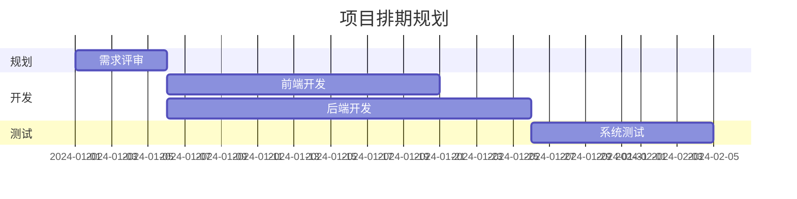

常用图表：

- 甘特图：项目进度
- 流程图：工作流程
- 饼图：资源分配

## 架构师

常用图表：

- 类图：系统架构
- ER图：数据建模
- 流程图：系统设计

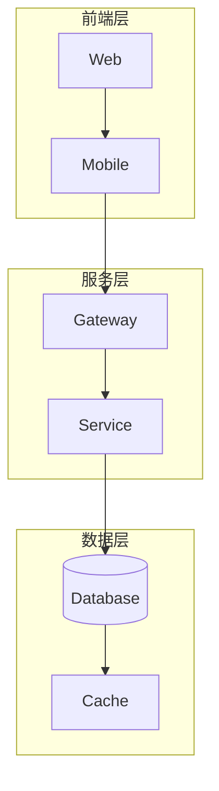

## 开发工程师

常用图表：

- 时序图：接口交互
- 类图：代码结构
- 状态图：状态流转

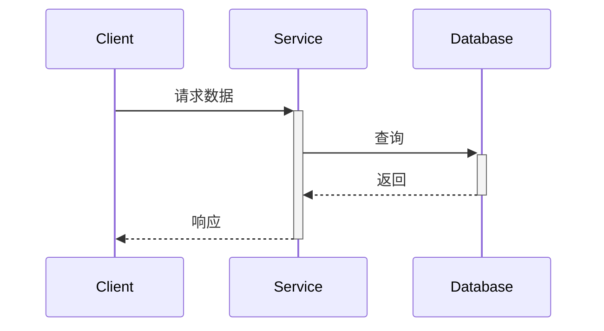

## 测试工程师

常用图表：

- 状态图：测试流程
- 流程图：测试用例
- 时序图：接口测试

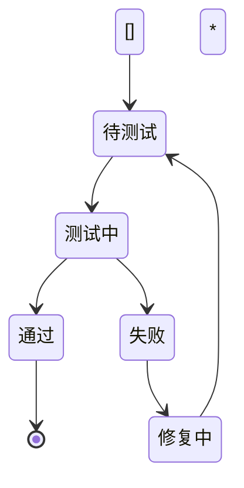

## 运维工程师

常用图表：

- 流程图：部署流程
- 时序图：问题排查
- 状态图：系统监控

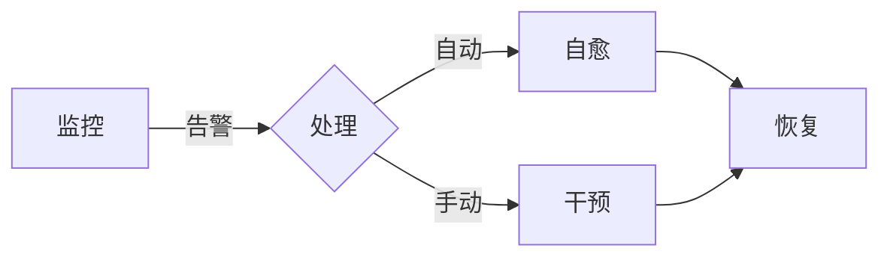

## UI/UX设计师

常用图表：

- 流程图：页面流转
- 用户旅程图：交互设计
- 状态图：界面状态

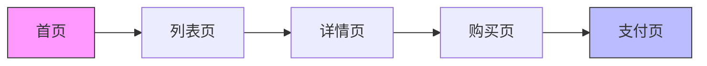

## 产品运营：详细举例

运营人员通常关注数据分析、用户行为和业务流程，以下是他们最常用的 Mermaid 图表类型：

图表的作用：

1. 更直观地展示数据
2. 更清晰地规划工作
3. 更有效地沟通决策
4. 更科学地评估效果

### 常用图表

#### 用户旅程图 (Journey)

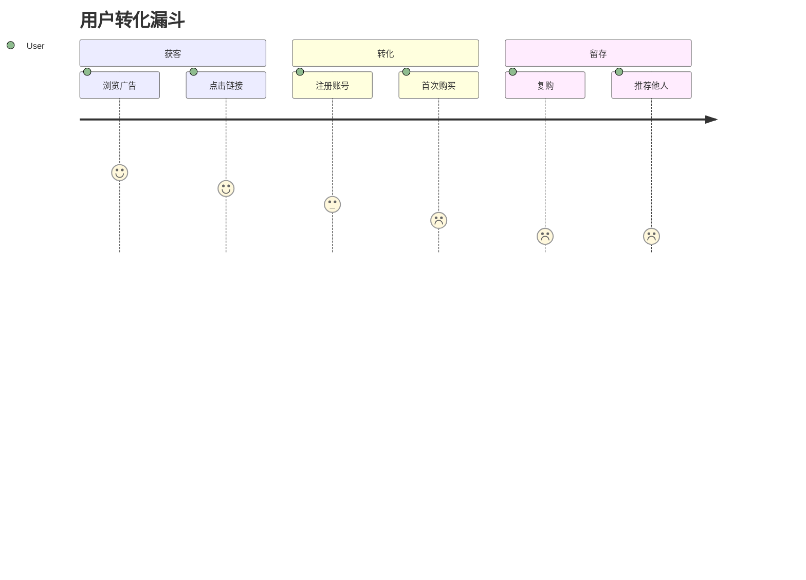

用途：

- 分析用户行为路径
- 识别转化瓶颈
- 优化用户体验

#### 饼图 (Pie)

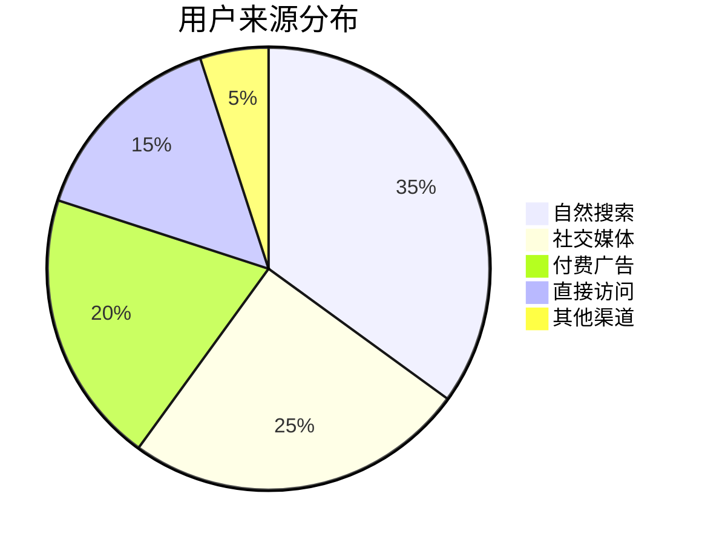

用途：

- 渠道分析
- 用户画像
- 收入构成

#### 流程图 (Flowchart)

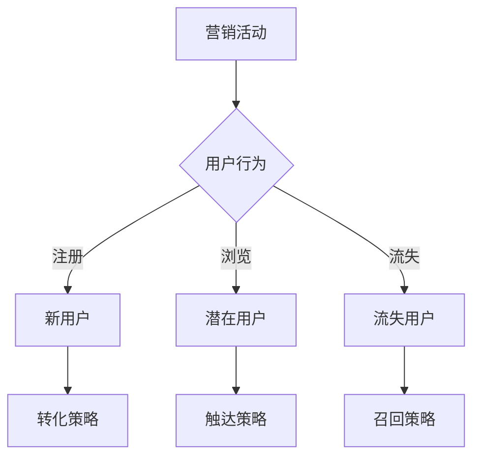

用途：

- 活动流程设计
- 用户分层策略
- 运营决策流程

#### 甘特图 (Gantt)

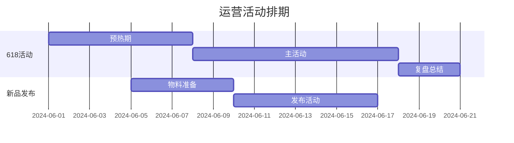

用途：

- 活动排期
- 资源规划
- 里程碑管理

#### 状态图 (State)

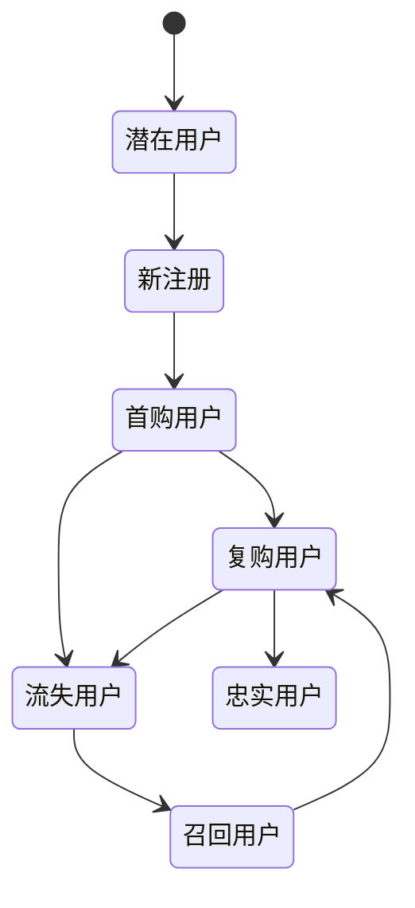

用途：

- 用户生命周期
- 会员等级变化
- 商品状态流转

### 运营场景应用

#### 活动策划

#### 数据分析

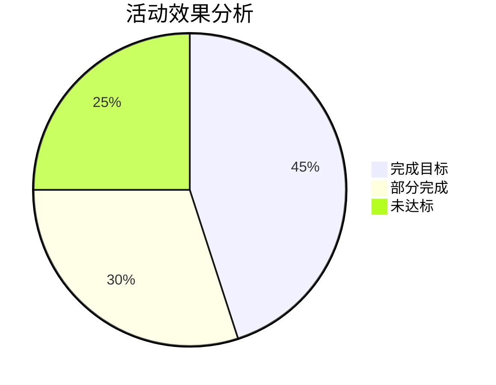

#### 用户运营

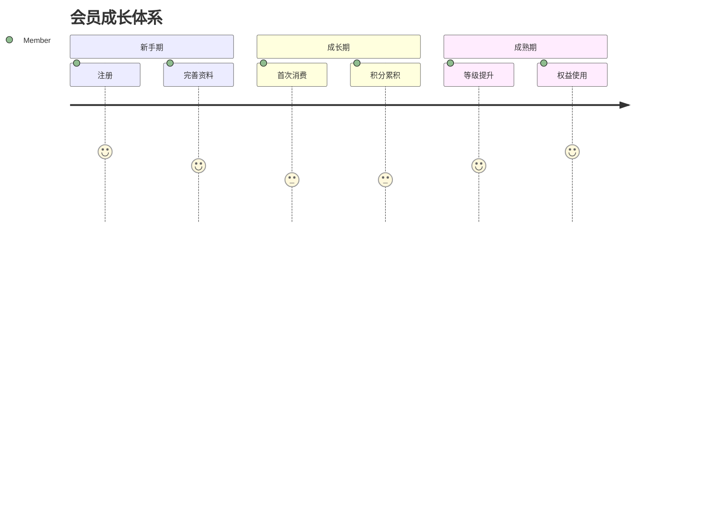

### 运营决策支持

| 渠道分析 | 用户分析 | 活动分析 |
| --- | --- | --- |
| 投放效果评估 | 行为轨迹 | 参与度 |

### 建议使用场景

| 日常工作 | 战略规划 | 团队协作 |
| --- | --- | --- |
| 活动策划：流程图 | 用户旅程：Journey图 | 任务分配：甘特图 |

---

# 结语

> 以上，仅涉及到数据可视化和Mermaid的基础用法，各个图表均可使用其语言/语法进行高级设置。

> 希望这篇文章能帮助大家使用 Cursor 进行代码可视化的学习和应用。

> 如果你有任何问题或建议，欢迎在评论区留言交流！

> 欢迎大家交流链接，可以通过鱼丸找到我。

# 参考资源

- [Cursor 官方文档](https://cursor.sh)
- [Mermaid 官方文档](https://mermaid.js.org/)
- [VANNA-MAIN 项目](https://github.com/vanna-ai/vanna)
- [huggingface.co](https://huggingface.co/datasets/fka/awesome-chatgpt-prompts)
- [Seaborn官方教程](https://seaborn.pydata.org/index.html)
