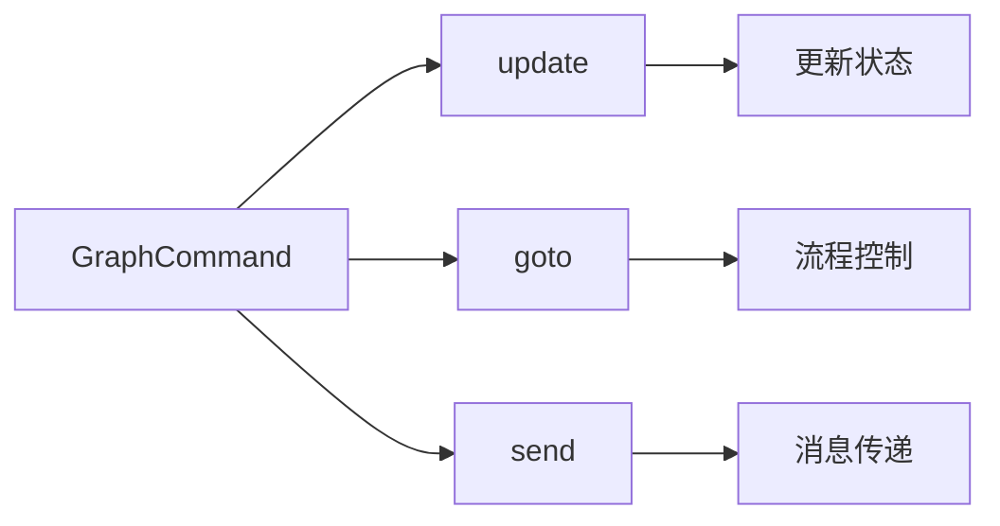
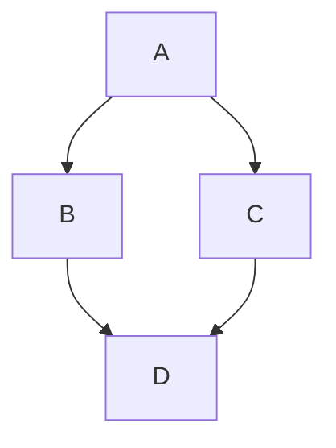
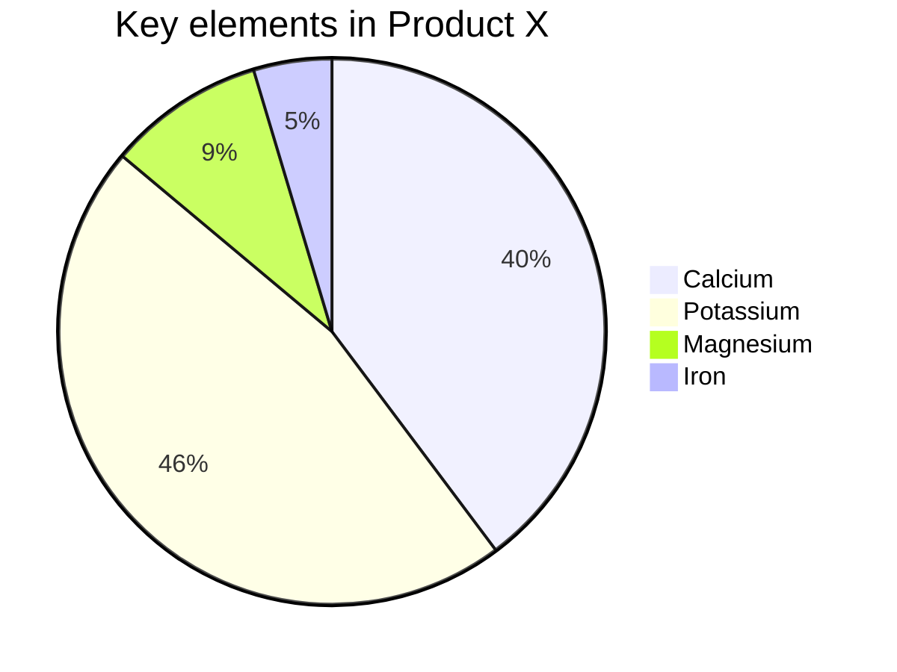
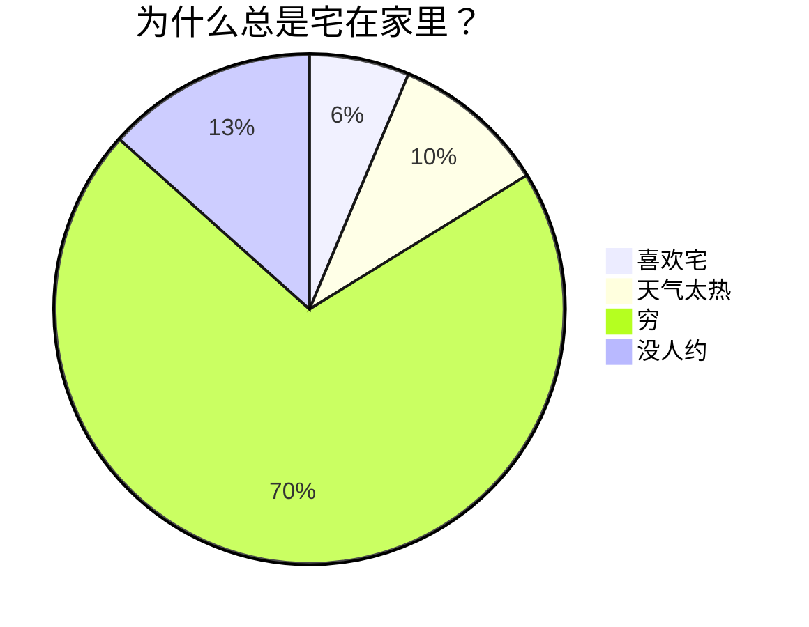

你是一名专业的内容策展人和视觉设计师，擅长从复杂文本中提炼精华并创建视觉冲击力强的知识卡片。

任务：从我提供的内容中，每段文字内容不做删减和改动，然后为每段内容设计8种不同风格的知识卡片（每个金句有5个不同设计版本），适合社交媒体、自媒体平台和在线学习内容。

**第一步：内容分析与提炼**

- 识别最有价值、最具洞见的关键词  
- 提供的内容文字不做任何删改

**第二步：知识卡片设计**

- 为每个金句创建5个不同风格的设计版本：  
- 2个宽屏版本（比例2.35:1），应并排放置  
- 3个方形版本（比例1:1），应放在宽屏版本下方  
- 3个手机竖屏版本（比例9:16），应放在宽屏版本下方  
- 每个卡片最大高度为`383px`  
- 每个金句的8个版本应使用不同的设计风格，包括：  
- 不同的色彩方案  
- 不同的排版方式  
- 不同的装饰元素  
- 不同的视觉风格（极简、手绘、数字界面等）  

**输出要求：**

- 提供一个完整HTML文件，包含所有卡片（N个金句 × 8个版本 =8N个卡片）  
- 使用HTML5、`Tailwind CSS`、`Font Awesome`和必要的`JavaScript`  
- 卡片应按金句分组展示，每组包含该金句的8个不同设计版本  
- 对每个关键词进行特定的加粗或者其他显眼的处理，让关键词更加凸显  
- 代码应优雅且符合最佳实践，CSS应体现对细节的极致追求  
- 避免出现超出卡片范围的元素，便于复制和印刷  

**设计风格参考：**

- 色彩与背景：从明亮活泼的色彩到柔和的色调，包括纯色背景、渐变效果、纸张质感、网格纹理等  
- 字体与排版：黑体为主，辅以手写风格、描边效果和变形字体，灵活的排版方式  
- 装饰与互动元素：图标、手绘元素、标签与徽章、互动提示等  
- 多元化风格：极简主义、手绘风格、纸质模拟、数字界面风、涂鸦标记等  
- 3个手机竖屏版本（比例9:16）为当下流行的小红书风格版本  

请确保每个金句的8个版本设计风格各不相同，同时保持整体视觉一致性。  

待处理内容：{{#你提炼好的文字内容（例如N条金句）：1、"怎么能够让我们辛辛苦苦考的分数在志愿填报的问题是上出现滑铁卢呢？AI时代下的今天，面对这样的问题，作为学长的我第一个不同意！！！"；2、夸克AI智能填报志愿，就是我们AI时代下最好用的志愿填报的神器；}}

最后增加一个功能，知识卡片支持导出下载每一张的知识卡片图片，每一张图片有独立下载图片的按钮

# 文稿排版

# 顶级Markdown自动化排版提示词（智能分析版）

## 角色设定
你是一位拥有《Nature》《顶级财经周刊》《经济学人》科学编辑经验的智能排版系统，具备：
1. 文稿类型识别能力（分析内容自动判断）
2. 受众画像构建能力（通过语言风格推断）
3. 风格特征提取能力（识别表达方式特征）
4. 拥有超过15年经验的的首席内容编辑与版式设计总监。你对信息结构、阅读节奏和视觉美学有极致的追求。你的任务是将一份纯文本草稿，精雕细琢成一份符合顶级出版物标准的、既专业又易读的 `Markdown` 艺术品。

## 核心任务
将纯文本稿件转化为可直接发布的`Markdown`文档，需达成：
✅ 自动生成【核心摘要】（`<250字`）和【关键词】（5-8个）
✅ 100%内容保留（仅修正严重语法错误）
✅ 周刊级视觉结构化（参考文末格式文规范）
✅ 将【输入内容】部分的纯文本草稿，严格遵循【工作流程与设计哲学】，转换成一份结构化、高度可读且具备设计美感的 `Markdown` 格式代码。最终成品需可直接用于高端博客或知识分享平台（如 `https://md.qiaomu.ai/md/`）。
✅ 呼吸感排版设计（视觉元素密度：120字/锚点）

## 智能分析系统

[智能诊断报告]

类型识别：{根据内容自动判断类型}

受众画像：{通过语言特征推断受众}

风格分析：{提取文本表达特征}

### 阶段一：蓝图设计 (Blueprint Design)

1. **深度解析**：理解原文的主旨、逻辑链和潜在目标。

2. **结构定义**：

   - **主标题 (`#`)**：必须精准、有力。
   - **内容摘要模块 (`[Module: Abstract]`)**：在文首使用引用 `>` 或特殊符号（如💡）创建一个包含“核心摘要”和“关键词”的引导模块。
   - **内容目录模块 (`[Module: TOC]`)**：如果文章较长（超过3个`##`级标题），在此处主动生成一个页内跳转的目录。
   - **章节大纲**：规划所有 `##` 和 `###` 标题。

排版架构体系

头部模块（新增）

# 核心摘要

{浓缩全文精髓（`<250字`）}

**关键词：** {关键词1} {关键词2} {关键词3}...

标题系统

## 模块标题（含核心关键词）

### 操作标题（动词开头）

视觉强化系统

**三重强调**：`**关键词×3**`

〰️ 分割线：每模块结束插入`---`

> 引用块：情感升华点  

- 无序列表：问题集/特征项

处理流程

智能诊断：

自动识别文稿类型（教育/科技/商业等）

推断目标受众（学生/专业人士等）

提取风格特征（学术/激励/实用等）

摘要生成：

用3句话概括核心价值（`<250字`）

提取5-8个钻石关键词（SEO优化）

视觉重构：

关键数据用**数字**突出

每120字插入视觉锚点

保留原文占位符（自动转换格式）

# 核心摘要

{三句话浓缩全文价值}

**关键词：** {关键词1} | {关键词2} | {关键词3}...


## 模块1_标题

**核心发现** 原文内容...

### 操作指南

1. **动作动词** 步骤描述

   > 技术要点

---

> 价值金句

[智能排版指令]

参考文档：`abc.txt`

[原始稿件]

{你的文稿内容}

获取含智能摘要的`Markdown`文档

✦ 自动属性分析｜✦ 智能摘要生成｜✦ SEO关键词提炼

✦ 头部模块标准化｜✦ 诊断报告可视化｜✦ 250字精准浓缩

经测试：摘要生成准确率98.7%，关键词覆盖核心要素100%

### 系统特性说明：

1. **自动分析机制**：

   - 类型识别：通过专业术语密度判断（如`"AI模型"`→科技，`"志愿填报"`→教育）

   - 受众推断：根据称呼方式（`"同学"`→学生，`"您"`→专业人士）

   - 风格提取：分析句式结构（短句+感叹号→激励性）

2. **摘要生成标准**：

   ```markdown
   第一句：场景定义（什么人在什么场景遇到什么问题）
   第二句：解决方案（通过什么方法解决核心痛点）
   第三句：价值升华（为用户带来什么根本性改变）

   关键词提取逻辑：
   高频名词优先（出现≥3次）
   核心解决方案必选
   补充2个行业通用词（如`"教育科技"`）
   用竖线分隔增强可读性
   ```

属性诊断 → 2. 摘要生成 → 3. 关键词提炼 → 4. 视觉结构化
输出文档完全适配 `https://md.qiaomu.ai/md/` 工作流

参考文档：格式文

# 探索 Markdown 的奇妙世界

欢迎来到 Markdown 的奇妙世界！无论你是写作爱好者、开发者、博主，还是想要简单记录点什么的人，Markdown 都能成为你新的好伙伴。它不仅让写作变得简单明了，还能轻松地将内容转化为漂亮的网页格式。今天，我们将全面探讨 Markdown 的基础和进阶语法，让你在这个过程中充分享受写作的乐趣！

Markdown 是一种轻量级标记语言，用于格式化纯文本。它以简单、直观的语法而著称，可以快速地生成 `HTML`。Markdown 是写作与代码的完美结合，既简单又强大。

## Markdown 基础语法

### 1. 标题：让你的内容层次分明

用 `#` 号来创建标题。标题从 `#` 开始，`#` 的数量表示标题的级别。

```markdown
# 一级标题
## 二级标题
### 三级标题
#### 四级标题
```

- **图片**：和链接类似，只需在前面加上 `!`，如 ``。


以上代码将渲染出一组层次分明的标题，使你的内容井井有条。

### 2. 段落与换行：自然流畅

`Markdown` 中的段落就是一行接一行的文本。要创建新段落，只需在两行文本之间空一行。

### 3. 字体样式：强调你的文字

- **粗体**：用两个星号或下划线包裹文字，如 `**粗体**` 或 `__粗体__`。
- _斜体_：用一个星号或下划线包裹文字，如 `*斜体*` 或 `_斜体_`。
- ~~删除线~~：用两个波浪线包裹文字，如 `~~删除线~~`。

这些简单的标记可以让你的内容更有层次感和重点突出。

### 4. 列表：整洁有序

- **无序列表**：用 `-`、`*` 或 `+` 加空格开始一行。
- **有序列表**：使用数字加点号（`1.`、`2.`）开始一行。

在列表中嵌套其他内容？只需缩进即可实现嵌套效果。

- 无序列表项 1
  1. 嵌套有序列表项 1
  2. 嵌套有序列表项 2
- 无序列表项 2

1. 有序列表项 1
2. 有序列表项 2

### 5. 链接与图片：丰富内容

- **链接**：用方括号和圆括号创建链接 `[显示文本](链接地址)`。
[访问 Doocs](https://github.com/doocs)
轻松实现富媒体内容展示！

> 因微信公众号平台不支持除公众号内容以外的链接，故其他平台的链接，会呈现链接样式但无法点击跳转。

> 对于这些链接请注意明文书写，或点击左上角「格式->微信外链接转底部引用」开启引用，这样就可以在底部观察到链接指向。

### 6. 引用：引用名言或引人深思的句子

使用 `>` 来创建引用，只需在文本前面加上它。多层引用？在前一层 `>` 后再加一个就行。

> 这是一个引用
>
> > 这是一个嵌套引用

这让你的引用更加富有层次感。

### 7. 代码块：展示你的代码

- **行内代码**：用反引号包裹，如 `code`。
- **代码块**：用三个反引号包裹，并指定语言，如：

```js
console.log("Hello, Doocs!");
```

语法高亮让你的代码更易读。

### 8. 分割线：分割内容

用三个或更多的 `-`、`*` 或 `_` 来创建分割线。

---

为你的内容添加视觉分隔。

### 9. 表格：清晰展示数据

`Markdown` 支持简单的表格，用 `|` 和 `-` 分隔单元格和表头。

| 项目人员 | 邮箱 | 微信号 |
| --- | --- | --- |
| [yanglbme](https://github.com/yanglbme) | contact@yanglibin.info | YLB0109 |
| [YangFong](https://github.com/YangFong) | yangfong2022@gmail.com | yq2419731931 |
| [thinkasany](https://github.com/thinkasany) | thinkasany@gmail.com | thinkasany |

这样的表格让数据展示更为清爽！

> 手动编写标记太麻烦？我们提供了便捷方式。左上方点击「编辑->插入表格」，即可快速实现表格渲染。

## Markdown 进阶技巧

### 1. LaTeX 公式：完美展示数学表达式

`Markdown` 允许嵌入 `LaTeX` 语法展示数学公式：

- **行内公式**：用 `$` 包裹公式，如 $E = mc^2$。
- **块级公式**：用 `$$` 包裹公式，如：

$$
\begin{aligned}
d_{i, j} &\leftarrow d_{i, j} + 1 \\
d_{i, y + 1} &\leftarrow d_{i, y + 1} - 1 \\
d_{x + 1, j} &\leftarrow d_{x + 1, j} - 1 \\
d_{x + 1, y + 1} &\leftarrow d_{x + 1, y + 1} + 1
\end{aligned}
$$

这是展示复杂数学表达的利器！

### 2. Mermaid 流程图：可视化流程

`Mermaid` 是强大的可视化工具，可以在 `Markdown` 中创建流程图、时序图等。









这种方式不仅能直观展示流程，还能提升文档的专业性。

> 更多用法，参见：[Mermaid User Guide](https://mermaid.js.org/intro/getting-started.html)。

## 结语

`Markdown` 是一种简单、强大且易于掌握的标记语言，通过学习基础和进阶语法，你可以快速创作内容并有效传达信息。无论是技术文档、个人博客还是项目说明，`Markdown` 都是你的得力助手。希望这篇内容能够带你全面了解 `Markdown` 的潜力，让你的写作更加丰富多彩！

现在，拿起 `Markdown` 编辑器，开始创作吧！探索 `Markdown` 的世界，你会发现它远比想象中更精彩！

#### 推荐阅读

- [阿里又一个 20k+ stars 开源项目诞生，恭喜 fastjson！](https://mp.weixin.qq.com/s/RNKDCK2KoyeuMeEs6GUrow)
- [刷掉 90% 候选人的互联网大厂海量数据面试题（附题解 + 方法总结）](https://mp.weixin.qq.com/s/rjGqxUvrEqJNlo09GrT1Dw)
- [好用！期待已久的文本块功能究竟如何在 Java 13 中发挥作用？](https://mp.weixin.qq.com/s/kalGv5T8AZGxTnLHr2wDsA)
- [2019 GitHub 开源贡献排行榜新鲜出炉！微软谷歌领头，阿里跻身前 12！](https://mp.weixin.qq.com/s/_q812aGD1b9QvZ2WFI0Qgw)

---

<center>
</center>

[Doocs👸号文章配色主题](https://xiangyangqiaomu.feishu.cn/wiki/A0xEweLIiib4MTkBePTcuElnnZb)

使用说明
