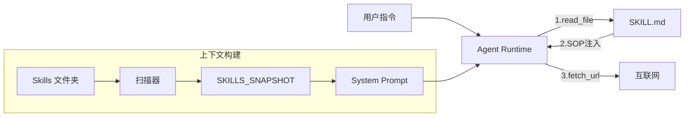

## B. 核心指令：双模态工作流 (The "Dual-Mode" Workflow)

文档中定义了两套截然不同的 SOP，分别对应“创建”和“编辑”：

### 模式一：从零创建 (Creation Mode)

Instructions: "To create new documents, `write and exec` a `Node.js` script using the `docx` library."

这里 Agent 不再是简单地调用 `create_doc(text)`，而是被要求编写一段完整的 JavaScript 代码。

Skill 中的代码片段示例（教 Agent 如何写代码）：

```javascript
// Agent 会学习这个模板，然后根据用户需求修改
const doc = new Document({
  sections: [{
    children: [
      new Paragraph({ text: "Hello World", heading: HeadingLevel.HEADING_1 }),
      new Table({ ... }) // Agent 需自行构建表格逻辑
    ]
  }]
});
```

**技术价值**：这种模式赋予了 Agent 极高的灵活性。它不仅仅是在填表，而是在利用 `docx-js` 库的强大能力进行排版编程。

### 模式二：手术刀式编辑 (Surgical Editing Mode)

Instructions: "To edit existing documents with precision:

1. Run `python scripts/office/unpack.py doc.docx output_dir` to reveal the raw XML.
2. Read and modify the `word/document.xml` file directly.
3. Run `python scripts/office/pack.py output_dir new_doc.docx`."

**技术价值**：这是非常硬核的操作。`.docx` 本质上是 XML 的压缩包。这个 Skill 教会了 Agent “外科手术”般的编辑能力——直接修改底层 XML，从而实现许多 API 无法做到的精细修改（如保留修订痕迹、修改特定样式）。

### 原子能力层 (Atomic Tools)

为了支撑上述逻辑，Skill 挂载了几个关键的“硬原子”：

- **Pandoc**：用于“读取”。Agent 并不是自己去读二进制文件，而是调用 `pandoc -t markdown doc.docx` 将 Word 文档转译为 Markdown 文本，方便自己理解。

- **Unpack/Pack 脚本**：用于“状态转换”。将封闭的 `.docx` 转换为开放的文件夹结构。

- **LibreOffice (Headless)**：用于“渲染”。当用户需要 PDF 时，Agent 调用 `soffice.py` 在后台启动无界面的 LibreOffice 进行转换。

### 总结：复杂 Skill 的系统论

docx 技能向我们展示了 Agent Skills 的上限：

1. 代码生成 (Code Gen) > 工具调用 (Tool Call)：对于复杂任务，直接让 Agent 编写并运行临时脚本（如 JS 生成文档），比预定义一千个 API 函数要灵活得多。

2. 工具链编排 (Toolchain Orchestration)：Agent 成为了一个指挥官，它指挥 `Pandoc` 读、`Node.js` 写、`Python` 改、`LibreOffice` 转，形成了一条完整的自动化流水线。

3. 知识封装 (Knowledge Encapsulation)：关于“如何操作 XML”和“如何使用 `docx-js` 库”的知识，全部封装在 `SKILL.md` 中，不需要 Agent 预训练时死记硬背。

### 1.7 热门 Agent Skills 集成网站与开源社区

在 Agent Skills 范式下，我们不需要从零编写每一个功能。目前全球开发者已经贡献了海量的 Skill 资产，我们可以像下载 App 一样直接集成这些能力。以下是目前最热门的三个资源获取渠道：

#### Anthropic Official Skills (官方标准库)

**网址**：`https://github.com/anthropics/skills`

**特点**：

- **官方出品**：这是 Anthropic 维护的官方仓库，代表了 Skill 开发的“最高标准”和“最佳实践”。

- **覆盖面广**：涵盖了从创意生成（Art/Music）、技术开发（Coding/Testing）到企业工作流（Branding/Comms）的全场景示例。

- **教学价值**：每一个 Skill 都是教科书级的 `SKILL.md` 编写范例，非常适合新手模仿学习。


#### ClawHub (OpenClaw 技能中心)

**网址**：`https://clawhub.ai`

**特点**：

- Agent 界的“App Store”：专为 `OpenClaw` 生态设计的技能市场，拥有超过 50,000+ 个现成 Skill。

- **一键安装**：支持通过命令行 `claw install <skill-name>` 直接将能力注入到你的 Agent 中，无需手动拖拽文件。

- **社区驱动**：拥有最活跃的第三方开发者生态，大量非官方的“黑科技”Skill（如抖音爬虫、私域流量操盘手）都首发于此。


#### Awesome Agent Skills (社区精选集)

**网址**：`https://github.com/VoltAgent/awesome-agent-skills`

**特点**：

- **跨平台兼容**：这里的 Skills 不仅适配 `Claude`，还兼容 `Codex`、`Gemini CLI` 等多种主流 Agent 运行时。

- **大厂集成**：收录了来自 `Vercel`, `Stripe`, `Cloudflare` 等知名技术团队发布的官方 Skill，是企业级集成的首选。

- **数量庞大**：目前已收录超过 300+ 高质量 Skill，是寻找灵感和“现成轮子”的宝库。


## 2. 【进阶】借助 LangChain 开发 Agent Skills 系统入门

### 2.1 系统架构设计：MVP 版本 (LangChain 1.x)

要实现一个真正支持 `Agent Skills` 的系统，我们不能只把目光停留在简单的对话链上。我们需要构建一个具有 “感知-决策-执行” 闭环的 `Runtime` (运行时)。

基于 `LangChain` 1.x 的最新标准（特别是 `Graph-based` 架构），我们将系统架构精简为以下三个核心模块。这个 `MVP` (最小可行性产品) 版本虽然精简，但保留了 `OpenClaw` 最核心的“灵魂”：

1. 能力引导层 (`Bootstrap`)：在系统启动的瞬间，扫描本地 `skills` 文件夹，提取元数据，生成技能快照 (`SKILLS_SNAPSHOT`)。

2. 核心工具层 (`Core Tools`)：赋予 Agent “阅读文件” (`Eyes`) 和 “联网获取” (`Hands`) 的基础物理能力。

3. 智能体运行时 (`Agent Runtime`)：使用最新的 `create_agent` `API` 构建核心大脑，并动态注入 `System Prompt`，实现对技能的挂载。

**架构图：**



### 2.2 核心工具层 (Core Tools) 实现

Agent Skills 的核心逻辑是：“Agent 通过阅读文档学会使用工具”。因此，在 Agent 出厂设置中，必须原生具备两个最基础的工具：`read_file` (用于读文档) 和 `fetch_url` (用于执行文档里的联网请求)。我们使用 `LangChain` 的 `@tool` 装饰器进行封装：

```python
import os
from langchain_core.tools import tool
from langchain_community.tools.file_management import ReadFileTool
from langchain_community.tools import RequestsGetTool

# --- 工具 1: 安全的文件读取 (The Eyes) ---
# 初始化底层工具，强制指定 root_dir 为项目根目录
# 安全警告：这是防止 Agent 越狱读取 /etc/passwd 等系统文件的关键！
raw_read_file = ReadFileTool(root_dir="./backend/skills")

@tool
def read_file(file_path: str) -> str:
    """
    用于读取 Agent Skills 的定义文件 (SKILL.md)。
    输入参数 file_path 必须是相对于 skills 文件夹的路径，例如: 'get_weather/SKILL.md'
    """
    try:
        # 在这里可以添加额外的路径检查逻辑
        if ".." in file_path:
            return "Error: 禁止访问父目录文件。"
        return raw_read_file.invoke({"file_path": file_path})
    except Exception as e:
        return f"Error reading file: {str(e)}"

# --- 工具 2: 联网能力 (The Hands) ---
# allow_dangerous_requests=True 是必须的，否则无法访问公网
raw_requests = RequestsGetTool(allow_dangerous_requests=True)

@tool
def fetch_url(url: str) -> str:
    """
    用于执行 HTTP GET 请求获取网页或 API 数据。
    当 Skill 文档要求访问某个 URL 时使用此工具。
    """
    try:
        # 实际生产建议：在此处集成 html2text 库，将 HTML 转为 Markdown，减少 Token 消耗
        response = raw_requests.invoke({"url": url})
        return response[:2000] # 简单截断，防止网页内容过长撑爆上下文
    except Exception as e:
        return f"Error fetching URL: {str(e)}"

# 将工具打包，准备注入 Agent
core_tools = [read_file, fetch_url]
```

#### 代码深度解析

**沙箱机制 (`root_dir`)**：大家注意 `ReadFileTool` 的初始化。我们并没有让 Agent 满磁盘随便读，而是将它的视野通过 `root_dir="./backend/skills"` 锁死在技能目录中。这是 Agent 系统安全设计的第一道防线。

**装饰器 (`@tool`)**：`LangChain` 的 `@tool` 装饰器不仅是将函数转为工具，它还会自动读取函数的 `Docstring` (注释)。`read_file` 下面那段中文注释：“用于读取 Agent Skills 的定义文件...” 最终会被转换成 `Prompt` 告诉大模型，所以这段注释必须写得非常精准。

**上下文保护 (`[:2000]`)**：在 `fetch_url` 中，我们做了一个简单的截断处理。真实的网页往往包含大量无用信息，如果不做处理直接丢给 `LLM`，不仅浪费钱，还会挤占 Skill 指令的空间。

### 2.3 技能引导层 (Skill Bootstrap) 实现

Agent 怎么知道自己有哪些技能？我们需要在系统启动时，通过代码自动扫描目录。这被称为 “Bootstrap (引导过程)”。我们将编写一个 `bootstrap.py`，它的作用是生成一份 “技能菜单”：

```python
import os

def generate_skills_snapshot(skills_dir="./backend/skills"):
    """
    扫描 skills 文件夹，提取元数据，生成 XML 格式的快照
    """
    # 使用 XML 标签包裹，有助于 Claude/GPT 模型更精准地识别结构
    snapshot = "<available_skills>\n"
    
    # 1. 遍历 skills 目录下的所有子文件夹
    # 假设每个子文件夹就是一个 Skill
    if not os.path.exists(skills_dir):
        return "<available_skills>No skills found.</available_skills>"

    for skill_name in os.listdir(skills_dir):
        skill_path = os.path.join(skills_dir, skill_name, "SKILL.md")
        
        # 2. 校验：只有包含 SKILL.md 的文件夹才被视为有效技能
        if os.path.exists(skill_path):
            # 3. 读取 SKILL.md 的内容（实际项目中建议只读前几行元数据）
            with open(skill_path, 'r', encoding='utf-8') as f:
                content = f.read()
                
            # 简单提取：假设 SKILL.md 第一行是 name，第二行是 description
            # 实际生产中应使用 YAML Frontmatter 解析库
            snapshot += f"""  <skill>
<name>{skill_name}</name>
<path>{skill_name}/SKILL.md</path>
<description>（该技能的动态描述，引导 Agent 何时使用它）</description>
</skill>\n"""
            
    snapshot += "</available_skills>"
    return snapshot
```

#### 代码解析

**为什么用 XML?**：注意看 `snapshot` 变量，我们使用了 `<available_skills>` 这种 `XML` 标签。在最新的 `Prompt Engineering` 实践中（特别是 `Claude` 系列），模型对 `XML` 结构的理解能力远强于 `JSON` 或纯文本列表。这能显著提高 Agent 检索技能的准确率。

**动态扫描**：这个函数的存在，实现了 “热插拔”。你只需要在文件夹里新建一个 `get_stock` 目录，下次运行代码时，这个函数就会自动把它加入到 Agent 的菜单里，完全不需要修改核心代码。

**路径映射**：注意 `<path>` 标签。我们告诉了 Agent 技能的名称，同时告诉了它文件在哪里。这为后续 Agent 调用 `read_file` 埋下了伏笔。

### 2.4 Agent 运行时构建 (LangChain 1.x Standard)
