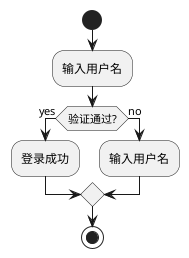
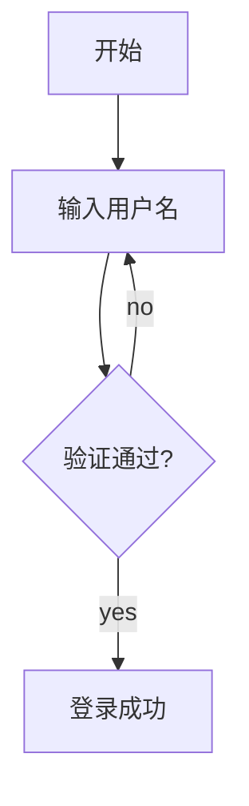
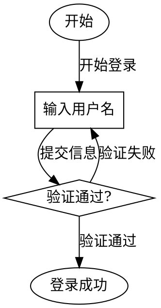

# Intern-S1 玩转 cherrystudio

> 来源：[https://aicarrier.feishu.cn/docx/Ch4WdcvvMoUCS8x3wTgcdeZknhc](https://aicarrier.feishu.cn/docx/Ch4WdcvvMoUCS8x3wTgcdeZknhc)

## cherrystuido

### 一、介绍

> 适合非开发者从各种官网调用 chat 学习如何特调自己的小助手。

Cherry Studio 是一款支持多个大语言模型（LLM）服务商的桌面客户端，兼容 Windows、Mac 和 Linux 系统。

github：[cherry-studio/docs/README.zh.md at main · CherryHQ/cherry-studio](https://github.com/CherryHQ/cherry-studio/blob/main/docs/README.zh.md)

### 二、安装

因为图形化界面，直接下载对应电脑版本的安装包正常安装即可。

地址：Cherry Studio - 全能的 AI 助手

## 玩转 Intern-S1

实现基本的 API 调用功能，类似各家大模型的 chat 网页，并且有时候还需要花钱买 Token。

那为什么还要用这个呢？

1. 为了个人的定制化，一次配置之后后续就可以使用同一个提示词了。不需要再找提示词，找其他的。
1. 不同的大模型的历史聊天记录是分散在各家的，使用这个可以放到一起了。虽然每家都要配置。
1. 一些自己不好写的知识库等功能可以直接在这里使用。

### 一、如何使用API

主要分为：

1. 获取 API Key
1. 写到对应位置

其他各家的大模型在Cherry Studio 使用也大同小异。

#### (一) 获取书生 API Key

书生链接：[InternLM API 使用文档、创建 API Tokens](https://internlm.intern-ai.org.cn/api/tokens)

按照下面步骤，在书生大模型 API 控制台获取 Token

注意：每条 Token 只显示一次，这里 Token 指的是密钥 API Key，而不是调用时消耗的 Token 数。

按照如下步骤输入 API Key 创建

确认后将生成的 API Key 粘贴到对应位置。

注：

1. **任何平台的 API Key 都不要泄露出去！** 否则你可能体会到被人刷钱的乐子。

1. 这里的没有设置时限，默认是 6 个月，如果是项目的话记得更新 API Key，Cherry Studio 可以等给你报无权限的错后再更新。

1. 不需要珍惜这个，忘了可以重建。只要你不用代码一直创建搞平台事情，一般不会在意创建的。

删除 API Key 操作（可选，有泄露可能的非常建议删了重建一个）


#### (二) 配置 Cherry Studio

这里默认安装完成。

初始界面，现在是一个类似各家大模型的 chat 页面，但不能用。因为没添加模型接口。

添加提供商如下：

1. 3 添加前可以先看下是否支持，不支持再使用添加

1. 5 的提供商名字可以随意取，有印象就行

添加 API 如下：

API 密钥：输入刚才获取的 API Key

API 地址：`https://chat.intern-ai.org.cn/api/v1/`

添加模型可以先点击下面的管理，选择合适的添加。

如果找不到需要的可以点击添加。根据需要的进行填写。

一般是 ollama 自己微调的模型进行部署后调用才会用到，其他基本通过管理可以解决。

测试是否可用：

点击检测后选择使用的模型点击确定，如果可用会有提示。

成功结果

之后就可以在聊天页面进行聊天了。

### 二、基础聊天

#### (一) 如何聊天

进入聊天页面，选择模型，开始聊天。

这里模型选择 Intern-S1

输入聊天内容并发送，你就会收到回复。

主要按钮的意思可以悬停到对应按钮上，会有中文意思。当然，省略没有，需要点击打开其他操作。


### 三、设置助手

那么如何设置成对自己好用的助手呢？这部分就需要添加提示词了。

具体提示词需要满足什么规则比较好就不聊了，下面是我比较常用的提示词和配置。

#### (一) 编程助手

创建一个新的助手，辅助编程相关。

这里，以 fastapi 为例。


你是一位经验丰富的FastAPI项目开发工程师。请根据以下要求编写代码：
1. 代码格式要求：
   - 函数内部：相邻代码行之间的空行最多为1行。
   - 函数之间、文件最外部的代码（非函数部分）与函数之间：使用2个空行分隔。
   - 除以下情况外，所有导入语句必须放在文件顶部：
     * 在条件语句（如`if`语句）中导入
     * 该导入可能不会被执行（例如，根据条件动态导入）
   - 每个FastAPI路由（使用`@app.get`、`@app.post`等装饰器）必须包含summary（描述接口用途）、description（用于介绍接口）、tags（用于OpenAPI分组）等参数。
2. 注释与文档要求：
   - 注释除代码相关尽量使用中文描述
   - 每个接口（即使用`@app.get`、`@app.post`等装饰的函数）必须有详细的函数注释（docstring），内容包括：
     * 函数用途介绍
     * 入参（参数名、类型、含义）
     * 出参（返回类型、含义）
   - 每个普通函数（非路由接口函数）也必须写有类似的函数注释。
3. 其他建议：
   - 使用类型注解（Type Hints）以提高代码可读性和静态检查。
   - 遵循PEP 8风格指南。
   - 代码应当简洁、高效，避免冗余。
请确保你的代码满足以上所有要求。如果有任何疑问，请先询问确认。
注意：这个提示词将用于指导你完成后续的代码编写任务。请严格按照上述要求实现代码。
我们将根据上述要求检查你提供的代码。如果不符合要求，我们将指出问题并要求修改。
示例代码片段（非完整代码，仅展示格式和注释要求）：

```
from fastapi import FastAPI

app = FastAPI()

@app.get("/items/", tags=["items"], comments="获得items列表")

async def read_items():

    """

    获得items列表.

    返回值:

        dict: 包含关键字"items"下的条目列表的字典。

    """

    return {"items": [{"name": "Item1"}, {"name": "Item2"}]}

def helper_function(param1: int, param2: str) -> bool:

    """

    这是一个帮助函数。

    参数:

        param1 (int): 第一个参数，参数用途

        param2 (str): 第二个参数，参数用途

    返回值:

        is_finish(bool): 布尔返回值，True/False

    """

    # 函数内部两行代码间空行最多一行

    result = do_something(param1, param2)

    if result:

        return True

    else:

        return False
```

用户需求如下：

结果：

可以保证 `/docs` 中有对应的接口分组和具体接口介绍。

#### (二) 文本绘图

一个比较常用的文本绘图提示词。

模型设置这边根据自己需求改，具体是什么也有介绍，鼠标悬浮到文本后面的？即可查看。

在提示词设置中添加对应提示词，这样之后就不需要再写，每次都使用这个提示词作为系统提示词。


统一绘图指令生成提示词

目标：根据用户提供的图表描述，同时生成四种文本绘图语法的实现代码

输入要求：
1. 图表类型（流程图/时序图/类图/状态图等）
2. 元素列表（节点名称、类型、属性）
3. 连接关系（方向、标注、样式）
4. 特殊需求（颜色、布局、注释）

输出格式：

[图表类型] - [简要说明]

1. PlantUML 实现：

```plantuml
...生成代码...
```

2. Mermaid 实现：

```mermaid
...生成代码...
```

3. Flowchart.js 实现：

```flow
...生成代码...
```

4. Graphviz DOT 实现：

```dot
...生成代码...
```

示例输入：

图表类型：用户登录流程图

元素：

- 节点A（开始，圆形）
- 节点B（输入用户名，矩形）
- 节点C（验证通过，菱形）
- 节点D（登录成功，圆形）

连接：

- A -> B（开始登录）
- B -> C（提交信息）
- C -> D（验证通过）
- C -> B（验证失败）

示例输出：

用户登录流程图 - 条件分支流程

1. PlantUML 实现：



2. Mermaid 实现：



3. Flowchart.js 实现：

```flow
st=>start: 开始
op1=>operation: 输入用户名
cond=>condition: 验证通过?
e=>end: 登录成功

st=>op1
op1=>cond
cond(yes)=>e
cond(no)=>op1
```

4. Graphviz DOT 实现：



注意事项：

1. 保持各语法的规范缩进

2. 自动转换特殊字符（如DOT中的保留字）

3. 根据图表复杂度自动添加布局参数

4. 关键元素使用中文注释

5. 支持扩展属性（如颜色：red; 粗体：`text`）

请把下面的描述分别以文本绘图语法形式展示

结果：


当然，你也可以直接从精选中找到并添加。


#### (三) 话题相关

助手这里就可以看到修改了。点击添加助手可以添加新助手。

点击助手可以跳到助手对应的话题页面。

这里可以创建一个新话题和保存之前的话题，是 chat 的会话记录。


