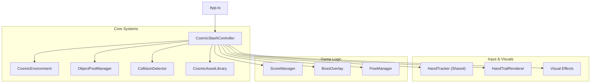

# GLM4.7手势互动提示语

> 来源：[https://aiwarts101.feishu.cn/docx/Ppw4dKi59ovGqMxUs1zcB62Rn0d](https://aiwarts101.feishu.cn/docx/Ppw4dKi59ovGqMxUs1zcB62Rn0d)

## 手势圣诞树

### 角色设定

你是一位精通`THREE.JS`、`WEBGL`和视觉设计前端开发。

### 任务目标

编写一个包含`HTML`、`CSS`和`JAVASCRIPT`的单文件应用。该应用需要结合`THREE.JS`和`MEDIAPIPE HANDS`来创建一个基于手势控制的3D粒子+照片云构成的圣诞树。

### 要求

#### 整体内容

- 主色系；哑光绿＋金属金+圣诞红色；
- 有电影感的辉光与光晕效果，整体金碧辉煌有高级感
- 圣诞树由若干球、正方体、糖果棍和照片云等元素构成，照片通过上传获取。

#### 交互逻辑和状态

##### 圣诞树状态

- 合拢态（初始状态）：所有元素收拢、聚合为一个圣诞树圆锥体。
- 散开态：所有元素在空间中无序漂浮、散落
- 照片放大态：在背景保持散开态的同时，放大单张照片

##### 手势动作

- 握拳表示回到合拢态
- 打开五指表示进入到散开态
- 手旋转表示在散开态的状态下，对画面进行旋转，根据手的移动调整相机角度
- 抓的动作表示抓住一张照片，进入照片放大态

##### 交互要求

需要根据手势，在几个状态之间平滑切换，带有过渡动画。

#### 技术栈

包括但不限于使用以下技术栈：`THREE.JS`、`WEBGL`、`INSTANCED MESH`、`SHADERS` / `GLSL`、`MEDIAPIPE HANDS`

## 手势贪吃蛇

做一个手势贪吃蛇游戏。用浏览器实现手部轨迹绘制。用`getUserMedia()`打开摄像头，`MediaPipe Hands`识别手部关键点，选定一个点（如食指尖）每帧记录坐标，在`canvas`上连线绘制。本地静态服务运行，`HTML`+`JS`实现。

## 手势爆炸星球

create a webapp using `wanilla js`, `html`, `css`, `modern threejs`, `mediapipe`. 如果 `mediapipe` 来自`CDN`，要用常规的`<script>`方式引入变量

用 `Wanilla JS`、`html`、`css`、`modern threejs`、`mediapipe` 创建网页应用。如果 `mediapipe` 来自 `CDN`，要用常规的`<script>`方式引入变量

画面中是由大量球形小的粒子构成的一个绚烂的橙色的星球，星球球面应该是显现出来（可能在球面聚集了更多的粒子）。周围环绕着白色的粒子，构成星球的两层环绕型环。粒子要很大很亮。

摄像头的中心一直对着星球的中心，可以通过用户的手势控制摄像头，用户旋转手的时候，摄像头会随之旋转，就像星球在同步的顺时针或逆时针旋转；当握拳并拉远摄像头的时候，相机会较快远离星球，速度先慢后快，而当5指张开并靠近摄像头的时候，摄像头会快速靠近星球，速度先快后慢（摄像头距离星球的中心有个最小距离）。

## 粒子互动带面板

角色设定：你是一位世界顶级的创意开发专家和图形工程师（Creative Technologist）。精通使用`React`，`Three.js`，`WebGL`，和`Tailwind CSS`，你深刻理解光影、物理模拟、着色器（`Shaders`）和电影级的后处理特效。

任务目标：构建一个的高保真的交互式 `WebGL` 网页应用，视觉风格需呈现圣诞节日，可以切换成麋鹿，礼物，圣诞树，铃铛等粒子效果

### 技术栈约束（Tech Stack）

框架：`React 19`（Hooks 风格）。

样式：`Tailwind CSS`（通过 `CDN` 引入）。

3D 引擎：`Three.js`（标准库+Addons:`OrbitControls`, `EffectComposer`，`UnrealBloomPass` 等）。

GUI控制面板：使用 `Lil-GUI` 显示关键参数（如粒子颜色、自传速度、光照强度、粒子数量等），以便实时调整视觉效果

交互逻辑（Interaction）：场景必须对用户做出反应，加上摄影头视觉识别，与手势进行互动

## 机器人演示动画

## 水果忍者

### Cosmic Slash Mode - Design Document

#### 1. Vision & User Experience

##### Goal

Create a high-energy, arcade-style `beat saber` meets `fruit ninja` experience in a cosmic setting. Users slice through incoming cosmic objects (crystals, meteors, stars) using their hands as lightsabers, building combos and defeating bosses in a visually stunning 3D environment.

##### User Experience Flow

1. `Entry`: User switches to Cosmic Slash mode. The environment transitions to a deep space scene with a procedural starfield and neon lighting.
2. `Gameplay Loop`:
   - Cosmic objects (crystals, meteors, etc.) spawn in the distance and fly toward the screen.
   - User moves hands to create glowing, energy-ribbon trails.
   - Slicing objects triggers explosions, sound effects, and floating score popups.
   - Consecutive hits build a `Combo` multiplier, increasing score.
3. `Progression`:
   - As score increases, the game levels up (speed and spawn rate increase).
   - `Boss Encounters`: Periodically, a massive `Boss` object appears. The user must slash it repeatedly to defeat it before it passes.
   - `Power-ups`: Special `POW` mechanics allow for screen-clearing attacks (e.g., two-hand laser beam).
4. `Feedback`:
   - Visuals: `Bloom`, screen shake, particle explosions, dynamic lighting.
   - UI: `HUD` shows `Score`, `Combo`, `Level`, and `Boss` Health.

---

#### 2. Technical Architecture

##### 2.1 System Overview

The architecture follows a controller-based pattern, orchestrating `Three.js` rendering, physics, and game logic.

