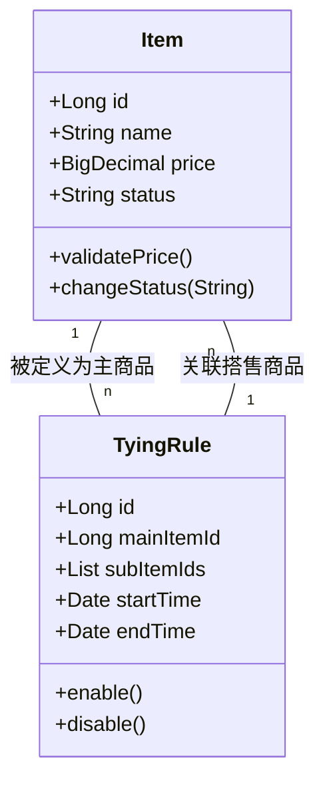
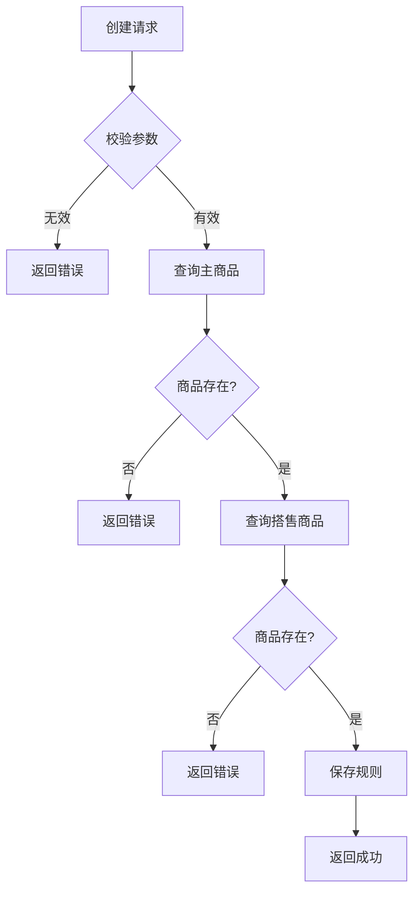

"data": data,

}, nil

}

## Model 层示例

```go
package example

import (
    "context"
    "time"
    "github.com/pkg/errors"
    "amap-aos-activity/framework/mdb"
    "amap-aos-activity/framework/mcache"
)

// UserData 表示用户数据
type UserData struct {
    UserID    string    `json:"userId" db:"user_id"`
    Name      string    `json:"name" db:"name"`
    CreatedAt time.Time `json:"createdAt" db:"created_at"`
}

// GetUserData 从数据库获取用户数据
func GetUserData(ctx context.Context, userID string) (*UserData, error) {
    // 尝试从缓存获取
    cacheKey := "user_data:" + userID
    var userData UserData
    cached, err := mcache.Get(ctx, cacheKey, &userData)
    if err == nil && cached {
        return &userData, nil
    }

    // 从数据库查询
    query := "SELECT user_id, name, created_at FROM user_table WHERE user_id = ?"
    err = mdb.GetDB().GetContext(ctx, &userData, query, userID)
    if err != nil {
        return nil, errors.Wrap(err, "query database failed")
    }

    // 更新缓存
    _ = mcache.Set(ctx, cacheKey, userData, 5*time.Minute)

    return &userData, nil
}
```

## 示例

```go
// 良好实践：正确的错误处理和日志记录 package service
package service

import (
    "context"
    "github.com/pkg/errors"
    "amap-aos-activity/basic/common"
    "amap-aos-activity/framework/mlogger"
    "amap-aos-activity/model/user"
)

func GetUserProfile(ctx context.Context, userID string) (*user.Profile, *common.Error) {
    // 参数验证
    if userID == "" {
        return nil, common.NewError(common.ErrCodeParam, "用户ID不能为空")
    }
    // 调用模型层
    profile, err := user.GetProfileByID(ctx, userID)
    if err != nil {
        // 包装错误并记录日志
        wrappedErr := errors.Wrap(err, "获取用户资料失败")
        mlogger.XErrorf(ctx, "%+v", wrappedErr) // 记录堆栈信息
        // 返回适当的业务错误
        if errors.Is(err, user.ErrUserNotFound) {
            return nil, common.NewError(common.ErrCodeNotFound, "用户不存在")
        }
        return nil, common.NewError(common.ErrCodeService, "获取用户资料失败")
    }
    return profile, nil
}

// 不良实践：不规范的错误处理和日志记录 package service
package service

import (
    "context"
    "fmt"
    "log"
    "amap-aos-activity/model/user"
)

func GetUserProfile(ctx context.Context, userID string) (*user.Profile, error) {
    // 缺少参数验证
    // 直接调用模型层
    profile, err := user.GetProfileByID(ctx, userID)
    if err != nil {
        // 错误：使用fmt直接打印错误
        fmt.Println("Error getting user profile:", err)
        // 错误：使用标准log包而非项目日志框架
        log.Printf("Failed to get profile for user %s: %v", userID, err)
        // 错误：直接返回底层错误，没有包装或分类
        return nil, err
    }
    return profile, nil
}
```

结合当前项目总结出golang开发规范，可以免去我们花大量时间补充。

最近新发布的版本， 不建议大家马上更新，涉及到隐私模式权限问题，会有代码泄漏的风险，可以先等等。

新增自动记忆模块：简单来说，这个功能会根据我们和Cursor的历史对话，来自动创建User Rules。只要你的项目持续迭代，那么这个User Rules就会自动更新。之前我们使用每次chat新开就是 它的记忆在每次会话（session）之间会完全重置 ，目前新增了该模块，通过自动创建user rules变得更懂你。

## 一些有帮助的rules

1. 项目梳理文档Rule：通过已有的代码进行codebase整理输出项目架构、技术实现细节等


具体的Rule给到大家一个参考：

### 项目梳理文档Rule

````markdown
# 项目文档规范

**文档受众明确为软件开发人员**，目的是帮助开发团队快速理解系统架构、业务逻辑和技术实现细节，便于代码维护、功能扩展和知识传递。

## 关键规则
- 项目文档必须包含四个核心部分：项目简介、核心领域模型、项目结构和外部依赖
- 接口文档必须按照@接口文档规范进行编写和维护
- 业务流程文档必须按照@业务流程文档规范进行编写和维护
- 文档应保持客观性，基于现有代码而非理想状态
- 文档中使用的术语必须与代码中的术语保持一致
- 文档应使用Markdown格式，支持图表、表格和代码块
- 代码示例必须是从实际代码中提取的，而非虚构的
- 图表应使用Mermaid或PlantUML语法，以确保可维护性
- 文档应当引用具体的代码文件路径，便于读者查找相关实现
- 首先判断项目是否使用GBF框架，并根据实际架构选择适合的文档结构和内容
- 所有文档必须统一放置在docs目录下，并使用规定的中文名称
- **文档生成过程中必须确保完整覆盖所有内容，不允许任何遗漏**

## 文档优化与结构指南
- **主索引文档**：每个核心部分创建一个主索引文档，包含子文档链接和简要说明
- **文档内导航**：超过500行的文档必须在开头提供目录
- **分层结构**：按照"金字塔结构"组织（顶层：核心概念；中层：主要功能模块；底层：具体实现细节）
- **文档拆分**：接口超过20个时按业务域拆分；核心实体超过10个时按业务领域拆分

## 文档结构和内容要求

### 1. 项目简介
- docs/项目概述.md必须包含：
  - 项目背景
  - 项目目标
  - 功能概述
  - 技术栈和架构类型（明确是否使用GBF框架）

### 2. 核心领域模型
- docs/领域模型说明.md必须包含：
  - 领域模型概述：核心业务概念的定义和边界
  - 核心实体关系图：使用E-R图或类图表示
  - 关键业务场景下的模型交互
  - 数据流转关系

**强制性领域模型扫描规则**：
- **全面扫描**：包括`*Entity.java`、`*DO.java`、`*PO.java`、`*Model.java`、`@Entity`、`@Table`、`@Document`注解类、服务层核心模型、DTO/VO类
- **按目录结构识别**：位于`model`、`domain`、`entity`目录及其子目录下的Java类文件，以及领域模型专用包路径（如`*.domain.*`、`*.model.*`、`*.entity.*`）下的类文件
- **完整提取**：实体属性和业务含义、实体关系、聚合结构、生命周期和状态流转
- **识别规则**：属性约束、实体关系约束、状态转换规则

**领域模型分析策略**：
- 全域扫描实体类和值对象，支持多种ORM框架
- 提取关联关系（通过字段类型、泛型参数和ORM注解）
- 识别聚合根和聚合边界（通过包结构和类间关系）
- 分析继承结构（包括抽象类、接口和实现类）
- 提取业务方法和状态转换逻辑
- 生成完整属性表和业务规则说明

**GBF框架项目补充**：
- 扩展点定义与实现
- 行业/场景定制点
- 路由条件与动态选择机制

### 3. 接口文档
- docs/接口文档.md
  - 接口文档应遵循专门的@接口文档规范进行创建和维护，以确保API接口的完整记录和更新。

### 4. 业务流程
- docs/业务流程说明.md
  - 业务流程文档应遵循专门的@业务流程文档规范进行创建和维护，以确保业务流程的完整记录和更新。

### 5. 项目结构
- docs/项目结构说明.md必须包含：
  - 项目模块划分
  - 代码组织结构
  - 关键包说明
  - 分层架构说明

**GBF框架项目补充**：
- docs/GBF框架应用说明.md：
  - GBF分层结构
  - 扩展点文件位置
  - 行业定制目录
  - 场景定制目录

### 6. 外部依赖与下游服务
- docs/外部依赖说明.md必须包含：
  - 下游服务概述：依赖的所有外部服务列表和用途
  - 调用关系图：系统与外部服务的调用关系

## 文档生成工作流程
1. **架构识别**：确定项目架构类型、识别关键组件和分层结构
2. **代码分析**：识别核心业务包和类、分析领域模型、提取接口定义、理解调用链路
3. **内容整理**：按文档结构组织信息、提取代码示例、绘制图表
4. **审核完善**：验证文档与代码一致性、补充关键信息、完善图表和示例
   - **接口覆盖性验证**：确认总览文档中的所有接口都在详细文档中有完整描述
   - **文档完整性检查**：确保没有遗漏任何必要的接口和服务描述
5. **定期更新**：与代码审查流程集成、重大变更更新文档、每季度全面审核

## 示例

### 领域模型示例
`````markdown

## 核心实体关系图



## 实体属性详细说明

### Item 商品实体

| 属性名 | 类型 | 说明 |

|----|---|---|

| id | Long | 商品唯一标识 |

| name | String | 商品名称，长度限制：2-50个字符 |

| price | BigDecimal | 商品价格，精确到小数点后2位，最小值：0.01 |

| status | String | 商品状态，枚举值：ON_SHELF(上架)、OFF_SHELF(下架)、DELETED(删除) |

#### 业务规则

- 商品价格必须大于0

- 商品状态只能按特定流程转换（上架->下架->删除）

### 业务流程示例

`````markdown
## 搭售规则创建流程
### 核心流程图


### 调用链路
**入口点**: `ItemTyingController.createTyingRule()`
**调用流程**:
1. 请求参数校验 - `validateTyingRequest(request)`
2. 查询主商品信息 - `itemService.getItemById()`
3. 校验主商品状态 - `validateItemStatus(item)`
4. 查询并校验搭售商品列表 - `validateSubItems()`
5. 构建并保存搭售规则 - `tyingRuleRepository.save()`
6. 发送规则创建事件 - `eventPublisher.publishEvent()`

### 关键判断点
| 判断点 | 条件 | 处理路径 |
|-----|---|----|
| 参数校验 | 主商品ID为空 | 返回参数错误 |
| 主商品校验 | 主商品不存在 | 返回商品不存在错误 |
| 搭售商品校验 | 存在无效商品 | 返回商品无效错误 |
```
````

两个rule可以亲自试试效果，第二个描述规范了Cursor要深入检索，但是目前免费能用的模型很难做到，新出来的Claude4.0可以完成复杂任务的分析研究。

### 梳理项目Rule

````markdown
# 代码分析规则

## 目标
根据代码入口深入分析完整业务流程，生成详细的业务流程文档，便于团队理解和维护代码。
## 关键规则
- **必须生成分析文档保存到项目的docs目录下**
- **必须使用sequential-thinking辅助分析**
- **必须深入方法内部逻辑，因此你可能需要检索代码**
- **建议使用sequential-thinking辅助检索代码**
### 1. 聚焦业务核心逻辑
- 忽略日志打印、参数基础校验等次要逻辑
- 忽略异常处理中的技术细节，只关注业务异常处理逻辑
- 忽略与业务无关的工具方法调用（如字符串处理、集合操作等）
- 聚焦业务状态转换、流程分支、核心计算等关键逻辑
### 2. 深入方法调用链
- 追踪每个关键方法的内部实现，不仅停留在方法调用层面
- 对调用链上的每个重要方法都分析其内部业务逻辑
- 对于外部依赖的服务（如HSF、RPC调用），说明其功能和业务意义
- 深入分析每个关键业务分支的条件和处理逻辑
### 3. 结合已有文档
- 优先使用已有文档中的描述，避免重复分析
- 如果已有文档对某个方法有详细描述，直接引用该内容
- "站在巨人的肩膀上"，基于已有文档进行补充和完善
- 对已有文档与代码实现不一致的地方进行标注
### 4. 文档输出规范
- 分析结果保存到 `/docs` 目录下，使用 Markdown 格式
- 文档命名格式：`业务名称-流程分析.md`（如：`订单创建-流程分析.md`）
- 文档需包含方法调用树，清晰展示调用层级关系
- 使用分步业务流程描述完整处理过程
## 文档结构模板

`````markdown

# 业务名称流程分析

## 功能概述

[简要描述该业务功能的目的和作用]

## 入口方法

`com.example.Class.method`

## 方法调用树

```
入口方法
├─ 一级调用方法1
│  ├─ 二级调用方法1.1
│  ├─ 二级调用方法1.2
├─ 一级调用方法2
   ├─ 二级调用方法2.1
   └─ 二级调用方法2.2
      └─ 三级调用方法
```

## 详细业务流程

1. [步骤1：业务逻辑描述]

2. [步骤2：业务逻辑描述]

   - [子步骤2.1：详细逻辑]

   - [子步骤2.2：详细逻辑]

3. [步骤3：业务逻辑描述]
```
````
