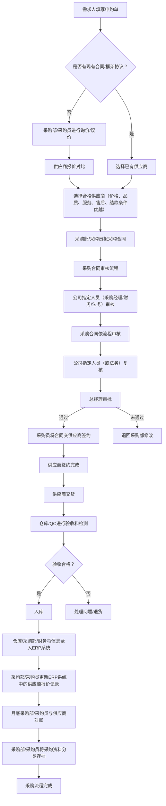

# Deepseek制作的采购流程图

> 来源：[https://rxq0zfnkm77.feishu.cn/docx/QZdCdCmCBohOVhxnfwVcSespn2c](https://rxq0zfnkm77.feishu.cn/docx/QZdCdCmCBohOVhxnfwVcSespn2c)

使用Mermaid流程图展示的详细采购流程：

## 流程图图片

## 采购流程代码展示

## 采购流程文案

1. **需求识别**
   - 需求人根据部门需求、临时需求、安全库存、生产情况、实际库存等情况填写“申购单”。

2. **供应商选择**
   - 如果有现有合同或框架协议，直接选择已有供应商。
   - 如果没有，采购部/采购员负责询价/议价，至少需要三个供应商的报价进行对比，选择价格、品质、服务、售后、结款条件优越的合格供应商。

3. **合同签订**
   - 采购部/采购员拟定采购合同，并经过采购合同审核流程。
   - 公司指定人员（如采购经理、财务、法务）审核采购合同。
   - 采购合同依流程审核后，由公司指定人员（或法务）复核。
   - 最后由总经理进行最终审批。

4. **供应商交货与验收**
   - 供应商按合同要求交货。
   - 仓库和QC根据“材料检测管理制度”对供应商提供的物料进行检测，办理入库作业。

5. **入库与ERP录入**
   - 经IQC检验合格的原材料按“入库流程”执行。
   - 仓库、采购部、财务等部门将采购信息录入ERP系统。
   - 采购部/采购员更新ERP系统中的供应商报价记录。

6. **账务结算与对账**
   - 采购部/采购员在月底与供应商进行采购信息对账。
   - 确保财务结算的准确性和及时性。

7. **资料存档**
   - 采购部/采购员将各类采购资料分类存档，登记台账，确保采购流程的可追溯性。
