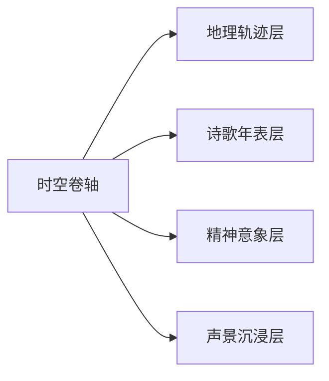

# 产品需求文档

在完全保留原始功能基础上，以专业级数字文化产品标准重构视觉语言与用户体验，融合古典意境与现代交互美学：

## 升级版产品需求文档

**项目名称**：谪仙行迹——李白的沉浸式时空漫游  
**网站类型**：文化叙事型数字博物馆（信息展示+情感化交互）  
**核心理念**：以“水墨为骨，数据为脉”，构建可游、可读、可聆的盛唐数字诗境  

## 一、视觉风格升级：三维水墨时空系统

### 1. 主视觉语言

- **动态山水底纹**：全站背景采用程序化生成的水墨粒子动画（参考《千里江山图》笔意），随滚动/光标产生涟漪、墨迹晕染、远山淡出等微交互  
- **材质系统**：
  - 绢本纹理：正文区采用半透明仿古宣纸叠加效果，文字如墨书浮现  
  - 青铜/青瓷UI组件：按钮与卡片边框融入唐代器物纹样（宝相花、卷草纹），悬停时泛起铜绿光泽  
  - 光影逻辑：模拟午后斜阳穿透窗棂的光影层次，重要信息区投射竹影窗格的光斑  

### 2. 色彩体系

```markdown
主色：
  - 天青 #4A90A4（盛唐官服色）
  - 绛紫 #5D2E8C（夜宴烛光）
辅助色：
  - 赭石 #A3633A（古卷批注）
  - 月白 #F5F3E9（绢本留白）
强调色：
  - 朱砂 #D34336（诗眼高亮/轨迹路径）
  - 流金 #FFD76F（重要事件光效）
```

- **渐变逻辑**：所有色彩过渡模仿矿物颜料剥落感，采用非均匀渐变（如青→紫→墨的破碎式融合）

### 3. 字体系统

- 标题：**方正清刻本悦宋**（宋版刻本刀痕感）+ 动态笔锋动画（落笔时墨迹扩散）  
- 正文：**思源宋体** + 行距1.8em营造古籍呼吸感  
- 交互文字：**汉仪尚巍手书**（重要按钮/诗题）搭配毛玻璃质感衬底  

## 二、空间化信息架构：四维叙事框架



### 1. 主界面 - 折叠式立体地图

- 采用等距斜轴投影地图，山脉以青绿山水笔触3D建模，长江为流动光带  
- 轨迹点设计为悬浮墨滴，鼠标接近时自动展开为菱形诗笺卡片（卡片边缘做旧撕边效果）  
- **季节模式切换**：春（杏花烟雨）/秋（红叶栈道）/冬（雪覆夔门）对应李白不同时期心境  

### 2. 轨迹详情页 - 诗卷交互剧场

- **空间分层结构**：
  ```
  [前景] 动态诗轴（竖排文字自右向左徐展）
  [中景] 3D微缩场景（如黄鹤楼送别场景，帆船可拖拽）
  [背景] 地理信息层（唐代与现代地名双标注，卫星图做水墨晕染处理）
  ```

- **事件可视化**：
  - 政治失意期 → 背景渐变为灰青色，文字出现墨点遮蔽特效  
  - 漫游期 → 地图边缘浮现水墨云气，诗句随机飘入视野  

### 3. 诗歌展示系统 - 动态装帧设计

- **诗体自适应**：
  - 乐府诗 → 竹简书卷形式，文字带竹节分隔符  
  - 绝句 → 四扇屏风布局，每句独立浮现  
  - 古风 → 仿长卷手卷，支持横向手势滑动  

- **吟诵激活**：
  - 长按诗句触发方言吟诵（可选四川/碎叶/长安腔）  
  - 声纹可视化：声波转化为墨色涟漪，与诗中意象联动（如“大江”触发金色浪纹）  

## 三、核心功能交互增强

### 1. 地图探索系统

- **墨迹导航**：初始界面为纯白生宣，鼠标移动如笔锋扫过渐显山水轮廓  
- **时空缩放**：滚轮控制时间维度（青年/中年/晚年）与空间尺度（郡县级→洲际级）  
- **足迹热度图**：在轨迹层下叠加半透明赭石色浓度云，显示停留时长与创作密度  

### 2. 诗歌矩阵

- **多维筛选**：
  - 情绪维度：激昂（金红）/孤寂（靛蓝）/超逸（青碧）  
  - 地理维度：按流域/关隘/都会分类  
  - 物质维度：涉及酒器/乐器/兵器等文物  

- **诗境生成器**：输入现代地点，AI匹配李白诗中意境（如输入“重庆洪崖洞”→ 输出《巴女词》相关场景重构）  

### 3. 声景档案馆（新增模块）

- 古乐器采样：复原唐代尺八、阮咸、羯鼓音源  
- 诗歌空间音频：点击`《早发白帝城》`自动加载江水流声+猿啼采样，支持`3D音效定位`  
- **声纹年谱**：将李白26首代表诗作的吟诵频率分析为色谱带，形成声纹人生轨迹  

## 四、响应式交互细节

### 1. 移动端手势语言

- 双指缩放 → 切换诗歌字体大小（小楷→榜书）  
- 上滑抛投 → 翻页式浏览年谱事件  
- 长按震动 → 触发诗句金石篆刻音效  

### 2. 桌面端深度交互

- `Ctrl+拖动`：旋转三维诗境空间视角  
- `Shift+悬停`：展开诗句的典故注释气泡（气泡形制为唐代铜镜）  
- `空格键`：暂停/继续全局水墨动画  

### 3. 暗黑模式

- 夜间自动切换「墨池模式」：背景转为玄黑，文字呈现银粉书写效果，轨迹线变为萤火微光  

## 五、情感化设计组件

### 1. 「诗债」时间提醒

- 每日酉时（17-19点）弹出仿古信笺：“今日宜读《将进酒》，君有三百杯未酬？”  
- 配合铜壶滴漏动画与浊酒声效  

### 2. 「谪仙笔」创作工具

- 用户可手写输入文字，实时转化为瘦金体/狂草风格  
- 生成专属数字诗笺，可分享至社交媒体  

### 3. 「长安十二时辰」模式

- 实时时钟映射唐代时辰，点击时辰自动定位李白当日活动轨迹  
- 子时（23-1点）触发《静夜思》沉浸场景：月光随鼠标移动洒落  

## 六、技术实现建议

### 1. 渲染引擎

- `Three.js` + `WebGL`水墨着色器（实现宣纸渗透效果）  
- `Deck.gl`地理图层 + 自定义唐代地图瓦片服务  

### 2. 动效曲线库

```typescript
// 模仿毛笔提按的缓动函数
const inkEase = cubicBezier(0.7, 0.15, 0.3, 0.95);

// 模拟宣纸吸水延迟
transition: transform 1.2s inkEase, opacity 0.8s step-end;
```

### 3. 无障碍设计

- 高对比模式：墨书转白描+朱砂批注  
- 语音导航：切换为说书人口吻（“且听下回分解...”）  

## 七、视觉叙事动线示例

```
[入口] 泼墨开场 → 墨滴渐变为三维地图 →  
[初唐] 碎叶城雪景模式 → 点击「铁杵磨针」图标 →  
[场景] 动态呈现老媪磨杵，诗句《上李邕》从杵尖生长而出 →  
[交互] 拖动铁杵改变磨杵速度 → 对应诗句字体从规整到狂放渐变 →  
[出口] 折扇收起动画 → 生成用户专属「李白精神基因报告」
```

## 交付价值升级

### 1. 学术严谨性

所有地理轨迹标注《李白全集编年笺注》版本依据  

### 2. 文化破圈

- `AR模式`：手机扫描现实场景触发对应李白诗句全息投影  
- 诗酒盲盒：每月解锁一款唐代酒器3D模型+匹配诗作  

### 3. 可持续叙事

预留`「诗星对照」`接口，未来可扩展至杜甫/苏轼等文人数字宇宙  

> 此方案将历史真实性转化为可感知的数字诗意，通过**物质性设计**（宣纸/青铜/墨迹）连接当代用户与唐代文化肌理，使信息展示升维为跨时空的情感对话，在每处交互细节埋藏诗性隐喻，实现“技术为表，文化为里”的沉浸式体验。

## STEP 03 将提示词扔给秒哒

1. 对输出的提示词进行细微调整，删减非必要部分，按需求调整部分  
1. 将修改/调整后的提示词扔给秒哒进行生成  
1. 等待优化完毕  


## 进阶版（设计+代码）

本节更适用于没有设计能力，但有深度 UI 定制化需求的开发者

- 非设计师，但可以简用设计软件实现 UI 样式定制升级  
- 非程序员，但可以使用一些代码实现 动效/交互 的定制升级  

**请谨记三秘诀**

- 让大模型给你帮助  
- 灵活运用 `F12`  
- 深度使用 CSS  

以下内容以“秒哒非编程黑客松大赛”官网应用进行举例

### 有网站想抄：html to design

**适用场景**

1. 想要制作网站类应用  
1. 有心仪的网站样式，想要直接复刻上手“抄”  

**使用工具**

- 工具：`https://www.figma.com/`  
- 插件：`html.to.design` `https://www.figma.com/community/plugin/1159123024924461424/html-to-design-by-divriots-import-websites-to-figma-designs-web-html-css`  

**操作方法**

| 步骤 | 动作 | 图示 |
| --- | --- | --- |
| 第一步 | 发现或找到喜欢、想“抄”的网站 | |
| 第二步 | |  |
| 第三步 | 输入网站链接，完成网站设计文件复刻 | |
| 第四步-方案 1 | 将设计文件导出为 PNG 图片扔给为秒哒进行完整复刻制作 | 将图片扔给秒哒进行复刻 |
| 第四步-方案 2 | 进入开发模式，复制特定模块的 CSS 扔给秒哒修改特定模块 | |


### 有配色想精调

**适用场景**

1. 对于配色有极高定制化的需求  
1. 有基础的审美和设计能力  

**使用工具**

- 工具：Figma 等设计工具 `https://www.figma.com/`  

**操作方法**

| 步骤 | 动作 | 图示 |
| --- | --- | --- |
| 第一步-方案 1 | 进入设计软件，自行完成配色设计 | 配色设计（模块+字体） |
| 第一步-方案 2 | 心仪的网站，按 `F12` 复制配色色号 | 配色（模块+字体）复制学习 |
| 第二步 | 选中模块将 CSS 扔给秒哒实现 | |


### 有样式想定制

**适用场景**

1. 有想要的特定组件  
1. 想减少在秒哒上使用的试错成本（避免影响整体功能逻辑），那可以先让大模型帮你试错有  

**使用工具**

- 工具：`code` 类大模型产品（有代码预览模式）  

**操作方法**

| 步骤 | 动作 | 示例 |
| --- | --- | --- |
| 第一步 | 明确想新增或优化的组件需求 | 1. 我想给‘秒哒非编程黑客松’增加一个秒哒水印 |
| 第二步 | 将需求描述给大模型，进行多轮修改，直至符合预期 | 1. 将复制的 CSS 代码+优化需求，给到大模型 |
| 第三步 | 复制 CSS 代码给到秒哒 | 将代码丢给秒哒生成 |


### 有排版没思路

**适用场景**

1. 特定模块的排版优化  
1. 想减少在秒哒上使用的试错成本（避免影响整体功能逻辑），那可以先让大模型帮你试错有  

**使用工具**

- 工具：多模态理解大模型+`code` 类大模型产品（有代码预览模式）  

**操作方法**

| 步骤 | 动作 | 示例 |
| --- | --- | --- |
| 第一步 | 明确有想调整的排版 | ‘秒哒非编程黑客松’要升级成 2 个赛道，但是排版没有头绪 |
| 第二步 | 将需求描述给大模型，让大模型给你方案 | 1. 截个图+加背景信息+需求，给到多模态理解大模型 |
| 第三步 | 将优化后的排行需求给到秒哒实现（结合 GUI 进行选中实现） | 将排版描述的提示词扔给秒哒 |


### 找动效去实现

**适用场景**

1. 有样式想定制，想追求高级的动效  

**使用工具**

- 工具：开源开放的动效组件库 `https://21st.dev/`  

**操作方法**

| 步骤 | 动作 | 示例 |
| --- | --- | --- |
| 第一步 | 进入开源开放库，寻找组件 |  |
| 第二步 | 复制部分代码，仅保留核心部分，扔给秒哒进行拓展实现复制 CSS 代码给到秒哒 | 将代码丢给秒哒生成 |


## 小结

1. Vibe Coding 极其重要的点就是【提示词】，让大模型理解清楚你的清楚，并完美呈现。如果你担心描述不明白，那就交给大模型帮你进行需求填充，再交给下一个大模型去执行开发落地  
1. Vibe Coding 做得好，需要你清晰知晓当前的技术边界，哪些可能实现、哪些是现阶段技术做不到的。合理描述你的需求，功能有优先级，关注核心重点功能，做“小而精”  
1. Vibe Coding 应用“美”，需要你有审美、懂用户体验，站在用户视觉去评估，是否符合目标用户的审美、用户是否用的流程、看的明白  

# 3、韩熔丨我真的把「技能五子棋」做出来了

应用链接：`https://www.miaoda.cn/apps/app-6hpuhkk191c1?s=s`

## 为什么选择这个方向

### 先机在哪？——从热点里发现机会

在📕上刷到了技能五子棋，看了这个视频后觉得非常有意思，同时观察了一下📕各种相关帖子的增长趋势，就发现这个话题一定会火，而且当时还没有很多人借势传播。

### 怎么做得更好？——用产品力说话

技能五子棋是有游戏性质的，天然的就可以作为一个游戏的形态出现，我也看到了有其他博主做的技能五子棋的游戏，但要么规则混乱，要么介绍不清晰。我想做一个更清晰、更好玩的版本，正好「秒哒」可以帮我轻松实现。

## 我是怎么做的

### 选对工具，效率翻倍

擅长快速做游戏的 Vibe Coding 工具，是秒哒和 lovable，V0 擅长做纯前端，bolt 和 replit 用得不太顺手。于是构想了一下游戏逻辑，快速出了一版提示词：

做一个双人五子棋对战游戏，对战双方的名字分别为：“技能五”和“子祺”同时要增加一些特殊技能，每个人都有几个技能，下面是技能名字和对应的效果「飞沙走石」可以选中对手的一枚棋子，令其消失，弹窗提示「棋子被丢进了什刹海」「静如止水」可以冻结对方这一回合，我方连续进行两个回合「力拔山兮」我方直接获胜「东山再起」当我方失败时，使用该技能可以重置游戏「两极反转」平局，但使用的一方会说「你的面向都变了」

喂给 lovable 和秒哒，比较初版生成的效果，秒哒完胜，于是在秒哒的初版上继续修改润色。

### 录制演示视频，一次过

录视频我用的是 Screen Studio，一口气录了三版。回看时发现第一版最自然，就直接用了。

重点不是功能多完美，而是清晰展示“怎么做的”和“为什么有趣”。

在内容设计上，明确本次游戏开发演示的核心目标并非追求功能完整度，而在于高效实现并清晰传达设计思路，以提升内容的吸引力与观众参与感。考虑到实际游戏用户数量可能有限，因此在制作过程中注重敏捷与效率，避免陷入过度优化的误区，力求在较短时间内完成高质量的内容输出。

## 总结一下

✅ 半小时搞定一个互动游戏，全程不用代码  
✅ 「秒哒」目前免费，而且一直在更新，越来越强  
✅ 对内容创作者来说：你得到的不是一个游戏，而是一个“活的”互动内容平台  

这才是真正的价值：

你创造的不再是静态的图文或视频，而是一个用户可以参与、可以玩的“内容载体”。粉丝的每次点击、每次互动，都在共同创造内容。比如你可以做一个“粉丝共创追星站”，大家一起更新内容、一起玩——这个过程本身，就是你源源不断的创作素材。

最后送大家一句话：

“不要等完美，先快速做出一个‘能玩’的版本，让用户和你一起迭代。”

# 4、纯新小白丨 AI 法律工具“法盾”：从一条 3800 赞评论到 AI 应用上线——小白开发者的“法盾”爆款拆解

应用链接：`https://www.miaoda.cn/apps/app-6hizv59fghkx`

## 怎样找到真实需求？

你是不是经常觉得：想法很多，但不知道哪个需求真正值得做？

其实，最高效的方法不是自己埋头想，而是——去流量最多的地方，看大家“用赞投票”选出来的痛点！

来看这条改变我轨迹的📕笔记 👇


这条笔记本身有 2600 多赞，讲的是一个普遍的法律困境。但真正有意思的是评论区：

- “普通人请律师太难了” → 3800 赞，比原文还高！  
- 一条反对观点的评论 → 也拿到了 1700 多赞  

这告诉我们什么？三个超实用信号：

✅ 共识性痛点：高赞=一群人的刚性需求，不是一个人的矫情  
✅ 天然话题场：有对立、有讨论，就是传播的好土壤  
✅ 低成本契机：“不赚钱所以没人搞”？正好是我们无代码/AI 开发者的机会！  

所以，第一个核心经验是：去评论区找被赞出来的痛点，比我们自己猜需求准得多！

## 从想法到原型

找到需求后，问题来了：我一个小白，怎么判断这个想法 AI 能不能实现？

答案是：不做天马行空的想象，而是学会“技术侦察”——搞懂你手中工具的能力地图！

### 第一步：静态侦察——读懂工具的“说明书”

在无代码平台，`api_list` 就是我们的核心技术地图


比如“法盾”需要两个能力：

1. 信息检索 → 对应“搜索模块”  
1. 内容理解生成 → 对应“AI 分析模块”  

一个复杂想法，就这样拆解成平台能执行的步骤：

用户输入 → 触发搜索 → 结果送AI分析 → 返回解释  

### 第二步：动态侦察——探知系统的“能力边界”

但说明书只讲“理想情况”，我们还得动手测试。

比如，当 AI 返回“文本过长，我将进行裁剪”时——这就是系统在提醒你：需要优化流程啦！

### 案例：为什么我放弃了一个“很酷”的功能

我曾想加“自动定位最近法律援助中心”的功能，听起来很贴心对吧？

但技术侦察后发现：

- 需要精准地理位置 → 平台可能没有对应接口  
- 要调用地图服务 → 生态中没有现成的 API  
- 要查 POI 数据库 → 根本没有这个数据源  

结论：核心依赖的 API 在平台“武器库”里不存在，果断放弃！

此外，我还明确了 AI 的能力边界：

- ✅ 能力域：法律概念查询、信息整合、基于规则的计算  
- ❌ 限制域：提供法律建议、预测案件结果、共情支持  

## 包装与展示

当一个可运行的原型诞生后，怎样让它被更多人看到？

我的两个小心得：

1. 提升“视觉完成度”

我用 `PWA` 技术，让网页能像 App 一样被“安装”。这个小动作，极大提升了产品的专业感和信任度。

1. 讲好“产品故事”

在项目介绍里，我直接引用了那条 3800 赞的评论。让产品从一个真实的故事开始，比任何技术辞藻都更有力量。

（当然，直接放链接最方便，但📕有时会限流…嗯，我被限过两次了）

## 总结一下

找到一个被流量验证的需求痛点 → 吃透你的 AI 工具能力边界 → 用心把它包装出来

这就是我作为一个小白开发者，完整跑通的全过程。

这条路我已经走通了，现在，工具箱和地图都在你们手中。接下来，就等你动手了！

# 5、云中江树丨 AI Coding 实战共学分享：从想法到上线的菜谱网站

## 项目背景与成果

最近关于预制菜的争议闹得沸沸扬扬，但老乡鸡对菜品公开透明的做法却赢得了大家的好评。这种坦诚让人很有好感，也引发了一个思考：能不能做一个菜谱公开网站，让大家对吃进嘴里的东西更了解、更放心？

这个想法在脑子里盘旋了很久，直到遇到了百度秒哒这个 AI 工具。它号称"一句话做应用"，结果真的只用了十几分钟，想法就变成了现实。

**项目成果**：

- 🔗 在**线访问：**`https://app-6c2x5n0ta41t.appmiaoda.com/`  
- 📊 数**据规模：**收录 102 道菜谱，11 个分类  
- 🔍 核**心功能：**分类浏览、关键词搜索、详情查看  
- 🤖 智**能助手：**配置了"老乡鸡大厨"AI 机器人  


**关键亮点**：整个过程没写一行前端代码，纯粹用 AI 工具完成。

---

## 第一部分：AI 时代的应用开发逻辑

### 传统思维 vs AI 时代思维

**传统应用开发流程**：
