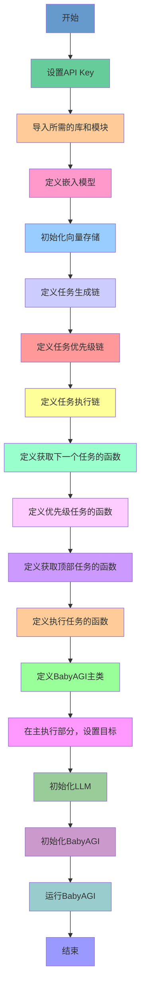

```python
llm = OpenAI(temperature=0)

verbose = False

max_iterations: Optional[int] = 6

baby_agi = BabyAGI.from_llm(
    llm=llm,
    vectorstore=vectorstore,
    verbose=verbose,
    max_iterations=max_iterations
)

baby_agi({"objective": OBJECTIVE})
```

> 这段代码是一个人工智能（AI）代理的实现，它可以创建、优先级排序和执行任务。这个AI代理被称为"BabyAGI"。

+ 导入所需的库和模块：这部分代码导入了所有需要的Python库和模块。

+ 定义嵌入模型和向量存储：这部分代码定义了一个嵌入模型（`OpenAIEmbeddings`）和一个向量存储（`FAISS`）。

+ 定义任务生成链、任务优先级链和任务执行链：这些类是用于生成、优先级排序和执行任务的链。每个链都有一个从`LLM`（Language Model）获取响应解析器的方法。

+ 定义获取下一个任务、优先级排序任务和执行任务的函数：这些函数用于获取下一个任务、优先级排序任务和执行任务。

+ 定义`BabyAGI`主类：这个类是AI代理的主要控制器。它有一个任务列表，可以添加任务，打印任务列表，打印下一个任务，打印任务结果。它还有一个`_call`方法，用于运行代理。

+ 主执行部分：这段代码创建了一个`BabyAGI`实例，并运行了它。首先，它定义了一个目标（`OBJECTIVE`），然后创建了一个`LLM`（`OpenAI`），然后创建了一个`BabyAGI`实例，并运行了它。

> 这个AI代理的工作流程是这样的：首先，它会创建一个任务，然后将任务添加到任务列表中。然后，它会从任务列表中取出第一个任务，执行这个任务，并将结果存储起来。然后，它会根据这个结果创建新的任务，并将新的任务添加到任务列表中。然后，它会对任务列表进行优先级排序。这个过程会一直重复，直到满足某个结束条件。



# 综合演练：实现客户聊天机器人

> 综合演练和项目演练所需的文件可以参阅 Langchain Workshop 项目库：https://gitee.com/cloudzun/langchan-workshop/。

> 如果直接运行代码库中的ipynb文件有异常，请参阅此文件中的代码和步骤进行修正。

在聊天机器人的实现过程中，遵循敏捷开发原则。

首先，集中精力开发基础版本的机器人，实现核心功能，如聊天交互。然后，逐步添加更多功能，如利用易速鲜花的企业知识库进行检索。用户可通过输入订单号查询订单状态或询问退货等常见问题。通过渐进式开发，逐步完善机器人功能，提供更多有用服务。

这个项目的具体技术实现步骤如下：

+ 第一步：使用LangChain的`ConversationChain`实现基本的聊天对话工具。

+ 第二步：利用LangChain的记忆功能，使聊天机器人能够记住用户之前的对话内容。

+ 第三步：结合LangChain的检索功能，整合易速鲜花的内部文档资料，使聊天机器人能够根据自身知识和易速鲜花的业务流程提供专业的回答。

+ 第四步（可选）：利用LangChain的数据库查询功能，用户可以输入订单号查询订单状态或了解存货情况等。

+ 第五步：将聊天机器人部署在网络上，并发布供易速鲜花的内部员工和用户使用。

在上述五个步骤中，将使用了多项LangChain技术，包括提示工程、模型、链、代理、RAG和数据库检索等功能。

## 1.0 基本聊天

通过 LangChain 的 `ConversationChain`，实现一个最基本的聊天对话工具

```python
# 设置OpenAI API密钥

import os

# os.environ["OPENAI_API_KEY"] = 'Your Key'

# 导入所需的库和模块

from langchain.schema import (
    HumanMessage,
    SystemMessage
)

from langchain.chat_models import ChatOpenAI

# 创建一个聊天模型的实例

chat = ChatOpenAI()

# 创建一个消息列表

messages = [
    SystemMessage(content="你是一个花卉行家。"),
    HumanMessage(content="朋友喜欢淡雅的颜色，她的婚礼我选择什么花？")
]

# 使用聊天模型获取响应

response = chat(messages)

print(response)
```

> 这段Python代码实现了一个简单的聊天机器人，使用了langchain库的`ChatOpenAI`模型。

+ 设置OpenAI API密钥：这段代码注释掉了一个设置OpenAI API密钥的语句。如果你需要使用OpenAI的服务，你需要取消这行代码的注释，并将'Your Key'替换为你的实际密钥。

+ 导入所需的库和模块：这段代码导入了`langchain.schema`中的`HumanMessage`和`SystemMessage`类，以及`langchain.chat_models`中的`ChatOpenAI`类。

+ 创建一个聊天模型的实例：使用`ChatOpenAI`类创建了一个聊天模型的实例。

+ 创建一个消息列表：创建了一个包含两个消息的列表。第一个消息是一个`SystemMessage`，内容是"你是一个花卉行家。"；第二个消息是一个`HumanMessage`，内容是"朋友喜欢淡雅的颜色，她的婚礼我选择什么花？"。

+ 使用聊天模型获取响应：将消息列表传递给聊天模型的实例，获取模型的响应。

+ 打印响应：打印出聊天模型的响应。

进行多轮会话

```python
# 设置OpenAI API密钥

import os

# os.environ["OPENAI_API_KEY"] = 'Your Key'

# 导入所需的库和模块

from langchain.schema import HumanMessage, SystemMessage

from langchain.chat_models import ChatOpenAI

# 定义一个命令行聊天机器人的类

class CommandlineChatbot:

    # 在初始化时，设置花卉行家的角色并初始化聊天模型

    def __init__(self):

        self.chat = ChatOpenAI()

        self.messages = [SystemMessage(content="你是一个花卉行家。")]

    # 定义一个循环来持续与用户交互

    def chat_loop(self):

        print("Chatbot 已启动! 输入'exit'来退出程序。")

        while True:

            user_input = input("你: ")

            # 如果用户输入“exit”，则退出循环

            if user_input.lower() == 'exit':

                print("再见!")

                break

            # 将用户的输入添加到消息列表中，并获取机器人的响应

            self.messages.append(HumanMessage(content=user_input))

            response = self.chat(self.messages)

            print(f"Chatbot: {response.content}")

# 如果直接运行这个脚本，启动聊天机器人

if __name__ == "__main__":

    bot = CommandlineChatbot()

    bot.chat_loop()
```

> 这段代码是一个命令行聊天机器人的实现示例。它使用了LangChain的`ChatOpenAI`模型来实现聊天功能。

> 首先，通过设置OpenAI API密钥，确保能够访问OpenAI的API服务。

> 然后，导入所需的库和模块，包括`langchain.schema`中的`HumanMessage`和`SystemMessage`类，以及`langchain.chat_models`中的`ChatOpenAI`类。

> 接下来，定义了一个名为`CommandlineChatbot`的类，用于实现命令行聊天机器人。在初始化方法中，初始化了聊天模型，并设置了一个系统消息作为机器人的角色，这里设定为花卉行家。

> 然后，定义了一个`chat_loop`方法，用于持续与用户进行交互。在循环中，用户可以输入消息，如果输入为`exit`，则退出循环。否则，将用户的输入添加到消息列表中，并调用聊天模型的`__call__`方法进行对话。最后，打印出机器人的响应。

> 最后，如果直接运行这个脚本，会创建一个`CommandlineChatbot`的实例，并调用其中的`chat_loop`方法，启动聊天机器人。

> 这段代码提供了一个基本的命令行聊天机器人的实现框架，可以根据需求进行扩展和定制。

## 2.0 具备记忆功能

通过 `ConversationBufferMemory` 给 `Chatbot` 增加记忆

```python
# 设置OpenAI API密钥

import os

# os.environ["OPENAI_API_KEY"] = 'Your Key'

# 导入所需的库和模块

from langchain.schema import HumanMessage, SystemMessage

from langchain.memory import ConversationBufferMemory

from langchain.prompts import (
    ChatPromptTemplate,
    MessagesPlaceholder,
    SystemMessagePromptTemplate,
    HumanMessagePromptTemplate,
)

from langchain.chains import LLMChain

from langchain.chat_models import ChatOpenAI

# 设置OpenAI API密钥

# os.environ["OPENAI_API_KEY"] = 'Your Key'  

# 带记忆的聊天机器人类

class ChatbotWithMemory:

    def __init__(self):

        # 初始化LLM

        self.llm = ChatOpenAI()

        # 初始化Prompt

        self.prompt = ChatPromptTemplate(

            messages=[

                SystemMessagePromptTemplate.from_template(

                    "你是一个花卉行家。你通常的回答不超过30字。"

                ),

                MessagesPlaceholder(variable_name="chat_history"),

                HumanMessagePromptTemplate.from_template("{question}")

            ]

        )

        # 初始化Memory

        self.memory = ConversationBufferMemory(memory_key="chat_history", return_messages=True)

        # 初始化LLMChain with LLM, prompt and memory

        self.conversation = LLMChain(

            llm=self.llm,

            prompt=self.prompt,

            verbose=True,

            memory=self.memory

        )

    # 与机器人交互的函数

    def chat_loop(self):

        print("Chatbot 已启动! 输入'exit'来退出程序。")

        while True:

            user_input = input("你: ")

            if user_input.lower() == 'exit':

                print("再见!")

                break

            response = self.conversation({"question": user_input})

            print(f"Chatbot: {response['text']}")

if __name__ == "__main__":

    # 启动Chatbot

    bot = ChatbotWithMemory()

    bot.chat_loop()
```
