第一版回答格式我是比较满意的，但是cursor死板的只以我提问的流程图、时序图和类图进行回答，强迫症不能接受，后面继续追问，为了不占用太多篇幅和冗余，下面只贴Prompt过程，不再一一贴回答图。


最终，基于cursor回答，以及手动整合修改，下面展示效果。

# 基础图表展示

下面展示一些常用图表，图表左侧附带了Mermaid代码，大家看一下就可以，可以不必过于关注，本次重在演示如何使用cursor帮我们自动生成这些图表，而深度使用用户，建议去官网查看Mermaid或UML语法。

## （1）流程图：展示业务逻辑和数据流

大家最常接触到的图片是流程图，首先以流程图进行展示，那么为什么要绘制流程图呢？


流程图由节点（几何形状）和边（箭头或线条）组成，可以辅助系统设计、提升代码的可理解性，并且能够促进团队协作。

Mermaid 代码定义了如何制作节点和边，并适应不同的箭头类型、多方向箭头以及任何与子图的链接。

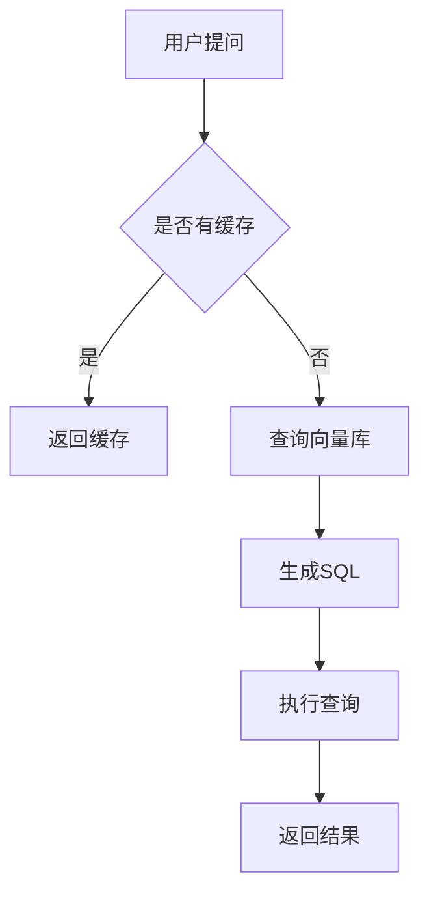


| 详细用途 | 优点 | 适用场景 | 基本用法 |
| --- | --- | --- | --- |
| + 清晰展示处理步骤 | + 统一团队认知 | + 业务流程 | + `TB/TD`——从上到下 |


基本用法：

+ `TB/TD`——从上到下
+ `BT`——从下到上
+ `RL`——从右到左
+ `LR`——从左到右

## （2）时序图：展示组件交互

序列图是一种交互图，显示进程如何彼此运行以及以什么顺序运行。

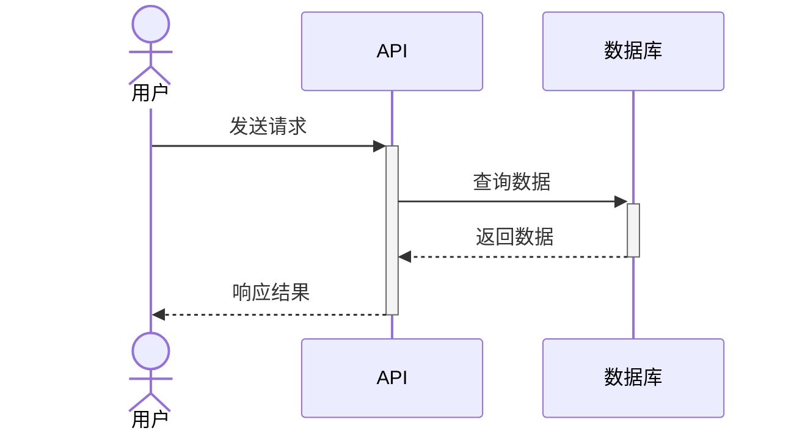


详细用途：

+ 展示交互顺序
+ 明确责任边界
+ 识别异步操作
+ 优化响应时间

适用场景：

+ 组件交互
+ API 调用
+ 消息传递

## （3）类图：展示系统架构

“在软件工程中，统一建模语言（UML）中的类图是一种静态结构图，它通过显示系统的类、它们的属性、操作（或方法）以及对象之间的关系来描述系统的结构”。-Wikipedia -维基百科

类图是面向对象建模的主要构建块。它用于应用程序结构的一般概念建模，以及将模型转换为编程代码的详细建模。类图也可用于数据建模。类图中的类表示主要元素、应用程序中的交互以及要编程的类。

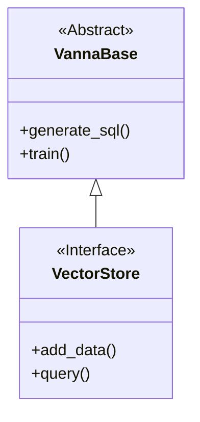


详细用途：

+ 展示类的关系
+ 定义接口规范
+ 明确继承结构
+ 规划系统扩展

适用场景：

+ 系统架构
+ 类关系
+ 接口定义

## （4）甘特图 (Gantt)：时间进度

甘特图是一种条形图，最初由 Karol Adamiecki 于 1896 年开发，并由 Henry Gantt 在 1910 年代独立开发，它说明了项目进度表以及任何一个项目完成所需的时间。甘特图显示了项目的终端元素和摘要元素的开始日期和完成日期之间的天数。

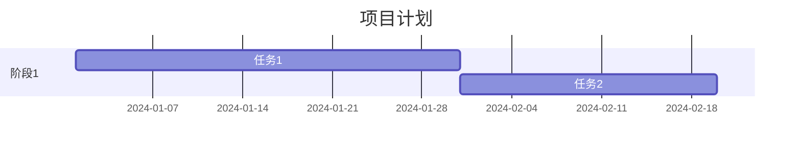

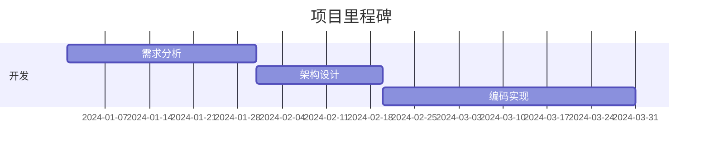


适用场景：

+ 项目管理
+ 时间规划
+ 进度跟踪

## （5）饼图 (Pie Chart)

饼图（或圆形图）是一种圆形统计图形，将其划分为多个切片以说明数字比例。在饼图中，每个切片的弧长（及其中心角和面积）与其表示的数量成正比。虽然它因其类似于切片的馅饼而得名，但它的呈现方式却有多种变化。已知最早的饼图通常归功于 William Playfair 于 1801 年出版的统计手册——维基百科

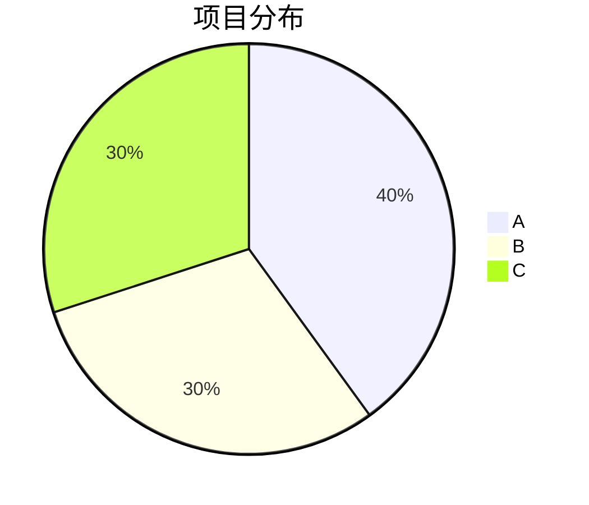


适用场景：

+ 数据分布
+ 占比分析
+ 统计展示

## （6）状态图 (State Diagram)

“状态图是计算机科学及相关领域中用于描述系统行为的一种图。状态图要求所描述的系统由有限数量的状态组成；有时确实如此，而在其他情况下有时这是一个合理的抽象。”——维基百科

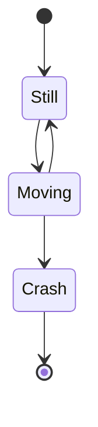


适用场景：

+ 状态机
+ 生命周期
+ 工作流程

## （7）ER 图 (Entity Relationship)

实体关系模型（或 ER 模型）描述特定知识领域中相关的感兴趣的事物。基本 ER 模型由实体类型（对感兴趣的事物进行分类）组成，并指定实体（这些实体类型的实例）之间可能存在的关系。——维基百科

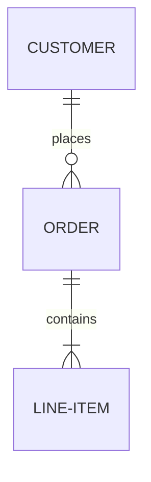


适用场景：

+ 数据库设计
+ 实体关系
+ 系统建模

## （8）用户旅程图 (Journey)

用户旅程高度详细地描述了不同用户在系统、应用程序或网站内完成特定任务所采取的步骤。该技术显示当前（原样）用户工作流程，并揭示未来工作流程的改进领域。——维基百科

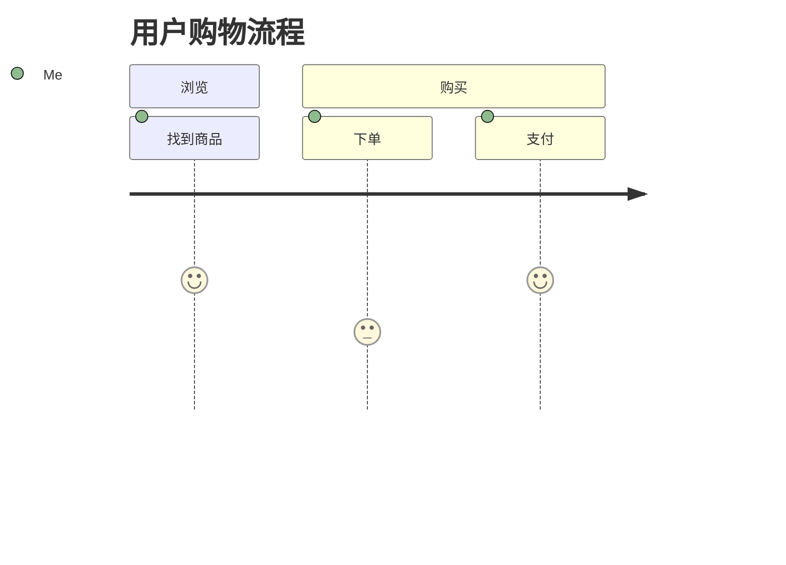


适用场景：

+ 用户体验
+ 流程体验
+ 满意度分析

> PS：可能是我接触的比较少，所以之前没画过这个图，不清楚实际业务场景这个图的作用是否大。

# 不同维度的需求

从不同业务场景和项目相关人员进行介绍，更加详细的介绍与示例，请查看文档最后附件章节。

| 业务阶段 | 需求 | 设计 | 开发 | 测试 | 管理 | 运营 |
| --- | --- | --- | --- | --- | --- | --- |
| 角色 | 产品经理 | 程序员 | 程序员 | 测试工程师 | 项目经理 | 运营 |
| 关注图表 | + 用户旅程图：用户体验 | + ER图：数据库设计 | + 流程图：处理逻辑 | + 状态图 | + 甘特图：项目进度 | + 饼图：分析数据 |

# 解决不同问题

## （1）架构问题

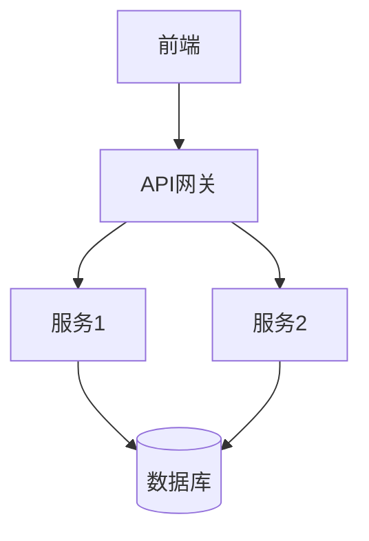


使用图表：

+ 流程图：系统架构
+ 类图：模块关系
+ ER图：数据结构

## （2）性能问题

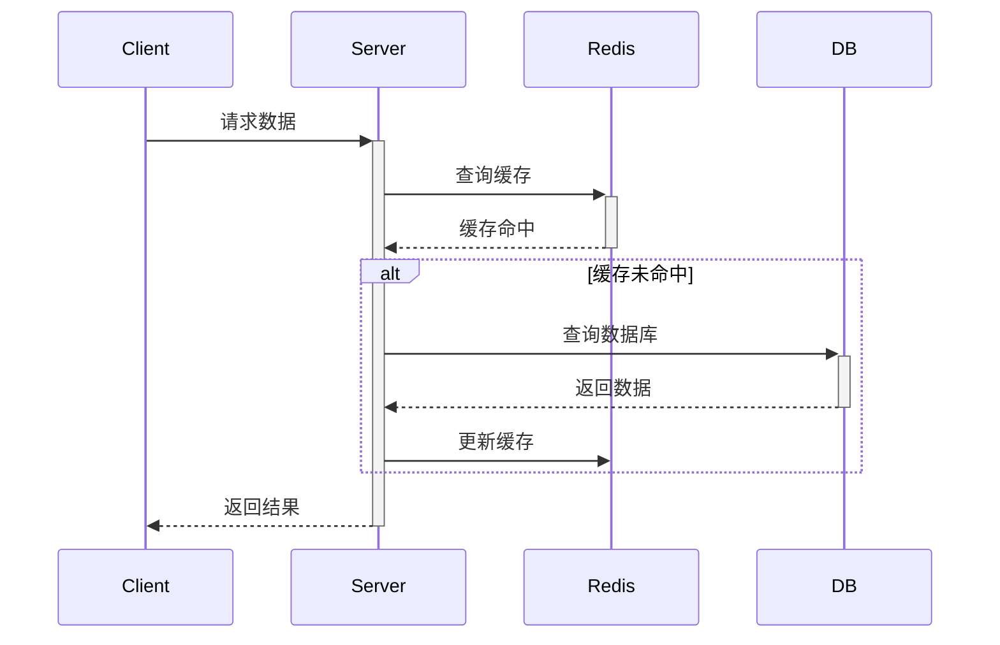


使用图表：

+ 时序图：调用链路
+ 流程图：处理流程
+ 状态图：状态变化

## （3）协作问题

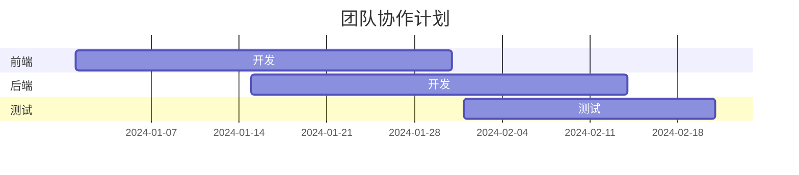


使用图表：

+ 甘特图：进度同步
+ 流程图：工作流程
+ 时序图：协作流程

## 总结：通过合理选择和组合这些图表，能够：

1. 提高沟通效率
2. 减少理解偏差
3. 优化开发流程
4. 提升项目质量

# （三）已有项目代码可视化操作

不论代码项目大小，以及是自己编程或学习其他项目，均可使用这种方式。

## 项目介绍

vanna-ai项目为github本周410stars （总11.8kstars）的开源项目，其是 MIT 许可的开源 Python RAG（检索增强生成）框架，用于 SQL 生成和相关功能，下面是介绍视频与github链接。


[`ann-ai.mp4`](https://internal-api-drive-stream.feishu.cn/space/api/box/stream/download/all/U2VybB2KooUYYGxPBL8clPuUnrc)

## 梳理整个项目逻辑并且初步可视化

使用Chat梳理整个项目逻辑，并且使用mermaid对项目进行可视化。


由于`@Codebase`，所以会读取所有的文件，不仅仅是代码文件，过程如下图所示：


下面是回答结果，能够初步对项目功能及架构进行说明，并且给出了工作流程、训练过程以及关键代码位置，非常棒：


## 不同角度图表的绘制

### （1）绘制项目流程图

`梳理VANNA-MAIN的完整逻辑流程，创建 mermaid_flow.md文件到根目录，同时在mermaid_flow.md中使用绘制mermaid项目流程图`


cursor回答后，点击Apply就可以自动创建对应的md文档，并且会将内容预写进该md文档中，继续点击Accept就可以完整的接受回答到md文档中。

> 上面的Prompt有语法错误，但是完全不影响cursor的理解。


回答的很不错，但是这个回答是以广义上的流程来回答绘制的，在这里我想要的是mermaid的Flowchart，于是加上Flowchart限定，重新提问，提示词如下：

`梳理VANNA-MAIN的完整逻辑流程，创建 mermaid flow.md文件到根目录，同时在mermaid flow.md中使用绘制mermaid项目流程图(Flowchart)`


这次只使用Flowchart绘制了核心流程、训练流程以及相关业务流程，还很贴心的给出了错误处理流程，非常nice！


`完整整理[苏苏]角色逻辑的时序图，用terminal帮我创建mermaid_sequence.md文件到根目录`

### （2）绘制项目时序图

这里没有像绘制Flowchart一样，而是只让cursor绘制了一个全流程的时序图，使用Prompt如下：

`@Codebase 完整梳理全流程的时序图，{只输出```mermaid.md```图表}，并帮我创建mermaid_sequence.md 文件到根目录`
