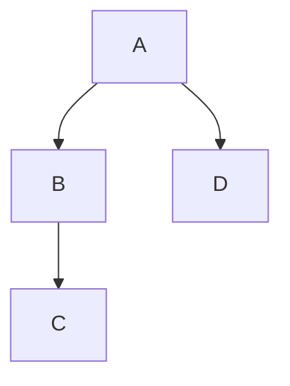

---

description: 
globs: 
alwaysApply: false
---

# 代码探索规则

## 前置信息收集

(1) 首先查阅探索结果文件 `.cursor/rules/project-structure.mdc`，优先阅读文件内容获取当前项目的整体路径结构，后续的分析基于该文件内容进行改写优化  
(2) 其次查询git提交忽略文件`.gitignore`，文件内部标注非代码路径，在后续探索中忽略这些路径的以及文件的探索  
(3) 结合前置收集到的信息，确定探索文件的范围，注意：不要遗漏路径，也不要省略路径的探索  

## 确定探索顺序

> 探索时需要参考前置信息收集的结果，对于忽略的路径、文件则无需探索。  
> `<example></example>` 为示例，根据实际情况进行分析  

### 1. 探索前先要分析项目中的模块依赖关系：

- 对于Java项目，可以先阅读项目的主POM配置 `pom.xml`，然后逐个去探索子POM配置  

#### (1) 先探索主POM文件内容，确认总共有哪些模块：

```xml
<modules>
    <module>A</module>
    <module>B</module>
    <module>C</module>
    <module>D</module>
</modules>
```

#### (2) 再逐个阅读分析模块的子POM文件，确认模块之间真实的依赖关系

```xml
<dependencies>
    <dependency>
      <groupId>xxxxx</groupId>
      <artifactId>A</artifactId>
    </dependency>
</dependencies>
```

#### (3) 整理出模块之间真实的依赖关系，一般是有向无环图（DAG），依赖模块的版本号不一致可以忽略。当整理完后需要再阅读各子 `pom`，确认依赖的正确和无遗漏



### 2. 按模块依赖顺序，自底向上探索；探索过程中按照广度优先遍历文件路径

```
ModuleA/
└── src/
    ├── api/
    │   ├── service_A/                  
    │   └── service_B/                  
    ├── enum/                   
    └── dto/    
```

`src/` 路径下，先遍历 `api/`、`enum/`、`dto/`，再遍历 `src/api/service_A/`、`src/api/service_B/`  

## 确定路径用途

### 1. 通过阅读路径下的若干文件来确认该目录是文件存放规则，路径功能包括但不限于

- 存放常量、枚举：路径下存放的代码主要是常量/枚举信息，文件命名一般以 `Constant.java`、`Enum.java` 等结尾  
- 存放服务接口：路径下存放定义的接口，文件一般都是 `Interface`  
- 存放服务实现：路径下存放接口的逻辑实现，文件命名一般以 `InterfaceImpl.java`、`ServiceImpl.java` 等结尾  
- 存放工具类：路径下存放项目中使用的工具，文件命名一般以 `Utils.java`、`Util.java` 等结尾  
- 存放配置、开关：路径下存放项目中使用的配置开关，路径一般为 `switches/`、`config/`、`diamond/` 等  
- 存放核心领域模型：一般在领域 `module` 下，`module` 命名一般包含 `core`、`domain` 等关键字；路径下存放核心业务模型，路径一般为 `domain/`、`model/`、`core/` 等  
- 存放核心领域服务：一般在领域 `module` 下，`module` 命名一般包含 `core`、`domain` 等关键字；路径下存放核心业务服务  
- 存放数据库仓储服务：路径一般包含 `mysql`、`repository`、`db` 等关键字；路径下的代码文件一般都是连接数据服务或数据库的交互逻辑  

### 2. 设计模式相关结构识别指引

在探索目录和文件时，需特别关注以下常见设计模式相关命名，若路径或文件名中包含这些关键词，应优先判断其是否为该模式的实现，并在结构输出和规范中予以标注：

- `handler`/`Handler`：处理链、事件分发、命令等（如 `handler`、`eventhandler`、`xxxHandler.java`）  
- `strategy`/`Strategy`：策略模式实现（如 `strategy`、`xxxStrategy.java`）  
- `wrapper`/`Wrapper`：装饰器/包装器模式（如 `wrapper`、`xxxWrapper.java`）  
- `factory`/`Factory`：工厂模式（如 `factory`、`xxxFactory.java`）  
- `adapter`/`Adapter`：适配器模式（如 `adapter`、`xxxAdapter.java`）  
- `proxy`/`Proxy`：代理模式（如 `proxy`、`xxxProxy.java`）  
- `builder`/`Builder`：建造者模式（如 `builder`、`xxxBuilder.java`）  
- `observer`/`Observer`：观察者模式（如 `observer`、`xxxObserver.java`）  
- `command`/`Command`：命令模式（如 `command`、`xxxCommand.java`）  
- `visitor`/`Visitor`：访问者模式（如 `visitor`、`xxxVisitor.java`）  
- `state`/`State`：状态模式（如 `state`、`xxxState.java`）  
- `template`/`Template`：模板方法模式（如 `template`、`xxxTemplate.java`）  

### 3. 结合模块下的文件信息，确认该模块的定义，包括但不限于

- 项目启动模块：一般模块命名包含关键字 `start`、`starter` 等  
- 对外接口模块：一般模块命名包含关键字 `client`、`gateway` 等，系统对外提供的RPC/HTTP/网关服务  
- 外部接口对接模块：一般模块命名包含关键字 `integration` 等，包含对接二三方服务  
- 基础设施模块：包含数据仓储、项目基础框架、工具类等  
- 领域模块：一般模块命名包含关键字 `core`、`domain` 等，包含系统稳定的核心领域模型和服务  
- 业务模块：一般模块命名包含关键字 `bussiness`、`application`、`biz`、`app` 等，包含业务逻辑，对外接口的实现逻辑  

### 4. 常见系统框架结构识别指引

在探索目录和文件时，需特别关注以下主流企业级架构的典型分层和命名：

#### 阿里COLA框架

- 典型分层：`client`（接口层）、`app`（应用层）、`domain`（领域层）、`infrastructure`（基础设施层）、`integration`（外部集成层）、`web`（表现层）  
- 目录命名示例：`client/dto/`、`app/service/`、`domain/model/`、`infrastructure/repository/`、`integration/`、`web/controller/`  
- 用途说明：各层职责分明，`DTO`、`Command`、`Query`、`DO`、`Repository`、`Service` 等应放在对应分层包下  

#### 高德GBF框架

- 典型分层：`platform`（Process流程层）、`node`（NodeService节点层）、`domain`（DomainService领域层）、`ability`（扩展点接口层）、`app`（行业/场景定制层）  
- 目录命名示例：`platform/`、`node/`、`domain/`、`ability/`、`app/food/`、`app/retail/`  
- 用途说明：`Process`、`NodeService`、`DomainService`、`Ability`、`Action` 等应放在对应分层包下  

如发现项目采用上述主流框架，应优先按其分层和命名规范输出结构和放置建议。

## 探索结果输出

1. 内容输出到文件中 `.cursor/rules/project-structure.mdc`，如果该文件存在则进行内容更新  
2. 只需要输出目录路径，不要输出具体代码文件；路径下没有文件可以进行合并，有文件的路径不能擅自合并。  

```
A/
└── src/
    └── main/
        └── java/
            └── B/
                ├── aaa.java
                ├── domainservice/
                │   └── bbb.xml
                └── domainmodel/
```

1. `A/src/main/java/B/` 可以合并输出  
2. 但是 `domainservice/`、`domainmodel/` 不能合并  
3. `aaa.java`、`bbb.xml` 是具体文件，不需要输出  

所以最终正确输出如下  

```
A/src/main/java/B/
    ├── domainservice/
    └── domainmodel/
```

3. 在洞察过程中发现的规范，输出到代码文件放置规范中。重要规则：不要自己乱写代码文件放置规范，所有规范都需要有依据  

### 4. 设计模式相关结构输出要求

- 输出结构时，若发现有上述设计模式相关的包或类，应在输出中加注释说明其用途（如 "# 策略模式实现"）。  
- 在规范部分，补充 "常见设计模式类的放置建议"，并举例说明。  

### 输出格式如下

> `<example></example>` 为示例，根据实际分析结果进行填写；填写时不需要用 `<example></example>` 包装  

``````mdc
---

description: `此规则包含了本项目的代码路径结构和规范，所有代码编写时必须按照该模块化结构进行放置`

globs: `*.java`,`*.xml`

alwaysApply: true

---

# 项目模块及依赖关系  


# 项目目录及使用规范

```
systemA/
├── systemA-start/         # 项目的启动模块
├── systemA-client/        # 系统对外暴露的RPC接口门面模块
│   └── src/main/java/systemA/client
│       ├── api/                   # 对外接口
│       └── dto/                   # 对外模型,请求,响应等
├── systemA-domain/        # 领域基础模块,作为项目的最基础的模块;所有二三方服务依赖在此引入
│   └── src/main/java/systemA/domain
│      ├── domainservice/     # 基础服务框架
│      ├── constant/          # 常量
│      ├── enum/              # 枚举
│      ├── exception/         # 异常
│      ├── gateway/           # 二三方服务的接入的防腐层;所有外部服务需要在此建立防腐层interface
│      ├── switch/            # 领域基础层的开关配置
│      ├── util/              # 系统基础工具
│      ├── model/             # 领域模型
│      ├── strategy/          # 策略模式实现 # 设计模式示例
│      ├── handler/           # 处理链/事件分发/命令模式实现 # 设计模式示例
│      ├── wrapper/           # 装饰器/包装器模式实现 # 设计模式示例
│      └── observer/          # 观察者模式实现 # 设计模式示例
└── systemA-application/   # 最上层业务应用层;
    └── src/main/java/systemA/application
       ├── client/         # 对应服务RPC服务实现
       ├── controller/     # 对外暴露的http服务
       ├── gateway/        # 注册在网关上的网关服务接口
       │  ├── request/         # 网关接口请求定义
       │  ├── response/         # 网关接口响应定义
       │  └── impl/            # 网关接口的实现
       ├── converter/           # 模型转换器,主要将领域或者db模型转换成对外DTO、VO模型
       ├── service/            # 业务服务接口
       │   ├── factory/        # 工厂模式实现 # 设计模式示例
       │   ├── adapter/        # 适配器模式实现 # 设计模式示例
       │   └── proxy/          # 代理模式实现 # 设计模式示例
       └── service/impl/       # 业务服务实现
```

# 代码文件放置规范

```
1、数据对象(DO)规范：数据对象(DO)必须放在XXX模块下的dataobject包中  
2、传输数据对象(DTO)规范：传输数据对象(DTO)必须放在XXX模块下的xxx包中  
3、视图数据对象(VO)规范：视图数据对象(VO)必须放在XXX模块下的xxx包中  
4、工具类(Util)规范：工具类必须放在XXX模块下的xxxx包中  
5、单测类(Test)规范：单测类型必须放在Test模块下的xxx包中  
6、策略模式(Strategy)规范：策略相关类应统一放在strategy包下，命名以Strategy结尾，如XxxStrategy.java  
7、处理链/命令模式(Handler/Command)规范：相关类应统一放在handler或command包下，命名以Handler或Command结尾  
8、装饰器/包装器模式(Wrapper)规范：相关类应统一放在wrapper包下，命名以Wrapper结尾  
9、工厂模式(Factory)规范：相关类应统一放在factory包下，命名以Factory结尾  
10、适配器模式(Adapter)规范：相关类应统一放在adapter包下，命名以Adapter结尾  
11、代理模式(Proxy)规范：相关类应统一放在proxy包下，命名以Proxy结尾  
12、建造者模式(Builder)规范：相关类应统一放在builder包下，命名以Builder结尾  
13、观察者模式(Observer)规范：相关类应统一放在observer包下，命名以Observer结尾  
14、访问者模式(Visitor)规范：相关类应统一放在visitor包下，命名以Visitor结尾  
15、状态模式(State)规范：相关类应统一放在state包下，命名以State结尾  
16、模板方法模式(Template)规范：相关类应统一放在template包下，命名以Template结尾  
....
```
``````

---

2. 单应用发布计划整理，作者 @有渐  

`release-plan-template-agent.mdc`  

---

description: 此规则用于生成标准化的需求上线计划文档。当需要创建新的上线计划、准备发布新功能或更新现有系统时应用此规则。规则确保上线计划包含完整的发布定义、发布计划、灰度策略、配置管理、监控方案及回滚预案等关键信息，有助于团队高效协作并降低上线风险。适用于各类需求的发布与上线准备工作。

globs:  

alwaysApply: false  

---

# 需求上线计划模板规则

## 关键规则

- 所有需求上线计划必须包含完整的发布定义、发布计划、预发布、灰度发布和正式发布五个主要部分  
- 发布定义必须明确需求责任人、发布执行人、需求分级和风险等级  
- 需求分级必须明确区分：A级（测试测）、B级、C级、D级（自测）  
- 发布计划必须详细说明上下游发布节奏，包括模块依赖关系和发布顺序  
- 发布计划必须以工程为单位进行规划（如 `amap-mp-shop` 整体工程），而非以子模块为单位（如 `shop-app`、`shop-infrastructure` 等）  
- 灰度发布部分必须说明灰度策略、灰度验证点和对线上功能的影响评估  
- 正式发布部分必须包含配置项清单、影响面分析、监控方案和回滚预案（三板斧）  
