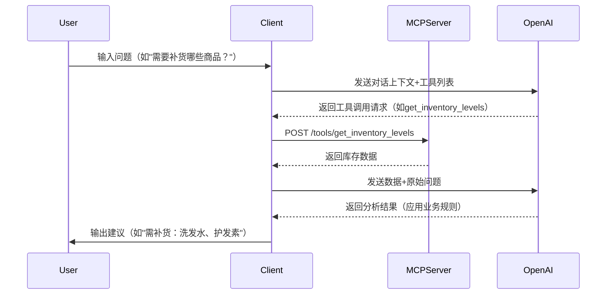
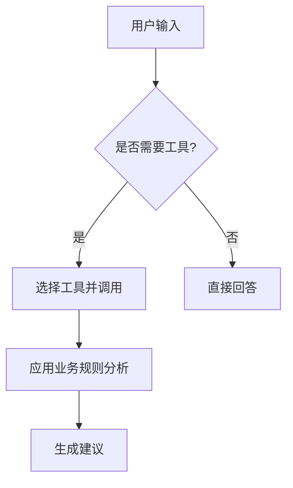

# MCP 架构代码解析与交互逻辑

以下是结合 MCP 架构的代码解析和交互逻辑图示：

MCP（Multi-Component Platform）在此代码中体现为：

+ **工具服务器**：独立运行的 `FastAPI` 服务，提供工具发现和执行能力
+ **客户端**：与用户交互的 AI 代理，动态调用服务器工具
+ **标准化协议**：通过 `HTTP/REST` 接口实现解耦


```mermaid
classDiagram
    class MCP_Server {
        +GET / : 工具发现
        +POST /tools/{name} : 工具执行
        -tools_registry : 工具注册表
    }
    
    class MCP_Client {
        +discover_tools_from_mcp()
        +execute_mcp_tool()
        -SYSTEM_PROMPT : 业务规则
    }
    
    class OpenAI_Proxy {
        +chat.completions.create()
    }
    
    MCP_Client --> MCP_Server : HTTP请求
    MCP_Client --> OpenAI_Proxy : API调用
```

## 交互流程详解




## 关键交互阶段

### 阶段 1：工具发现（启动时）

```python
def discover_tools_from_mcp(server_url):
    response = requests.get(server_url)  # 获取工具schema列表
    # 返回示例: [{
    #   "type": "function",
    #   "function": {
    #     "name": "get_inventory_levels",
    #     "description": "获取所有产品的当前库存水平"
    # }}]
```

### 阶段 2：动态工具调用

```python
# 当AI决定调用工具时：
function_response = execute_mcp_tool(
    server_url=MCP_SERVER_URL,
    tool_name="get_weekly_sales",  # 由AI动态选择
    tool_args={}  # 参数由AI生成
)
# 返回示例: {"Moisturizer": 22, "Shampoo": 18, ...}
```

### 阶段 3：结果整合

```python
# 客户端将原始数据交给AI进行业务规则处理：
"""
Restocking Rule: 当前库存 < 周销量 → 需补货
Clearance Rule: 库存 > 20 且 周销量 < 5 → 应清仓
Best Sellers: 取周销量TOP3
"""
```

## MCP 服务器设计亮点

### 统一工具注册表

```python
tools_registry = {
    "get_inventory_levels": {
        "function": get_inventory_levels,  # 实际函数
        "schema": {...}  # OpenAI工具描述
    }
}
```

### 双端点设计

+ `GET /`：工具发现（返回所有工具的 schema）
+ `POST /tools/{name}`：工具执行

### 线程隔离

```python
server_thread = threading.Thread(target=run_mcp_server, daemon=True)
```

## 客户端智能决策流程




这种架构实现了：

+ **工具热插拔**：增减工具无需修改客户端代码
+ **安全隔离**：工具运行在独立进程
+ **协议通用性**：任何兼容 `OpenAI Tool Calling` 的客户端都可接入

通过 MCP 架构，将业务规则（客户端）与数据获取（服务器）完全解耦，形成可扩展的企业级 AI 代理系统。

# 附录

## 高级提示词管理技巧和最佳实践

我们来探讨一下当项目中提示词（`Prompts`）数量变得庞大（几十甚至上百个）时，如何进行有效管理。这确实是构建复杂、可维护的 LLM 应用时必须面对的工程问题。

将提示词像普通代码一样进行管理至关重要。混乱的提示词会导致难以维护、难以协作、难以追踪效果和难以迭代优化。

### 面临的挑战

+ **可读性与维护性**：将长提示词硬编码在业务逻辑代码中，会严重降低代码可读性。修改提示词需要深入代码内部，容易出错。
+ **复用性**：很多提示词可能有相似的结构或指令，简单复制粘贴会导致冗余和不一致。
+ **版本控制**：提示词的效果往往需要不断迭代优化。如何追踪哪个版本的提示词效果最好？如何回滚到之前的版本？
+ **协作**：不同团队成员可能需要创建、修改或使用提示词，需要统一的管理方式。
+ **动态性**：很多提示词需要根据不同的输入动态填充变量。
+ **评估与测试**：需要方便地对不同提示词版本进行 A/B 测试或离线评估。

### 最佳实践与管理策略

以下是一些管理大量提示词的最佳实践和常用策略，从简单到复杂：

### 将提示词作为常量或配置

**实践**：最基础的方法是将提示词定义为 Python 模块中的常量字符串，或者存储在专门的配置文件中（如 `.py`、`.json`、`.yaml`）。

**优点**：将提示词与业务逻辑代码分离，提高了可读性。修改提示词只需在特定文件或位置进行。

**缺点**：对于大量提示词，单个文件可能变得臃肿。缺乏结构化和模板化能力。

**示例（Python 模块）**：

```python
# prompts.py
CUSTOMER_SERVICE_SYSTEM_PROMPT = """
你是一个专业的“易速鲜花”客服助手。请根据用户问题提供友好、准确的帮助。
"""

ORDER_QUERY_PROMPT_TEMPLATE = """
根据以下订单信息回答用户关于订单号 {order_id} 的问题。
订单信息：{order_details}
用户问题：{user_query}
请仅基于提供的订单信息回答。
"""
# main.py
# import prompts
# system_message = prompts.CUSTOMER_SERVICE_SYSTEM_PROMPT
# user_prompt = prompts.ORDER_QUERY_PROMPT_TEMPLATE.format(...)
```

**示例（YAML 文件）**：

```yaml
# prompts.yaml
customer_service:
  system_prompt: |
    你是一个专业的“易速鲜花”客服助手。请根据用户问题提供友好、准确的帮助。
order_query:
  template: |
    根据以下订单信息回答用户关于订单号 {order_id} 的问题。
    订单信息：{order_details}
    用户问题：{user_query}
    请仅基于提供的订单信息回答。
  input_variables: ['order_id', 'order_details', 'user_query']
```

```python
# main.py
# import yaml
# with open('prompts.yaml', 'r', encoding='utf-8') as f:
#     prompts_config = yaml.safe_load(f)
# system_message = prompts_config['customer_service']['system_prompt']
# order_template = prompts_config['order_query']['template']
# user_prompt = order_template.format(order_id=..., order_details=..., user_query=...)
```

### 使用提示词模板（Prompt Templates）

**实践**：利用模板引擎来创建包含占位符（变量）的提示词。这使得提示词可以动态生成。

**简单模板**：Python 的 `f-strings` 或 `.format()` 方法适用于简单的替换。

**高级模板引擎（`Jinja2`）**：对于更复杂的逻辑，如条件判断（`if/else`）、循环（`for`）、宏定义、模板继承等，可以使用强大的模板库 `Jinja2`。

**优点**：提高了提示词的复用性和动态性。`Jinja2` 尤其适合构建结构复杂、包含可选部分的提示词。

**示例（Jinja2）**：

```jinja
{# order_summary_prompt.j2 #}
请根据以下信息为用户总结订单 {order_id} 的状态。

订单状态：{{ status }}

预计送达时间：{{ estimated_delivery }}

目前暂无预计送达时间。


订单商品：

- {{ item.name }} (数量: {{ item.quantity }})



备注：{{ notes }}

```

```python
# main.py
# from jinja2 import Environment, FileSystemLoader
# env = Environment(loader=FileSystemLoader('.')) # 加载当前目录的模板
# template = env.get_template('order_summary_prompt.j2')
#
# prompt_data = {
#     'order_id': '12345',
#     'status': '已发货',
#     'estimated_delivery': '2025-04-10',
#     'items': [{'name': '玫瑰花束', 'quantity': 1}, {'name': '贺卡', 'quantity': 1}],
#     'notes': '请在上午送达'
# }
# rendered_prompt = template.render(prompt_data)
# print(rendered_prompt)
```

### 利用 LLM 框架（如 `LangChain`，`LlamaIndex`）

**实践**：这些框架内置了强大的提示词管理功能。

`PromptTemplate` / `ChatPromptTemplate`：标准化模板创建，支持输入变量校验、部分格式化、模板组合等。

**示例序列化（Example Selectors）**：可以根据输入动态选择最相关的几个示例加入到提示词中（Few-shot Learning）。

**提示词流水线（Pipelines/Chains）**：可以将多个提示词（和模型调用、工具调用）串联起来形成复杂的工作流。

**优点**：提供了一套成熟、集成化的解决方案，与框架的其他组件（模型、检索器、记忆等）无缝集成。简化了许多常见模式的实现。

**缺点**：引入了框架依赖，需要学习框架的特定用法。

**概念示例（`LangChain`）**：

```python
# from langchain_core.prompts import ChatPromptTemplate, SystemMessagePromptTemplate, HumanMessagePromptTemplate
# system_template = "你是一个专业的 {role}。"
# human_template = "请回答关于 {topic} 的问题。"
# chat_prompt = ChatPromptTemplate.from_messages([
#     SystemMessagePromptTemplate.from_template(system_template),
#     HumanMessagePromptTemplate.from_template(human_template)
# ])
# formatted_prompt = chat_prompt.format_messages(role="数据分析师", topic="Python")
# print(formatted_prompt)
# # Output: [SystemMessage(content='你是一个专业的数据分析师。'), HumanMessage(content='请回答关于 Python 的问题。')]
```

### 版本控制系统（如 `Git`）

**实践**：将存储提示词的文件（`.py`、`.yaml`、`.j2` 等）纳入 `Git` 等版本控制系统进行管理。

**优点**：可以追踪提示词的修改历史，比较不同版本的效果，方便回滚，支持分支开发和协作。

**关键**：像对待代码一样对待提示词文件，编写有意义的提交信息（`commit messages`）来记录修改原因和效果。

### 专门的提示词管理工具/平台

**实践**：随着 LLM 应用的发展，出现了一些专门用于管理、协作、测试和部署提示词的工具或平台（有开源也有商业产品）。

**常见功能**：

+ **图形化界面（`UI`）**：用于创建和编辑提示词模板。
+ 版本控制和审批流程。
+ `A/B` 测试框架。
+ 团队协作功能。
+ 效果分析和监控。
+ 通过 `API` 或 `SDK` 与应用程序集成。

**优点**：提供了一站式的解决方案，特别适合大型团队和复杂的提示词管理需求。

**缺点**：可能引入新的工具依赖和学习成本，商业工具可能产生额外费用。

**示例（概念性，非特定工具）**：`Vercel AI Playground`，`Langfuse`，`PromptLayer`，`HumanLoop` 等提供了此类功能或思路。

### 关键词供自行探索

+ `Prompt Engineering`：提示词工程（更广泛的概念，包含如何写好提示词）。
+ `Prompt Template`：提示词模板（核心技术）。
+ `Prompt Management`：提示词管理（工程实践）。
+ `Prompt Versioning`：提示词版本控制。
+ `Prompt Evaluation` / `Prompt Testing`：提示词评估与测试。
