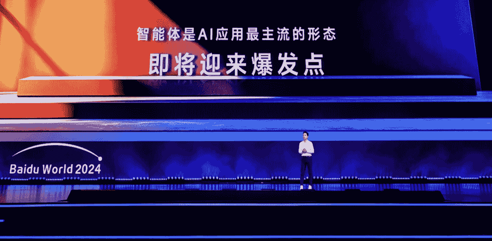
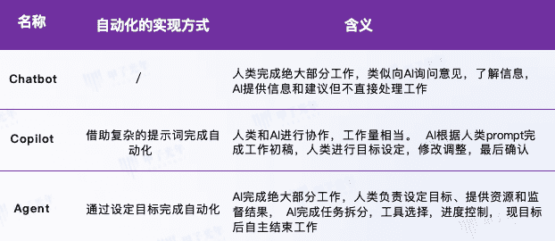
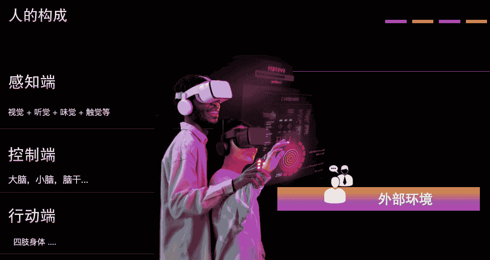
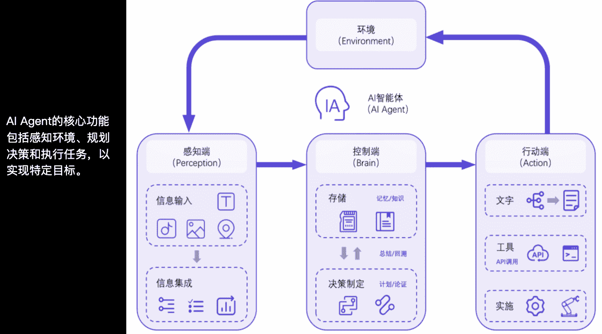
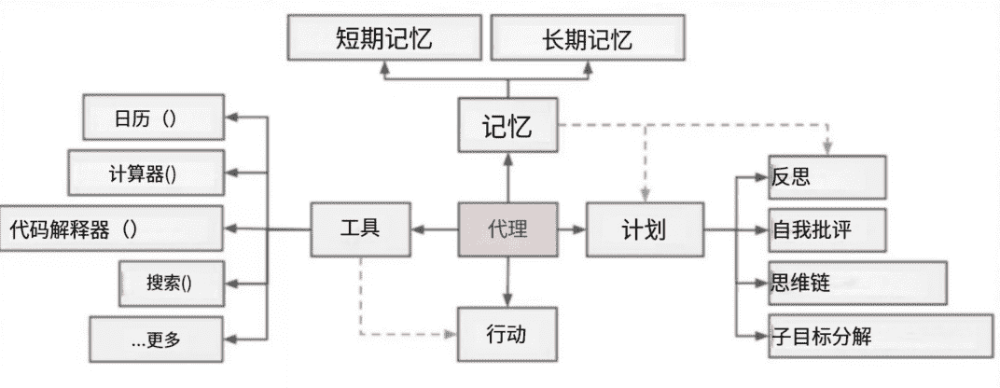
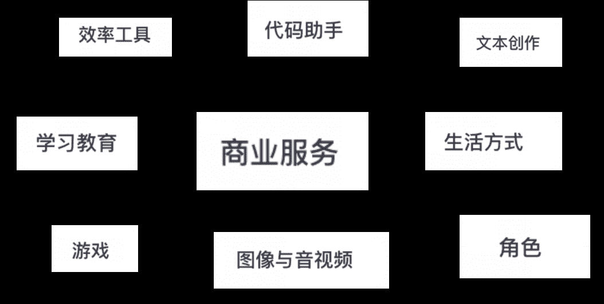

# 01 智能体基础概念

> 来源：[https://hyperspace.feishu.cn/docx/UtW3d87kXoO1G1xP2smcovi1nMb](https://hyperspace.feishu.cn/docx/UtW3d87kXoO1G1xP2smcovi1nMb)

> 前言：2024年被誉为“智能体元年”，那么，智能体究竟是什么？本文将深入浅出地为您讲解智能体的核心概念，帮助您快速理解这一新兴领域，并为后续学习打下坚实基础。

# 什么是智能体？

> 学术解释：AI智能体(AIAgent)中的Agent通常被译作“代理”一词。在计算机和人工智能领域，直到20世纪80年代中后期才逐渐关注对代理概念的研究，并将该领域具有智能的代理称之为智能体。1995年Wooldridge等人在《智能体:理论与实践》一文中将人工智能的核心目标定义为:旨在设计和构建基于计算机的、表现出智能行为各个方面的智能体。在Wooldridge等人的定义中，“智能体”是人工智能的核心概念。当前对于AI智能体具有共识性的定义是: 一种能够感知环境、进行决策和执行动作的智能计算实体。它拥有自主性和自适应性，可以依靠AI赋予的能力完成特定任务，并在此过程中不断对自我进行完善和改进。AI智能体的一个重要特征是主动，它能够在用户提出要求前就提出建议，能够跨应用程序完成任务。

> 以上解释太过专业，对于小白的我们可能不太理解... 接着往下看，我们先看看智能体是如何演化的！

###  Chatbot 到 Copilot，再到 Agent：智能体的演化之路

| 维度 | Chatbot | Copilot | Agent |
| --- | --- | --- | --- |
| **目标定位** | 以对话为主要交互形式，提供信息、情感支持或解决具体问题，像是一个“交流助理”。 | 更依赖于人类的提示来完成任务，像是一个“实习生”。 | 能根据目标自主规划行动，像是一个“老员工”，具备更高的自主性和独立性。 |
| **独立性** | 介于两者之间，能够通过自然语言理解简单任务，但复杂任务仍需结合明确指令。 | 较低，通常需要依赖清晰明确的 prompt。 | 较高，能独立思考、制定和分解计划。 |
| **流程决策** | 灵活且对话式：以对话为核心动态调整流程，适应用户的多样化需求。 | 静态且固定：依赖于人类事先确定的流程，常为硬编码（hardcode）。 | 动态且自主：AI 自主确定任务的规划和执行步骤，具有自适应性。 |
| **开发重点** | 开发重心在于对话引擎优化，包括上下文理解、多轮对话和情感识别能力。 | 核心依赖 LLM 的性能，开发重心在于 Prompt Engineering。 | 核心是对 LLM 多任务的规划、分解和工具整合（如调用外部 API），以及多模态数据交互能力。 |
| **应用案例** | 客服助手、陪伴聊天机器人、知识问答助手等。 | 文案助手、编程助手、翻译助手等。 | GPTs、AI 分身、虚拟主播、数字员工等。 |

> 由此可以看出智能体很重要且不同的地方在于其可以调用各种工具！这好比如就像人类会用工具一样！

> 也可以理解成 智能体 == 数字“人”！

### 智能体 == 数字“人”

#### 智能体构成

> AI Agent智能体是一种能够感知环境、做出决策并采取行动的智能实体。它在人工智能领域中扮演着核心角色，具备自主性、适应性和交互能力。AI Agent可以是软件程序、机器人或其他形式的系统。

#### 核心功能

> AI Agent的核心功能包括感知环境、规划决策和执行任务，以实现特定目标。

#### 智能体的主要能力

> 情感交互、个性化推荐、智能助理、自动化运营等,可以大幅提升企业的服务效率和用户体验。

人的构成（感知端、控制端、行动端）

智能体就是复刻人类一样设计的

> 智能体像人一样具备 “ 记忆 + 工具 + 计划 + 行动

+   规划：包括规划、决策能力，有效执行复杂任务。涉及子目标分解、连续思考（思维链）、自我反思和批评、对过去行动的反思。

+   记忆：短期记忆和长期记忆。

+   **短期记忆**：与上下文学习有关，属于提示工程一部分。

+   **长期记忆：与信息长时间**保留与检索有关，利用外部向量存储和快速检索。

+   工具：包括agent调用的各类工具，如：日历、计算器、代码解释器等。

+   执行（行动）：基于规划和记忆执行具体行动，包括：与外部世界互动、调用工具完成一个动作或者任务。

# 搭建智能体

> **搭建智能体 == 造人**

> 所以说白了搭建智能体也可以理解成“造人”！只要有创意有想象力，就可以造出各式各样的智能体！

涉及的类目就太多了，无论是商业服务的智能体还是角色扮演的等等，只要你想得到，没有你做不到！！