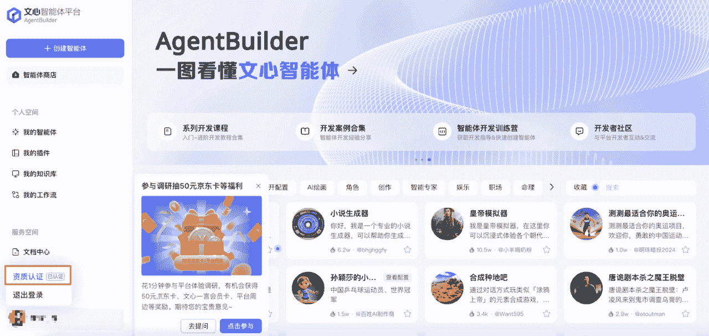

# 资质认证

> 来源：[https://hyperspace.feishu.cn/docx/EmrgdRh6lo0r8cxXgbhcc8kSnr7](https://hyperspace.feishu.cn/docx/EmrgdRh6lo0r8cxXgbhcc8kSnr7)

资质认证范围：

+   智能体： 仅限所填写的信息包含品牌商标或姓名的情况，为避免侵权需提交此认证，若不涉及可不认证。

资质认证类型： 目前支持个人、企业（包含个体工商户）、政府、事业单位等，主体类型及信息审核通过将无法更改。

资质认证要求：

资质认证路径：

[登录平台 → ](https://agents.baidu.com/entity)我的 → 用户名头像处 → 资质认证（或点此直达）

