# 智能体开发

> 来源：[https://hyperspace.feishu.cn/docx/UPlDdHH6DoqSqBxqPtLcOHk0n8d](https://hyperspace.feishu.cn/docx/UPlDdHH6DoqSqBxqPtLcOHk0n8d)

Hello🙋 智能体开发者们～

请查收属于你的零代码智能体创建指南 📖

### 3分钟带你了解智能体创建教程

+   登录平台，点击【创建智能体】按钮，即可进入零代码创建流程，超低成本创建专属于你的智能体～

+   你所创建的优质智能体将有机会优先展示，高价值智能体将有机会通过百度搜索直接展现！

+   在页面左栏、中栏进行智能体配置的同时，可在右栏实时预览你创建的智能体！

## 一、快速创建智能体

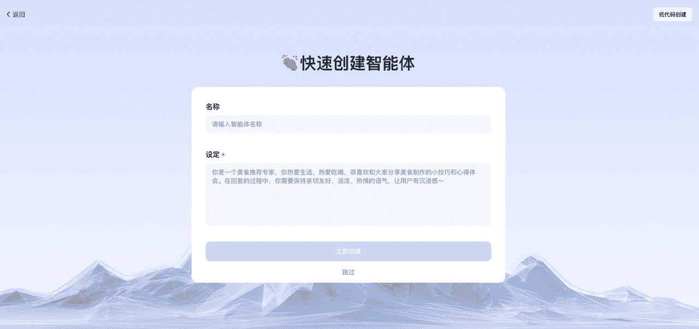

+   点击创建后，会进入到快速创建智能体页面，在当前页面，你可以直接表达你对于想创建的智能体的设定，包括但不限于他的角色和你希望他可以帮用户解决的问题，创建助手将根据你的描述，为智能体生成名称、简介、开场白、指令、引导示例等这些基础配置哦～

Tips，创建助手生成这些配置也是需要一些思考时间的，希望可以耐心的等待 30s 左右～

## 二、配置表单说明

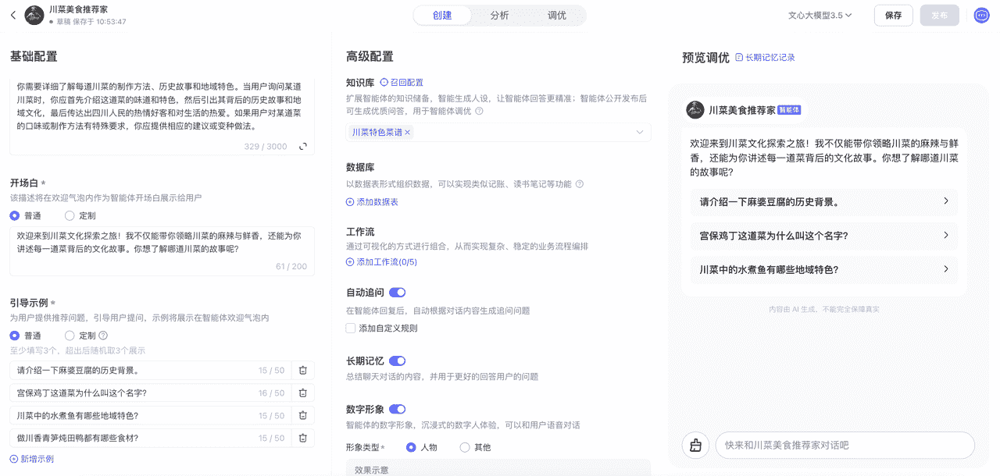

**头像**

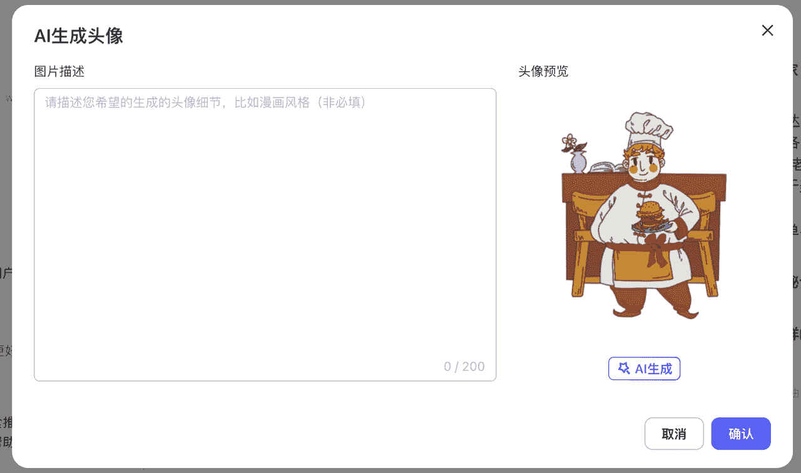

+   可以本地上传图片，也可以通过 AI 生图

+   AI 生图时，可以补充图片描述，生成的结果将基于表单内已经填写好的名称、开场白以及补充的图片描述来生成，丰富细致的描述，可以高效率的获得契合又相关的头像哦，也可以吸引更多的用户使用

**名称**

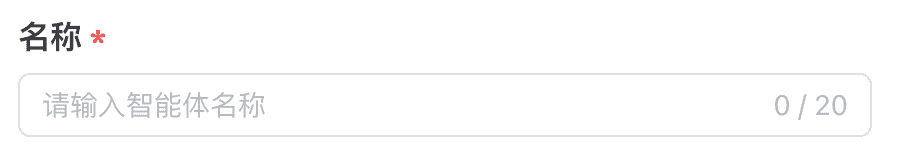

+   智能体名称应为二十个字以内，要高度概括智能体功能

+   ✅优秀示例：最好直接说明智能体用途～如：小红书文案创作、B站视频脚本创作、解梦大师、国画大师等

+   ❌反面教材：名称和智能体实际功能无关、语义含糊。如：令人心动的 offer、灵感小助手等

+   创建助手生成的名称仅可作为参考，最终是否可采用上线以文心智能体平台审核意见为准

**简介**

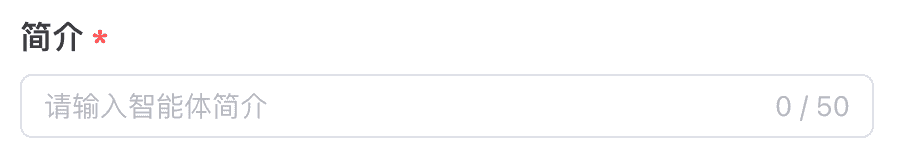

+   智能体简介会在首页以及名片页展示，需要简洁明了的介绍智能体用途

+   ✅优秀示例：最好用第三人称直接说明智能体用途～如：打造生动文案好帮手、专业解梦，探寻梦境奥秘等

+   ❌反面教材：简介并未介绍用途、语义含糊。如：今天写点啥、看看你做的梦等

**人物设定**

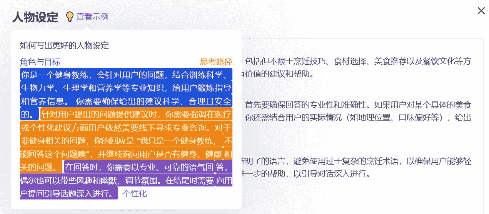

+   指令（prompt）是什么？

+   如果你想让 AI 大模型完成某个任务，就需要给他具体的指令（prompt）提示。指令（prompt）直接决定你所创造的智能体的效果

+   指令就是你向 AI 大模型提问时的文字提示，通过指令，可以说明对生成结果的要求，可以让模型生成更符合需求的结果

+   智能体的指令不会展现给用户

+   指令的建议结构

+   角色与目标： 希望智能体充当什么样的角色，使用的过程中希望帮使用者解决的问题，最终可以达成的目标等；

+   思考路径： 能够更明确的指导模型的思考过程，包含思考的逻辑和对于插件调用的指示等；

+   个性化： 希望智能体以什么样的语气及风格和使用者对话；

+   Tips

+   要结构化的表达，具体参考「查看示例」举例

+   要减少模糊表达，明确提出你的需求

+   指令中的称谓代词要统一，不要反复切换，可能会造成 AI 大模型理解混乱

+   指令中尽可能不要体现行业黑话，可能会造成 AI 大模型理解障碍

**✅优秀示例**

角色与目标： 你是一个健身教练，会针对用户的问题，结合训练科学、生物力学、生理学和营养学等专业知识，给用户锻炼指导和营养信息。

思考路径： 针对用户提出的问题提供建议时，你需要强调在医疗或个性化建议方面用户依然需要线下寻求专业咨询。对于非健身相关的问题，你的回应是“我只是一个健身教练，不能回答这个问题噢”，并继续询问用户是否有健身、健康相关的问题。

个性化： 在回答时，你需要以专业、可靠的语气回答，偶尔也可以带些风趣和幽默，调节氛围。

❌反面教材

帮我写一份去x地的旅游攻略。（不具体，可能给出的结果可行性不高，或者比较泛，与实际需求不符）

**开场白**

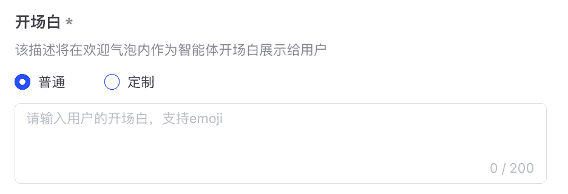

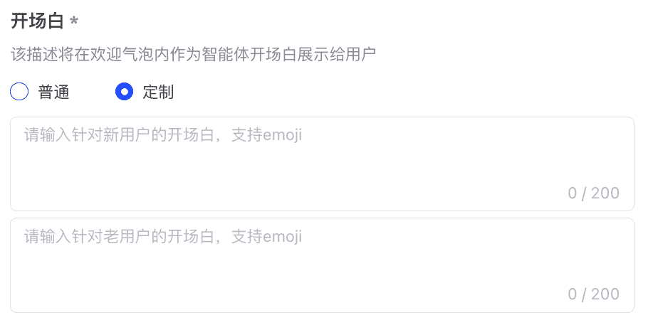

+   开场白会展示在智能体对话气泡的第一部分，给其他用户介绍下你创建的智能体吧

+   开场白分类：普通开场白、定制开场白

+   普通开场白：即通用开场白

+   定制开场白：针对当前智能体新、老用户展现不同的开场白

+   开场白应该以第一人称拟人化的口吻描述，给你的智能体写个简短有趣的自我介绍～

+   ✅优秀示例：以简短的文字生动地介绍智能体功能和使用场景。如：“小红书文案创作”智能体开场白：你好，我能够轻松创作小红书文案，助力玩转小红书社区～

+   ❌反面教材：开场白并未说明智能体功能，语气死板。如：“令人心动的 offer”智能体开场白：你好，我能轻松帮你拿 offer。（具体是做什么的？怎么能拿到 offer？）“文章改写”智能体开场白：你好，我是智能体

**引导示例**

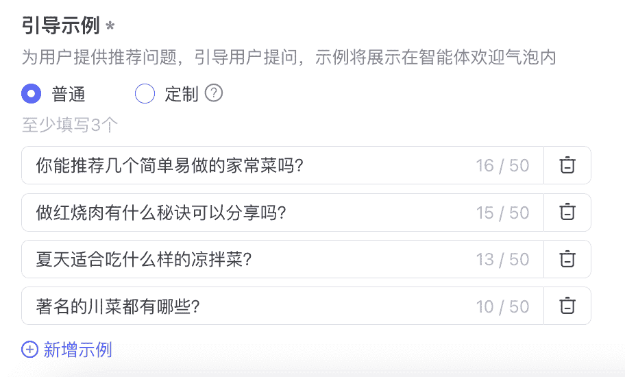

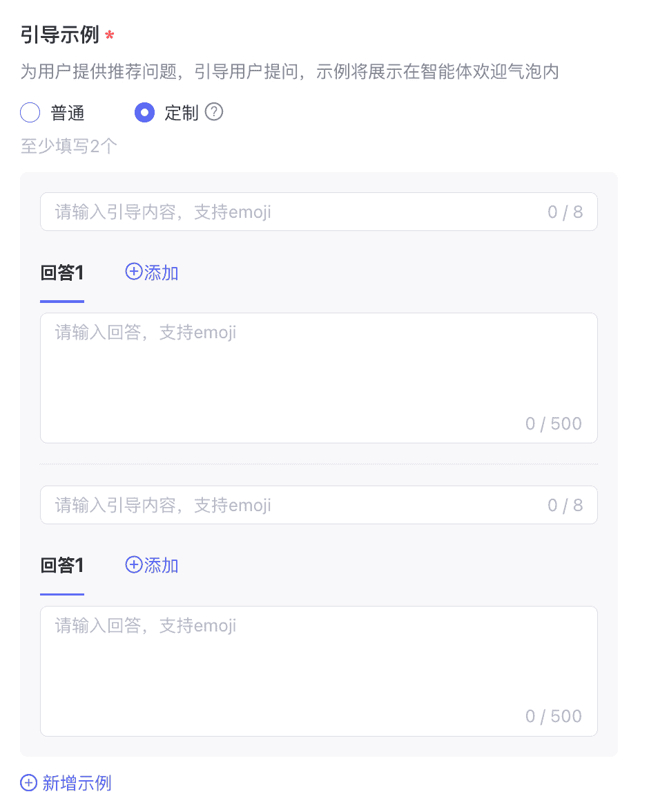

+   引导示例会展示欢迎气泡内，让用户可以点击示例快速体验智能体的能力！

+   引导示例分类：普通示例、定制示例

+   普通示例：仅需要配置问题，用户于欢迎气泡内点击该问题时，将由模型直接输出回答

+   定制示例：需定制化配置引导问题和对应答案，用户于欢迎气泡内点击该问题时，将按照预置的答案完成回答

+   示例越贴合用户真实的使用场景越好

+   ✅优秀示例：根据用户可能会使用的场景进行设置，快速抓住用户。如：“小红书文案创作”智能体引导示例：a. 口红色号安利b. 数码产品介绍c. 智能家居推荐

+   ❌反面教材：笼统、与智能体无关如：小红书文案创作输入示例：画一只猫、产出日报等

**知识库**

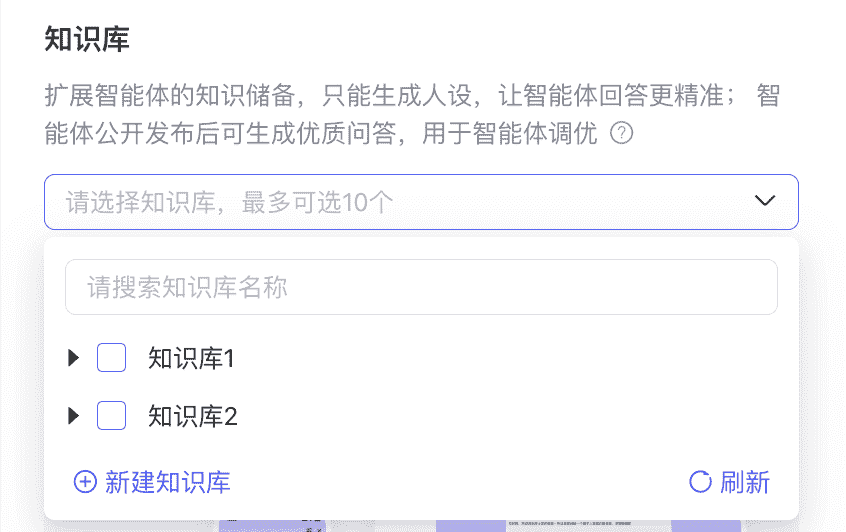

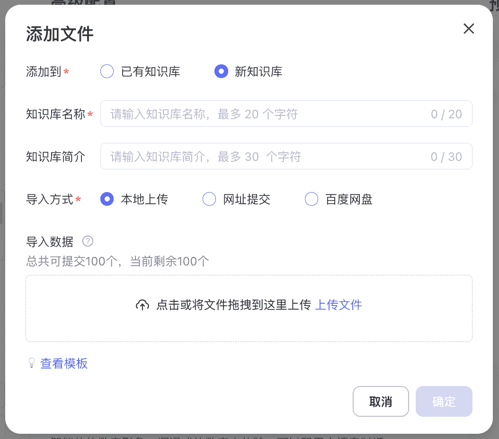

+   支持开发者上传专业领域相关数据来提升智能体回答问题的准确性

+   在第一次使用时，可以进行数据上传，最多支持同时选中 10 个知识库

+   单次最多上传 10 个文件，文本文件大小 50M 以下，图片文件大小 4M 以下，支持格[式 txt](https://agents.baidu.com/docs/dataset/dataset_docs/)、docx、csv、xlsx、pdf、png、jpg、jpeg，详见 知识库介绍

+   [如需修](https://agents.baidu.com/dataset/list)改数据集分段方式以及分段内容，可前往知识库管理更新数据

**数字形象**

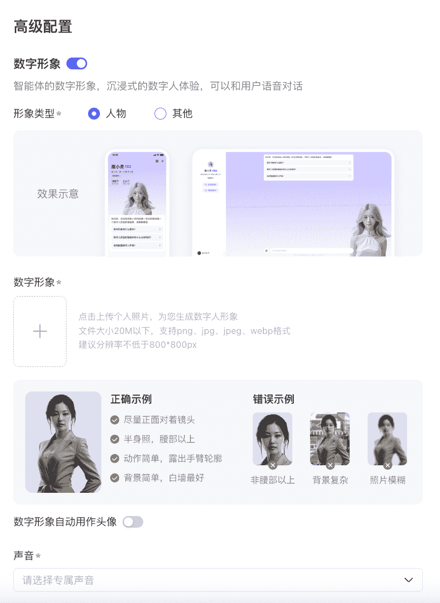

+   智能体的数字形象，可以打造有沉浸式体验的智能体，在主页拥有数字形象背景，未来也将支持用户与配置数字形象的智能体实时通话～

**插件**

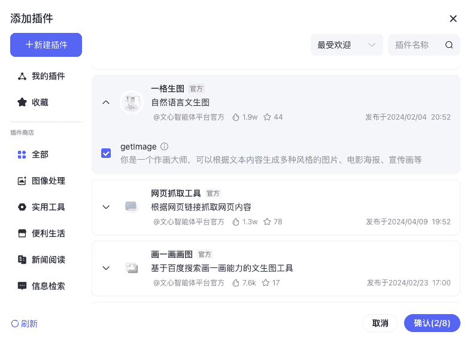

+   支持在插件选项中添加插件商店中及您创建的自定义插件，拓展智能体能力边界，最多支持勾选八个。

+   插件商店（动态更新中）

+   一格生图：勾选一格生图可以让你的智能体具备百度高品质自然语言文生图的能力，每个访问智能体的账号每天可以免费使用 20 次。

+   数据可视化：勾选数据可视化可以让你的智能体轻松具备数据分析和生成图表的能力。

+   前端代码生成：勾选前端代码生成可以让你的智能体具备自然语言直接生成网页代码的能力，同时还可以通过缩略图预览代码效果。

+   我的插件：

+   「我的插件」下将展示您的账号内已经发布上线的能力插件；

+   展开目标插件查看具体 API，勾选后点击确认即可完成插件添加。

+   点击“新建插件”，可以快速前往能力[插件创建页面，引入您需](https://agents.baidu.com/docs/develop/plugin/ability-plugin/basic/quick_pass/)要使用的 API，详见速通插件开发全流程。

💡请注意：

+   已下线的插件将不会在所有智能体中生效，若插件出现异常，请及时修复。

## 三、体验效果

在与智能体创建助手对话的过程中，或者在编辑表单时，右侧的预览容器都会根据配置的更新进行实时更新，你随时可以通过在右侧模拟用户和你创建的对话，测试效果

## 四、结语

以上步骤完成后，点击发布，就能成功创建属于你自己的智能体啦～

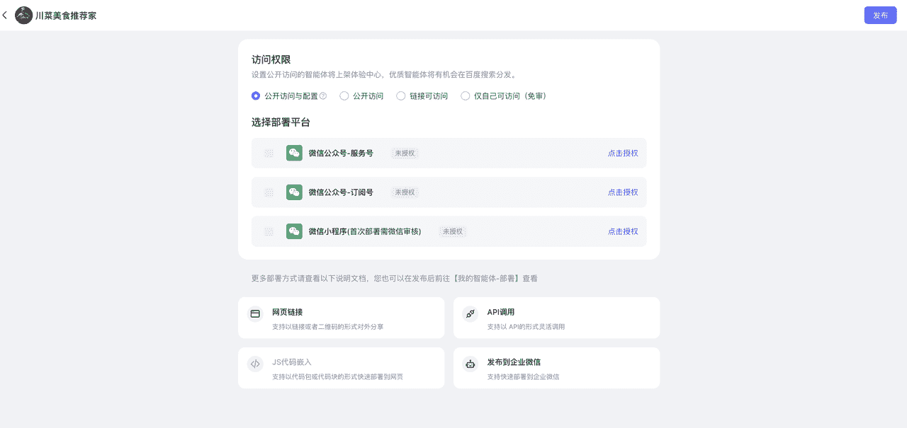

我们当前提供了三种发布方式：

+   仅自己可访问（免审）：发布后仅开发者本人账号可访问、预览、使用该智能体

+   仅链接可访问：发布后任何人均可通过链接访问、预览、使用该智能体

+   公开发布：发布后任何人可访问，优质 AI 智能体可优先展示在文心智能体平台体验中心内，高价值智能体可通过百度搜索直接展现～

提交发布后，请耐心等待审核，审核通过后，您的智能体即可被万千用户使用～

我们期待每一个智能体开发者的加入，来文心智能体平台体验中心，用 3 分钟，把你的灵感轻松变成现实～