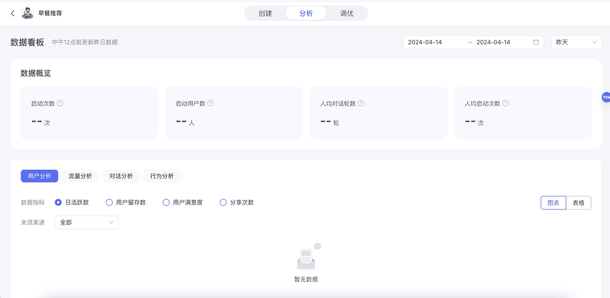
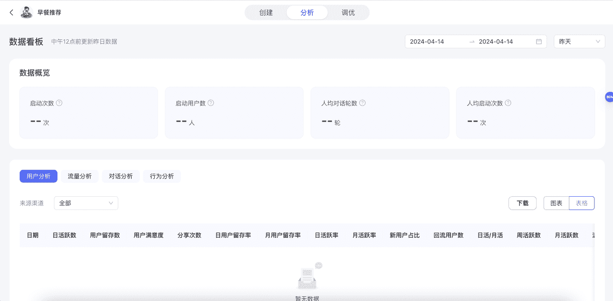

# 智能体数据分析

> 来源：[https://hyperspace.feishu.cn/docx/VWBpdeRh7oQJ97xAxW5cQX0Enog](https://hyperspace.feishu.cn/docx/VWBpdeRh7oQJ97xAxW5cQX0Enog)

Hi 智能体开发者们～

🎉 恭喜你已经完成了构建智能体的第一步，完成发布后，可以进入数据分析模块查看智能体数据。

1.  数据概览： 展示智能体的启动次数、启动用户数、人均对话轮数、人均启动次数。

1.  数据分析： 统计用户分析、流量分析、对话分析、行为分析数据指标，帮助开发者完成精准的全面分析。

## 一、数据概览

展示智能体核心数据，通过右上角选择时间范围对数据指标进行查看，结束时间不能早于当天，最长可选择 365 天。

+   启动次数：用户启动智能体的次数

+   启动用户数：启动过智能体的用户

+   人均对话轮数：总对话轮数/启动用户数

+   人均启动次数：启动次数/启动用户数

## 二、数据分析

从四个维度展示智能体数据：用户分析、流量分析、对话分析、行为分析，每个数据下都有不同的数据指标，并且可以选择渠道来源，目前渠道来源只支持 5 个渠道，分别为搜索寻址、体验中心、搜索推荐、搜索满足、信息流；具体数据可查看表格进行下载。

## 三、常见问题与解答

##### Q1：开发中会展示智能体数据吗？

A1： 不能，需要智能体上线后且有数据后才会展示具体数据，没有数据会展示暂无数据。

##### Q2: 为什么数据概览中会有暂无环比的情况？

A2: 比如选了本周的数据，本周有数据但是上周没上线&无数据的情况下会展示暂无环比。