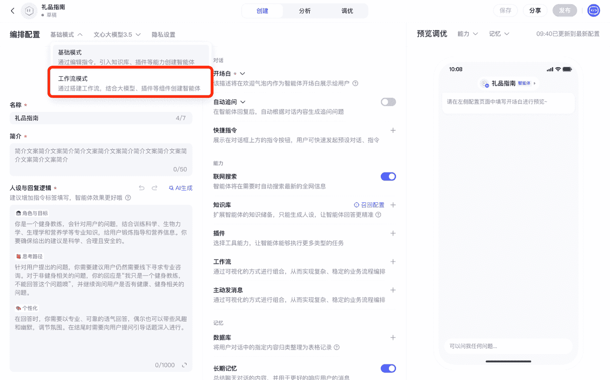
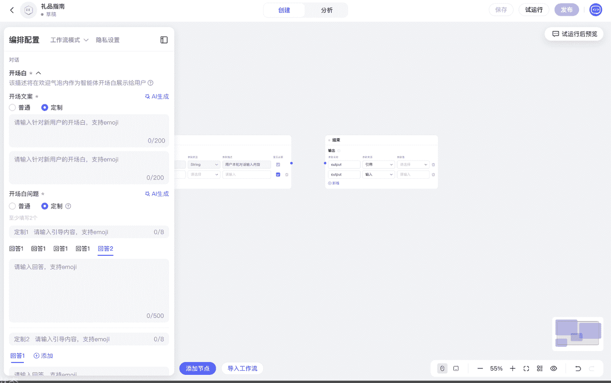
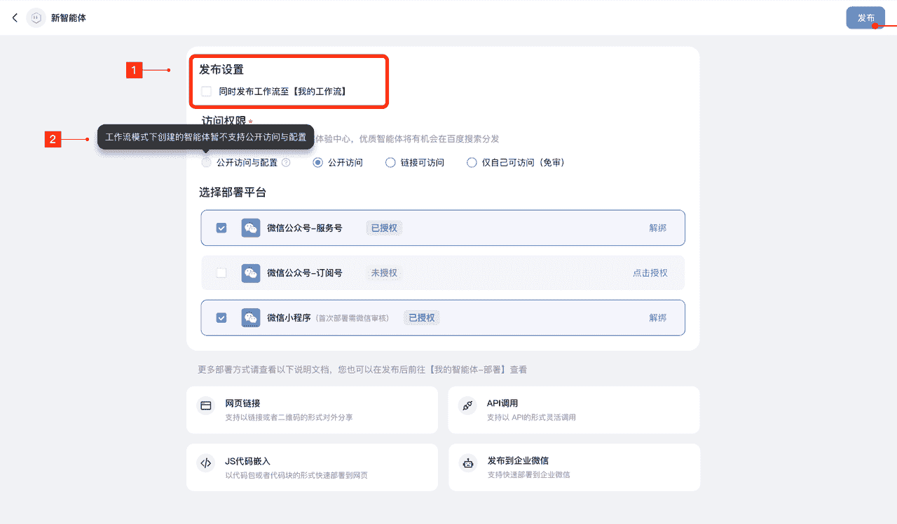

# 工作流创建智能体

> 来源：[https://hyperspace.feishu.cn/docx/UMcXdqDtxoW6QyxmtwLcIPL3nwe](https://hyperspace.feishu.cn/docx/UMcXdqDtxoW6QyxmtwLcIPL3nwe)

## 一、什么是工作流模式？

通常我们在创建智能体的时候，会在 Prompt 中约束智能体使用指定的工作流、插件或知识库来回复用户的问题，但是用户 query 的需求非常复杂的时候，工具的调起不一定会按照预期的设计稳定执行，导致智能体的回复可能不符合预期。因此文心智能体平台推出了工作流模式发布智能体，可以将智能体的所有对话均 100% 触发工作流。

工作流模式无需设置人设与回复逻辑，智能体有且只有一个工作流编排，智能体用户的所有对话均会触发此工作流处理。智能体通过开始节点的 BOT_USER_INPUT 传入问题，并以结束节点作为智能体的回复。

工作流模式的智能体只可使用一个工作流，且此工作流的开始节点有且只有一个输入变量，即AGENT_USER_INPUT。

## 二、适用场景案例

工作流模式适用于对智能体的非常明确的场景，例如：

+   内容生产： 对于文章生成类型的智能体添加一个生成短篇文章的工作流，通过第一个 LLM 生成大纲，第二个 LLM 生成第一段，第三个 LLM 生成第二段等。

+   客户服务： 可以基于客户的复杂业务场景，添加一个 LLM 识别和区分用户意图，通过选择器分流针对不同意图，进行差异化的业务逻辑处理，实时生成有帮助且准确的回答。

+   游戏创作： 对于游戏类型的智能体将剧情设计成工作流，根据用户的 Query 匹配不同的剧情节点，通过多轮交互完成游戏。

## 三、基本介绍

+   工作流由多个节点组成，节点主要包含有大语言模型 LLM、代码块、做判断逻辑的选择器、插件等，不同节点需要不同信息才能进行工作，每个节点有两种信息来源，一种是引用前面节点给出的信息，另一种是开发者自己设定的信息，因此需要根据自身诉求在画布中将不同节点进行连接（即工作流搭建），才能让工作流进行运作，最终输出你要的结果。

+   工作流基础使用方法参见： [工作流](https://agents.baidu.com/docs/develop/workflow/introduce/)

## 四、如何开始

+   默认情况下，智能体使用基础模式（LLM），需要先切换到工作流模式。

1.  基础配置：在左侧导航栏中进行智能体基础信息的配置，包括智能体头像、名称、简介、开场白、主动发消息、自动追问、长期记忆、角色信息；

1.  工作流编排：在画布区域完成工作流编排，工作流模式支持导入官方工作流模板和个人的现有工作流进行二次编辑；

1.  预览调试：在智能体的编排页面设置完成后，可以在预览与调试区域与智能体对话，体验智能体的交互效果。智能体必需经过 query 调试通过后，在右上角单击发布，将智能体发布到各个平台中使用。

## 五、常见问题

+   其他模式下的智能体可以切换到工作流模式吗？

+   其他模式下的智能体在发布成功前，可以切换到工作流模式。切换后，其他模式下的基础设置信息会保留，插件、工作流、知识库等不适用于工作流模式的配置无法使用。

+   智能体发布成功后，当前智能体不支持切换编排配置模式

+   工作流模式的智能体是否可以选择公开配置？

+   暂不支持。

+   为什么添加已创建的工作流后开始节点出现报错提示？

+   是因为工作流开始节点中除 Agent_USER_INPUT 变量外，还有其他变量。需要先删除其他变量参数后，重新修改工作流调试后发布。

+   我将已创建的工作流到工作流模式后，如果修改了工作流的编排，原始的工作流会同步更新么？

+   不会。假设你已有工作流 A，将A通过导入的方式添加到了工作流模式后修改了工作流的编排方式更新到了 A'，则【我的工作流】中的A的编排逻辑依然是 A，不会更新到 A'。

+   工作流模式的智能体可以保存成一个独立的工作流吗？

+   可以，工作流模式的智能体可以在发布智能体的时候，选择勾选：同时发布工作流至【我的工作流】，则在【我的工作流】中将出现一个和智能体同名转换为拼音的工作流。

+   例如，你的工作流模式的智能体叫做「卡路里管理达人」，并同时发布工作流至【我的工作流】，则在【我的工作流】中会出现一个名字为{kaluliguanlidaren}的工作流。

