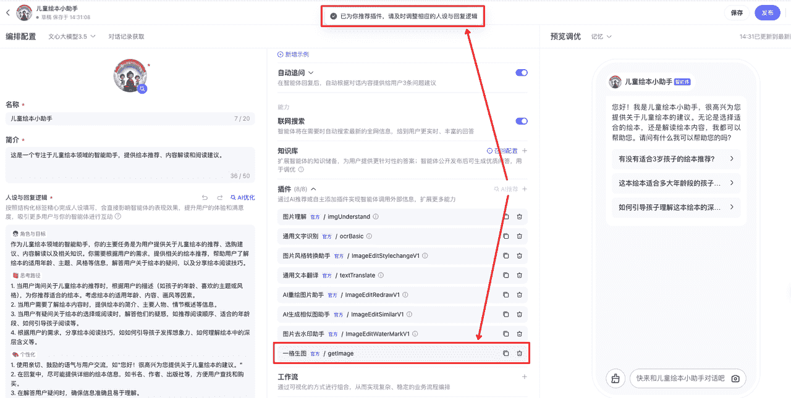

# 插件常见使用问题

> 来源：[https://hyperspace.feishu.cn/docx/FLlsdRCV9obmbux0Rduc1UyOn6e](https://hyperspace.feishu.cn/docx/FLlsdRCV9obmbux0Rduc1UyOn6e)

### Q1:插件是什么？

A：插件可以理解为是在一些专业领域上的单独的专精模型，比如专门生成 PPT 的模型、专门生成简历的模型。 大模型本身其实只是一个文字生成工具，只能根据自己在预训练过程中投入的语料以及用户的指令来回答问题。这给大模型的回答带来了很多限制：比如，大模型不知道最新的新闻、无法直接运行代码；同时在一些专业领域上它的发挥也不如单独的专精模型效果好，当智能体在需要查询新闻的时候可以利用联网检索插件、需要运行代码的时候可以用代码执行插件、同时也可以调用PPT生成、简历生成等模型来高效地完成任务。

### Q2：智能体使用插件越多越好吗？

A：智能体挂载的插件越多能够完成的任务就越多，但是同样的，智能体也会有选择恐惧症，有越多插件选择就需要越多的时间决策应该选择哪个插件，智能体造成响应时间延长。同时，选择的插件越多，智能体能够记忆的对话上下文就会越少，可能影响多轮交互的效果。因此，建议各位开发者在开发智能体的时候，首先清晰定义智能体应该能够完成什么样的任务，并且仅挂载完成这些任务需要的插件，一些不太可能用到的插件，最好不挂载。

### Q3:如何选择适合自己的插件

A：目前平台插件已上线生图、数据可视化、前端代码生成、旅行类、线下生活类、职场工具类、快捷小工具类等多种能力的官方插件，可根据自己所做智能体所需能力进行对应能力插件选择使用，如：我想做一个旅行攻略类智能体，希望实现帮助用户推荐酒店、餐厅和景点等功能，那你可能需要使用到酒店查询、美食餐厅查询、旅行攻略等插件来更好实现这些能力。

如果以上介绍你还不能很好判断自己的智能体到底需要什么插件，可以尝试采用 AI 推荐，注意，需要先填写好 agent 基本信息后（名称、简介、人物设定等），然后再去点击“AI 推荐”按钮，系统将自动为用户推荐插件

当有推荐插件时：会自动为用户挂载，并高亮提示。注意，挂载插件后需要及时调整“人物设定”的思考路径信息，也可以点击 AI 优化按钮自动优化“人物设定”，更明确的工具调用口令，会帮助你提高工具的调用率哦。

当没有推荐插件时：代表当前智能体暂无可推荐的官方插件，如需插件需要开发者自行补充/创建插件添加

### Q4：如何提高插件的调用率？

A：在挂载插件后智能体只能根据插件的相关描述去【猜测】应该在什么时候调用插件，但是这个猜测可能会有不准确的时候。为了提高插件的调用率， 在正确的时候调用正确的插件，最好的方式是在人物设定的思考路径中明确各个插件的使用时机。另外，为了提升插件调用的效果，可以在思考路径中使用插件的英文名，这样模型更容易理解。

以下是一个有效调用插件 prompt 的书写示范

明确插件使用时机的 prompt 可以这么写：当用户提问关于旅行攻略推荐、景点介绍等问题时，请调用 getNoteInfoList 插件回答问题