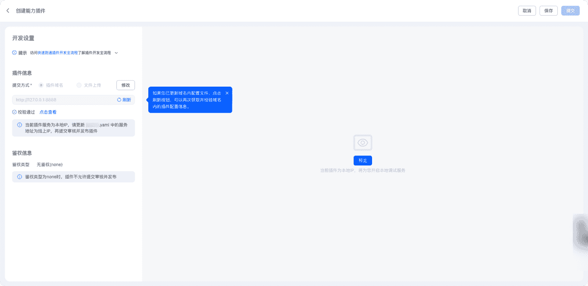
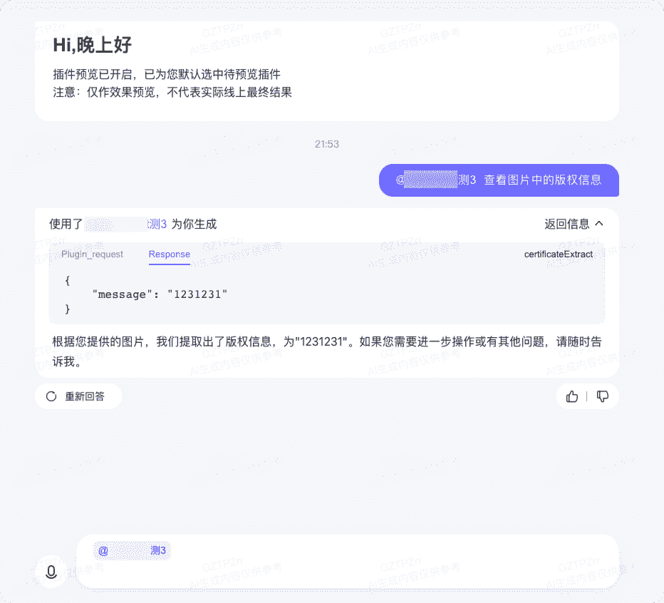

# 速通插件开发流程

> 来源：[https://hyperspace.feishu.cn/docx/GEMAdUnFroYsUTxW2KWcCgbTnzl](https://hyperspace.feishu.cn/docx/GEMAdUnFroYsUTxW2KWcCgbTnzl)

这是一份文心智能体平台插件开发和调试的速通攻略，我们将带您从零开始了解创建一个插件的全过程，确保您能够轻松、高效地开发并调试您的插件，让我们一起开启 AI 之旅吧～

首先你需要准备一个插件服务和配置文件，我们为您[准备了一](https://lingjing-online.bj.bcebos.com/lingjing-online/document/2023-12-14/plugin-demo.zip)套可供本地调试的示例 demo，点此下载。

```
plugin-demo/              # 插件 demo 注册的根目录
|—.well-known
  |— ai-plugin.json       # 插件主描述文件
  |— openapi.yaml         # 插件 API 服务的标准描述文件
|— logo.png               # 插件的图标文件
|— server.py              # 插件注册服务，可以启动到本地
|— requirements.txt       # 启动插件注册服务所依赖的库，要求 python &gt;= 3.7
|— readme.md              # 说明文件
```

1.  修改 ai-plugin.json 文件：
这份文件将包括插件的基本信息（名称、简介、头像等），其中插件名称不可以重复，因此你需要先修改 demo 文件中的名称字段，避免重名。

```
&quot;name_for_human&quot;: &quot;单词本_PluginDemo&quot;, ===&gt; 可改成&quot;单词本_zhangsan&quot;或者&quot;单词本_1024&quot;，（插件对用户展示的名称，不可与其他插件重名）
&quot;name_for_model&quot;: &quot;wordbook_demo&quot;, ===&gt; 可改成&quot;wordbook_zhangsan&quot;或者&quot;wordbook_1024&quot;（插件的唯一标识，建议是有语义信息的英文字符串，便于模型理解，创建后不允许修改）
```

1.  启动插件注册服务

```
pip install -r requirements.txt
python server.py
```

1.  上传插件配置文件

+   点击「我的插件」跳转插件页面，点击「创建插件」进入平台的能力类插件创建流程。

+   提交插件配置文件，默认插件注册文件在 http://localhost:8081/.well-known/ai-plugin.json, 只需要填入 http://localhost:8081 即可；填入后点击校验；



+

+

+   看到如上提示即为校验通过，此时您可以点击预览体验插件效果；如果下方出现错误提示，您只需根据提示信息在本地修改配置文件后，点击“刷新”按钮重新校验。



+   示例输入：“将 wonderland 添加到单词本”；当结果中有“使用 XX 插件为您生成”字样时，代表本轮对话成功调起了插件；

+   点击返回信息，即可展开插件请求和返回的详细日志；您可以不断调试并预览插件效果。

+   点击保存，即可完成插件创建，如果您已对插件调试效果满意，将 openapi.yaml 中的 server_url 替换为线上服务地址后，即可提交发布您的插件。

**接下来**

您已经快速体验插件开发流程，接下来您可能需要了解：

+   [如何从0到1开发插件](https://agents.baidu.com/docs/develop/ability-plugin/basic/develop_from_scratch/)

+   [如何在平台创建并发布插件](https://agents.baidu.com/docs/develop/ability-plugin/basic/create_to_publish/)