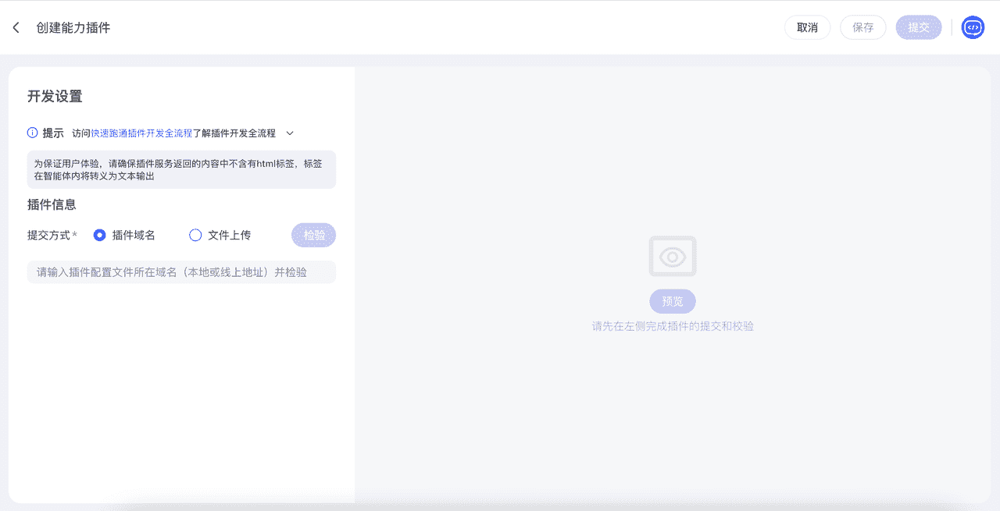
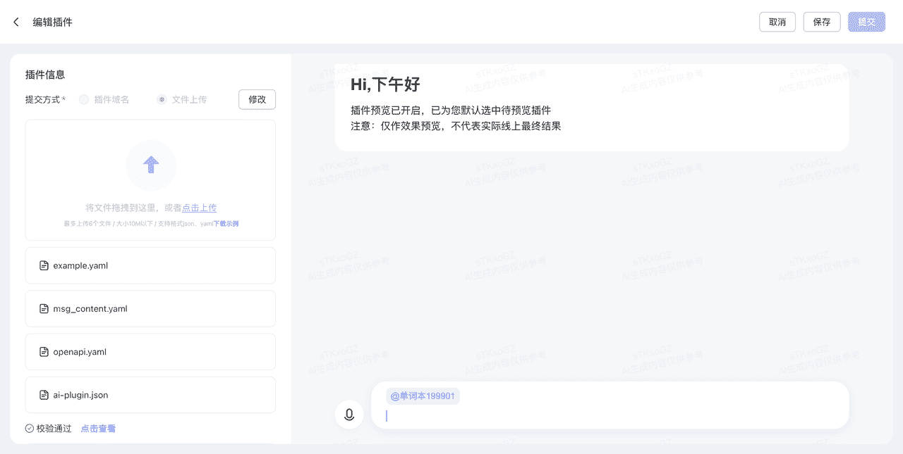
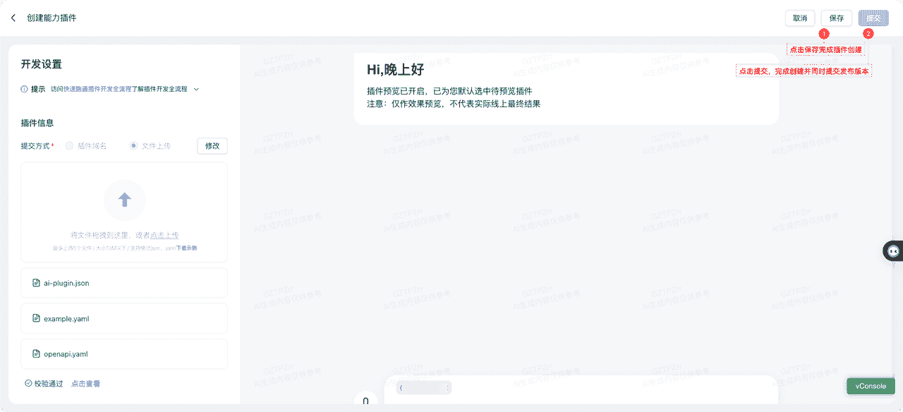
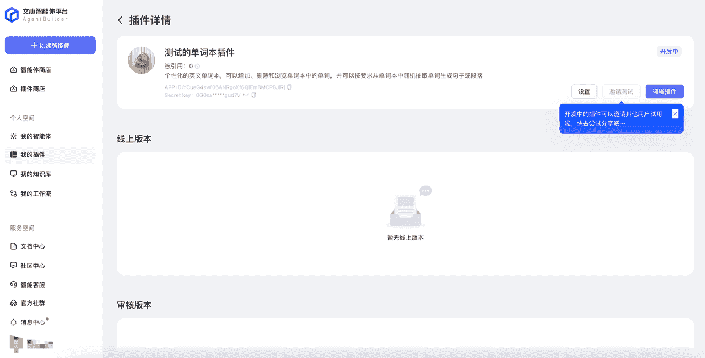
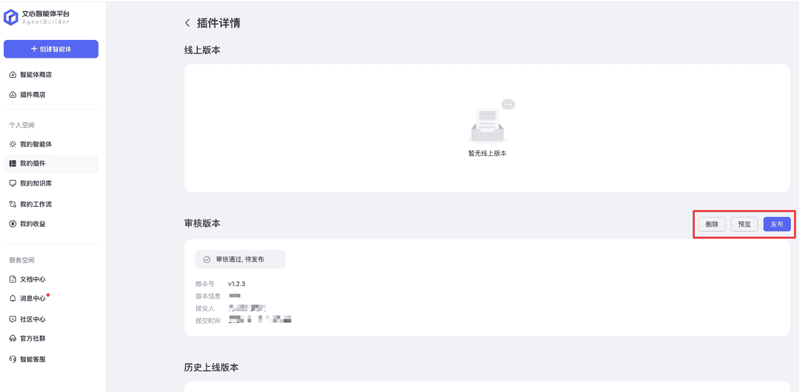
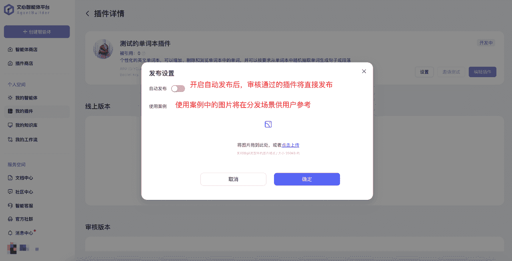

# 如何在平台创建并发布插件

> 来源：[https://hyperspace.feishu.cn/docx/OmLFdvd1eoQmsnxdbtncoROhnRh](https://hyperspace.feishu.cn/docx/OmLFdvd1eoQmsnxdbtncoROhnRh)

完成插件服务开发和配置文件撰写后，您可以在文心智能体平台进行创建和发布：

1.  创建插件：提交您的插件信息，预览插件效果并逐步完善功能；

1.  发布：提交您的插件版本，在通过平台审核后，手动/自动完成插件发布；

1.  更新：您可以不断更新插件版本并发布。

下文将详细介绍平台进行创建、发布、更新的操作流程。

## 一、创建插件

登录后点击「我的插件」跳转插件页面，点击「创建插件」进入平台的能力类插件创建流程。

### 提交插件配置文件

平台支持两种提交方式——域名提交和文件上传：

+   域名提交：填写插件文件所在的域名；支持线上域名地址或 IP:port，暂不支持本地地址；

+   文件上传：直接上传插件配置文件（e.g. ai-plugin.json），支持批量上传。

### 文件校验与效果预览

+   填写域名/完成必选文件上传后，点击检验，平台将识别文件内容并进行文件校验；其中，配置文件必须包含 ai-plugin.json 和 openapi.yaml；

+   校验完成后，可在下方查看结果；点击查看按钮，即可查看已上传的配置文件详情和报错信息；

+   如果清单文件中鉴权类型（auth）为 service_http，您还需填写鉴权信息中的 Token 值；

+   完成校验和鉴权信息填写后，即可点击右侧预览按钮，预览插件效果；您可以基于预览效果不断更新插件文件内容。预览功能仅作效果预览，不代表实际线上最终结果。

### 插件创建与提交

+   点击保存按钮，即可在平台创建插件；此时的插件将维持在开发态，仍可以继续进行编辑修改操作。

+   点击提交按钮，可以直接完成创建并提交发布版本，完成版本信息填写后，插件将进入审核流程。

## 二、插件发布

### 提交发布版本有如下两种方式

+   在创建插件页面内点击提交按钮，直接提交发布版本；

+   进入插件详情页面 - 点击编辑插件 - 点击提交并填写发布版本信息。

### 提交发布后，插件将进入平台审核流程，可在下方示例图中查看审核进度；

### 审核通过后，插件可手动/自动完成发布

+   手动发布：进入插件详情页面-审核版本区域，手动点击发布按钮。

+   自动发布：若在插件详情 - 设置中打开自动发布功能，插件通过审核后将自动完成发布操作；

## 三、更新插件

如您需对插件进行更新操作，可在插件概览 - 编辑插件中提交新版本；通过审核后，在版本管理 - 审核版本中发布或开启自动发布，即可完成线上版本更新。

注意：插件的基础信息（头像、名称等）均包含在插件配置文件中，可通过修改 ai-plugin.json 中的对应字段更新基础信息。

## 四、接下来

至此，您已完成平台的插件创建、发布、更新操作，您可能需要继续了解：

+   [API接口开发注意事项](https://agents.baidu.com/docs/develop/ability-plugin/advanced/api_notes/)

+   [如何使用插件鉴权功能](https://agents.baidu.com/docs/develop/ability-plugin/advanced/auth/)