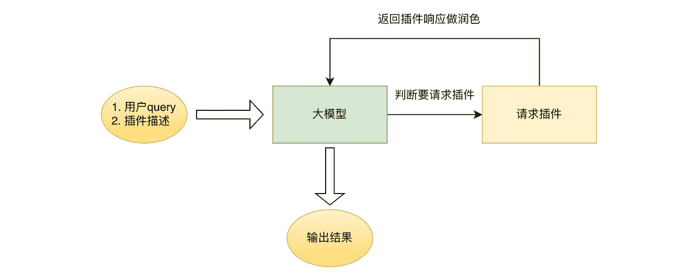
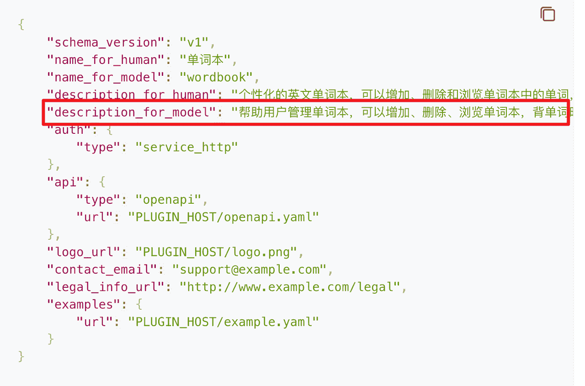
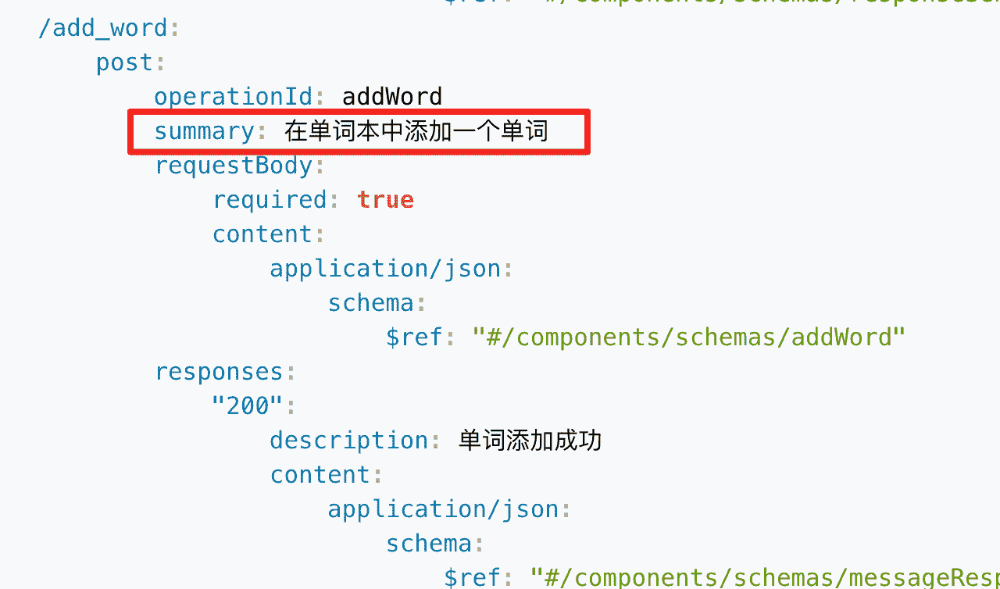

# 1-100 使用插件

> 来源：[https://hyperspace.feishu.cn/docx/Qz0qd8m7Do9RiyxOQcWcfI8an2f](https://hyperspace.feishu.cn/docx/Qz0qd8m7Do9RiyxOQcWcfI8an2f)

## 一、插件在 agent 中是如何被调用的？

**调用过程**



+   用户在输入 query 后，agent 会把用户的 query 和插件的请求/响应信息传递给模型，模型根据用户的意图和插件的描述，决定要不要调用插件

+   如果要调用插件，模型会返回插件的请求参数

+   agent 拿到插件的请求参数后，会根据 openapi.yaml 中的 API 定义，组装插件的请求参数，发送插件请求

+   agent 获取插件响应后，将插件响应结果传递给模型，模型做最后的润色输出

划重点：

+   插件的描述表示插件的功能，是模型决定是否调用插件的关键信息

+   接口的请求参数的描述决定了模型的填充参数质量

+   接口响应参数的描述可以帮助模型理解插件响应数据，影响模型的润色效果

## 二、插件配置中哪些字段会影响工具召回？

+   插件描述字段要求：

+   我们不需要将执行过程告诉模型，我们仅需要将功能描述清楚即可：

+   错误情况❌：从用户的 query 中提取英文单词，保存到 mysql 存储里。

+   正确情况✅：添加单词到单词本。 或者更详细的，可以将能力边界说明。如：添加单词到单词本，包括但不限于英语单词、日语单词、法语单词等，但不要直接添加汉语单词。

+   插件描述字段：

+   ai-plugin.json 中的 description_for_model 字段



+   openapi.yaml 中的接口描述字段



## 三、配置插件 API 需要注意的点

**http 支持的范围**

agent 支持多种常见的 http 方法的解析，按支持的解析请求参数插件分为两大类：

划重点：

+   parameters 中的字段仅支持 body、path、query 三个位置填充

+   body 中仅支持一级字段填充，即接口的请求参数不要有层级嵌套

## 四、agent 如何解析插件的响应？

**插件响应结构**

+   结构：json 数据

+   支持 sse 协议数据包

划重点：

+   SSE 数据包一定要符合标准的 sse 协议规范，否则会导致[解析](https://agents.baidu.com/docs/develop/plugin/ability-plugin/advanced/plugin_usage/#%E9%99%84%E5%BD%95)不到插件响应数据(SSE 规范详见：附录)

**注意事项**

预留字段

示例：

```
// json数据包
{
    &quot;message&quot;: &quot;xxxx&quot;,
    &quot;errCode&quot;: &quot;testCode&quot;
}

// SSE数据包
// 只要有任何一包的errCode不是0， 就会认为插件调用失败
event: message
data: {&quot;content&quot;: &quot;你好&quot;, &quot;errCode&quot;： &quot;processiong&quot;}
```

关于 SSE 数据还需要注意的细节

+   仅支持 event: message 的数据包解析， 如：

```
event: message
data: {&quot;content&quot;: &quot;你好&quot;}

event: test
data: {&quot;content&quot;: &quot;test&quot;}

event: message   
data: {&quot;content&quot;: &quot;你好 我是&quot;}

event: message   
data: {&quot;content&quot;: &quot;你好 我是文心智能体&quot;}
```

第二包 test 包将会被忽略，如果所有的 event 都不是 message 类型，那么 agent 会获取不到插件的响应内容

+   agent 只会取最后一包的内容给模型，即 agent 只会把{"content": "你好 我是文心智能体"}传递给模型，所以需要把插件的全部信息放到最后一包中

## 五、如何控制传给模型/用户的内容？(x-return-raw用法)

> agent 支持把插件的响应直接传递给用户/前端展示，如果插件返回的内容太多，也可以把插件的部分必要的数据传递给模型。

x-return-raw 字段规范

+   字段配置规范

+   字段说明

+   outputFieldPath 为给前端返回的内容字段，不关联 ui.json 时不支持流式返回、关联 ui.json 时，支持流式数据返回给前端

+   promptFieldPath 为给模型字段，进去最后一包的内容传递给模型

+   配置示例

```
/get_image:                               # 接口的path
    post:                                 # 接口的http method
        operationId: getImage             # 接口的唯一标识
        summary: 根据用户query画图          # 接口的描述 将和ai-plugin.json中的name_for_model字段一起作为该接口的描述传递给大模型
        requestBody:                      # post请求的参数
            required: true                # 是否必填
            content:                      
                application/json:         # 请求的Content-Type
                    schema:               # 请求参数定义
                        $ref: &quot;#/components/schemas/getImage&quot;
        responses:                        # 接口的响应结构有助于模型理解插件的结果
            &quot;200&quot;:                        
                description: 画图成功  
                content:
                    application/json:     # 接口响应的Content-Type 注意插件服务响应的Content-Type 要保持一致 范泽会认为插件调用失败
                        schema:
                            $ref: &quot;#/components/schemas/getImageResponse&quot;
        x-return-raw:
            description: 标记当前接口的返回结构，哪些字段是直接展示给用户，哪些字段传递给大模型 
            mediaType: application/json
            promptFieldPath: /data/prompt
            outputFieldPath: /data/content
```

## 六、如何设置给插件传递用户 query 信息？(x-raw-input 用法)

> 插件支持透传用户的原始输入

x-raw-input 字段规范

+   填充规范

x-raw-input 设置为 api 粒度，内容为多模态 input，仅支持 post 请求，通过 body 下发

+   字段

+   query 字段结构

```
{
    &quot;user_input&quot;: {
        &quot;message&quot;: [
            {
                &quot;data&quot;: {
                    &quot;text&quot;: {
                        &quot;query&quot;: &quot;推荐几家杭州性价比高的酒店&quot;
                    }
                },
                &quot;type&quot;: &quot;TEXT&quot;
            }
        ]
    }
}
    
字段说明：
type：query的类型；
    枚举：TEXT：文本，IMAGE：图片，FILE：文档
data：数据内容，根据不同的类型返回不同的内容结构
    text：文本结构
        query：用户query
    image：图片结构
        image_url：图片地址
        image_name：图片名称
        image_type：图片类型
        image_size：图片大小（字节）
    file：文件结构
        file_id：文档ID，不同业务方在实现时可能存在差异，id 不作为资源定位使用，大多情况时缺省
        file_url：文档url
        file_name：文档名称
        file_type：文档类型
        file_size：文档大小（字节）
```

+   x-raw-input 字段配置示例

```
/image_descrption:                        # 接口的path
    post:                                 # 接口的http method
        operationId: imageDescription     # 接口的唯一标识
        summary: 获取图片描述               # 接口的描述 将和ai-plugin.json中的name_for_model字段一起作为该接口的描述传递给大模型
        requestBody:                      # post请求的参数
            required: true                # 是否必填
            content:                      
                application/json:         # 请求的Content-Type
                    schema:               # 请求参数定义
                        $ref: &quot;#/components/schemas/image_description&quot;
        responses:                        # 接口的响应结构有助于模型理解插件的结果
            &quot;200&quot;:                        
                description: 成功信息   
                content:
                    application/json:     # 接口响应的Content-Type 注意插件服务响应的Content-Type 要保持一致 否则会认为插件调用失败
                        schema:
                            $ref: &quot;#/components/schemas/imageDescriptionResponse&quot;
        x-raw-input: 
            description: 用户本轮下发的query，不经过任何大模型处理，支持多模态，必须是post请求，仅通过body下发，优先级最高，会覆盖模型填参。
            name: user_input
```

## 七、附录

**SSE 协议规范**

> SSE(Server-Sent Events) 是一种服务端向客户端(浏览器)主动推送消息流的单工通信协议。agent 中支持插件的 SSE 流式数据包的解析。

**Header 参数**

**数据包格式**

一包的数据格式

```
event: message   
data: {&quot;content&quot;: &quot;你好&quot;}
```

event: message

+   表示是数据包的时间类型 以 event 加英文冒号 : 开头， event和 :之间没有空格

+   event: 后面接着是事件的名称 message, event: 和 message 中间一般有一个空格

data: {"name": "wenxin"}

+   表示真正的数据包内容, 以 data: 开头，data 和 :之间没有空格

+   data: 后面接真正的数据内容，中间使用一个空格隔开，数据包是一个 json 字符串

**多包的数据包示例**

```
event: message   
data: {&quot;content&quot;: &quot;你好&quot;}

event: message   
data: {&quot;content&quot;: &quot;你好 我是&quot;}

event: message   
data: {&quot;content&quot;: &quot;你好 我是文心智能体&quot;}
```

注： 多包之间有两个换行符相隔。