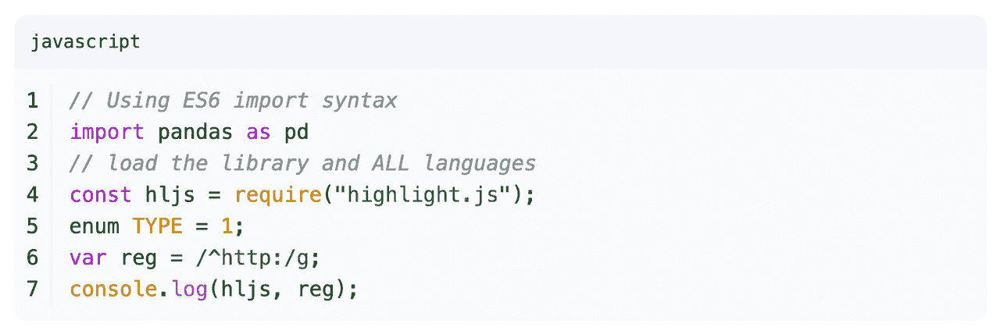
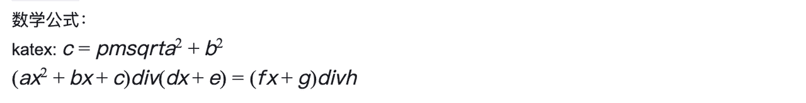
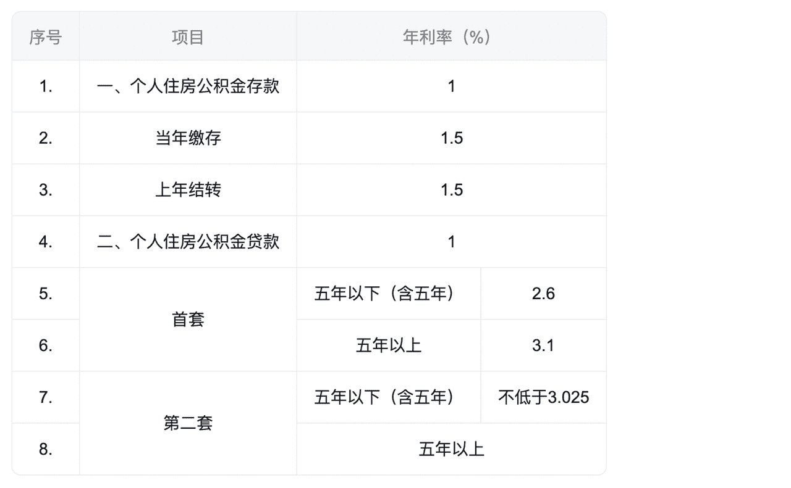

# Markdown 配置说明

> 来源：[https://hyperspace.feishu.cn/docx/I1XUdYjFoo39B4xRxlmcjjpSnvf](https://hyperspace.feishu.cn/docx/I1XUdYjFoo39B4xRxlmcjjpSnvf)

创建插件时若希望数据按照特定 UI 样式输出，除了选择平台提供的官方模板进行可视化配置之外，还支持通过 markdown 语法约束样式，上手门槛低，无需编写代码。

按照以下的 Markdown 基础及扩展语法约束数据规范，即可在插件输出时解析展示出对应的UI效果。

## 一、Markdown 配置说明

在插件配置文件 openapi.yaml 里定义如下 x-return-raw 字段：

```
x-return-raw:
    description: 标记当前接口的返回结构，哪些字段是直接展示给用户，哪些字段传递给大模型
    mediaType: application/json
    outputFieldPath: /data
    type: string
```

具体规范字段位置： 整体放置于接口定义下的 method 节点下，与 operationId、requestBody 等字段并列。

规范字段含义说明：

+   x-return-raw 为配置当前 API 不经过 EB 大模型的配置根节点，名字固定。节点包括 3 个成员，分别如下：

+   description: 非空的字符串 - 不可缺少，内容不空，填写本规范的相关描述信息。其中“标记当前接口的返回结构，哪些字段是直接展示给用户，哪些字段传递给大模型” 为示范

+   mediaType: application/json - 固定写法，其含义是目前的规范仅仅在 metaType 所设定的 API 接口上生效，不支持其他值

+   outputFieldPath：给前端返回的 markdown 格式的内容字段

+   type: 其含义是 x-return-raw 所获取的字段类型，如使用 markdown 格式返回内容，则填写 string

+   配置示例

```
paths:
    /get_image:                               # 接口的path
        post:                                 # 接口的http method
            operationId: getImage             # 接口的唯一标识
            summary: 根据用户query画图          # 接口的描述 将和 ai-plugin.json 中的 name_for_model 字段一起作为该接口的描述传递给大模型
            requestBody:                      # post请求的参数
                required: true                # 是否必填
                content:                      
                    application/json:         # 请求的Content-Type
                        schema:               # 请求参数定义
                            $ref: &quot;#/components/schemas/getImage&quot;
            responses:                        # 接口的响应结构有助于模型理解插件的结果
                &quot;200&quot;:                        
                    description: 画图成功  
                    content:
                        application/json:     # 接口响应的Content-Type，注意插件服务响应的 Content-Type 要保持一致，否则会认为插件调用失败
                            schema:
                                $ref: &quot;#/components/schemas/getImageResponse&quot;
            x-return-raw:
                description: 标记当前接口的返回结构，哪些字段是直接展示给用户，哪些字段传递给大模型 
                mediaType: application/json
                outputFieldPath: /data
                type: string

components:
    schemas:
        getImage:
            type: object
            required: [query]
            properties:
                query:
                    type: string
                    description: 需要生成图片的prompt
        getImageResponse:
            type: object
            description: 插件返回结果
            properties:
                data:
                    type: string
                    description: 生成的图片信息
```

+   开发者服务接口返回示例

```
{
    &quot;data&quot;: &quot;已为您生成如下图片：&quot;
}
```

## 二、Markdown 语法说明

### 1. 基础语法

[基础语法规范](https://github.github.com/gfm/)（包含段落，标题，列表，分割线，引用，代码块，表格等）。

#### 1.1. 语法及效果示例

##### 1.1.1. 基础文本

```
// 标题：文本前面添加 #，且 # 的数量代表了标题的级别。例如 # xx 表示创建一个一级标题
# 一级标题
// 强调： **文本**
// 代码：`代码`
段落文本**强调文本**段落文本段落文 `code` 本段落文本段落文本段落文本段落文本段落文本段落文本段落文本段落文本段落文本段落文本段落文本段落文本。
// 分割线：---
下面是个分割线。\n\n---\n段落文本段落文本段落文本段落文本段落文本段落文本段落文本段落文本段落文本段落文本段落文本段落文本段落文本段落文本段落文本段落文本段落文本
// 引用：
下面是一个引用\n\n &gt; 引用内容
```


##### 1.1.2. 结构化列表

```
// 列表：
**无序列表**\n- 一级列表\n    - 二级列表\n    - 二级列表\n\n- 一级列表\n- 一级列表
**有序列表**\n1. 一级列表\n    1. 二级列表\n    2. 二级列表\n\n2. 一级列表\n3. 一级列表
// 表格
| 表头 | 表头 | 表头 |\n| :--: | :--: | :--: |\n| 表内容 | 表内容 | 表内容 |\n| 表内容 | 表内容 | 表内容 |
```


##### 1.1.3. 代码块

```
// 代码块
```javascript\n// Using ES6 import syntax\nimport pandas as pd\n// load the library and ALL languages\nconst hljs = require(&quot;highlight.js&quot;);\nenum TYPE = 1;\nvar reg = /^http:/g;\nconsole.log(hljs, reg);\n```\n\n
```



#### 1.2. Tips

+   html 标签只支持 <br> ;

### 2. 扩展语法

#### 2.1. 语法及效果示例

##### 2.1.1. 高亮

[highlight ](https://github.com/ipikuka/remark-flexible-markers)高亮

如：==核心答案==

```
## ==**短答案**==

==**核心答案**==
```


##### 2.1.2. 数学公式

[数学公式](https://katex.org/docs/supported)

需要用 $ 或 $$ 符号包裹，如：$c = pmsqrt{a^2 + b^2}$

```
数学公式：\nkatex: $c = \pm\sqrt{a^2 + b^2}$\n$$(ax^2 + bx + c) div (dx + e) = (fx + g) div h$$
```



##### 2.1.3. 表格合并单元格

[表格合并单元格拓展](https://github.com/wataru-chocola/remark-extended-table)

```
|序号|项目|&gt;|年利率（%）|\n| :---: | :---: | :---: | :---: |\n|1.|一、个人住房公积金存款|&gt;|1|\n|2.|当年缴存|&gt;|1.5|\n|3.|上年结转|&gt;|1.5|\n|4.|二、个人住房公积金贷款|&gt;|1|\n|5.|首套|五年以下（含五年）|2.6|\n|6.|^|五年以上|3.1|\n|7.|第二套|五年以下（含五年）|不低于3.025|\n|8.|^|&gt;|五年以上|
```



##### 2.1.4. 标准语法基础上拓展属性

标准语法基础上拓展属性：语法{key="value" key2="value2" ..}

+   如：链接拓展 [带笔记icon的链接](http://www.baidu.com){type="note"}

+   如：图片拓展 ![] (https://gips1.baidu.com/it/u=1726338917,3904303031&fm=3028&app=3028&f=PNG&fmt=auto&q=75&size=f54_54){width=26 height=26}

```
**链接**\n[链接](http://www.baidu.com)[带文本icon的链接](http://www.baidu.com){type=&quot;text&quot;} [带视频icon的链接](http://www.baidu.com){type=&quot;video&quot;} [带笔记icon的链接](http://www.baidu.com){type=&quot;note&quot;}

**图片**\n{width=26 height=26}
```


##### 2.1.5. 自定义指令规范

已有指令如下：

```
**溯源**\n根据能获取到的最新数据显示，第二季度的GDP累积为xxx万亿元。:ml-citation[1] \n:ml-citation[1][数据](https://baidu.com)

::ml-audio{title=&quot;测试文本测试测试&quot; src=&quot;https://sensearch.baidu.com/gettts?lan=en&amp;text=Rotation%20of%20one%20person%20in%20front%20and%20one%20person%20in%20back&amp;source=alading&quot;}

::ml-video{poster=&quot;https://t15.baidu.com/it/u=3316478311,1741256587&amp;fm=220&amp;app=103&amp;size=w931&amp;q=75&amp;n=0&amp;g=12n&amp;f=JPEG&amp;fmt=auto&amp;maxorilen2heic=2000000&quot; src=&quot;https://psstatic.cdn.bcebos.com/video/video/mda-nbmw6cyaiu299cdc_1656429723000.mp4&quot;}
```

