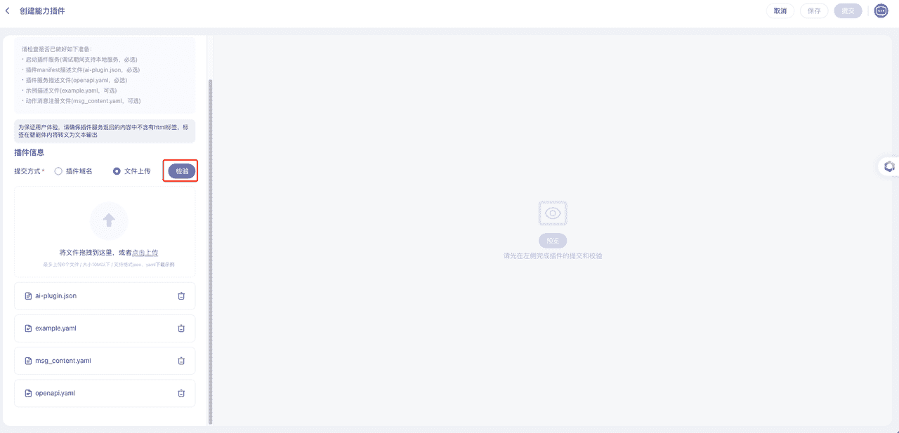
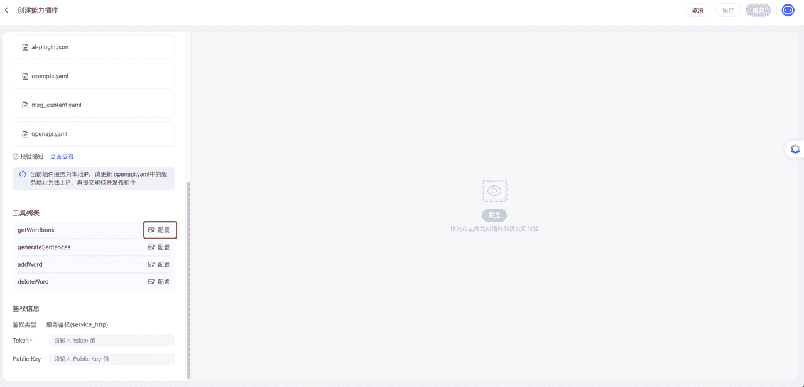
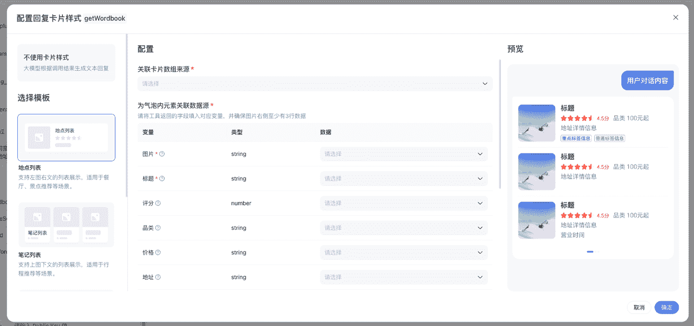

# 如何快速配置插件回复气泡样式

> 来源：[https://hyperspace.feishu.cn/docx/BTT3dl2glovhFrxZFX8c9TALnMb](https://hyperspace.feishu.cn/docx/BTT3dl2glovhFrxZFX8c9TALnMb)

平台支持快速选用插件回复卡片样式，丰富你的插件回答。

提交插件配置文件时，可以通过两种方式设置插件回复卡片的样式：

1.  直接选用平台提供的官方卡片模板，本文将详细说明使用方法。

1.  按[照 Markdown ](https://agents.baidu.com/docs/develop/plugin/ability-plugin/advanced/markdownConfig/)基础语法及扩展语法约束数据规范，即可在插件输出时展示出对应的 UI 效果。详情见：Markdown 配置

## 一、为插件配置气泡样式

1.  提交插件配置文件，完成校验

1.  点击 “配置样式”，在配置插件气泡样式弹窗中，选择平台提供的官方模板，后续平台将不断扩充模板样式。

1.  完成配置后，插件下对应的工具将优先以配置的样式回答；

## 二、官方模板可视化配置说明

第一步：选择合适模板，在预览区可查看模板样式示例（当前提供了3种模板，更多模板逐步上线中！）

第二步：给卡片绑定数据，绑定插件对应数据后即可按照卡片样式回复！

1.  关联卡片数组来源：如果选择模板是多条数据，则需要关联数组来源。地点列表、笔记列表均支持基于返回数据数量，展示单条/多条内容。

1.  为卡片元素关联数据源：为卡片中各类展示元素，关联插件数据，例如为「标题」元素关联插件中返回的 title 字段；

1.  为气泡配置跳转链接：

+   通用链接：点击后跳转到指定页面；

+   PC 端链接：配置后，在 PC 端打开时优先跳转当前链接；

+   小程序：配置后，在支持百度智能小程序打开的场景下，优先跳转小程序；

+   appKey：小程序唯一标识，可通过【小程序开发者平台-开发管理-开发设置】查询；

+   path：小程序打开的页面路径。页面路径可以在小程序代码 app.json 文件的 pages 属性中取到，常见形式为 "pages/index/index" ；

+   query：小程序页面路径参数；

第三步：在预览区对话预览调试卡片效果~

## 三、常见Q&A

Q1：若插件在创建页绑定了卡片样式，如果在智能体创建时选择了该插件，样式是否仍生效？

A：在插件创建页绑定的卡片样式为该插件的默认样式；在智能体创建页使用插件时，即可按照默认样式生效；同时也支持在智能体创建页，根据场景需求更换其他样式/或者不使用卡片样式（官方插件除外），更换后不影响其他插件的样式，仅在智能体粒度生效；

Q2：如果在插件创建页更新了样式，会影响到绑定该插件的智能体吗？

A：在插件创建页更新样式后，若有所绑定的智能体，会同步更新；