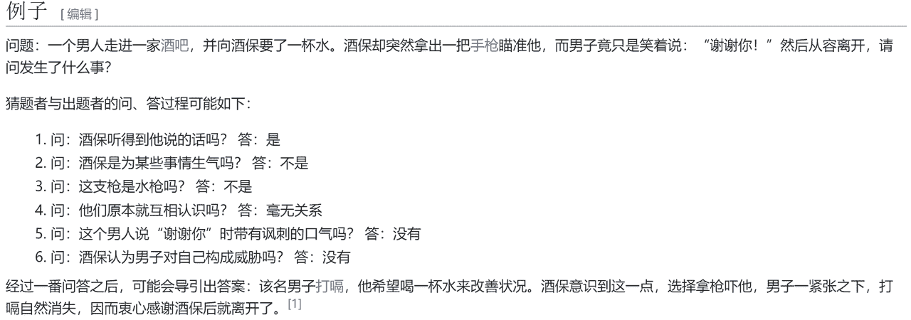
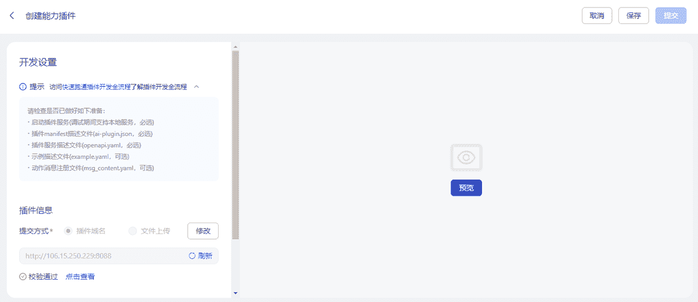
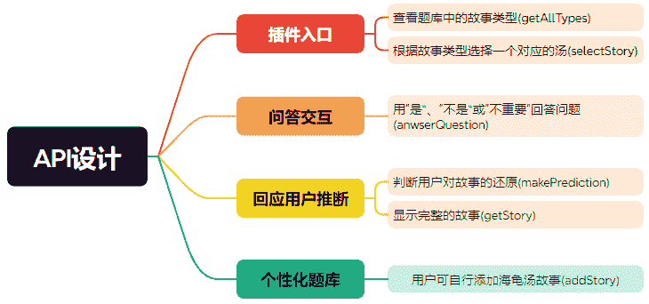
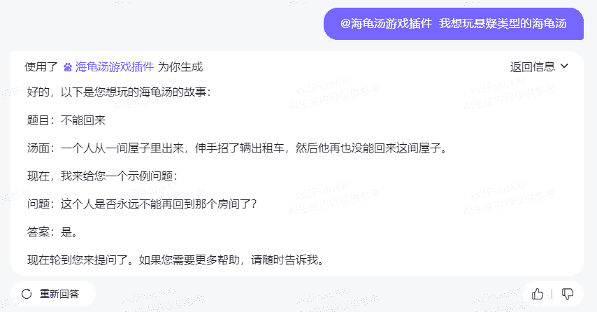
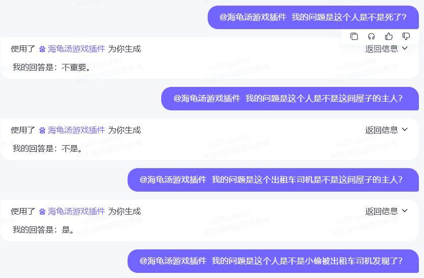
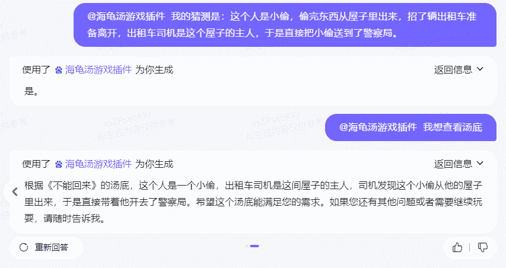
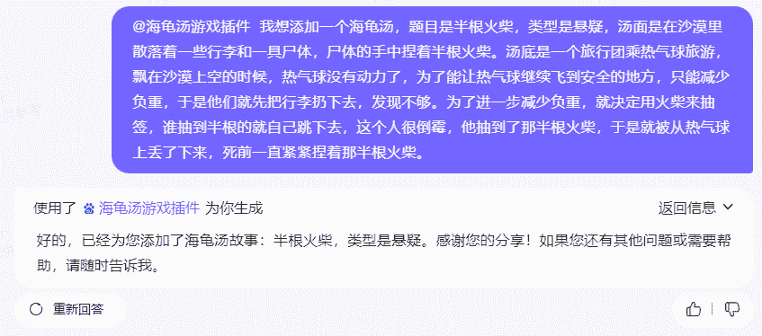

# “海龟汤”插件

> 来源：[https://hyperspace.feishu.cn/docx/RK24dTkOloGHkDxnvU6cSsalnBb](https://hyperspace.feishu.cn/docx/RK24dTkOloGHkDxnvU6cSsalnBb)

## 一、项目背景

随着人们娱乐需求的不断发展，桌游提供了一种人人交互式游戏环境，让玩家在体验丰富娱乐内容的同时，能够与朋友或陌生人进行互动和交流。

“海龟汤”作为一种聚会类桌游，又称情境推理游戏，是一种猜测情境还原事件真相的智力游戏。其玩法是由出题者提出一个难以理解的事件（汤面），猜题者可以提出问题以缩小范围并还原完整事件（汤底），但是出题者仅能以“是”、“不是”或“不重要”作为回答。一个示例如下图所示：



在传统的交互环境中，需要选择一个人作为出题者查看汤底来回答问题，这不仅影响了出题者的游戏体验，也限制了单人游玩的可能。

本文通过文心智能体平台，为文心一言大语言模型开发了一款“海龟汤”能力类插件，利用文心一言自然语言理解能力，可以使其作为 AI 出题者，帮助用户游玩“海龟汤”。

## 二、平台简介

文心智能体平台是基于文心一言的 AI 插件开发平台，支持开发者根据自选取不同插件类型、不同开发方式进行接入，为 C 端用户提供更加优质的服务。

为了方便开发者配置，文心智能体平台提供了统一标准的接口配置文件，其中必须配置插件清单文件 (ai-plugin.json) 和满足 OpenAPI 规范的 API 描述文件（openapi.yaml）。

OpenAPI 规范（OAS）定义了一个与语言无关的标准 HTTP API 接口，允许人类和计算机发现和理解服务的功能，而无需访问源代码、文档或通过网络流量检查。如果实现正确，API 使用者只需要最少量的实现逻辑来理解 API 服务并与之交互。

文心智能体平台支持插件域名和文件上传的方式对核心文件进行校验，检验成功即可进行预览以及后续提交审核。



## 三、开发流程

文心智能体平台极大地方便了开发者的开发流程，核心步骤在于插件的 API 设计、核心文件的配置以及根据 API 定义开发服务器端的 plugin-server。本文将在后续的内容中一一介绍。

**API 功能设计**



首先是插件 API 的设计，海龟汤游戏过程的主要逻辑包含三个部分：选择故事开始游玩，人机交互式问答和判断用户对故事的还原。

服务器上已存有部分“海龟汤”故事，每一个故事都有其题目、类型、汤面和汤底。为了增加游戏的可玩性，用户可以选择某种故事类型，服务端将根据特定类型随机挑选一个故事。在用户提问过程中，模型将根据汤底回答“是”、“不是”还是“不重要”。在多次提问后，用户可以尝试还原故事内容，模型会判断是否正确。

另外，通过提供故事的信息，用户也可以添加自己想要游玩的故事，创建自己的个性化“海龟汤”题库。

```
{
    &quot;0&quot;:{
        &quot;题目&quot;: &quot;不能回来&quot;,
        &quot;类型&quot;: &quot;悬疑&quot;,
        &quot;汤面&quot;: &quot;一个人从一间屋子里走出来，伸手招了辆出租车，然后ta再也没能回来这间屋子。&quot;,
        &quot;汤底&quot;: &quot;这个人是一个小偷，出租车司机是这间屋子的主人，司机发现这个小偷从他的屋子里出来，于是直接带着他开去了警察局。&quot;
    },
}
```

**核心文件配置**

ai-plugin文件为项目核心文件，这个文件描述了插件的基本信息。其中核心关键字：

+   "description_for_model"：是面向模型的自然语言描述，模型将参考其进行解析，判断是否触发插件；

+   "auth": 鉴权字段，其中鉴权类型为 none 时，不允许提交审核。为了安全性建议在发布时使用带有加密和时间戳的服务级别鉴权；

+   "api": API 规范以及其文件所在位置的链接；

+   "logo_url": 插件 logo 图片所在位置的链接；

+   "examples": 示例描述文件 example.yaml 文件所在位置的链接，推荐使用，可以有效提高插件的调用率。

```
{
    &quot;schema_version&quot;: &quot;v1&quot;,
    &quot;name_for_human&quot;: &quot;海龟汤游戏插件&quot;,
    &quot;name_for_model&quot;: &quot;hgt_test&quot;,
    &quot;description_for_human&quot;: &quot;海龟汤文字猜谜游戏, 大模型作为出题者会提出一个难以理解的事件（汤面），参与猜题者可以提出任何问题以试图缩小范围并找出事件背后真正的原因，但出题者仅能以“是”、“不是”或“不重要”来回答问题&quot;,
    &quot;description_for_model&quot;: &quot;和用户进行交互，帮助用户玩海龟汤文字游戏，开始提出一个事件，用户会询问问题，根据汤面、汤底和用户的问题，以“是”、“不是”或“不重要”回答&quot;,
    &quot;auth&quot;: {
        &quot;type&quot;: &quot;none&quot;
    },
    &quot;api&quot;:{
        &quot;type&quot;: &quot;openapi&quot;,
        &quot;url&quot;: &quot;http://106.15.250.229:8088/.well-known/openapi.yaml&quot;
    },
    &quot;logo_url&quot;: &quot;http://106.15.250.229:8088/logo.png&quot;,
    &quot;contact_email&quot;: &quot;support@example.com&quot;,
    &quot;legal_info_url&quot;: &quot;http://www.example.com/legal&quot;,
    &quot;examples&quot;: {
        &quot;url&quot;: &quot;http://106.15.250.229:8088/.well-known/example.yaml&quot;
    }
}
```

在 openapi.yaml 中需满足 OpenAPI 标准，在文件内详细定义需要向模型暴露的 API 端点以及 API 所涉及的参数。

```
openapi: 3.0.1
info:
    title: 海龟汤游戏插件
    description: 和用户进行交互，帮助用户玩海龟汤文字游戏，开始提出一个事件，用户会询问问题，根据汤面、汤底和用户的问题，以“是”、“不是”或“不重要”回答
    version: &quot;v1&quot;
servers:
    - url: http://106.15.250.229:8088
paths:
    # API路由地址
components:
    # 参数
```

以 anwserQuestion 操作为例，用户需要根据汤面向模型询问问题，因此需要将问题作为参数传给服务端程序。其中 summary 字段描述了接口的能力，帮助模型更好触发。

```
path:
    /anwser_question:
        post:
            operationId: anwserQuestion
            summary: 提取用户提的一个问题
            requestBody:
                required: true
                content:
                    application/json:
                        schema:
                            $ref: &quot;#/components/schemas/anwserQuestion&quot;
            responses:
                &quot;200&quot;:
                    description: 用“是”、“不是”或“不重要”回答用户的问题。
                    content:
                        application/json:
                            schema:
                                $ref: &quot;#/components/schemas/messageResponse&quot;
```

在参数部分，将问题视为 string 装入 body，并使用 "question" 关键字进行映射，在服务器端接受打包号的数据，通过该关键字即可提取用户的问题。

```
components:
    schemas:
        anwserQuestion:
            type: object
            required: [question]
            properties:
                question:
                    type: string
                    description: 用户提出一个问题。
```

为了更准确地触发插件 API，文心智能体平台支持 example 机制，即通过 example.yaml 文件中给出的触发示例和反例，以 fewshot 的方式，使模型学习如何触发插件。虽然 example.yaml 不是平台必须校验的核心文件，但是在插件调优过程中可以发挥非常显著的作用。

anwserQuestion 功能为例，通过对话示例提示模型接口应如何触发。当输入格式规范统一时，接口触发准确率会大幅提高。

```
version: 0.0.1
examples:
      - context: # 对话历史
          - role: user
            content: 我的问题是这个人是不是男人？
          - role: bot
            plugin:
              operationId: makeQuestion
              thoughts: 这是用户根据汤面进行提问的需求
            requestArguments:
              question: &quot;这个人是不是男人?&quot;     
              query: 我的问题是这个人是不是男人？
      - context: # 对话历史
          - role: user
            content: 你知道海龟汤怎么玩吗
          - role: bot
            plugin:
              thoughts: 我不需要使用以上工具
```

plugin-server 开发

本文使用 python 中的 flask 开源库，一个轻量级的Web应用框架进行服务器端开发。开发核心是实现 API 设计中的逻辑并进行路由。

选择插件后的启动服务中，模型会根据用户的实际情况调用启动接口，如果用户已经明确“海龟汤”的规则，可以直接输入想玩的故事类型，服务会根据该故事类型，从题库中随机选择一个故事开始游玩。

```
@app.route(&quot;/select_story&quot;, methods=[&#x27;POST&#x27;])
async def select_story():
    story_type = request.get_json()[&#x27;story_type&#x27;]
    selected = hgt.selectStory(story_type)
    title = selected[&#x27;题目&#x27;]
    tangmian = selected[&#x27;汤面&#x27;]
    prompt = f&quot;输出海龟汤故事信息，格式为题目：《{title}》和汤面：{tangmian}, 告诉用户一个只能用是或不是回答的问题示例，然后请用户提问题。&quot;
    anwser = [title, tangmian]
    return make_json_response({&quot;story_firstshow&quot;: anwser, &quot;prompt&quot;: prompt})
```

而对于第一次玩“海龟汤”的用户，则通过 getAllTypes 服务，显示“海龟汤”的游戏规则，以及展示题库中已有的故事类型。

在 anwserQuestion 服务中，为了让模型回答特定地内容（“是”、“不是”或“不重要”），需要为模型编写 prompt，约束其回答的内容和格式。

```
@app.route(&quot;/anwser_question&quot;, methods=[&#x27;POST&#x27;])
async def anwser_question():
    question = request.get_json()[&#x27;question&#x27;]
    tangdi = hgt.cur_story[&#x27;汤底&#x27;]
    prompt = f&quot;你正在玩海龟汤，游戏状态是{hgt.status}， 根据汤底：{tangdi}, 用“是”、“不是”、或“不重要”回答问题：{question}，&quot; \
              &quot;回答必须只能从“是”、“不是”、或“不重要”这三个里选择。不允许添加内容。&quot;
    return make_json_response({&quot;message&quot;: &quot;我的回答是：&quot;, &quot;prompt&quot;: prompt})
```

makePrediction 操作与问答类似，只不过用户不再是问问题，而是给出自己对于完整故事的猜测，模型则根据猜测内容与汤底进行回答，判断用户的猜测是否正确。

```
@app.route(&quot;/make_prediction&quot;, methods=[&#x27;POST&#x27;])
async def make_prediction():
    prediction = request.get_json()[&#x27;prediction&#x27;]
    tangdi = hgt.cur_story[&#x27;汤底&#x27;]
    prompt = f&quot;你正在玩海龟汤, 用户推断完整的故事是：{prediction}，请你根据汤底：{tangdi}，判断用户推断出的故事和汤底是否一直，并只能用“是”或“不是”回答&quot; \
            &quot;回答必须只能从“是”或“不是”这两个里选择。不允许添加内容。&quot;
    return make_json_response({&quot;message&quot;: &quot;你的判断是：是还是不是。&quot;, &quot;prompt&quot;: prompt})
```

addStory 服务支持用户自行添加想要游玩的故事，用户需要提供故事的相关信息，包括题目、类型、汤面和汤底。模型会参考 openapi.yaml 内参数定义部分中的 description，分割并提取句子存到相应的字段里。

```
addStory:
    type: object
    required: [story]
    properties:
        title:
            type: string
            description: 需要添加的海龟汤的题目
        types:
            type: string
            description: 需要添加的海龟汤的类型
        tangmian:
            type: string
            description: 需要添加的海龟汤的汤面
        tangdi:
            type: string
            description: 需要添加的海龟汤的汤底
```

这样一来，服务端只需要读取对应的字段，对值进行合法性检查，之后保存起来，并返回对应的保存结果即可。

```
@app.route(&quot;/add_story&quot;, methods=[&#x27;POST&#x27;])
async def add_story():
    story = request.get_json()
    response = hgt.addStory(story)
    prompt = &quot;不允许添加内容。&quot;
    return make_json_response({&quot;message&quot;: response, &quot;prompt&quot;: prompt})
```

此外，核心文件，如 ai-plugin.json 等同样需要进行注册并路由

```
@app.route(&quot;/logo.png&quot;)
async def plugin_logo():
    return send_file(&#x27;logo.png&#x27;, mimetype=&#x27;image/png&#x27;)

@app.route(&quot;/.well-known/ai-plugin.json&quot;)
async def plugin_manifest():
    host = request.host_url
    with open(&quot;.well-known/ai-plugin.json&quot;, encoding=&quot;utf-8&quot;) as f:
        text = f.read().replace(&quot;PLUGIN_HOST&quot;, host)
        return text, 200, {&quot;Content-Type&quot;: &quot;application/json&quot;}

@app.route(&quot;/.well-known/openapi.yaml&quot;)
async def openapi_spec():
    with open(&quot;.well-known/openapi.yaml&quot;, encoding=&quot;utf-8&quot;) as f:
        text = f.read()
        return text, 200, {&quot;Content-Type&quot;: &quot;text/yaml&quot;}

@app.route(&quot;/.well-known/example.yaml&quot;)
async def example_spec():
    with open(&quot;.well-known/example.yaml&quot;, encoding=&quot;utf-8&quot;) as f:
        text = f.read()
        return text, 200, {&quot;Content-Type&quot;: &quot;text/yaml&quot;}
```

当 plugin-server 开发完成，确定 host 和端口号即可开放服务。

```
if __name__ == &#x27;__main__&#x27;:
    app.run(debug=True, host=&#x27;172.18.91.246&#x27;, port=8088)
```

## 四、结果展示

上述开发过程完成后，将服务器的公网ip以及服务对用的端口号教给文心智能体平台，完成核心文件的校验，即可预览服务。预览界面如下图所示：


通过预览功能，开发者非常方便地调试提供的服务。用户可以输入内容与模型进行交互，已经默认启用了插件。可以开始和文心一言玩“海龟汤”了。

告诉模型想玩的故事类型，可以随机选择一个对应类型的故事，借助文心一言的自然语言理解能力，可以很好的完成格式的对齐。



根据汤面向模型提问题，模型会适当理解已有的汤面回答用户的问题，并且只从“是”、“不是”和“不重要”这三个选项里进行选择回答，这样就不需要人来看汤底，极大地扩展了“海龟汤”的使用场景。



当用户已经根据问题已经大致还原了整个故事后，就可以尝试进行猜测，模型会根据汤底判断用户的猜测是否正确，同时也可以询问获取故事的汤底。





## 五、项目总结与展望

本文介绍了如何利用文心智能体平台为文心一言大模型开发一个“海龟汤”插件，通过“海龟汤”的游戏逻辑进行 API 的功能设计，介绍核心文件如何配置，利用example示例进行插件调优以及使用 flask 库完成服务端开发。

完成本项目的最大感受是，文心智能体平台为开发者提供了非常方便的开发框架和调试平台，使得开发者可以专注于服务的功能设计，即使是初学者也可以快速上手开发一个大模型插件。

本项目也还有许多可以继续改进的地方，包括但不限于建立更大规模的“海龟汤”题库，使模型在交互过程中给出更人性化的提示以及让模型自己创造“海龟汤”故事等，在以后的项目我会扩展插件的功能使其更加完善。