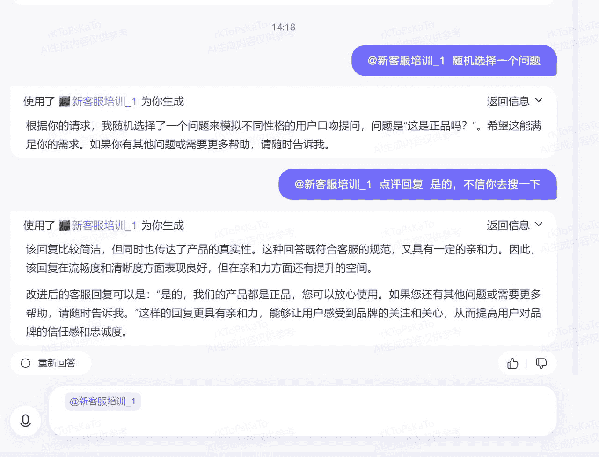
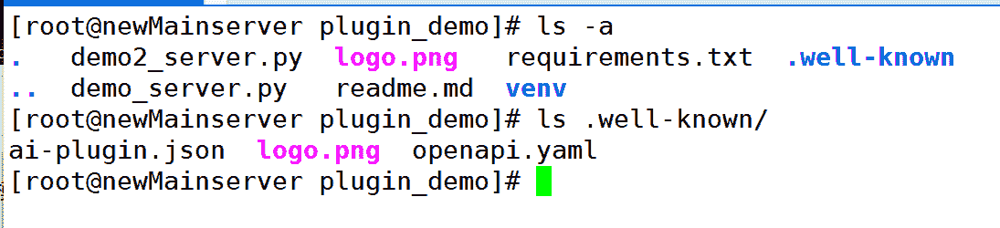
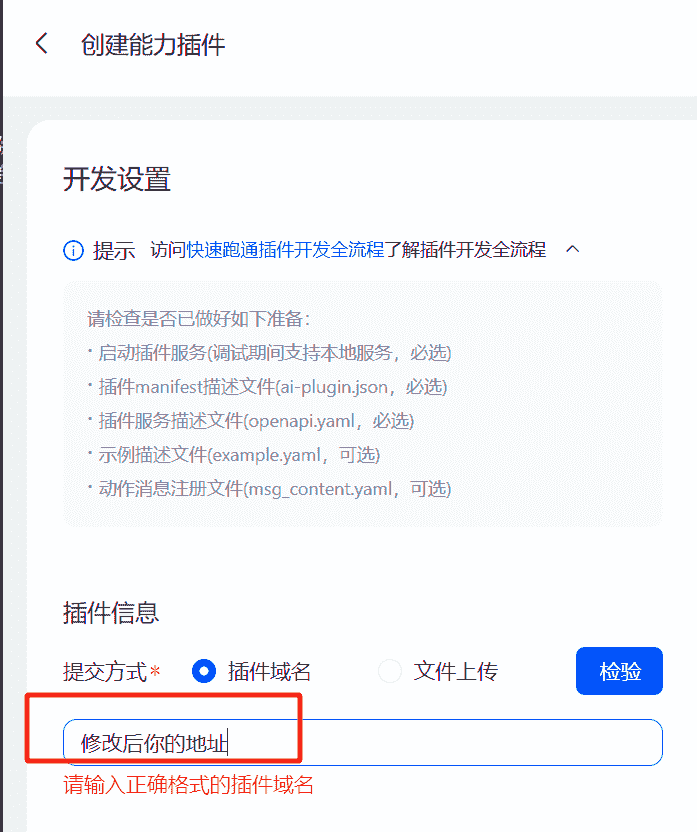
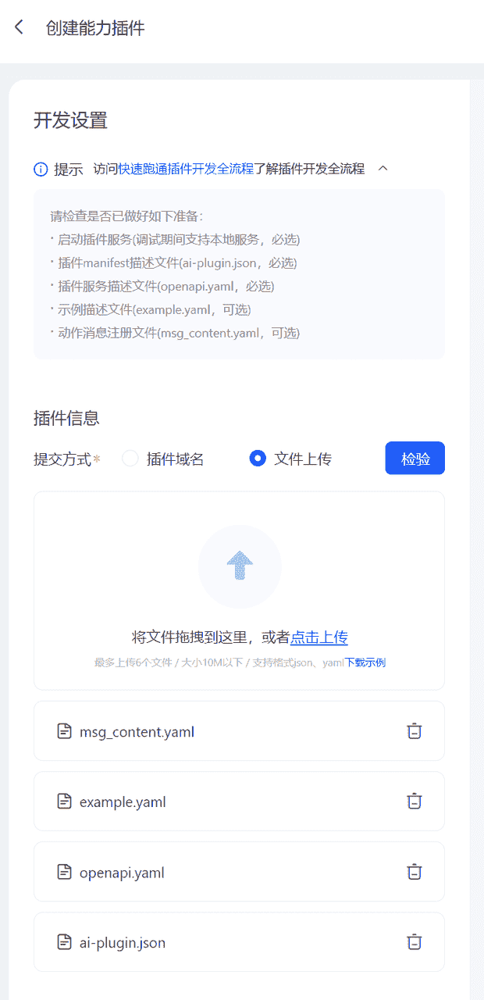
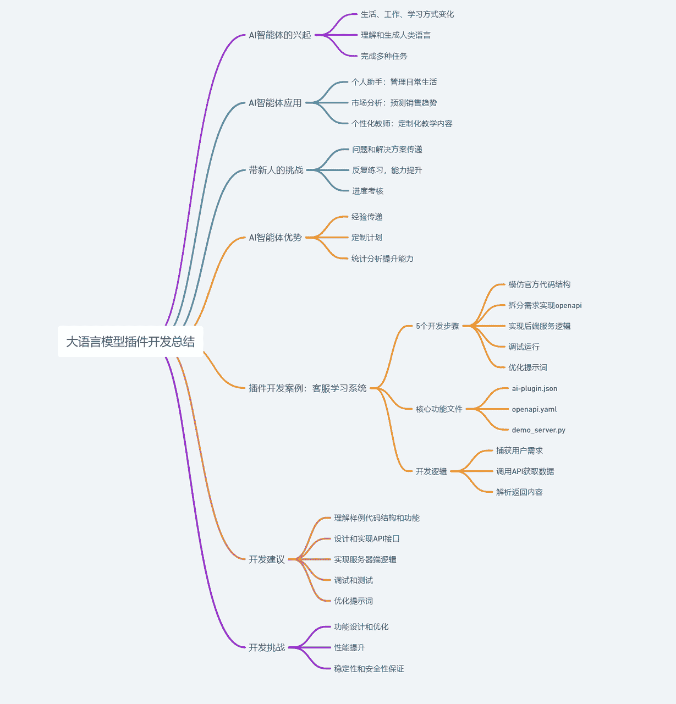

# 个性化学习系统

> 来源：[https://hyperspace.feishu.cn/docx/XBHIdzRuwoBdR3x4aKJcpG1dnfe](https://hyperspace.feishu.cn/docx/XBHIdzRuwoBdR3x4aKJcpG1dnfe)

随着大语言模型(LLM)驱动的AI智能体(AI Agent)的兴起，我们的生活、工作和学习方式正在发生深刻的变化。这些AI智能体能够理解和生成人类语言，帮助我们完成各种任务，从简单的日常事务管理到复杂的决策制定。

你可以将AI智能体可以作为个人助手，管理日常生活。也可以帮你进行市场分析，预测销售趋势。当然，它也可以作为一个个性化的教师，根据学生的学习进度和理解能力，提供定制化的教学内容。

最近我就遇到了一件棘手的事情上—带新人。带新人也就是将自己经常面对的问题，以及问题的成熟解决方案教给徒弟，为了确保徒弟学会你的能力，要让他反复练习，不断提升能力。最后免不了还要根据进度考核一下新人是否合格。

说起来容易做起来难，如果你带的不是一个人而是一个团队探索新的业务场景，往往还要针对不同的学习进度，给予不同的要求和反馈。而这种传递经验、根据不同进度定制每个人的计划，反复的练习，刚好能发挥AI智能体的优势。但是只使用通用的大语言模型还不成。因为大模型不知道用户最经常问哪些问题，而且学习者也不知道自己的答案要在哪个方向上改进。这时候就需要利用插件功能做一定的限制和补充。而在评价的时候则需要持久化存储来记录学员的结论。用上统计分析的知识来螺旋提升新学员的能力。这些能力刚好可以用插件方式来弥补。

那么接下来我就以培训新的客服人员为例，带你用简单的5个步骤来搭建一套新客服学习系统。首先我们先来看看搭建之后的效果。



上图我为你展示了两个问答过程，第一个是让文心智能体平台通过智能体，选择一个客户经常问到的高频问题。第二个问答过程是模拟新员工回复客户问题；回复之后，从流畅度、清晰度、亲和力等关键评估方面进行评价。并对回答进行改进。新员工可以根据改进意见不断优化话术，提高自己的服务能力。

你看，如此强大的功能，也许会让你觉得需要很长的开发时间。 我从学习插件的文档，到搭建整套工具，花费不超过 2 个小时。是不是很强大？接下来我就把如何开发这一插件的过程，拆分成 5 个部分，分别是：

1.  模仿官方代码结构

1.  拆分需求实现 openapi

1.  实现后端服务逻辑

1.  调试运行

1.  优化提示词

### 一、模仿官方代码结构



从截图不难看出，核心功能主要集中在三个文件中，分别是 ai-plugin.json、openapi.yaml、demo_server.py，用形象但不严谨的说法来描述，它们三个的功能分别是：

我们知道，开发大模型插件的逻辑主要是：通过发送和截获聊天对话捕获用户需求，调用相应 API 获取数据或生成提示词，然后解析返回的内容或提示词，并将处理后的结果返回给用户。样例文件实现了基础逻辑，但是直接使用还是无法调用的。这也成为插件开发者第一个要面临的问题。既然我们要模仿样例，那么首先要让样例运行起来。

你需要对样例文件做如下修改：

```
..
&quot;name_for_human&quot;: &quot;插件公开名称&quot;,
&quot;name_for_model&quot;: &quot;面向模型的自然语言描述&quot;,
&quot;api&quot;:{
        &quot;url&quot;: &quot;【改成你的服务器】/.well-known/openapi.yaml&quot;
    },
    &quot;logo_url&quot;: &quot;【改成你的服务器】/logo.png&quot;,
... 
```

```
servers:    
    - url: 【改成你的服务器】
```

对 "ai-plugin.json" 的修改主要是关于插件本身的描述，如 "name_for_human" 项，是指面向用户介绍介绍插件的主要能力，简明扼要，不超过 100 个字符。而 "name_for_model" 项，则是用于模型参考解析是否触发插件，假如，你的插件总是出现误触发或者漏出发，则优先考虑此处是否设置得当。也应当简明扼要，建议不超过 200 个字符。

首先修改的是 ai-plugin.json ,接下来修改 openapi.yaml 文件， 都要将 http://127.0.0.1:8081 改为文心智能体平台能够访问的到的 URL，此地址要填入插件测试的页面，页面如下：



最后要在你的服务器上运行 demo_server.py， 由于演示代码使用了async功能，因此 Python 版本尽量保证在 3.8 以上。要注意的是 demo_server.py 默认监听的仍然是 127.0.0.1，也需要修改成服务器监听 IP，修改位置如下：

```
if __name__ == &#x27;__main__&#x27;:
    app.run(debug=True, host=&#x27;【改成你的服务器】&#x27;, port=8081)
```

按照上述操作，执行完成后，你的样例文件大概率就可以跑起来了。那么还有一些开发者之前没有接触过 Python 开发，会遇到找不到 flask 模块，只需使用以下命令可以将依赖的软件包一次性安装完成

```
$ pip3 install -r ./requirements.txt
```

此外，从截图的提交方式来看， 除了使用"插件域名"方式外，你还可以将配置文件上传至服务器进行插件调试。如下图



此处允许上传四个文件，它们的名称和用途分别是：

前两个文件，[我已经为你讲解过了，](https://agents.baidu.com/docs/develop/ability-plugin/basic/develop_from_scratch/)那么示例描述文件和动作注册文件的作用我和你解释一下。这里的示例文件可不是给用户看的。示例文件是提升插件调用的正确率的。即告诉大模型遇到哪些提示词需要调用插件的哪个接口。而更有用的是，遇到哪种情况，不要调用插件。而动作注册文件，用于描述和定义了插件动作。并且这些动作可以显示在插件信息栏和用户前端，让用户更明确得知插件的工作状态，如果没有按照用户需求返回数据，也可以提示用户需要做哪些方面的输入优化。更具体的文件描述，你可以参考官方文档中的 如何从0到1开发插件 章节。

### 二、拆分需求实现openapi

能跑通样例代码后，相信你对插件开发也有一定的了解了，接下来我们来实现自己的真正的需求。即捕获对话中的内容，将其请求到服务器。我先将代码给你看，然后我们逐行来分析插件的搭建。

```
openapi: 3.0.1
info:
    title: 答疑学习助手
    description: 模拟用户提问，学员进行答疑，根据答疑情况反馈并优化答案
    version: &quot;v1&quot;
servers:
        - url: http://yourserver
paths:    
    /simulate_question:
        get:
            operationId: simulateQuestion
            summary: 随机选择一个问题，模拟不同性格的用户口吻提问
            responses:
                &quot;200&quot;:
                    description: 随机选择一个问题
                    content:
                        application/json:
                            schema:
                                $ref: &quot;#/components/schemas/simulateQuestion&quot;

components:
    schemas:
        simulateQuestion:
            type: object
            required: [question]
            properties:
                question:
                    type: string
                    description: 随机选择一个问题，模拟不同性格的用户口吻提问
```

我为你展示了代码最核心的两部分 paths、components 。 paths 是指响应的接口，components 是接口的类型与描述。每个 paths 的接口的 $ref必须有一个对应的 components 接口描述，否则会报错。接口下面是对插件服务器URI的请求方式，一般采用 get 和 post 两种方式。例如我定义的 “/simulate_question: get:” 会由文心智能体平台向我们的后台服务器发起如下请求:

```
curl http://yourserver/simulate_question
```

相应的如果，你的yaml文件采用的是 POST 方式，则类似如下请求方式：

```
curl -X POST -d &quot;your_data&quot; http://yourserver/answer_questions
```

除了请求方式，还有两个你需要重点关注的接口描述关键字叫做 summary 和 description。这两个关键字都属于提示词，即对话中包含描述信息，则会引用插件来访问指定的接口。你可以编写其中一个，也可以两个都编写。我把区别做了整理，你可以参考下表:

这里我要补充说明一下优先级，当 summary 和 description同时存在时，description 的优先级更高，即会使用 description 匹配会话。这也是大家在编写插件过程中，经常遇到的匹配不上插件的情况。

介绍完了 GET 方式接口，我再为你提供一个 POST 方式的接口。GET 方式经常用于从服务器获取数据，而P OST 被用于将会话内容发送至服务器。同样的，我来为你提供一个 POST 请求方式，演示学员回复问题时，如何将回复信息一并传给后端服务器。

```
/answer_questions:
        post:
            operationId: answerQuestions
            summary: 点评回复
            requestBody:
                required: true
                content:
                    application/json:
                        schema:
                            $ref: &quot;#/components/schemas/answerQuestions&quot;
            responses:
                    &quot;200&quot;:
                        description: 回复生成成功
                        content:
                            application/json:
                                schema:
                                    $ref: &quot;#/components/schemas/messageResponse&quot;
                                    
components:
    schemas:
        answerQuestions:
            type: object
            required: [question]
            properties:
                question:
                    type: string
                    description: 点评回复
        messageResponse:
            type: object
            required: [question]
            properties:
                message:
                    type: string
                    description: 回复生成成功
```

这段代码中会采用 POST 方式 以 question 作为 json 的 key ，以聊天内容作为 json 的 value，发送给服务器。

通讯机制和 GET 类似，我就不再赘述了。虽然逻辑比较简单，但是建议 paths 的 request 数量不要超过两个。插件尽量以简洁为主。捕获对话功能实现起来非常简单吧，接下来，我来带你学习一下服务器如何接收这两个请求。

实现后端服务（plugin-server）逻辑

我们还是先来展示代码，然后我来为你解释代码的功能。

```
questions = [&quot;商品太贵了&quot;,&quot;是不是正品&quot;,&quot;盒子破损了&quot;]

def make_json_response(data, status_code=200):
    response = make_response(json.dumps(data), status_code)
    response.headers[&quot;Content-Type&quot;] = &quot;application/json&quot;return response
    
@app.route(&quot;/simulate_question&quot;)
async def simulate_question():
    &quot;&quot;&quot;
        随机选择一个问题，模拟不同性格的用户口吻提问
    &quot;&quot;&quot;
    # 这里只是一个示例，实际情况下你需要根据不同的用户性格模拟提问
    question = random.choice(questions)
    return make_json_response({&quot;question&quot;: question})

@app.route(&quot;/answer_questions&quot; , methods=[&#x27;POST&#x27;])
async def answer_questions():
    &quot;&quot;&quot;
        回答问题，并根据我回答的情况按照流畅度、清晰度、亲和力给予评价，并提供改进后的回复
    &quot;&quot;&quot;
    prompt = &quot;根据回答的结果(question)，按照流畅度、清晰度、亲和力给予评价，并提供改进后的客服回复&quot;
    # API返回字段&quot;prompt&quot;有特殊含义：开发者可以通过调试它来调试输出效果
    question = request.get_json()[&#x27;question&#x27;]
    return make_json_response({&quot;question&quot;: question, &quot;prompt&quot;: prompt})
```

代码中是采用 get 方式响应/simulate_question 以及采用 POST 方式响应/answer_questions 路径的标准 flask 框架写法。在进行开发和调试时，需要注意返回时间，超过返回时间，会导致大语言模型调用插件失败，而采用自己的逻辑回答对话，具体的超时时间定义如下：

0.5s 连接超时，3s 读超时，2s 读响应头超时。如果插件服务内部处理流程较长，建议你采用 sse 流式方式及时返回。避免连接中断。

我来为你详细解读一下 plugin-server 的代码。首先，从最简单的 simulate_question 函数入手，我预先在 questions 存入了经常需要处理的问题，这些常见问题比 AI 生成的问题更具有代表性，同时也更加准确。当然你也可以根据提问的需要，将问题分门别类的储存。让学员更能具校准某一类特殊的问题上。

我这里为了演示需要，就只准备了一类问题，采用 “random.choice(questions)” 方式随机选取一条作为客服回复的提问。

接下来就是第二个功能，点评学员的答复。和提出问题不同的是，回答问题的学员无法评估自己的答案“好与坏”。需要让大模型来评估。而大模型只拿到答案，也不知道应该从哪些方面客观评估。所以这个逻辑上要将学员回答的问题交给 plugin-server， 再附加上提示词，再交给服务器。

比如说： 学员提交的答复是： “我是正品”和增加了提示词的答复:"根据回答的结果(“我是正品)，按照流畅度、清晰度、亲和力给予评价，并提供改进后的客服回复"。显然后者更能让大模型给出一个符合你预期的答案。

附加提示词的方式是在 plugin-server 返回数据时，增加 {"prompt": prompt}，这样可以将数据和提示词一起返回给大语言模型，这里还可以附加其他的 json数据，让大语言模型有更多的能力。实现了主要功能后，需要调试运行来继续优化你的插件。

### 三、调试运行

接下来，我们来尝试调试运行。

在 [创建能力插件](https://agents.baidu.com/plugin/ability/create) 页面，填写正确的域名后，可以通过 “预览”运行插件。首次运行插件效果一般都不理想。主要体现在没有调用到插件和返回结果异常两种情况。

没有调用到插件主要原因是 summary 和 description 冲突，或描述的不合理。描述应当尽可能短小精悍，体现核心功能，同时要减少通用词。例如：summary 只写 回答、对话、问题等，都有可能导致大语言模型无法识别问题，而采取默认回答策略，唤起插件失败。

另一种调试的异常是返回结果异常。这往往是由于schemas设置不当导致的。比如：schemas 设置的是 "required: [question]" ，而 plugin-server 判断的参数是 questions ，会导致参数不匹配等异常。另外还要注意，如果你需要将会话传给 plugin-server，你需要使用 POST 方式，而 plugin-server 接收的时候也同样采用 POST 方式。关于这一点我们会在后续的文章中详细讨论。

调试运行正确后，你可能还会遇到运行效果不理想的情况。这时候我们需要优化提示词。

### 四、优化提示词

提示词的规则，在不同的大模型有不同的技巧。但是通用的规则是：

1.  设定角色：为 AI 设定一个角色可以帮助用户更好地理解和接受 AI 的回答，比如设定 AI 为助手、顾问或专家。

1.  明确目标：提示词应明确指向用户需要完成的任务或问题，避免模糊不清。

1.  简洁明了：提示词应尽可能简洁，避免冗长复杂的句子，以便用户快速理解。

1.  用户友好：使用日常语言和礼貌用语，让用户感到舒适和尊重。

1.  适应性强：根据用户的输入和上下文信息，生成相关且有用的提示词。

你可以依据这几个规则，优化我个性化学习系统。当然，也可以为你自己编写一个实用的插件。

### 五、总结

在最后，我再为你回顾一下这五个步骤，帮你理清开发的一般过程。

1.  模仿官方代码结构：首先，你需要理解官方提供的样例代码的结构和功能，然后根据你的需求进行修改和扩展。

1.  拆分需求实现 openapi：你需要根据你的需求，设计和实现相应的 API 接口。这些接口将被大语言模型调用，以完成特定的任务。

1.  实现后端服务逻辑：你需要在服务器端实现这些 API 接口的逻辑。这些逻辑可能包括数据处理、计算、存储等操作。

1.  调试运行：在开发完成后，你需要进行调试和测试，确保你的插件能够正常工作，并满足你的需求。

1.  优化提示词：最后，你需要优化你的提示词，使得大语言模型能够更好地理解和响应用户的需求。

我也将完整的思考过程也整理成了一张思维导图，来帮你理解为什么需要掌握插件开发这一必备能力。以便你面对类似需求时，能和我一样有一个清晰的开发思路。



以上就是开发大语言模型插件的基本方式，大模型插件的开发不止这些，还包括了如何设计和优化插件的功能，如何提高插件的性能，如何保证插件的稳定性和安全性等等。这些都需要你在实际的开发过程中，根据你的需求和实际情况，进行不断的学习和探索。

后续文章中，我将为你继续讲解如何提升插件的稳定性和安全性，如何编写样例以及融合数据分析、多模态等能力。

总的来说，开发大语言模型插件是一个需要不断学习和探索的过程，希望你能在这个过程中获得乐趣，也能开发出真正有用的插件。

**作者简介**

尹会生，珠海太乙人工智能技术合伙人，前游戏公司技术总监