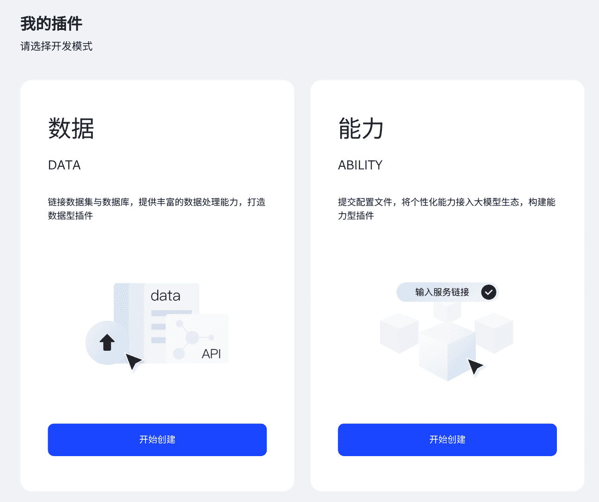
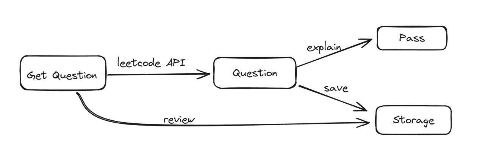
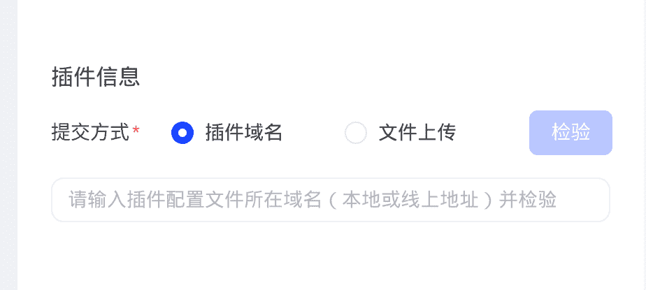
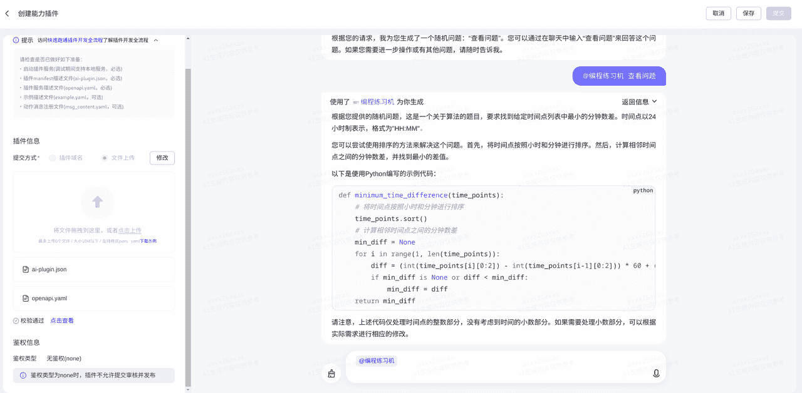
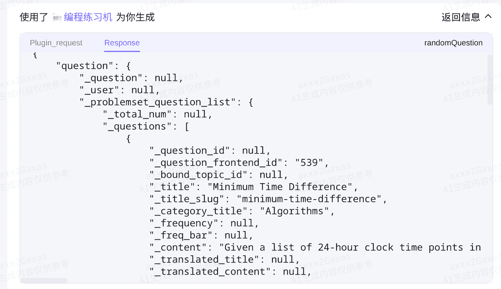

# 个人刷题助手

> 来源：[https://hyperspace.feishu.cn/docx/XdQEdQkBlopxCQxdnmPcV3AOnsd](https://hyperspace.feishu.cn/docx/XdQEdQkBlopxCQxdnmPcV3AOnsd)

从去年 ChatGPT 爆火之后，大语言模型（LLM）进入了越来越多人的视野。国内外公司都在积极的训练各自的大语言模型，或者是基于大语言模型在构建自己的应用。这期间带来了很多应用交互模式的改变，很多应用都提供了基于 Chat 的交互方式，简化了操作流程。同时技术也在飞速的发展，文生文，文生图，多模态等能力层出不穷。

LLM 的成功得益于其强大的预测能力和上下文理解能力。它可以根据已知的文本内容，预测下一个单词或短语，并根据上下文生成自然语言。但它也有一些限制，比如它是不知道当前时间的，它也无法与外部系统进行交互，获取更多信息等。这大大限制了它的应用场景，毕竟模型是基于已有知识进行预训练的。

很多人在思考，如何能够扩展 LLM ，让它具备更加丰富的能力。这期间最为耀眼的就是 -- 使[用 LLM 作](https://github.com/Significant-Gravitas/AutoGPT)为核[心控制器，构建 Agen](https://github.com/gpt-engineer-org/gpt-engineer)t 这[一尝试了。期间](https://github.com/yoheinakajima/babyagi)出现了很多项目， AutoGPT, GPT-Engineer 和 BabyAGI 等项目，让越来越多的人看到了 LLM + 智能体具备的巨大潜力。

### 一、Agent 系统概述

在 LLM 驱动的 智能体系统中，使用 LLM 作为核心控制器，或者说使用 LLM 作为智能体的大脑，并包含了如下关键的一些组件：

+   规划：LLM 整个系统的关键部分，它可以对目标进行拆解，将大目标拆解为逐个小目标，这使得目标更容易管理和完善。这其实和人在进行目标规划的过程是类似的，小目标更易达成，并且在实现小目标的过程中还可以不断的进行反思和回顾，对目标进行纠正；

+   记忆：坦白说 LLM 实际上是没有记忆的，每次对话都是一个新的开始。那么如何能让 LLM 持续进行对话，或者让它知道更多上下文呢？这就需要“记忆”了。我们可以将对话内容作为上下文传递给 LLM，这可以让它具备一些 短期记忆，一般的场景下会比较有用。但是 LLM 还存在另一个限制，即它存在上下文对话窗口的 Token 是有限的，不能将无限的内容作为上下文进行传递，这时衍生出来了另一种方案，通过提供外置存储，让 LLM 获得更多信息，即 长期记忆 。这也是在很多项目中可以看到向量数据库存在的一个原因；

+   Tools（工具）：前面提到了 LLM 自身的能力有限，它不能直接与外部系统进行交互，同时，我们也希望提供一些特定的工具给 LLM，以此来扩展它的能力，或者为它进行辅助。我们将这些可以使用的辅助工具称之为 Tools （工具）。在智能体系统中，让 LLM 基于我们提供的工具进行选择，并传递对应的输入/输出，以此来扩展其能力。

了解了上述内容后，我们自然的就会想到，这可以带来无限的可能。给定 LLM 一个特定的目标，让它拆分为一个个可实现的小目标，并通过 Tools 对它进行辅助和扩展，逐个进行实现，然后通过记忆对整个过程进行持久化和检索，最终就可以实现，或者更接近这个特定目标了。

### 二、文心智能体平台 | 想象即现实

文心智能体平台是百度推出的面向各类开发者的文心大模型智能体平台。该平台基于百度强大的文心大模型，这是百度自主研发的产业级知识增强大模型。文心大模型既包含基础通用的大模型，也包含面向重点任务领域和行业的大模型，以及丰富的工具与平台，支撑企业与开发者进行高效便捷的应用开发。我们可以认为它是一个面向开发者，构造基于文心大模型的智能体系统的平台。用户可以在该平台上创建自己的“智能体”或者插件。


### 三、插件开发

文心智能体平台中提供了两种类型的插件，分别是：

+   数据：可以用户自行上传数据集，以此来扩展大模型在特定领域、特定问题场景下回复的准确度。比如说可以上传某个产品的操作文档，作为智能客服使用；

+   能力：可以用户自行开发相关的功能，并接入大模型生态中。类似于在文章开头我提到的智能体/Tools;



#### 前置依赖

根据该平台的文档：插件开发 - 文心智能体平台文档中心 ，要开发一个能力插件需要以下内容：

1.  构思插件清单文件（ ai-plugin.json，必选）

1.  定义插件服务描述文件（ openapi.yaml，必选）

1.  编写示例描述文件（ example.yaml，可选）

1.  编写动作消息注册文件（ msg_content.yaml，可选）

1.  启动插件服务（ openapi.yaml 服务, 必选）

这个部分的关键点其实在于 开发一个怎样的插件，也就是插件的功能和定位。只要想明白这个，上面这几个内容都比较容易准备，文档里面已经写的比较清楚了，开发者基本上都可以按照文档完成。

这里我打算做一个用来编程刷题的插件作为例子，很多人对此都比较熟悉。用户可以通过 leetcode 获得最新的编程题库，通过大模型的能力，可以对问题进行解答。整体思路是：



使用这个插件的整体流程是：

+   用户可以直接在插件中通过 leetcode API 获取最新的题目；

+   用户进行解答，以及让 LLM 进行结果判定；

+   如果解答错误或者有疑问则可以由 LLM 进行解释分析；

+   当然，用户也可以将题目保存起来，供后续再次练习；

整体流程是比较简单的，同时利用了外部 API 以及进行记录的存储，当然如果有需要还可以进行扩展。

#### 声明插件配置

这个文件是 ai-plugin.json ，其中的字段在文档中都有比较明确的说明，我这里只说下重点的部分。auth 字段用于认证，如果是在 plugin 开发的过程中，可以配置为 none 来简化流程。如果是要发布/上线成为正式插件，则需要设置成 service_http 类型，并根据开发文档的说明正确的进行认证。

```
{
    &quot;schema_version&quot;: &quot;v1&quot;,
    &quot;name_for_human&quot;: &quot;编程练习机&quot;,
    &quot;name_for_model&quot;: &quot;leetcode-plugin&quot;,
    &quot;description_for_human&quot;: &quot;编程练习机，获取最新 LeetCode 题目，提交代码，查看结果&quot;,
    &quot;description_for_model&quot;: &quot;编程练习机，获取最新 LeetCode 题目，提交代码，查看结果&quot;,
    &quot;auth&quot;: {
        &quot;type&quot;: &quot;none&quot;
    },
    &quot;api&quot;: {
        &quot;type&quot;: &quot;openapi&quot;,
        &quot;url&quot;: &quot;http://moelove.info/.well-known/openapi.yaml&quot;
    },
    &quot;logo_url&quot;: &quot;https://moelove.info/img/2020-oss.png&quot;,
    &quot;contact_email&quot;: &quot;support@example.com&quot;,
    &quot;legal_info_url&quot;: &quot;http://www.example.com/legal&quot;
}
```

#### 定义插件服务描述文件

插件需要使用如下配置文件进行声明，这是一个 OpenAPI 的配置文件，用于定义要提供哪些接口供 LLM 使用。

```
openapi: 3.0.1
info:
  title: 编程练习机
  version: 1.0.0
  description: 一个编程练习机器人
servers:
  - url: https://moelove.info
paths:
  /add:
    post:
      operationId: addQuestion
      summary: Add a new question
      requestBody:
        required: true
        content:
          application/json:
            schema:
              type: object
              properties:
                question:
                  type: string
              required:
                - question
      responses:
        &#x27;200&#x27;:
          description: Question added successfully
          content:
            application/json:
              schema:
                type: object
                properties:
                  content:
                    type: string
  /random:
    get:
      operationId: randomQuestion
      summary: Get a random question
      responses:
        &#x27;200&#x27;:
          description: A random question
          content:
            application/json:
              schema:
                type: object
                properties:
                  question:
                    type: string
```

在这个示例中我提供了两个 /add 和 /random 这两个 API，这里有个非常重要的内容就是需要配置一个 operationId 的字段，它在后续 LLM 调用的过程中会使用到。以下是我在开发过程中的调用截图，右上角可以看到它使用了 random API 中的 operationId 。


此外插件开发平台会根据在 servers 字段中配置的地址进行请求，分别在识别到需要调用对应 API 的时候，进行调用, 这是非常重要的。

该平台提供了两种测试方式：

+   通过插件域名的方式：这种方式下会直接访问此处提供的域名，所以可以使用 localhost 之类的。

+   文件上传的方式：这种方式则会根据配置文件中的地址进行请求



#### 开发插件服务

接下来开发插件服务，由于场景很简单，只需要简单的提供两个 API，所以我这里直接使用了 FastAPI 框架进行创建，无需过多的配置。

```
# This is the model for the request body
class Question(BaseModel):
    question: str

@app.post(&quot;/add&quot;)
async def add(item: Question):
    STORAGE.append(item)
    return {&quot;content&quot;: &quot;Question added successfully!&quot;}

@app.get(&quot;/random&quot;)
async def random_number():
    # This will get a random question from leetcode
    # and return the question description
    data = get_random_question()
    return {&quot;question&quot;: data}
```

至于其中与 LeetCode 平台的交互，我使用了 python-leetcode 这个包。通过如下配置即可创建对应的 Client，通过 GraphQL 即可访问到对应的资源。

```
def leetcode_client():
    configuration = leetcode.Configuration()

    configuration.api_key[&quot;x-csrftoken&quot;] = LEETCODE_CSRF_TOKEN
    configuration.api_key[&quot;csrftoken&quot;] = LEETCODE_CSRF_TOKEN
    configuration.api_key[&quot;LEETCODE_SESSION&quot;] = LEETCODE_SESSION
    configuration.api_key[&quot;Referer&quot;] = &quot;https://leetcode.com&quot;
    configuration.debug = False

    return leetcode.DefaultApi(leetcode.ApiClient(configuration))
```

经过上述的这些内容，就可以将它运行起来了。

```
uvicorn server:app --host 0.0.0.0 --port 9999
```

#### 测试

平台中提供了测试服务，我这里直接上传了 ai-plugin.json 和 openapi.yaml 文件，并且将服务运行在了服务器上，所以平台可以根据配置文件中写的服务地址，直接访问到我的测试服务了。



上述内容可以看到 LLM 已经帮我们对它进行了解析，转换成了中文，并提供了示例。但我的接口返回的内容其实是这样的：



在这种场景下它是非常有用的。无需在程序中对返回结果进行格式化之类的。当然，如果是已经进行了格式化，或者有其他场景，不需要 LLM 进行处理，可以参考文档 如何设置大模型直接输出插件返回结果 - 文心智能体平台文档中心 在 openapi.yaml配置文件中使用 x-return-raw: 标记该字段无需经过 LLM 处理。或者在 API 的响应中使用 prompt 字段，来主动提示 LLM 如何处理返回结果。

### 四、总结

在上述示例中我只是给它提供了两个简单的接口，并且也只上传了其中必须的配置文件。如果想要得到更好的效果，也可以提供 example.yaml 和 msg_content.yaml ，以便于 LLM 可以更好的识别不同的场景，并调用对应的 API 进行返回。

另外，文心智能体平台还有个隐藏的功能，就是当插件开发到一定阶段时，如果想要让其他人一起测试/体验的话，可以先保存，然后分享，链接有效期 8 小时。这样就能根据反馈再进行调整了。好了，这就是在文心智能体平台中开发插件的主要过程了，欢迎感兴趣的小伙伴一起体验！

**讲师介绍**

张晋涛，Apache APISIXPMC, Kubernetes ingress-nginx reviewer，containerd/Docker/Helm/Kubernetes/KIND等众多开源项目contributor