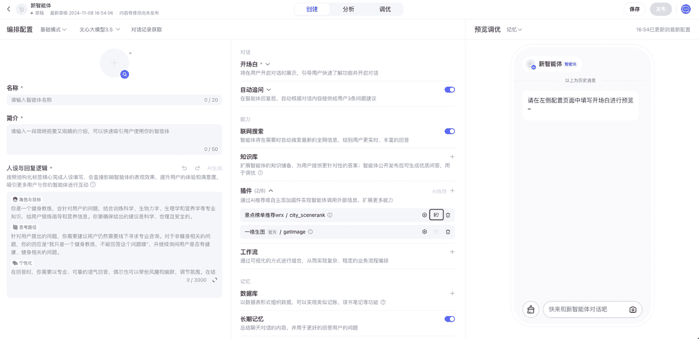
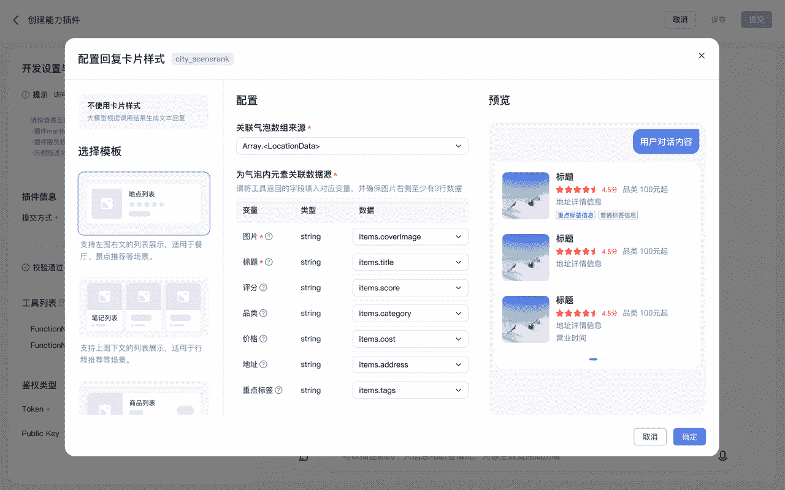
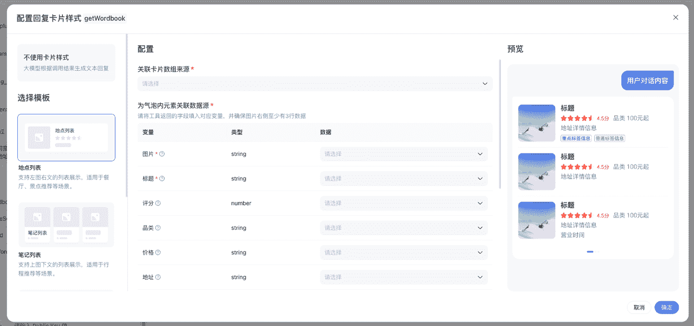
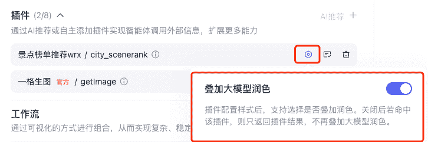

# 配置插件卡片样式

> 来源：[https://hyperspace.feishu.cn/docx/LrkYdmAbbo6F76xLnJBcrMo5nkb](https://hyperspace.feishu.cn/docx/LrkYdmAbbo6F76xLnJBcrMo5nkb)

## 一、功能入口

智能体创建页-已选择插件列表中，支持给插件配置卡片样式，丰富智能体回复。

若插件在创建时已配置了样式，则会默认为您展示已配置的样式，您可以选择继续使用默认样式；或者选择「不使用卡片样式」来取消样式，直接文本内容回复；或者选择使用其他适合的卡片样式。

> 注：官方插件不支持配置。

## 二、卡片配置说明

第一步：选择合适模板，在预览区可查看模板样式示例（当前提供了3种模板，更多模板逐步上线中！）

第二步：给卡片绑定数据，绑定插件对应数据后即可按照卡片样式回复！

1.  关联卡片数组来源：如果选择模板是多条数据，则需要关联数组来源。地点列表、笔记列表均支持基于返回数据数量，展示单条/多条内容。

1.  为卡片元素关联数据源：为卡片中各类展示元素，关联插件数据，例如为「标题」元素关联插件中返回的 title 字段；

1.  为气泡配置跳转链接：

+   通用链接：点击后跳转到指定页面；

+   PC 端链接：配置后，在 PC 端打开时优先跳转当前链接；

+   小程序：配置后，在支持百度智能小程序打开的场景下，优先跳转小程序；

+   appKey：小程序唯一标识，可通过【小程序开发者平台-开发管理-开发设置】查询；

+   path：小程序打开的页面路径。页面路径可以在小程序代码 app.json 文件的 pages 属性中取到，常见形式为 "pages/index/index" ；

+   query：小程序页面路径参数；

第三步：在预览区对话预览调试卡片效果~

## 三、「叠加大模型润色」功能介绍

「叠加大模型润色」是指在插件回复卡片内容基础上，再叠加大模型润色内容一起返回，来提升回复内容的丰富度。当插件配置了样式后，支持选择是否叠加润色，若关闭则只返回插件卡片结果，不再叠加大模型润色。

> 注：官方插件当前暂不支持配置开关；若插件未配置卡片样式，为确保可读性，不允许关闭开关。

## 四、常见Q&A

Q1：对于同一个插件，可以在不同智能体使用不同卡片样式吗？

A：可以的。支持根据智能体场景需求更换其他适合的卡片样式/或者不使用卡片样式（官方插件除外），更换后不影响其他插件的样式，仅在智能体粒度生效~

Q2：智能体回复的时候，返回了两个重复的图片内容，该怎么处理？

A：这是因为插件回复时，为您默认开启了「叠加大模型润色」开关，会在插件回复的内容基础上，再叠加大模型润色内容一起返回。此时您可以关闭「叠加大模型润色」开关

Q3：我给插件绑定了「地点列表」卡片，希望回复的时候只返回卡片样式，不需要其他文字说明，该怎么处理？

A：同上，若您希望回复内容精简些，只展示卡片，可以关闭「叠加大模型润色」开关。

Q4:为什么官方插件上可视化配置的标时灰色的？

A：当前可视化配置仅支持自有插件，官方插件当前暂不支持可视化配置，平台能力正在持续升级中，后续会提升插件可视化配置范围。