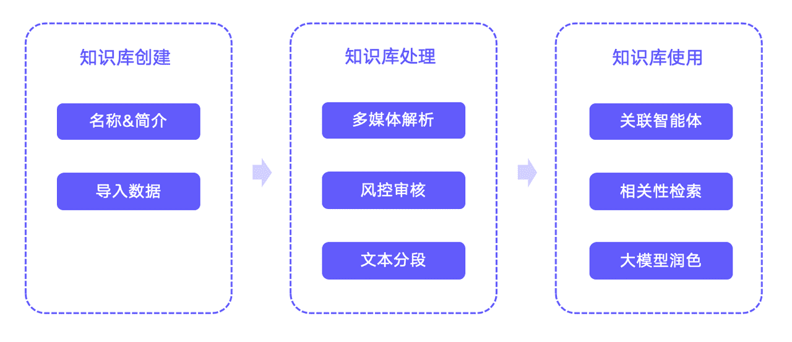
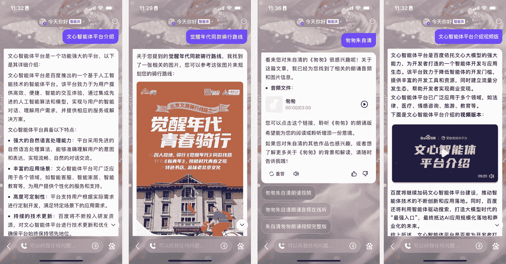

# 知识库介绍

> 来源：[https://hyperspace.feishu.cn/docx/H2M2d8ZmSo9P9qxQB6ycn70wnSd](https://hyperspace.feishu.cn/docx/H2M2d8ZmSo9P9qxQB6ycn70wnSd)

知识库是智能体输[出回答的数据依据，](https://lingjing-online.bj.bcebos.com/lingjing-online/document/video_tutorials/video/%E5%9F%BA%E7%A1%80%E5%BC%80%E5%8F%91%E7%B3%BB%E5%88%97-%E7%9F%A5%E8%AF%86%E5%BA%93%E7%AF%87-%E6%97%A0%E7%A0%81.m4v)适合有专业数据积累的开发者，以及对输出结果有准确性、专业性要求的开发者。

在知识库模块上传自己的数据，大模型与用户交互过程中，根据用户提问检索知识库中的相似内容，经过大模型润色后生成答案，可以有效限定模型的生成范围。

文心智能体平台充分尊重和保障您专有的数据安全，不会使用提交的数据来训练或改进通用大模型，暂时未开放专属模型训练能力。

戳此观看视频课程《知识库使用教程》。

## 一、使用场景

1.  支持在知识库中提交文本、表格、图文、图片、音频、视频文件，平台接收到内容后，会进行智能识别、风控审核、分段切片、向量化等处理流程；

1.  完成上述知识库处理流程后，可供智能体、工作流挂载引用；

1.  当用户发送问题时，模型会判断是否需要检索知识库，确定检索知识库后，将使用用户发送的问题在知识库中检索相似结果，并按照相关性召回采用，最后经过大模型的润色后输出答案。

注：提交的文本会经过模型改写后输出，图片、音频、视频文件召回采用后，会直接输出哦~

