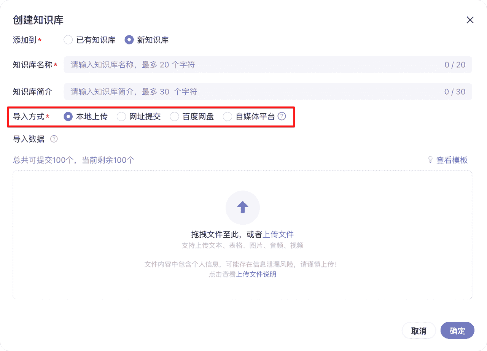
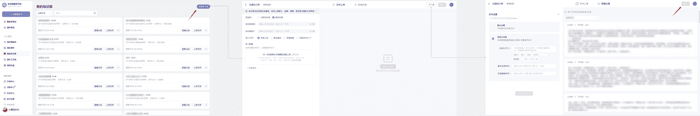
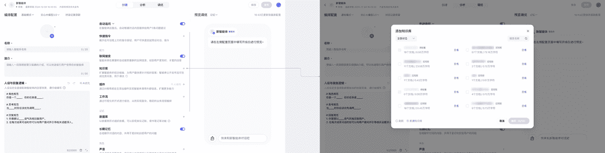
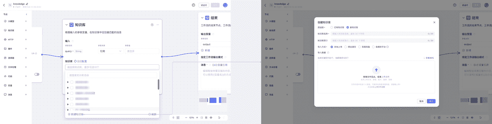
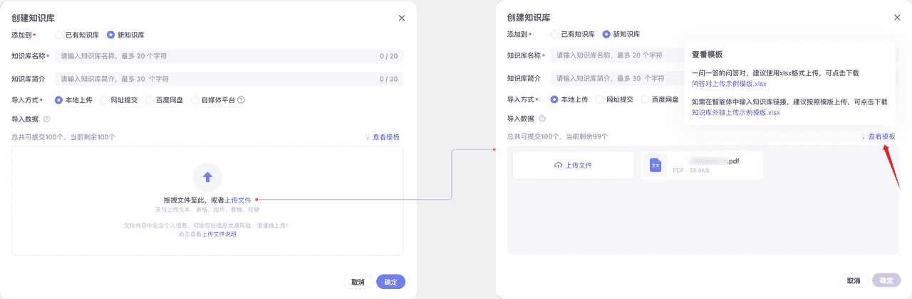
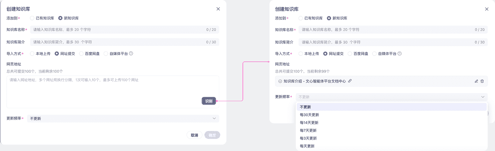
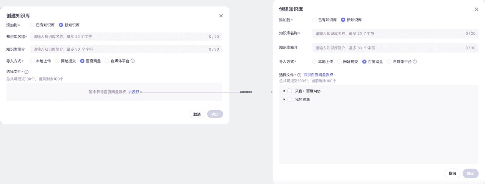
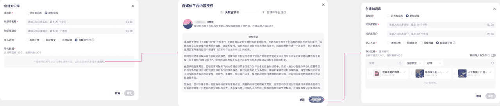

# 知识库创建

> 来源：[https://hyperspace.feishu.cn/docx/ZdC2dnuK2oYDkIxUTaqcneHSnKe](https://hyperspace.feishu.cn/docx/ZdC2dnuK2oYDkIxUTaqcneHSnKe)

文心智能体平台支持通过本地上传、网址提交、百度网盘授权导入、自媒体平台授权方式，导入提交知识库数据。创建成本更低、效率更高！

## 一、创建知识库

首次提交知识库数据，需创建知识库，1 个账号可以创建 100 个知识库，将内容分类管理, 全部知识库的总容量不能超过 1G。

## 二、知识库创建入口

### 1. 我的知识库页面

登录平台后，点击左导航，即可进入知识库模块。点击页面右上角【创建知识库】按钮，进入知识库创建流程。

注意：此入口为知识库模块的主要经营阵地，支持更丰富的知识库配置，导入知识库内容后，要记得点击【提交】按钮，否则知识库无法进入处理流程，不能被智能体引用挂载哦~

### 2. 智能体编排页面

创建或编辑智能体，进入智能体编排页面，点击【添加知识库】，再点击【创建知识库】进入知识库创建流程。

### 3. 编排工作流页面

创建或编辑工作流，进入工作流编排页面，插入知识库节点，点击【添加知识库】，再点击【创建知识库】进入知识库创建流程。

## 三、数据导入流程

### 1. 本地上传

+   点击上传文件调起本地文件管理，或拖拽本地文件上传；

注：如需上传问答对、文字链，我们提供了官方的上传模板，点击查看模板即可下载~

### 2. 网址提交

+   网页地址中输入URL，多个 URL 可以用换行分隔，1 次最多可以提交 10 个网址；

+   点击【识别】按钮识别网页中的文本内容，仅支持识别 公开访问 且 百度已收录 的网页地址，识别成功后会展示网址名称，因个别网站限制登录访问或限制百度收录，则无法识别；

+   支持设置知识库更新频率，定期识别已提交网址，尽量降低知识库内容与网站内容不同步的影响。

注：类似百家号视频播放落地页，需更换为自媒体平台导入方式提交，当前当时仅能识别页面中的文本，视频格式需提交含有mp4后缀的链接，示例：https://www.example.baidu.com/example.mp4。

### 3. 百度网盘导入

+   首次使用百度网盘导入知识库，需要前往百度网盘授权；

+   授权成功后，将在平台内展示网盘中保存的文件列表，勾选需要导入的文件即可导入；

注：网盘导入文件需对接对方平台数据，导入时间较长，您可以选择后台处理，后台导入后再返回当前页面提交文件。

### 4. 自媒体平台导入

+   首次使用，需要授权百家号及其他自媒体平台的内容授权，授权成功后既可导入在百家号发布成功的全部内容。

+   开启【自动导入新文件】后，将自动导入百家号发布的新内容，无需手动勾选哦～

注意： 授权其他自媒体平台内容，将自动发布到百家号，如不希望其他平台内容在百家号发布，只授权百家号账号即可。

[知识库创建](https://agents.baidu.com/docs/develop/dataset/dataset_docs_example/)[完成后，如需调](https://agents.baidu.com/docs/develop/dataset/application_search/)整解析、分段配置，可前往知识库处理，直接在智能体中挂载引用，可前往知识库应用检索。