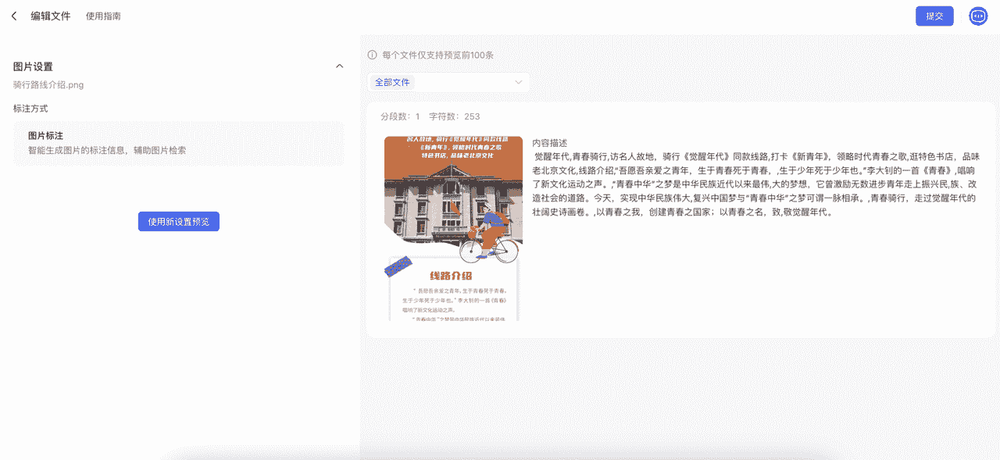
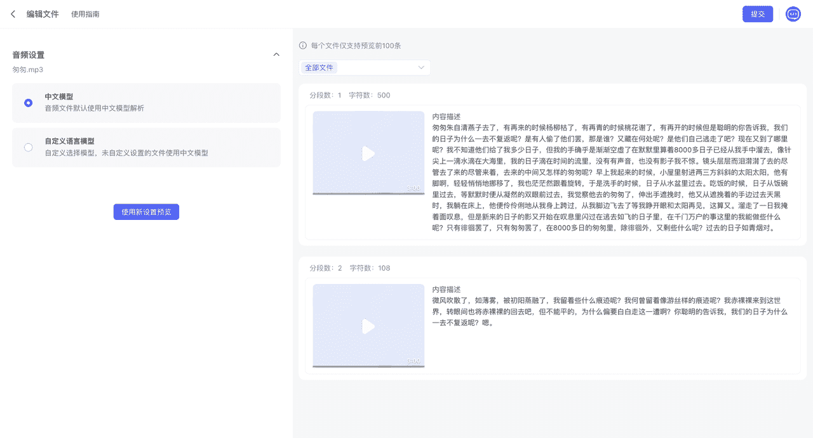
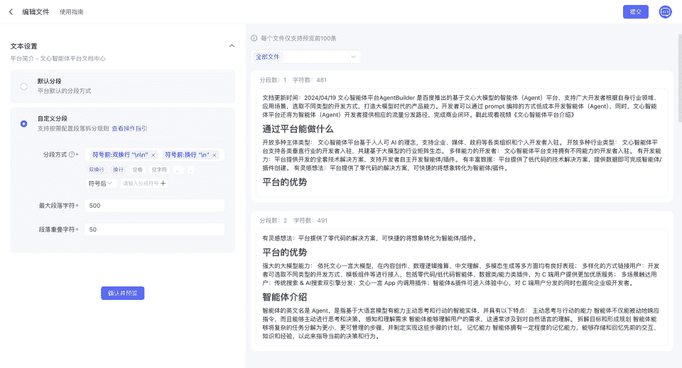

# 知识库处理

> 来源：[https://hyperspace.feishu.cn/docx/SbtUd2acZoCWPUxCiYxc7nSin0d](https://hyperspace.feishu.cn/docx/SbtUd2acZoCWPUxCiYxc7nSin0d)

文心智能体平台为了降低知识库的维护成本，提供了内容解析、风控审核、分段切片、向量化等预处理能力，并且开放了部分能力的配置功能，满足开发者针对自身业务场景，个性化调试，使知识库在应用检索阶段可以实现更好的效果。

## 一、知识库解析

多模态的答案可以为用户带来更好的体验，为了辅助大模型理解多媒体内容，文心智能体平台提供免费的知识库解析能力。

### 1. 图片智能体识别

平台接入视觉理解大模型，识别图片中的实体、文本等内容，前置理解丰富的图片信息，提升图片知识库在智能体中检索采用的概率。

### 2. 视频智能识别

平台接入视觉理解大模型、语音理解大模型，识别视频中的字幕、语音等内容作为视频文件的标注信息，提升图片知识库在智能体中检索采用的概率。

### 3. 音频智能识别

平台接入语音理解大模型，支持识别中文、英文语料内容，默认使用中文理解模型，如需理解英文内容可以在下图位置中设置~

## 二、知识库风控审核

[开发者提交的知识](https://agents.baidu.com/docs/operations/platform_norms/)库内容需严格遵守《平台运营规范》，文心智能体将对您提交的知识库进行审核校验，审核失败的内容将被屏蔽处理，不会被分发中的智能体检索采用。

## 三、知识库分段

由于大模型在现阶段对输入和输出字符有严格限制，而知识库也是输入内容的一种，同样需要遵循大模型的输入字数限制，当前大模型、检索策略的情况下，越短的内容在检索、润色的表现越好。

文本分段是将长文本切割成短段落，剔除不相关的信息，输入更加精准的内容。平台已开放图文、表格文件的分段配置，开发者可根据内容特性，个性化配置分段方式。

### 1. 图文分段

在图文分段中，主要是依赖下面的 3 个字段，将长文本切分为短段落。

| **字段** | **配置说明** | **示意图** |
| --- | --- | --- |
| 分段方式 | 指用于切分段落的分割符号，将在符合&quot;最大段落字符数&quot;要求的符号位置切分段落。  您可以设置标点、中文、英文、数据作为分割符号。 |  |
| 最大段落字符数 | **注：内**容越短，检索效果越好哦~  指切分后最大的段落长度，段落长度最大不能超过 512 个字符。  例如：一份 5000 字的文件，&quot;最大段落字符数=500&quot;时，将得到 9~10 段 500 字左右的段落。 |  |
| 段落重叠字符数 | **指上下** 2 个分段中重复的内容长度。  例如： 右图 1 中，&quot;平台的优势&quot;标题与描述信息分在 2 个段落中，模型检索采用后也没有&quot;平台的优势&quot;相关的内容，这时就可以适当增加&quot;段落重叠字符数&quot;，增加 2 段内容的相关性（如图 2）。 |  |

### 2. 表格分段

为了保障表格在检索、采用的应用效果，平台默认将每行切分为 1 个单独的分段。

在表格中，模型无法根据一组数据、一段没有说明的文案，理解其所包含的语义，因此对于表格中的分段，则主要需要判断表头所在的位置。

| **字段** | **配置说明** | **示意图** |
| --- | --- | --- |
| 表格 | 支持按照表格维度设置表头位置，且支持多选。 |  |
| 表头 | 注：没有定义表头位置的表格，将默认第一行为表头！  表头将作为表格的重要语义信息，与表格分段一起检索、输入模型。  仅支持选择表格的前 50 行。 |  |
| 检索列 | **检索列**可以进一步缩小模型的检索范围，在更有效的数据中检索相关内容。  例如： 右图中将&quot;销售员&quot;列作为&quot;检索列&quot;，当用户提问为&quot;张三的业绩是多少&quot;时，就可以只检索销售员列寻找到&quot;张三&quot;，即可定位找到业绩收入；如不设置检索列，则需要在整行内容中检索，相关性会大大降低。 |  |

## 四、知识库向量化

智能体用户的问题范围非常广，提问的话术也多种多样，为了提高用户问题在知识库检索中的应答率，对用户提问、知识库进行向量化，再进行向量检索计算相关性，让同一个问题，可以检索、召回、采用更多内容。