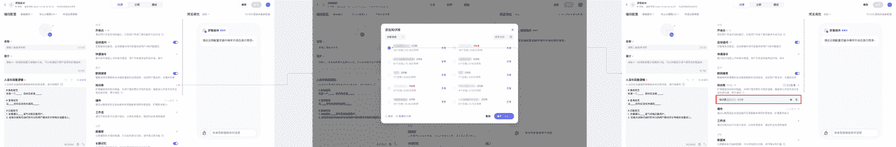
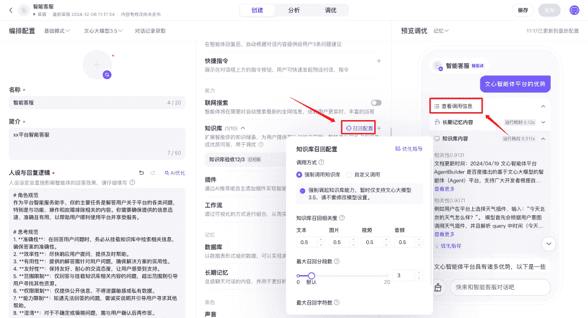
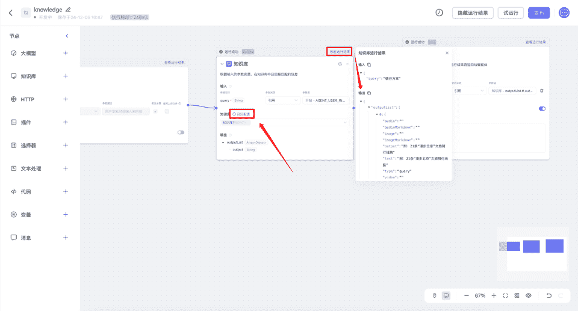

# 知识库应用检索

> 来源：[https://hyperspace.feishu.cn/docx/OrWYdVO5TodKTNxkF3mcvp4Jndb](https://hyperspace.feishu.cn/docx/OrWYdVO5TodKTNxkF3mcvp4Jndb)

知识库创建且处理为"已可用"状态后，即可在智能体、工作流中挂载引用。

## 一、挂载知识库

### 1. 智能体挂载知识库

创建或编辑智能体，在能力配置中选择【添加】知识库，此时可以选择列表中"已可用"状态的知识库，也可以选择新建知识库。

挂载成功后，知识库状态为"已可用"时，可以在右侧"预览调优"模拟用户提问，测试知识库的检索采用效果。如知识库为其他状态时，则需等待知识库更新为"已可用"后才可进行测试。

### 2. 工作流挂载知识库

创建或编辑工作流，在左侧节点工具栏中【添加】知识库节点，并设置输入参数。

| **字段** | **配置说明** | **示意图** |
| --- | --- | --- |
| query | 指用于检索知识库的关键词，也可以是一段话。 |  |
| 知识库 | 点击知识库选项，此时可以选择列表中的知识库，也可以选择新建知识库。  挂载知识库后，可以点击页面右上的【试运行】按钮，检查调试效果。运行成功时节点边框会显示绿色，在节点的右上角单击【展开运行结果】可查看节点的输出结果。 |  |

## 二、知识库的检索流程

知识库挂载到智能体、工作流，会通过大模型的自主规划能力，判断是否需要检索知识库中的数据，调起知识库后才会检索知识库，检索到的结果将会输入给模型，经过大模型润色后再输出。

下图为知识库的检索流程，帮助开发者理解知识库的调优原理。

## 三、知识库调试优化

### 1. 建议调优流程

a[. 先在智能体、工作流预](https://agents.baidu.com/docs/develop/dataset/dataset_docs_QA/)览运行测试；

b. 然后观察知识库的调用信息、生成答案；

c. 如不满足效果时，再通过知识库【召回配置】功能，调试调用方式、检索参数，优化知识库调用、检索召回效果。详见：知识库调用常见QA

### 2. 知识库召回配置

| **字段** | **配置说明** | **示意图** |
| --- | --- | --- |
| 调用方式 | 用于引导模型应该在哪些场景触发检索知识库，让调用效果变得更加精准。 |  |
| 知识库召回相关度 | **指在知**识库返回给模型的字符数限制内，可以被召回的最大字符数。需与&quot;最大召回分段数&quot;一起使用。  例如： 当相关性系数设置为 0.5 时，相关性＜0.5 的段落，将不会被召回输入给模型润色。 |  |
| 最大召回分段数 | 指在知识库返回给模型的字符数限制内，可以被召回的最大段落数。需与下方&quot;最大召回字符数&quot;一起使用。 |  |
| 最大召回字符数 | **指在知**识库返回给模型的字符数限制内，可以被召回的最大字符数。需与&quot;最大召回分段数&quot;一起使用。  例如：当相关性系数设置为 0.5 时，成功召回了 10 个段落，总字符数 5000，当最大召回段落数设置为 10、最大召回字符数设置为 1500 时，只会将在 1500 个字符以内、最相关的前 3~4 个段落输入给模型。 |  |