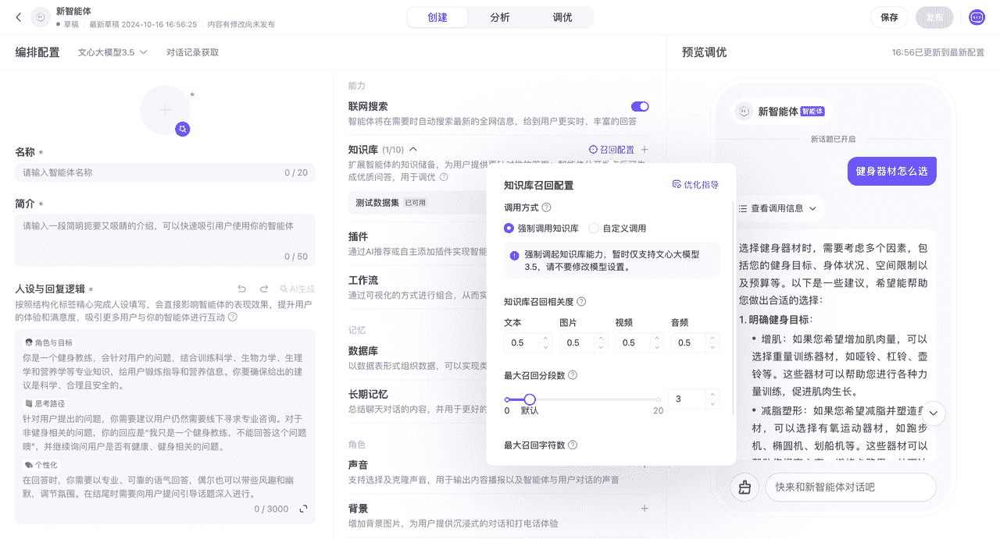
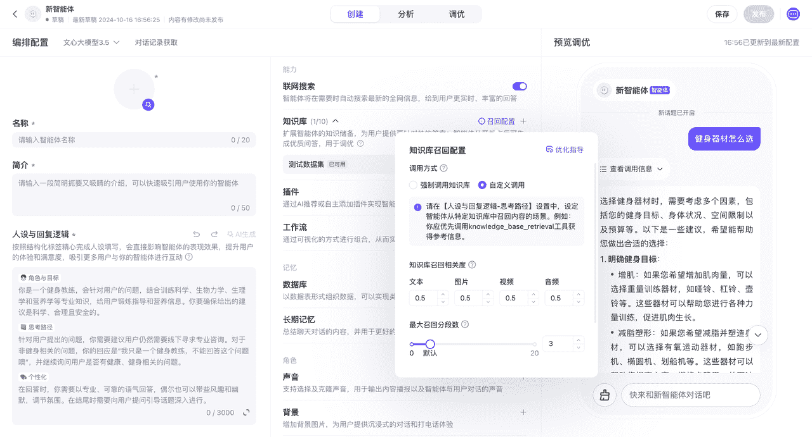
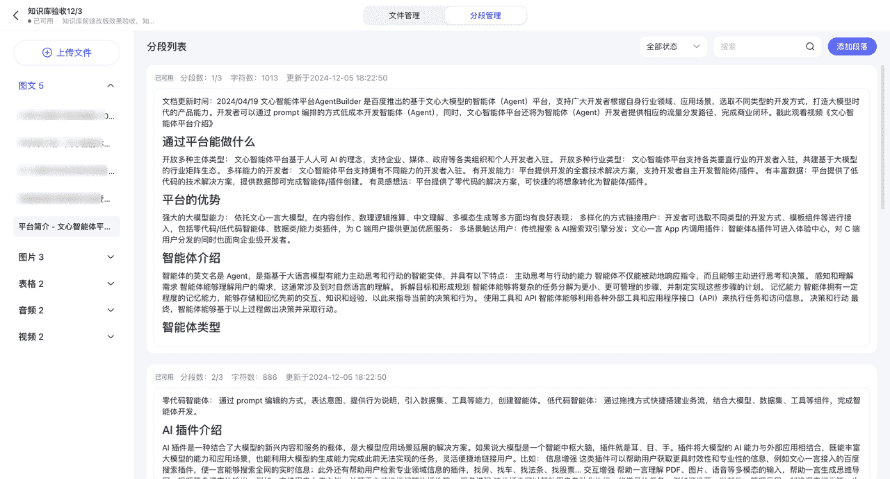
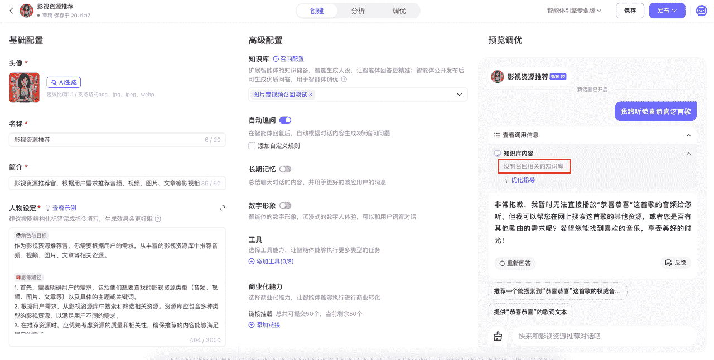
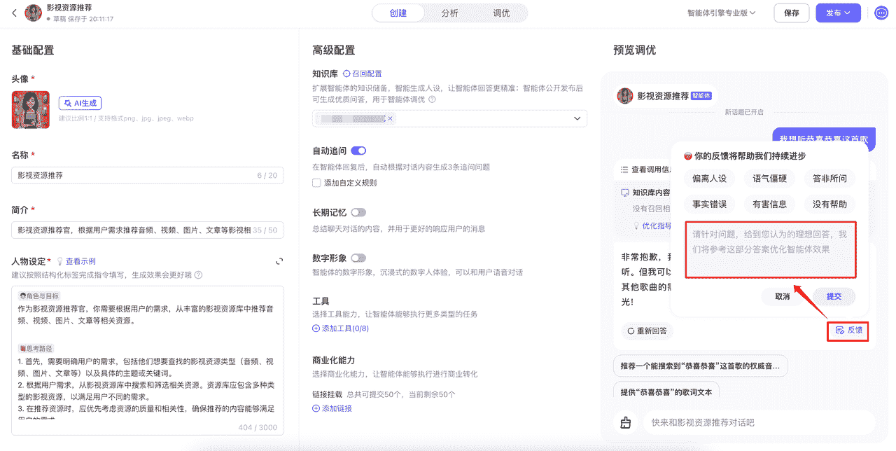
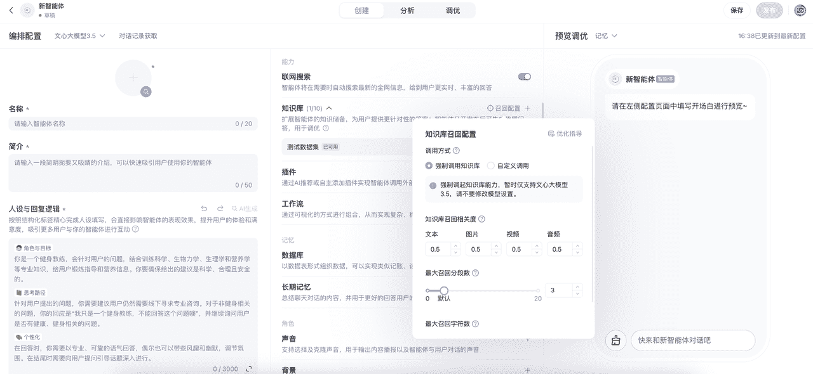
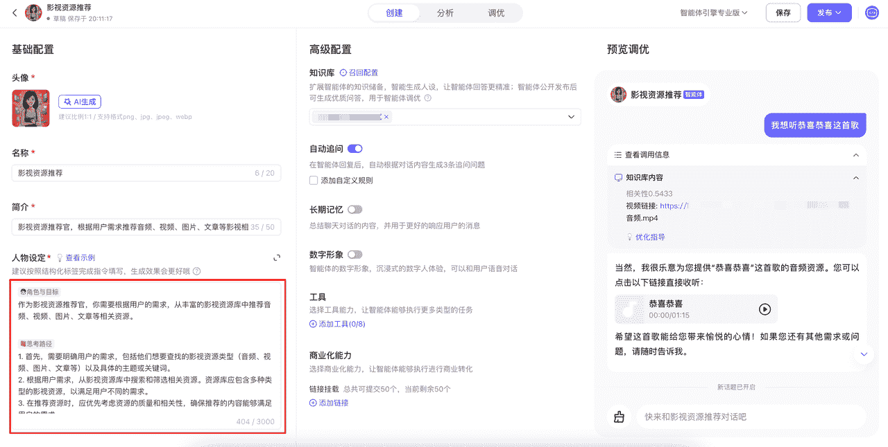

# 知识库调用常见QA

> 来源：[https://hyperspace.feishu.cn/docx/LBGjd5NziogZf2x0a7ucrjScnsg](https://hyperspace.feishu.cn/docx/LBGjd5NziogZf2x0a7ucrjScnsg)

Q1： 在预览知识库调用效果时，提示"系统异常"、"服务异常"，应该怎么处理？

A： 很抱歉影响您的使用体验，"系统异常"、"服务异常"只是偶发情况，您可以在提示后尝试刷新、退出当前页面重新访问、清除缓存等方式重试，即可恢复使用了。

Q2： 我在智能体上挂载了知识库，但是在实际对话中，知识库都没有被调用怎么办？

A： 原因可能是模型没有识别到用户问题与知识库的相关性，因此没有调用知识库。此时可以打开智能体的知识库【召回配置】，将调用方式切换为【强制调用】，可以保证模型在每轮对话中都调用知识库，再召回知识库中的相关内容，如果不需要每轮对话都调起知识库，可以选择自定义调用方式，然后在智能体【人设与回复逻辑】中详细说明，你希望模型应该在什么场景调起知识库。

注意：目前知识库强制调起能力，只有 文心大模型 3.5 可以支持，如果需要强制调起知识库，不要忘记切换模型哦~

[Q3： 我](https://agents.baidu.com/dataset/list)的知识库没有被召回怎么办？

A： 可能是知识库中没有与问题相关的内容，可以先去我的知识库检查是否有相关内容，没有相关内容可以根据问题补充丰富知识库，已有相关内容但没有被召回，可以转 Q3。

Q4： 我的[知识库中有](https://agents.baidu.com/dataset/list)相关内容，但是一直提示"没有召回相关的知识库"，怎么才能召回我的知识库？

A： 可以通过以下方式解决:

首先可以进入我的知识库页面，检查期望召回的内容，是否因文本分段、图片识别、音频识别导致内容存在语句不通顺、语序不连贯等问题，导致模型无法判断是否与用户问题有相关性，如果存在语义问题，可以先编辑段落内容优化语义问题；

其次可以通过知识库的召回配置功能，降低【检索相关度阈值】来调试召回效果。注意：【检索相关度阈值】将对当前智能体全局生效，需综合大部分需求场景做配置，如仅需优化个例问题，可以通过【反馈】提交理想答案的方式，修正模型生成答案。

Q5： 知识库召回结果与用户问题不相关，但是系统给的相关性值还挺高的，要怎么解决？

A： 有 3 种方式可以尝试解决这个问题：

1.修改召回段落内容，删除相关描述，再重新预览是否召回；

2.调试知识库的召回配置，当召回不相关结果在召回结果中，排在后几位，可以尝试提高【检索相关度阈值】，降低【最大召回段落数】、【最大段落字符数】；

3.如仅需优化个例问题，可以通过【反馈】提交理想答案的方式，修正模型生成答案。

Q6： 只召回了知识库中一部分相关的结果，还有一些也希望被召回，要怎么办？

A： 有 2 种方式可以尝试解决这个问题：

1.调试知识库的召回配置，可以尝试降低【检索相关度阈值】，提高【最大召回段落数】、【最大段落字符数】；

2.如仅需优化个例问题，可以通过【反馈】提交理想答案的方式，修正模型生成答案。

Q7： 召回结果都没有问题，但是最终输出的答案和我的知识库没有关系啊？

A： 出现这个问题，是因为模型在润色答案时，过滤掉了知识库召回的结果，解决这个问题，可以尝试在智能体的人物设定中，补充知识库的应用要求。例如：

• 模板1：当用户提问时，必须检索知识库，未检索到结果时输出"很抱歉，这个问题我也不太了解，我们可以聊点其他的问题吧~ "。

• 模板2：当用户提问时，优先使用检索知识库中召回的结果生成答案。

