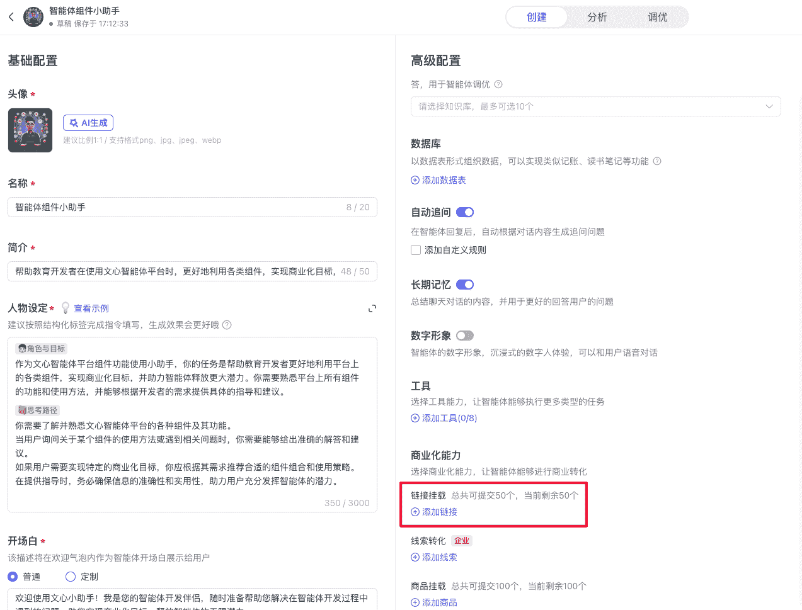
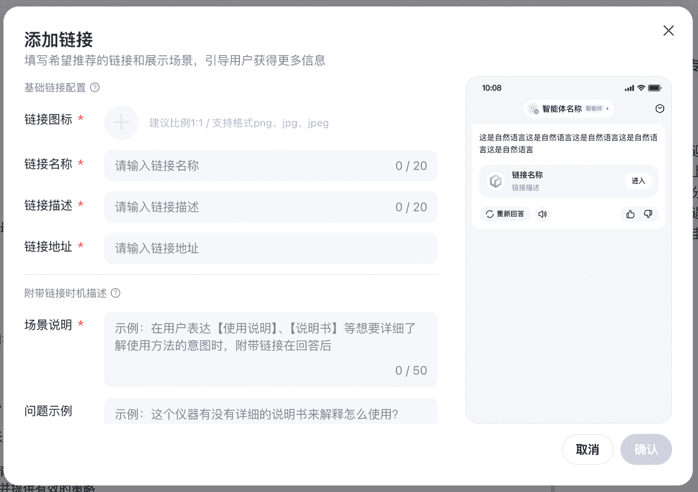

# 链接挂载

> 来源：[https://hyperspace.feishu.cn/docx/TgIhd8MOPoioTExJTiYc3sR0nUg](https://hyperspace.feishu.cn/docx/TgIhd8MOPoioTExJTiYc3sR0nUg)

## 一、链接挂载组件是什么

+   定义： 允许开发者在智能体对话中嵌入外部链接，如网页、文章、视频等，方便用户一键跳转，增加信息获取的便捷性。使用场景包括推荐阅读、内容分发、产品详情页引导等。

+   场景举例： 链接挂载组件，作为一种内容展示和互动手段，可应用于多个场景和行业。通过丰富内容形式、提升用户体验和互动性、扩大传播范围等方式，为开发者和企业带来更多的流量和收益，以下为细分应用场景及举例。

## 二、如何挂载组件能力

### 1、如何配置

+   步骤一：进入文心智能体平台 PC 端编辑界面。

+   步骤二：在高级配置-商业化能力-链接挂载中点击“添加链接”。

+   步骤三：填写链接地址、链接图标、链接名称、链接描述、链接触发场景说明和问题示例，确认无误后点击“确认”则添加成功。

【填写说明】

1.  链接图标：上传 1:1 比例的 png/jpg/jpeg 图片，用来作为链接卡片显示的图标内容。建议上传和链接内容相关的图片、或者是公司 logo，便于用户理解。

1.  链接名称：此处填写该链接的名称，要能清楚表达链接页面内容，例如：「活动报名入口」/「xx电器说明书」等。

1.  链接描述：此处填写对链接内容的进一步描述，例如：「点击链接填写信息即可报名」、「点击连接查看更多详情」等。

1.  链接地址：此处填写链接的跳转地址。

1.  场景说明：详细描述你希望在对话中召回链接的对应场景，例如「当用户询问哪里可以查看说明书，或者询问某一个功能如何使用时，召回该链接」

1.  问题示例：对上面的场景说明进行进一步细化，举例说明用户提问问题。此处填写的问题示例最好与场景描述中的问题示例不完全一致，以便模型更好理解多样的用户问题，准确召回链接。

### 2、配置 Tips

+   单个智能体可配置 50 个链接挂载。

+   请确保挂载链接与 agent 的相关性，以确保审核通过率。

+   智能体回答生成的链接分为两种，文字蓝链和链接卡片。回答中文字蓝链通常是生成内容的补充、延展，其来源为知识库中储备的链接数据；而链接挂载通常做为配合回答提供的增益服务，如提效工具、生活服务、购物消费等，并可为目标网站进行引流。

+   指导文档：平台上新 | 文心智能体支持各类型链接挂载，开发创想打开了！

### 3、注意事项

1.  确保所有链接、商品信息均合法合规，尊重用户隐私。

1.  请定期检查并更新链接和商品信息，保持内容的时效性和准确性。

## 三、如何让智能体有效召回、展现组件

评价本篇文档