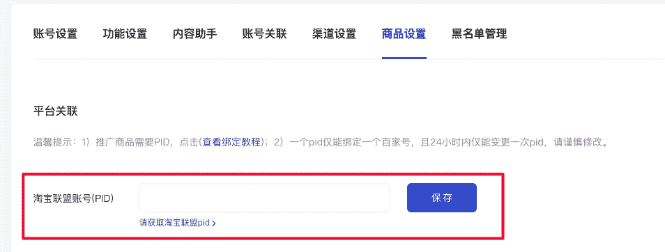
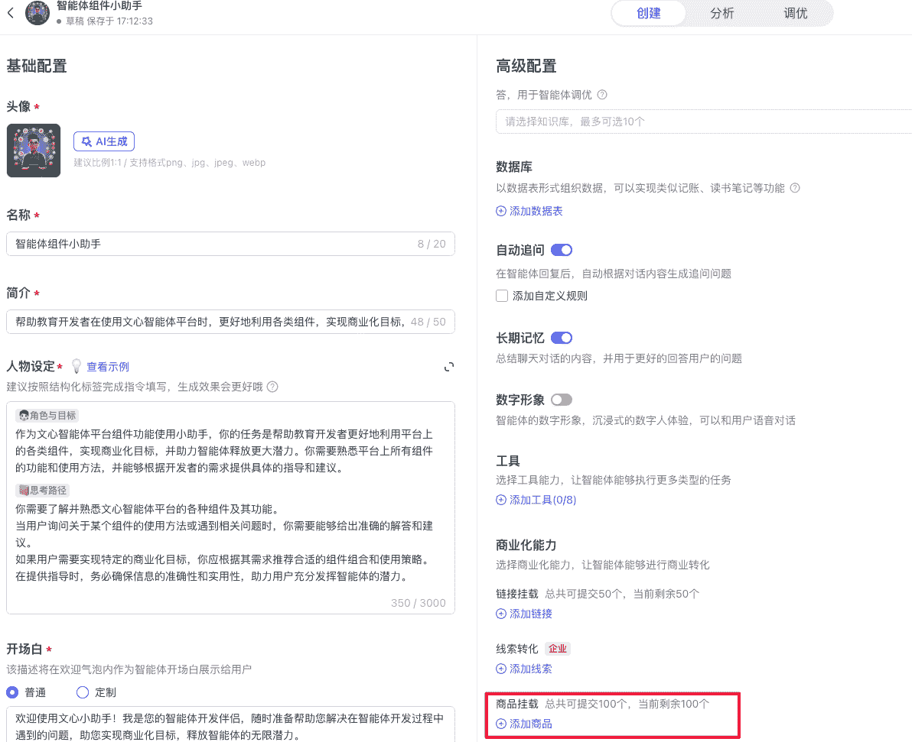
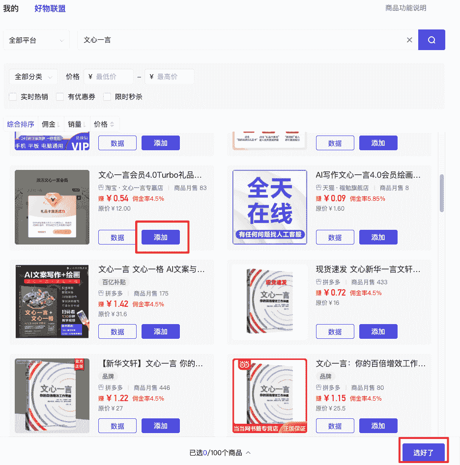

# 商品挂载

> 来源：[https://hyperspace.feishu.cn/docx/AHS3d7CiSoczVjxHmSuchkEgnwh](https://hyperspace.feishu.cn/docx/AHS3d7CiSoczVjxHmSuchkEgnwh)

## 一、商品挂载组件是什么

+   定义： 在对话中直接展示商品信息，包括图片、名称、价格、库存等，用户可直接点击购买或查看详情，提升购物体验。使用场景包括电商推广、产品介绍、促销活动等。

+   场景举例： 商品挂载组件可引导用户通过智能体对话进行购买，这种组件的适用范围非常广泛，几乎涵盖了所有涉及商品销售的行业，这些行业包括直营电商、箱包服饰、日用消费品、IT消费电子、母婴用品、食品饮料、文体器材以及商品交易等，以下为细分应用场景及举例。

## 二、如何挂载组件能力

### 1、如何配置

+   步骤一：确保所选商品已添加至平台商品库。

+   步骤二：在账号百家号后台商品设置中完成平台关联绑定，确保后续可进行商品售出分润。

+   步骤三：进入文心智能体平台 PC 端编辑界面。

+   步骤四：在高级配置-商业化能力-商品挂载中点击“添加商品”。

+   步骤五：搜索商品，点击“添加”，确认无误后点击“选好了”完成商品挂载。

### 2、配置 Tips

+   单个智能体可配置 100 个商品挂载。

+   请确保商品类目与 agent 的相关性，以确保审核通过率。

+   指导文档平台上新｜商品挂载能力上线，文心智能体支持开发者分佣！

### 3、注意事项

1.  确保所有链接、商品信息均合法合规，尊重用户隐私。

1.  请定期检查并更新链接和商品信息，保持内容的时效性和准确性。

## 三、如何让智能体有效召回、展现组件

评价本篇文档