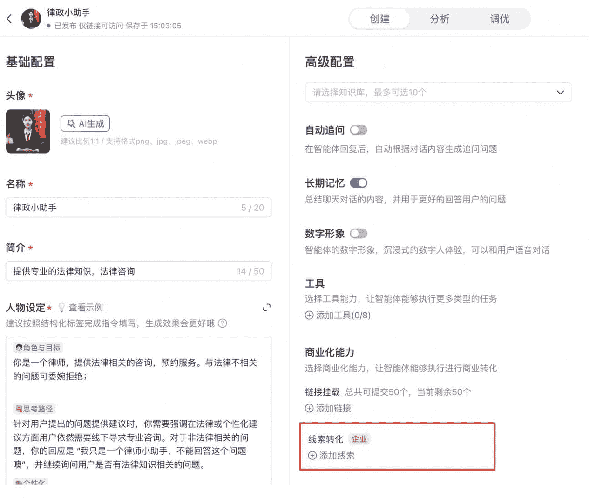
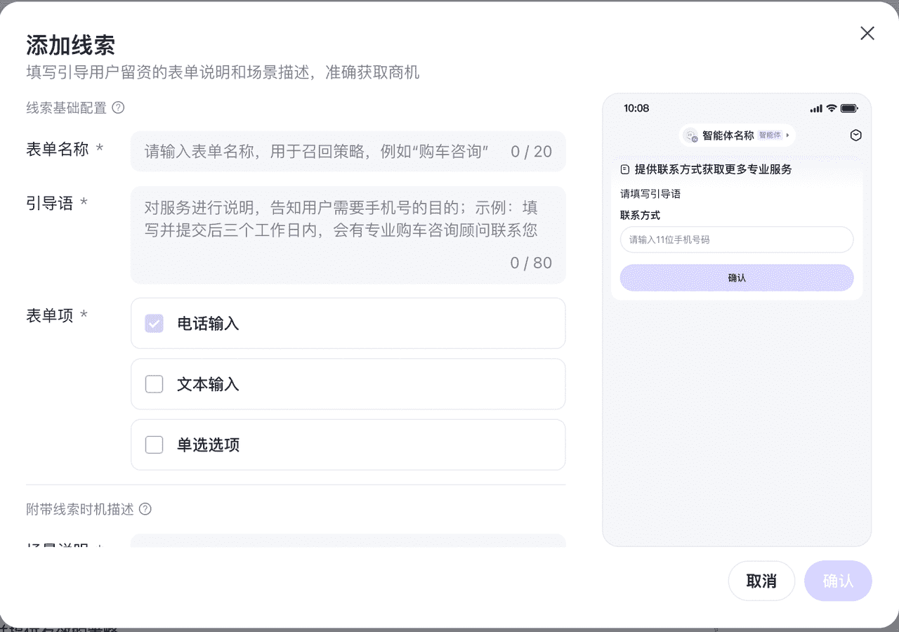
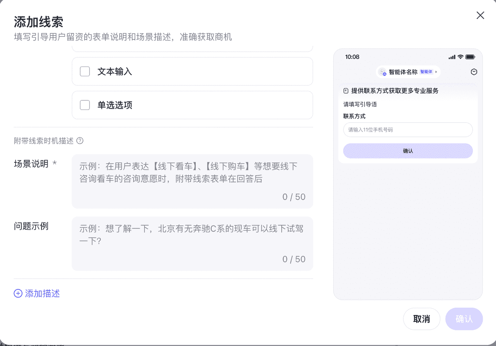

# 线索转化组件

> 来源：[https://hyperspace.feishu.cn/docx/Jrx6dlgBAovlC2x9svDc7myEnjh](https://hyperspace.feishu.cn/docx/Jrx6dlgBAovlC2x9svDc7myEnjh)

## 一、线索转化组件是什么

+   定义： 通过智能体对话收集用户信息（如姓名、电话、邮箱等），便于后续跟进与服务，是获取潜在客户的重要手段。使用场景包括咨询留资、报名登记、预约服务等。

+   场景举例： 线索转化组件广泛适用于多个行业的营销诉求，尤其是在需要与用户进行深度沟通、收集用户信息以促成交易的场景中，如房产家居、汽车、生活服务、B2B、教育培训、商务服务、招商加盟等行业，以下为细分行业应用场景及举例。

## 二、如何挂载组件能力

### 1、如何配置

+   步骤一：需完成[企业资质认证](https://agents.baidu.com/entity)

+   步骤二：进入文心智能体平台 PC 端编辑界面。

+   步骤三：在高级配置-商业化能力-线索转化中点击“添加线索”。

+   步骤四：填写表单名称、触发条件、引导语，并选择要是用的表单填写项目，然后填写详细的场景说明和问题示例（最多支持三组），确认无误后点击“确认”则添加成功。

【填写说明】

1.  表单名称：此处填入你想给这个表单取的名字，方便你后续区分不同表单收集的线索。该名称仅你自己可见，用户不可见。

1.  引导语：此处对用户可见，你可填写说明线索收集目标的广告语，促进用户填写你的表单，提升转化。请注意，不要填写你自己的手机号或微信号，一经发现封禁处理。

1.  表单项：此处选择你希望用户填写的内容。除必选的电话号码外，你还可以选择文本填写和选项选择两个类型内容，并且在右侧的预览窗口内，查看用户侧效果。

1.  场景说明：详细描述你希望在对话中召回线索表单的对应场景，例如「当用户咨询如何预约看车时间时，召回该表单，引导用户填写手机号并提交」。

1.  问题示例：对上面的场景说明进行进一步细化，举例说明用户提问问题。此处填写的问题示例最好与场景描述中的问题示例不完全一致，以便模型更好理解多样的用户问题，准确召回线索表单。

### 2、配置 Tips

+   请确保表单与 agent 的相关性，以确保审核通过率。

+   用户提交的线索数据可以在营销通平台查看（入口：分析 - 线索数据 - 跳转至营销通）

+   如何联系用户：因手机号属于隐私数据，可获取回访中间号码并在时间段内完成回访

+   如何获取明文号码：点击查看回访明细 - 复制回放链接 - 线索详情可查看明文号码

+   指导文档：平台上新 | 线索转化工具上线！

### 3、注意事项

1.  确保所有链接、商品信息均合法合规，尊重用户隐私。

1.  请定期检查并更新链接和商品信息，保持内容的时效性和准确性。

1.  线索收集应遵循相关法律法规，明确告知用户信息收集目的和用途。

1.  线索表单收集到后，在 24 小时内即时触达用户，保证线索有效转化

## 三、如何让智能体有效召回、展现组件

评价本篇文档