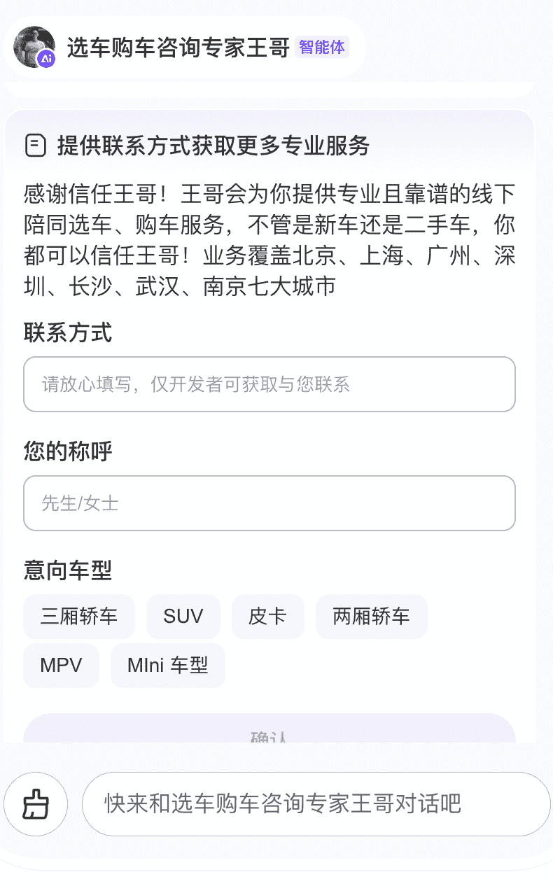
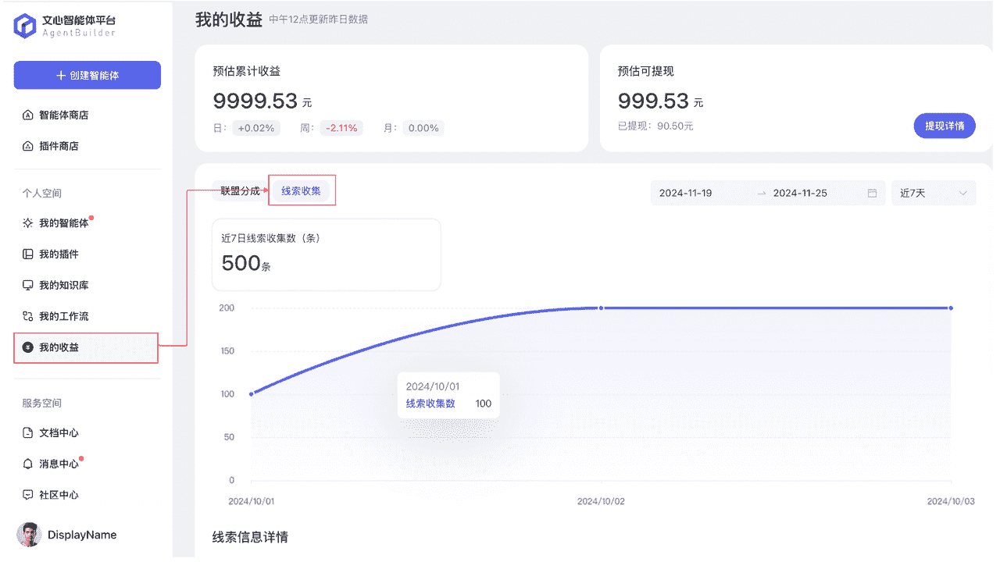
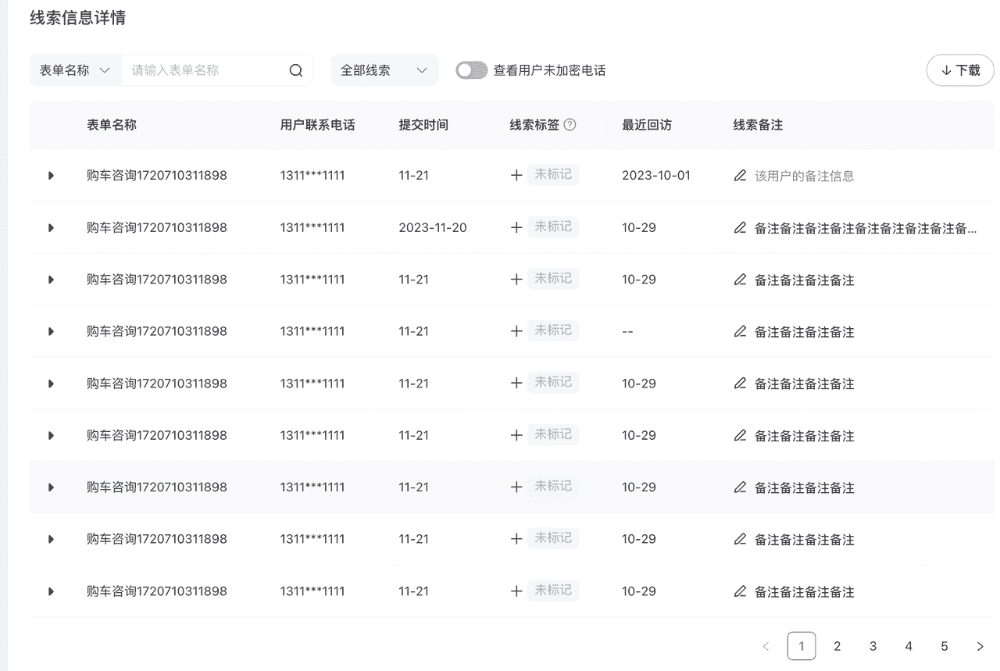
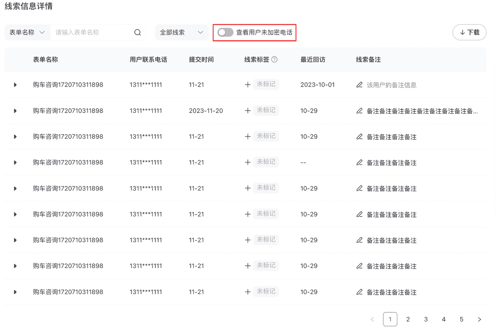
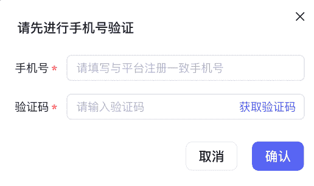
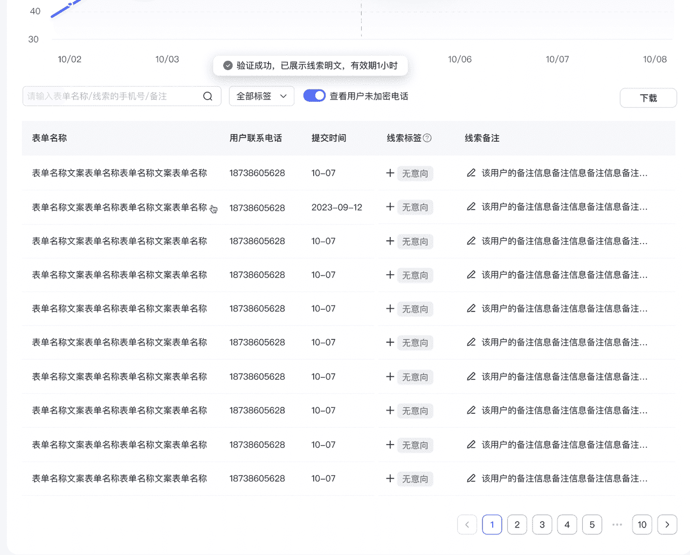
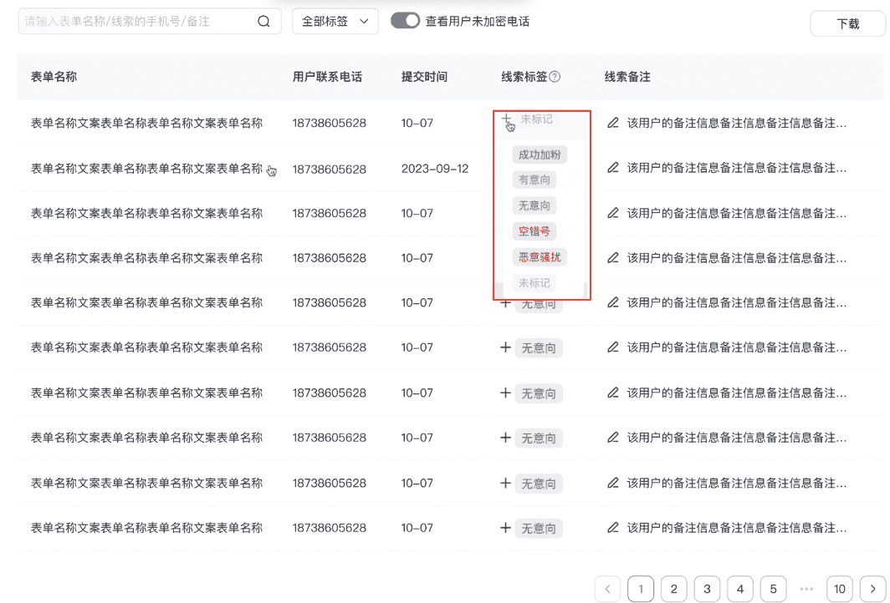
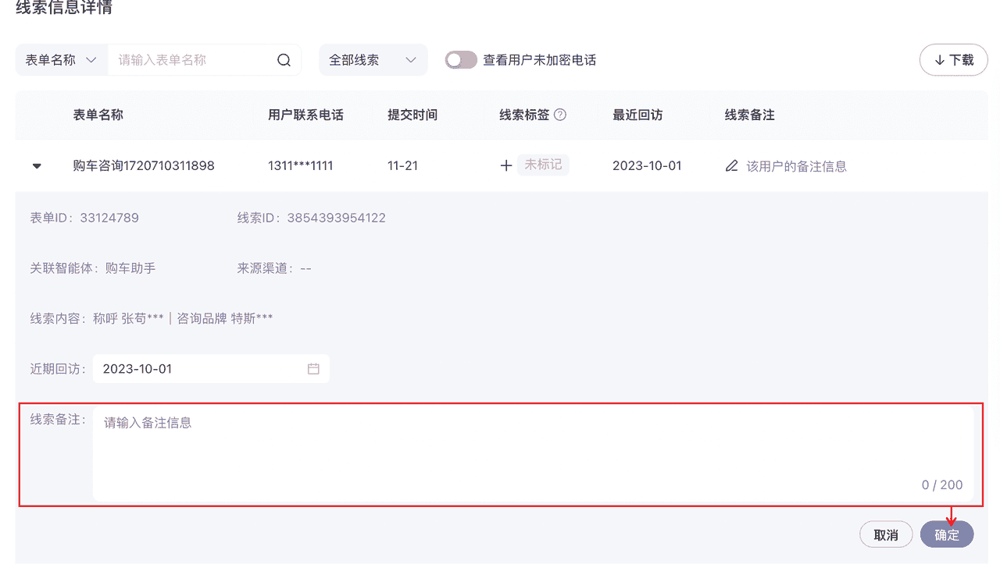
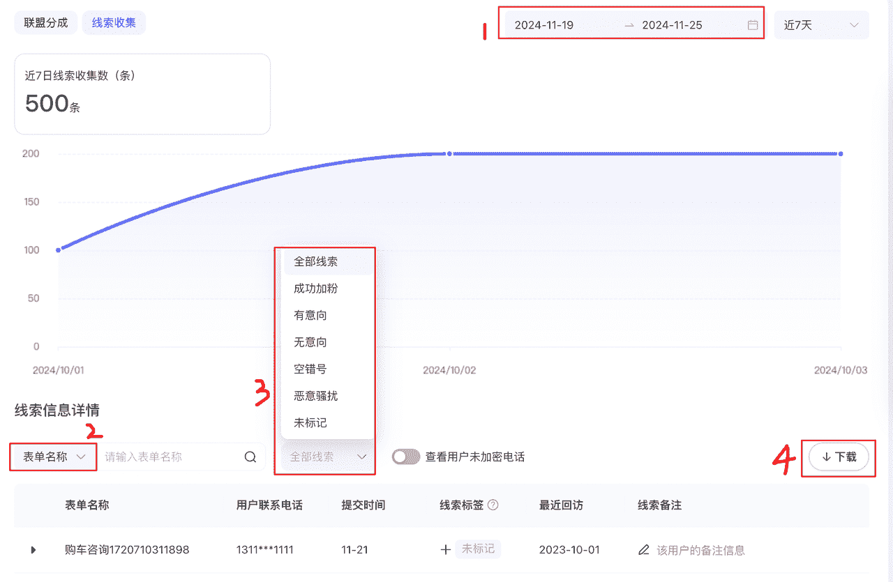

# 线索信息查看

> 来源：[https://hyperspace.feishu.cn/docx/Y7Ejd5to0onn6gxz2TCchjrFndh](https://hyperspace.feishu.cn/docx/Y7Ejd5to0onn6gxz2TCchjrFndh)

## 一、产品介绍

本功能为智能体平台内线索的查看和管理功能，支持文心智能体平台的开发者在创建智能体并配置线索组件后，在智能体后台对收集到的线索进行线索明细查看、编辑回访标签、线索下载等操作，实现在文心智能体平台内的线索挂载 - 收集 - 管理 - 回访转化闭环，提升开发者的体验。

## 二、应用场景

智能体挂载线索组件后，用户就可以在与智能体对话中触发并调起线索组件进行留资，开发者可以通过线索查看功能实时在平台查看用户填写的线索信息进行及时联系，同时也支持对线索标签化管理，方便开发者持续更新线索进展。

## 三、操作手册

### 3.1. 功能入口

智能体后台 ➡️ 我的收益 ➡️ 线索收集，默认展示最近 7 天的线索收集总数、BY 天维度线索趋势图、线索明细。

### 3.2. 查看线索明文

第一步，开启查看按钮，获取用户明文号码

第二步，进行手机号验证（支持企业入驻手机号或 TP 服务商手机号进行验证）。

第三步，手机号验证通过后，即披露手机号明文，有效期为 1 小时。

### 3.3. 线索编辑和管理

#### 3.3.1. 线索打标

在线索列表支持对每条线索进行回访后打标，标签类型有：成功加粉、有意向、无意向、空错号、恶意骚扰。

#### 3.3.2. 线索备注

支持对单条线索进行备注，需要对本次电话回访的客户的信息、基本情况、评估结果等进行细节描述，以便于后续查看。编辑完成后，点击确定即完成对线索的备注。

#### 3.3.3. 线索下载

支持按线索产生时间区间、表单名称、线索标签类型等进行线索筛选，筛选后点击【下载】列表的所有线索，以 xls 表格的格式进行产出。

