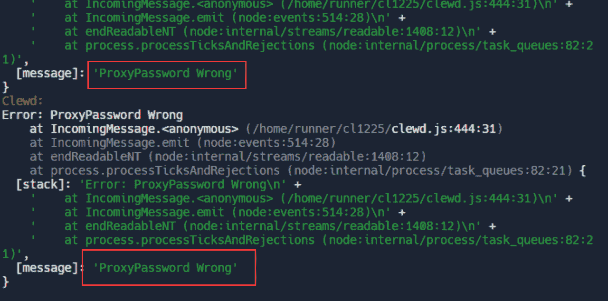
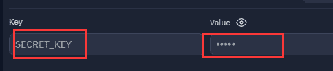
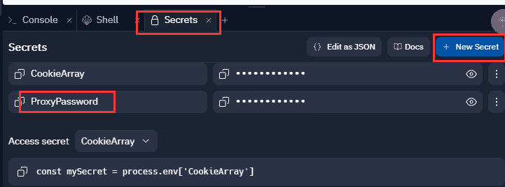
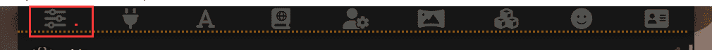
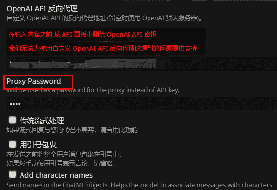
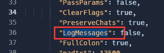
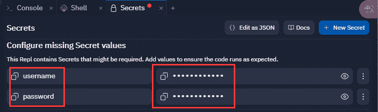
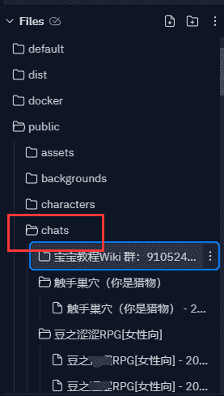

# 云端Replit如何防止被盗用cookie、暴露xp

> 来源：[https://docs.feishu.cn/docx/TubbdyGziofFMIxj2RKcERK6nbf](https://docs.feishu.cn/docx/TubbdyGziofFMIxj2RKcERK6nbf)

Replit平台的免费用户的项目都是公开的，任何人都可以找到你的酒馆，fork（克隆）和运行你自己的酒馆和Clewd，因此可以偷偷用你的Clewd反代链接和cookie、查看聊天记录品头论足你的xp。只有付费用户才能把酒馆设置为私用private，那么免费用户应该如何避免这种情况呢？

注：现在有人开脚本在定时扫Replit的clewd反代地址，尝试盗用，只要设了密码就能发现！

（备注：replit需要手动启动）

##### **Clewd加**密码防止被盗用反代和cookie

1.  打开你的云Clewd

1.  点stop

1.  参考上面的[Clewd与酒馆搭建教程](https://sqivg8d05rm.feishu.cn/wiki/E925wr6MKixS44kJUBtcB0uYnQe)或水秋[云酒馆b站教程](https://www.bilibili.com/video/BV1b34y1G7ei/)，找到Secrets选项

1.  点New Secret

1.  如下图，在KEY里填入ProxyPassword，Value👀里填入密码（你自己设置一个）

1.  Clewd点run，让它运行

1.  打开云酒馆，最左边的选项

1.  在之前填Clewd反代地址的地方的下面Proxy Password里填入你刚才设置的密码

1.  这样别人没有你的密码，即使有你的Clewd地址，也无法使用你的Clewd以及cookie

###### **错误填法**

不要把密码和cookie填到Secrets以外的地方！

不要把密码和cookie填到Secrets以外的地方！

不要把密码和cookie填到Secrets以外的地方！

如果填到config.js里的话，别人fork一下就连着config.js[一起fork了，全都看得](https://sqivg8d05rm.feishu.cn/wiki/E925wr6MKixS44kJUBtcB0uYnQe)见，具[体参考上面的C](https://www.bilibili.com/video/BV1b34y1G7ei/)lewd与酒馆搭建教程或水秋云酒馆b站教程，只能填到Secrets选项卡里。

##### 关闭Clewd的LogMessages设置

1.  打开你的云Clewd

1.  点stop

1.  找到config.js

1.  如图，找到"LogMessages"，如果是true，则改为false

1.  点run

这样Clewd这边的log日志就不会记录你的聊天记录以及xp

##### 确保酒馆SillyTavern 设置了密码

参考水秋的[云酒馆b站教程](https://www.bilibili.com/video/BV1b34y1G7ei/)，在Secrets里设置密码，不然谁都可以进你的酒馆玩你的waifu用你的饼干。

确保左边填username和password这俩关键词，右边才是填你自己的账号和密码，很多人填错了导致启动不了

##### 删除酒馆SillyTavern里的聊天记录和聊天记录备份

（如果大佬有更方便的删聊天记录方法可以在群里@江贤之补充）

如果你实在是不想别人看你的聊天记录对你的xp指指点点，可以每次聊完就删除聊天记录和备份文件

1.  在replit打开你的云酒馆

1.  如图，找到chats文件夹，这里面都是你的聊天记录，你可以点进去选自己喜欢的下载下来。

1.  右键chats文件夹，弹出的菜单里有红色的Delete，点它可以删除整个聊天记录文件夹

1.  如果你玩了群聊，可以用相同方法删group chats文件夹

1.  滚轮向上滚，有个文件夹叫backups，里面都是聊天记录的备份，右键删除整个文件夹

这样别人就不能看到你的聊天记录了

