# Colab 部署 Clewd+酒馆

> 来源：[https://docs.feishu.cn/docx/AOqGdi6d7o1t2Wx8yEscr5hLnzE](https://docs.feishu.cn/docx/AOqGdi6d7o1t2Wx8yEscr5hLnzE)

作者：

教程：

# Clewd

链接：https://colab.research.google.com/drive/12xjexwDcb2qwlvLk0x9UatP25Ff2jYkQ?usp=sharing

1.  进入[链接](https://colab.research.google.com/drive/12xjexwDcb2qwlvLk0x9UatP25Ff2jYkQ?usp=sharing)，点击“复制到移动硬盘” （或点击“文件” - “在云端硬盘中保存一件副本”），并打开新链接。

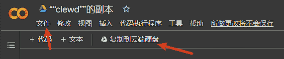

1.  电脑端点击“复制**保持的代码按钮”，按F1****2打**开开发者工具，选择控制台（Console），然后在输入框输入复制后的代码并按回车。手机端按下音乐播放器上的播放键以保持选项卡处于活动状态。

1.  往下翻，在此处填写你的Cookie，反代密码等。

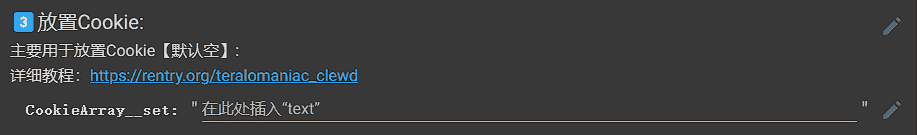

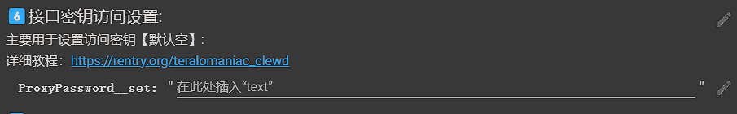

1.  点击这里运行clewd

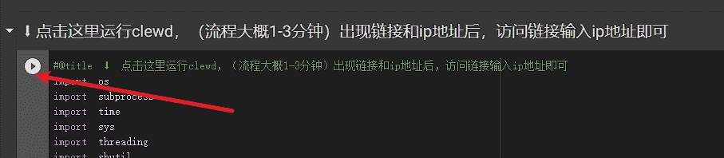

1.  （流程大概1-3分钟）往下翻，出现链接与正常登录后，访问链接。

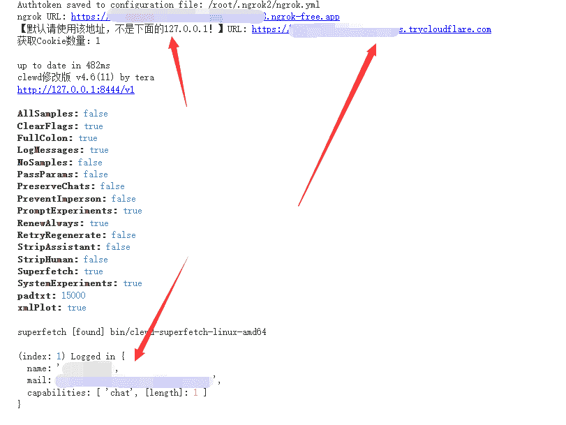

1.  点击“点击复制链接”，复制你的Clewd反向代理链接。

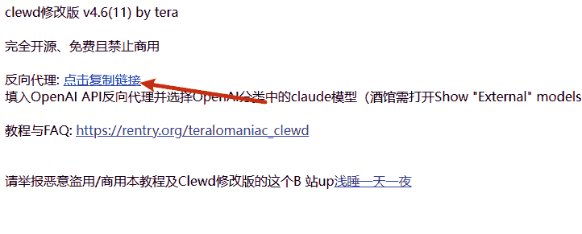

# 酒馆

链接：https://colab.research.google.com/drive/1ryepDoyjZCA6i7Vfkw2JNIC0k8vpDFTs?usp=drive_link

1.  进入[链接](https://colab.research.google.com/drive/12xjexwDcb2qwlvLk0x9UatP25Ff2jYkQ?usp=sharing)，点击“复制到移动硬盘” （或点击“文件” - “在云端硬盘中保存一件副本”），并打开新链接。

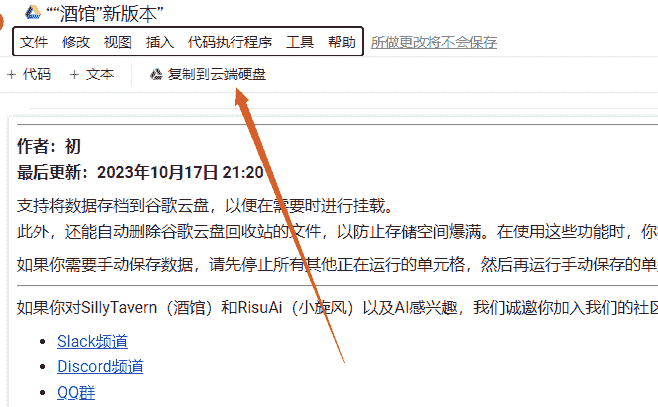

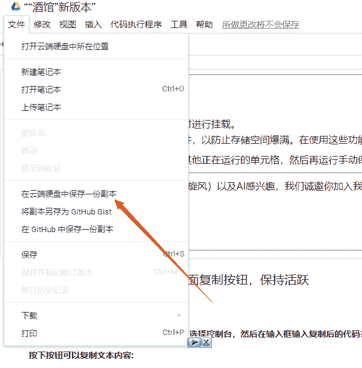

1.  电脑端点击“复制**保持的代码按钮”，按F1****2打**开开发者工具，选择控制台（Console），然后在输入框输入复制后的代码并按回车。手机端按下音乐播放器上的播放键以保持选项卡处于活动状态。

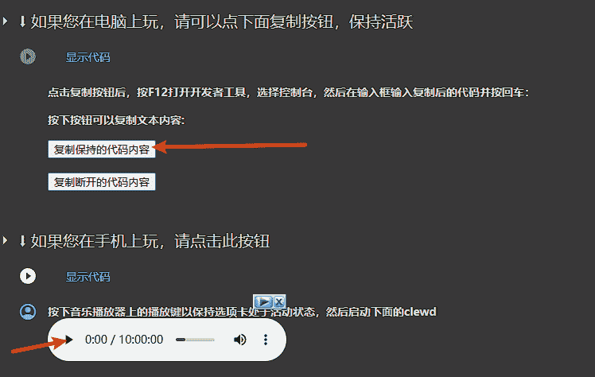

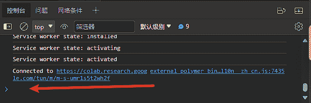

1.  点击这里运行酒馆

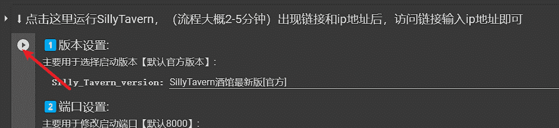

1.  （流程大概2-5分钟）出现链接和ip地址后，访问链接输入ip地址即可

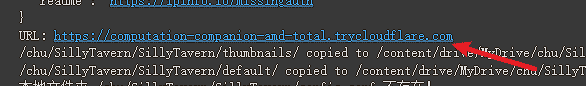

1.  进入酒馆并输入名字（不要选择简单界面），点击第二个按钮选择OpenAI，点击第一个按钮填写反向代理地址并保存。然后如图所示。

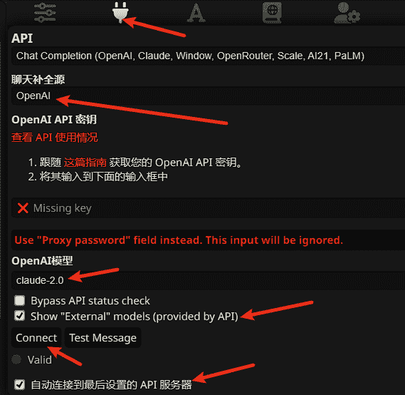

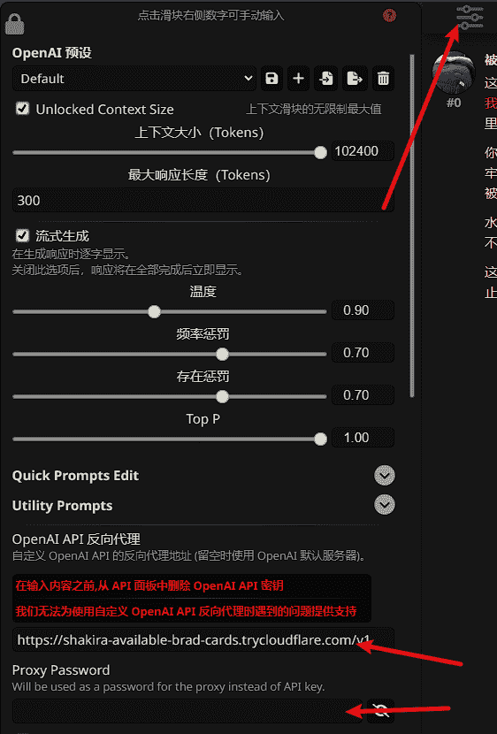

ps：酒馆不玩的时候记得执行下手动保存

pps：edge  添加 [*.]google.com

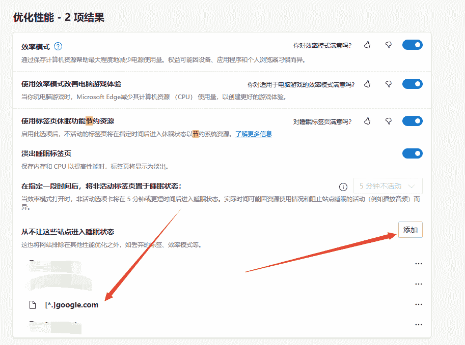

ppps：谷歌浏览器 保持活动添加 colab.research.google.com

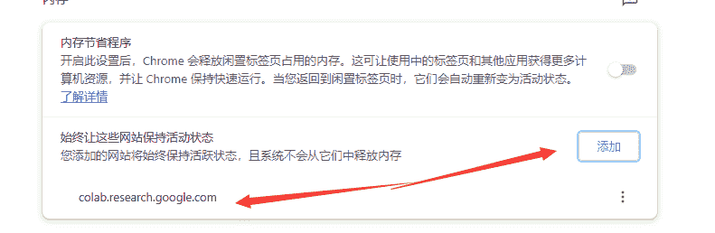