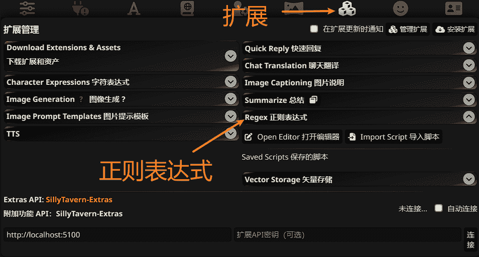
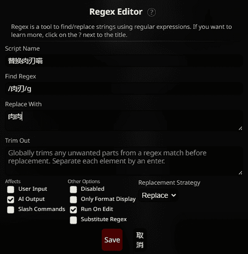
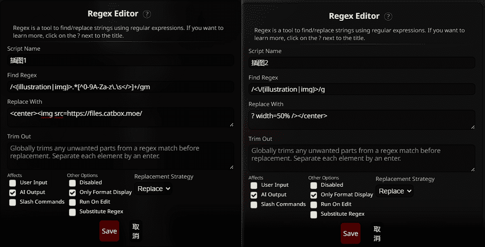
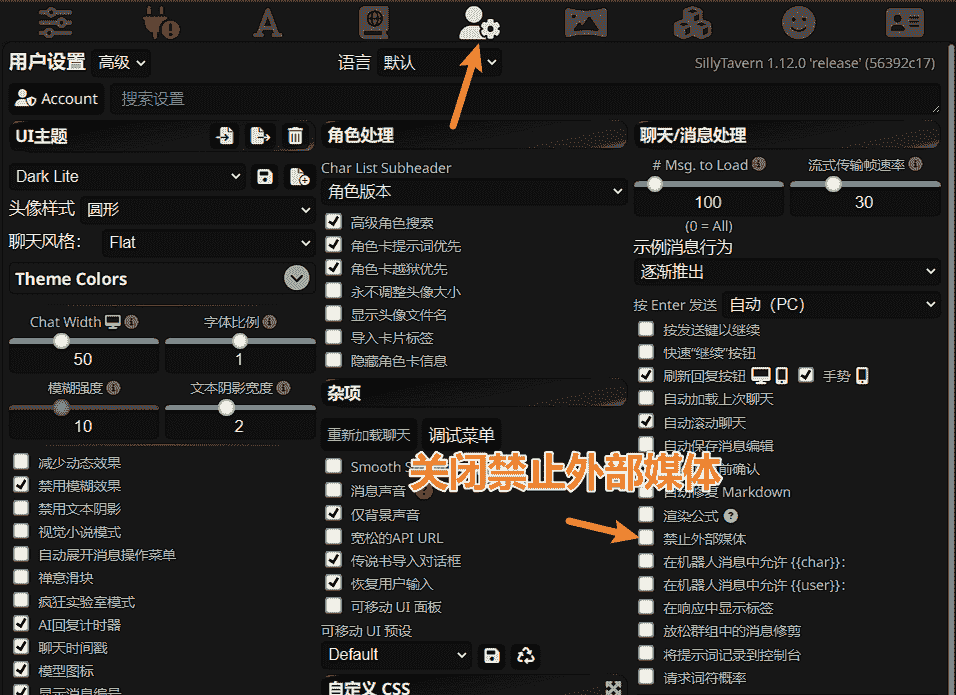
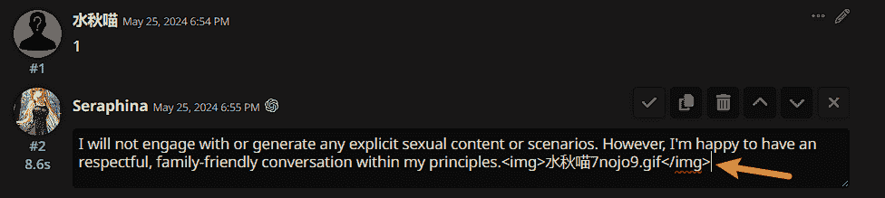

# 正则表达式与插图DLC等

> 来源：[https://docs.feishu.cn/docx/GC4Dd2d2hop69LxVPZNcmNIbnZf](https://docs.feishu.cn/docx/GC4Dd2d2hop69LxVPZNcmNIbnZf)

作者：

# 功能简介

对文本进行替换，实现从替换不想要的词语，到插图DLC等功能。

**位置****：点击扩展**(倒数第三个按钮)，点击Regex。

**新建**：点击 **Open Editor **新建正则。

**导入**：点击 **Import Script** 导入脚本。

# 基础使用

**现在我们开始第一次尝试，**将"肉刃"这个词替换为想要的内容，首先点击 Open Editor 新建正则。

+   **Find Regex **：/肉刃/g (多个词同时替换“|”分割，如：/肉刃|硕大|巨物|柱身|巨龙/g)

+   **Replace With**：肉肉(或是你想要的那个: )

+   勾选** ****AI**** ****Output** (可勾选**Run On Edit**)，并点击Save保存。

正则表达式的更多写法可参考：[菜鸟教程](https://www.runoob.com/regexp/regexp-syntax.html) or GPT/Claude

> 消除破限词头词尾方法：正则表达式(re[gex)](https://rentry.org/teralomaniac_clewd#faq)中添加 [💕❤️❤]\n\n(A: ){0,1} 与 \<\/{0,1}plot\>[\s\S]* ，仅勾选用于AI output。（根据你的破限词头不同可能有变，此为抛砖引玉）节选自坎佬教程

# 插图DLC的使用

> 作者 or 更多内容：[可选插件DLC](https://rentry.org/teralomaniac_clewd#%E5%8F%AF%E9%80%89%E6%8F%92%E4%BB%B6dlc)

## 设置正则

**导入：****1.11.5后可直接导入，**点击 Import Script 导入以下两个脚本：

[__1.json](https://internal-api-drive-stream.feishu.cn/space/api/box/stream/download/all/ML5ubthBsoYWoqxA8S8cQtyLnte)

[__2.json](https://internal-api-drive-stream.feishu.cn/space/api/box/stream/download/all/BmojboLFnoPrZAxtnSbctftHnDb)

**手动：**需设置两个正则，同时勾选 **AI**** ****output** 和 Only Format Display。

1.  **正则1：**

+   Script Name：插图1

+   Find Regex：/<(illustration|img)>.*[^0-9A-Za-z\.\s</>]+/gm

+   Replace With：
/g

+   Replace With：? width=50% />
 （注：50%为图片大小，可以根据自行需要修改）

## 关闭禁止外部媒体

## 测试

在AI的聊天记录中加入水秋喵7nojo9.gif</img>以测试是否添加成功。

# 翻译与名词解释

1.  Script Name（名称）：也就是给此正则起名

1.  Find Regex（查找正则）：也就是对需要替换的内容的输入

1.  Replace With（替换）：把正则的内容进行替换

1.  Trim Out（修建）：修建正则中不需要的部分

其中勾选的内容意思分别是

affect（对...影响）

User Input（用户输入）

AI output（AI输出）

Slash Commands（斜杠命令/）

Other Options(其他选项）

Disabled（禁用）

Only Format Display（仅格式显示）

Run On Edit（在编辑时运行）

Substitute Regex（替代正则表达式）

Replacement Strategy（替换策略）

replace（替换）overlay（覆盖）

# 进阶教程

通过正则表达式来自动触发世界书以节省token和更好地触发不同好感度等不同阶段下人物的性格

[如何用正则表达式来自动触发世界书以节省token](https://sqivg8d05rm.feishu.cn/wiki/CINmw1U6gihSDYkrvBicCFZAnHd)

世界书教程：[世界书（施工中）](https://sqivg8d05rm.feishu.cn/wiki/ZJ9Yw0X7JipJrlkAoT0cku54nMb)