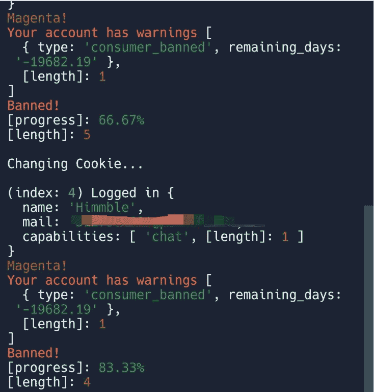

# 如何查看cookie饼干是否过期、被封

> 来源：[https://docs.feishu.cn/docx/Ng3mdMvp7oUtwCxOgNkcSeyLnNc](https://docs.feishu.cn/docx/Ng3mdMvp7oUtwCxOgNkcSeyLnNc)

参考[Clewd版本功能说明](https://rentry.org/teralomaniac_clewd_ReleaseNotes)

1.  打开你的Clewd，先点stop停止运行

1.  点开config.js

1.  Cookiecounter改为-1

1.  打开你的clewd，点run

1.  等他跑完，看输出结果

1.  看完结果没问题了，再改回原来的数字，点run运行

输出是类似这样的界面：

###### **关键词解释：**

+   Banned!就是被封了

+   warning因各种原因而被警告，比如黄标、封1天、永封等

+   expired就是cookie过期，需要重新抓

+   Overlap是跟别的cookie重复了，同一个邮箱抓了多个cookie，这些饼干都共用cd，这是没有意义的

+   Unverified! 没通过短信验证之类的号

+   Restricted!此号被黄标警告了

+   Exceeded limit!此账号到达对话上限，歇几个小时吧

没提示就是一切正常

###### **其他关键词：**

+   Magenta是11月16号左右claude新出的模型，现在可能所有人都是这个模型了（这个关键词应该不会再出现了，现在大家都是claude2.1）

+   index代表当前是第几个cookie，方便你删除被封的cookie、用邮箱重新抓取过期cookie

+   [progress]代表当前查询cookie的进度，比如你有10个号，它就每次10%的往上涨，100%代表全部cookie都查询完毕

+   length表示你填入CookieArray的cookie数量