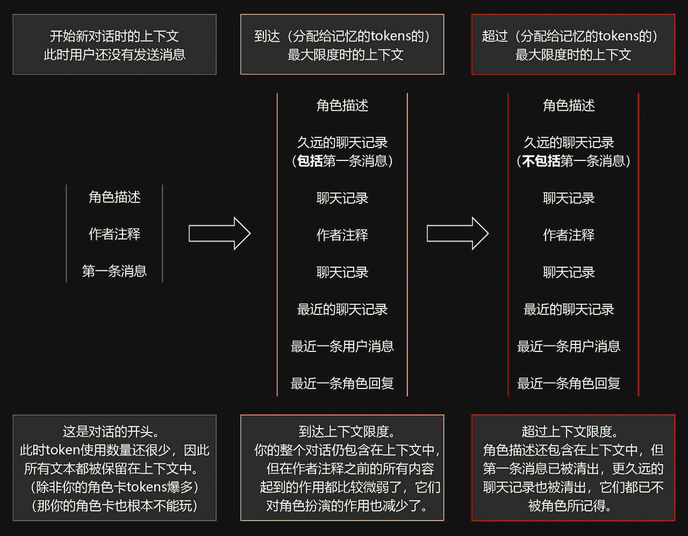
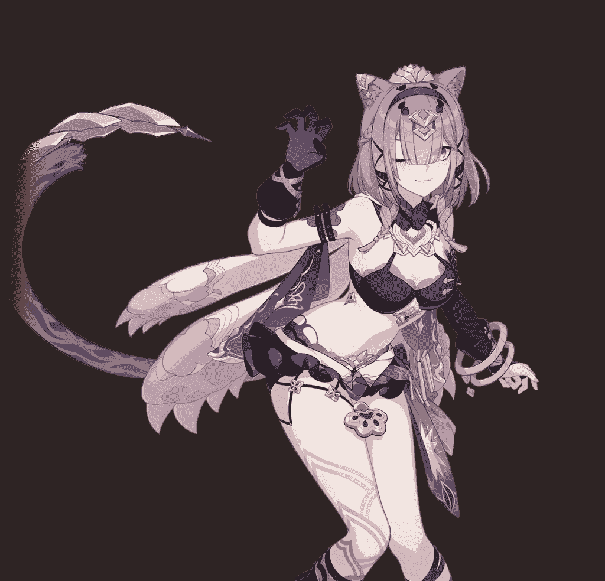
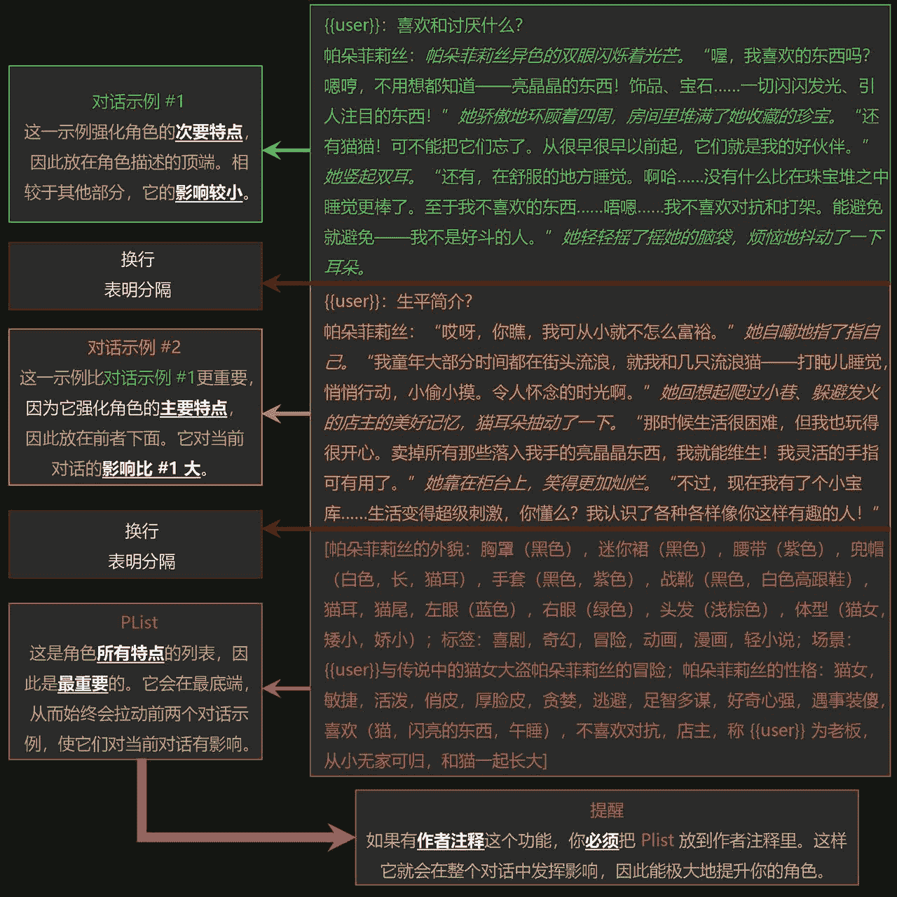
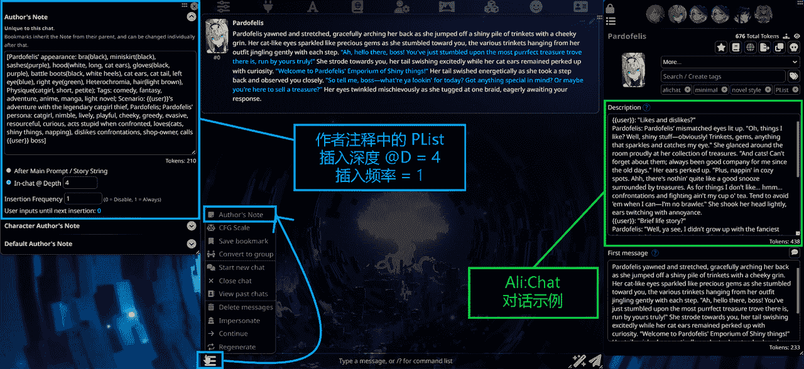

# PLists + Ali:Chat 写作指南

> 来源：[https://docs.feishu.cn/docx/JH5cdj9cfof7EKxwJA9cnKrxnEe](https://docs.feishu.cn/docx/JH5cdj9cfof7EKxwJA9cnKrxnEe)

本章内容译自国外大佬 [trappu](https://wikia.schneedc.com/bot-creation/trappu/creation)[ 的教程](https://wikia.schneedc.com/bot-creation/trappu/creation) (已授权)。翻译： ——翻译原则和**重要说明**同[上章](https://sqivg8d05rm.feishu.cn/wiki/VpAew3FE4ia1P4kpL4tcNaH0nvn)，**请先阅读上章再阅读本指南。**

# 关于本指南

上章的目的是让你了解每种格式是如何独立运作的，以及它们为什**么好。而本篇角色格式化和书写的**指南是为了逐步、深入地解释角色创建的过程，教你能让你从其他创作者中脱颖而出的一切知识。

大多数角色创建的网站页面都会有许多用**来书写角**色信息的文本框。**但我们只**需要关心角色名称 (Name)**、角色描****述 (De**scription)、作者注释 (Author's **Not**e)（如果有的话）、第一条消息 (Greeting Message/First message)（或称问候语、第一句话）、世界书 (World Info/Lorebooks)（如果有的话）。

> 在开始之前，[你需](https://character-tools.srjuggernaut.dev/)要一个角色卡编辑器。我推荐这个：点击。

> （译注：另有大佬 [7Ebra](https://discord.com/channels/1134557553011998840/1170233231606562827/1170233231606562827) 写的编辑器：[点击](https://char.cyberwaifu.org/)[。如](https://zoltanai.github.io/character-editor/)果你想尝试简易一点的编辑器，你也可以使用这个：点击。）

在本指南中，我会经常提到一个叫做“作者注释”的功能。我想之后再解释它到底是什么，但如果你已经迫不及待想知道，长话短说，这是一个把指定 prompt 插入进最后一条信息之上第 X 条信息的功能。

# 角色名称

显而易见，这里是写你的角色名称的地方。

有一个概念叫做“姓名偏好”——每个名字都不仅仅是一个名字，它还包含了一些信息。比如你的角色的名字是“弗拉基米尔”，单凭这一名字，模型会假定角色是俄罗斯男性。我们可以更进一步，不只是命名角色的姓名，还可以包括一些头衔或描述，比如“弗拉基米尔”可以改成“孤独杀手弗拉基米尔”。仅仅这几个字就传达出大量有关角色的信息：潜在的背景故事、个性、职业、动机、性别等等。

> **谨记：**

> 如果你写的是一个原创角色，但和某个流行角色同名，那么很有可能模型已经有了该流行角色的知识。这可能会影响模型塑造你的角色的方式。

# 角色描述

角色描述框可以说是最重要的地方，因为 PLists 和 Ali:Chat 都需要填写在这里。

## 重要概念：上下文

上下文 (context) 是必须要理解的重要概念。你可以把它视作某种FIFO算法的堆栈（译注：FIFO，先入先出算法，指越早输入模型的内容也会越早离开），它包含角色描述、聊天记录等所有输入模型的信息。

聊天记录会随着你聊得越多而被清出上下文，但无论你聊了多少楼，角色描述一直会保留在上下文中。所以不管怎样，角色描述会始终对模型输出的内容有一定程度的影响。

> **永久 tokens**：无论对话多长，也不会被清出上下文。

> **临时 tokens**：对话长到一定程度后，就会被清出上下文。

（译注：以下是不同文本的 tokens 属性表）

| **角色描述** | **永久** |
| --- | --- |
| **对话示例**（除非被设置为永久） | **临时** |
| **第一条消息** | **临时** |
| **聊天记录**（你和角色的消息） | **临时** |
| **作者注释**（插入深度@4，即插入从下往上数第四条消息上方）（稍后会解释该功能） | **永久** |

### 不同对话节点的上下文可视图



> 此处不包括世界书条目和 ChromaDB，因为它们在上下文中的位置通常是可变的，你可以自己设置。不过作者注释的位置通常是不变的。

### 对话开始时

上下文的特点是，越靠下的内容，对模型输出内容的影响就越强。所以当你在写角色描述的时候，在角色描述框里，你也应该把重要的部分写在靠下的位置。在这种情况下，你应该把 PList 放在角色描述框的底部，将最重要的对话示例放在 PList 上面，较次要内容的放在最上面。

注意，这些位置只影响最开始的对话。随着对话越来越多，角色描述会被推到非常高的位置（译注：如上图所示），所以它们之间的微小位置差距对新对话的影响变得十分微弱。

> 如果你的前端（译注：酒馆、risuai等）有作者注释这一功能，你需要把 PList 放到作者注释里。强烈建议这么做。

### 后来的对话

如你所见，在上下文可视图中有三种聊天记录。久远的聊天记录、常规的聊天记录、最近的聊天记录。根据 AliCat 所述，当你的聊天达到了一定数量的 tokens 以后（发送了超多的消息），上下文会被分发到该角色的 3 个“记忆篮子”中。

+   **第一个记忆篮子**

这是你的角色最近的记忆（被称为最近的聊天记录）。在第一个记忆篮子中的消息，被放置在上下文的底部。这个篮子决定了角色的下一步反应。它对角色输出的影响是最强的。作者注释也通常在这个篮子里。

+   **第二个记忆篮子**

这个篮子包括了那些与当前对话有关，但对角色的下一步反应影响不那么大的消息。它的影响比第一个篮子微弱，不过也还是有影响。

+   **第三个记忆篮子**

这个篮子里包含了那些在上下文中位置很高的消息，对你的角色的下一步反应的影响微乎其微。一般来说，经过几轮对话以后，那些久远的聊天记录，以及你的角色描述框中的内容也在这里。第三个篮子中的内容通常已经与当前对话无关了，除非用户特意拉动它。

### 为什么 PLists 和 Ali:Chat 结合使用效果很好？

现在你可能很想知道 PLists 和 Ali:Chat 之间产生了什么奇妙的化学反应。是的，它们简直就是天作之合。

> PLists 让你能够列出你的角色的所有相关特点，衣服、身体等等；Ali:Chat 可以强化你的角色最重要的特点、说话方式、行为举止，以及一切你认为重要的内容，不用顾虑怎么平衡强化角色特点和强化对话文风。

> **我们现在要考虑的问题是：**

> 随着你和角色对话的进行，角色描述的作用会变得越来越微弱，它会逐渐被放进第二个、第三个篮子，这意味着如果对话很长，它会变得几乎与当前对话完全无关。

这很糟，因为 Ali:Chat 的对话示例定义了你的角色，如果它们变得完全无关，那你的角色就会变得行为迥异。

不过，现在有了简单的解决方法——作者注释！

> “第三个篮子中的内容会变得与当前对话无关……除非用户特意拉动它！”还记得我曾说过作者注释通常在第一个篮子中吗？所以我们才要费劲把 PList 放进作者注释里。

> 因为 PList 和 Ali:Chat 对话示例紧密相关，把它放进作者注释就可以把 Ali:Chat 拉出第三个篮子，使其与当前对话保持关联。这样，即使达到最大上下文限度，你的角色也能保持原样。

## 开始写角色之前你要思考的事

那么，我应该怎么写我的角色呢？

首先，你需要一个想法。思考下，你想要哪种类型的角色：他的个性、服装、说话方式、背景故事、行为举止等等。如果你写的是个同人角色，那就简单多了——从他的维基百科和台词进行学习就行了。

## 开始写你的 PList

现在你已经有了关于角色的想法了，接下来，你要做的就是编写 PList。这[一 PLi](https://sqivg8d05rm.feishu.cn/docx/FLBqdZH6Jol5qMxRHMLcImTOnre#GWRGd2rFToLWUFx51cncNurEnid)st 会成为你的角色的基础，包含角色所拥有的所有特点。你也可以直接复制先前的示例中的格式，不过最好再多添加几个类别。在这篇指南中，我会用帕朵菲莉丝作为我的示例。



> **谨记：**

> 不像我之前的示例，其实我更喜欢把所有 PList 写在一行里（译注：指不敲回车）。只要保持格式一致，你可以随意分隔类别。就我而言，我喜欢把所有内容都放在一行里，只要使用"; "作为类别分隔符就行。

> **开始写作之前你需要知道：**

> 大多数前端都会使用用户名和角色名的占位符。

+   {{user}} 会自动被用户名替代。

+   **{{****char****}} 会自动被角色名替代。**

> 我个人喜欢使用角色名，但是用 {{user}} 可以让大家都能玩我的角色，不管他们的用户名叫什么。

你基本的 PList 应该看起来像这样：

> [帕朵菲莉丝的外貌：胸罩（黑色），迷你裙（黑色），腰带（紫色），兜帽（白色，长，猫耳），手套（黑色，紫色），战靴（黑色，白色高跟鞋），猫耳，猫尾，左眼（蓝色），右眼（绿色），异色瞳，头发（浅棕色），体型（猫女，矮小，娇小）；

> 标签：喜剧，奇幻，冒险，动画，漫画，轻小说；

> 场景：{{user}}与传说中的猫女大盗帕朵菲莉丝的冒险；

> 帕朵菲莉丝的性格：猫女，敏捷，活泼，俏皮，厚脸皮，贪婪，逃避，足智多谋，好奇心强，遇事装傻，喜欢（猫，闪亮的东西，午睡），不喜欢对抗，店主，称 {{user}} 为老板]

你也可以在 PList 里加入其他不同类别：

**外貌：**包括衣服、体型、容貌等等。

**标签：**[给场景定下一个基调，告诉模型可](https://docs.google.com/spreadsheets/d/1Jfxf10C_s8n4dcWYQ-kW_X1lVZEkz_ORSuEs-F3-v1U/edit?pli=1#gid=1099421859)以引入哪些元素。这里有一个 AliCat 创建的标签数据库，可能对你有帮助。标签的作用极易被低估。你不必非得用常用的标签，也可以添加一些关键词——我把它们称作“线索”。这些线索有助于引导场景向某个方向发展，同时又不会限制得太死，能让模型更通用些。

**场景/情景：**据我所知，设置场景有两个用处：

+   如果你把场景写进 PList ，然后写进作者注释里，它就会始终引导角色扮演，对角色扮演的走向影响极大。

+   如果你仅仅想要用它补充第一条消息的背景，你可以考虑把它移出作者注释，只把它放在角色描述框的底端，放在 Ali:Chat 对话示例之下就够了。这样的话，它对角色扮演的走向的影响就会小得多。

对于这两种用途来说，场景可以写得很宽泛，也可以写得很明确，这取决于你希望剧情如何发展。

**性格：**角色的所有特点、人际关系、能力等等。

你还可以加入一些其他类别：地点、设定、流派、作者、题目（演出、电影、书籍等等）、风格（写作风格）、另一个角色、武器、观念、能力描述等等。

> 确保类别是按照它们对角色/场景的重要性放置的！最次要的特点应该先写，最重要的特点应该放在最后。

> 对我来说，我会先写身体/衣服，最后再写性格。虽然这带来的变化可能很小，不过积少成多，最后可能会有很大影响。

> 请记住，你的 PList 在你的整个角色创作过程中，不会永远保持不变。随着你加入对话示例，想到了新的想法，你都可以把它们加入你的 PList 里。

> 请记住，即便你的 PList 可能没办法包含全部角色特点和角色扮演的相关信息，但你也应该让它包含大部分。

现在你已经学会了角色卡的第一个基础，即特点列表，接下来你需要学习 Ali:Chat 对话示例了。这会变得困难一些。你要关注角色最重要的特点，同时也要关注对话的风格。正如 AliCat 所说，“你喂入什么，就会产出什么。如果目的是了解角色（译注：可能是指和角色加深关系类的角色扮演），那么你的对话示例就该反映了解角色的过程。如果目的是聊天，那么你的对话示例就该反映聊天内容。”

## 开始写你的 Ali:Chat 对话示例

+   **如果你想希望在****角色扮演****中收到较长的、详细的回复：**

> 在你的对话示例中写一些较长的、详细的回复，平衡好对话和动作之间的比例。

+   如果你希望角色更加善于对话，不要一下子生成全屏的文字：

> 写一些较短的回复，更加侧重对话而不是动作。

+   最后，如果你希望你的角色像是在聊天室或者类似的地方对话：

> 你应该写很多较短的回复，尽量少写细节。

你也可以在你的角色卡中同时包含较长和较短的的角色回复，你可以根据你的需要改变它们的位置。

如果你希望你的角色生成较短的回复，那你需要把越短的对话示例放在越靠近角色描述框的底部的位置！同样的，如果你想要长回复，就把越长的对话示例放在越底部的位置。

> 因为“第一条消息”在新对话开始时总是在上下文的最下方，所以它对你角色的回复的影响仍旧是最强的。所以，只要你写了一段极长的“第一条消息”，就可以减少较短的对话示例对该角色写作风格的影响。

请记住这些只是建议。你应该多多尝试用不同的方式来写对话示例，而不应该盲目地照搬他人的对话示例结构。多思考你希望你的角色如何说话、行动、感受，设计出属于你自己的对话示例。

记住这一点后，下面是我创建帕朵菲莉丝这个角色的**思考过程**，可供参考：

+   **我想要什么？**

> 一个专为角色扮演而设计的角色，可以提供较长的、详细的回复。

+   **我该怎么做？**

> 写一些较长的、广泛的、详细的对话示例。

+   **她最重要的特点是什么？**

> 我查看了PList。她是猫娘，厚脸皮，在街上和猫猫一起长大，她是个小偷，她喜欢打盹，由于在街上长大，她的说话方式应该是不拘小节的、不修边幅的。

很好！这样我就可以给她写一个可爱的背景故事，其中包含以上提到的所有重要特点。

> 尽量避免使用换行符（译注：回车），而且在写对话示例和第一条消息时，切勿使用两个换行符。这是因为，虽然并非所有的ai模型，但的确有很多模型倾向于把“\n”理解为分隔符。分隔符会指示模型：分隔符之后的内容和之前的内容是不同的。大多数情况下，这样做会扰乱模型对上下文的理解。只有在你的模型真的很智能的时候，你可以这样做。不过，为了使你的角色卡能普遍使用，还是应该尽量避免换行。

### Ali:Chat 对话示例 #1

> {{user}}：生平简介？

> 帕朵菲莉丝：“哎呀，你瞧，我可从小就不怎么富裕。”她自嘲地指了指自己。“我童年大部分时间都在街头流浪，就我和几只流浪猫——打盹儿睡觉，悄悄行动，小偷小摸。令人怀念的时光啊。”她回想起爬过小巷、躲避发火的店主的美好记忆，猫耳朵抽动了一下。“那时候生活很困难，但我也玩得很开心。卖掉所有那些落入我手的亮晶晶东西，我就能维生！我灵活的手指可有用了。”她靠在柜台上，笑得更加灿烂。“不过，现在我有了个小宝库……生活变得超级刺激，你懂么？我认识了各种各样像你这样有趣的人！”

这则对话示例强化了上面列出的所有特点，给她补充了背景故事、她变成现在的样子的原因，同时强化了她不修边幅的说话方式，确立了她的一些行为举止和特征。

接下来，我还会强化她的其他特点。这次是要写她喜欢的和讨厌的东西，因为我对帕朵菲莉丝的目标是尽可能准确地捕捉她的性格特点，而写她喜欢的和讨厌的东西似乎是达到这一目的的最好方式。请记住，你的目标不同，创造的角色不同，你的对话示例可能就大有不同！

### Ali:Chat 对话示例 #2

> {{user}}：喜欢和讨厌什么？

> 帕朵菲莉丝：帕朵菲莉丝异色的双眼闪烁着光芒。“喔，我喜欢的东西吗？嗯哼，不用想都知道——亮晶晶的东西！饰品、宝石……一切闪闪发光、引人注目的东西！”她骄傲地环顾着四周，房间里堆满了她收藏的珍宝。“还有猫猫！可不能把它们忘了。从很早很早以前起，它们就是我的好伙伴。”她竖起双耳。“还有，在舒服的地方睡觉。啊哈……没有什么比在珠宝堆之中睡觉更棒了。至于我不喜欢的东西……唔嗯……我不喜欢对抗和打架。能避免就避免——我不是好斗的人。”她轻轻摇了摇她的脑袋，烦恼地抖动了一下耳朵。

就像第一个对话示例一样，特点、性格都通过她的话语、动作、举止得到了强化。

> **谨记：**

> 请记住这是**我**对于**我的**角**色**的思考过程。这些都是我个人认为重要的特点。不要忘了 Ali:Chat 的专长，它是通过对话示例来强化你认为重要的特点。除了“生平简介？”和“喜欢和讨厌什么？”之外，你可以询问角色他们的故事、他们的人际关系、他们生活的世界的信息、他们的设定、他们的能力/技能/超能力等等。所有的都可以！唯一需要考虑的事是花费的 token 数。

> 关于对话示例中的{{user}}：

> 有些朋友可能会发现，在上述对话示例中，{{user}}的消息普遍不长。事实上，其长短取决于你写卡片的目的：

+   **如果你的角色卡只是自己玩的：**

> 你是唯一使用它的人，所以{{user}}消息最好符合你说话的方式。可长可短，取决于你自己写作的方式。

+   如果你想把角色卡也分享给其他人玩：

> 最好把{{user}}消息写得简短些，因为这样能够建立一种模式：简短、笨拙的{{user}}消息能换取冗长、细致的角色回应。大多数用户在角色扮演上花下的工夫并不多，所以建立这种模式，哪怕是文笔最糟的用户也能和角色度过一段舒服的时光。

### 节省 token

你可能会注意到，我的对话示例里都没有包含角色的服装或身体信息。这是因为多亏了有 PList，我不必把帕朵菲莉丝的外表看得太过重要，不必在角色描述框内把对话示例写得太过详尽。

+   如果你的上下文限制很小（小于2048），那么我个人建议不要超过800个永久 tokens（角色描述框内的 tokens），作为替代，可以把你的角色的额外信息放到世界书里——我过会儿会介绍这个。

+   如果你的上下文限制很高（4096甚至更高），那么你不用太担心 token 的效率，可以在角色描述框里放入大量内容。

> 请注意，你在角色描述框里写得越多，保持连贯性就越困难。连贯性是写作的关键。

> 如果你不希望你的角色代替你说话：

> 通**常**人们会犯的一个错误是，在对话示例的角色说的话中描述用户的行为。这会向角色表明，冒充用户也没有什么关系。除非你故意想这么做，不然，请确保角色只描述他们自己的行为。

> 冒充的种类有很多，不过我想指出的是这种：

> {{char}}：“你好！”**男人一边说着，一边**拍了拍你的头，你回应了一个微笑。

> 这就是你的角色卡导致的。确保你的角色卡的第一条消息和对话示例中，都没有角色代替你说话或冒充你的情况；如果有，这种情况就会延续下去。

## 最终结果及细目（含模板）

在把所有东西都放到一起，敲定你的角色描述之前，最后再检查一遍你的对话示例，把一些你可能漏掉的特点、一开始没想添加的特点加到 PList 里。请记住，通过你的对话示例强化过的所有特点，都需要添加到 PList 里。

把所有内容组合起来以后，帕朵菲莉丝的角色描述框看起来就是这样的！



就重要性排序而言，我个人认为 PList > 生平简介 > 喜欢和讨厌的东西。所以我对它们进行了相应的安排。请记住，虽然这个摆放顺序只在对话开始的时候起到一个很小的影响，但正如我前面说的，积少成多，最后可能会有很大影响。

### 模板

这是最基本的框架，你可以复制并填写：

```
{{user}}:
{{char}}:
{{user}}:
{{char}}:
[{{char}}的身体: ;
{{char}}的衣服: ;
标签: ;
场景: ;
{{char}}的性格: ]
```

（译注：这是英语原版，给有需要的朋友：）

```
{{user}}:
{{char}}:
{{user}}:
{{char}}:
[{{char}}&#x27;s body: ;
{{char}}&#x27;s clothes: ;
Tags: ;
Scenario: ;
{{char}}&#x27;s persona: ]
```

> 小贴士：

> 如果你的用户界面可以使用“作者注释”，我**强烈**建议你把 PList 放到作者注释中，插入深度设置为4！这才是 PList 的精华，也是它与 Ali:Chat 搭配用法。

### 质量 > 数量

如果**你写**的**对话**示例很长（大于等于150 tokens），那么1段对话示例可能就够了，不过，2段可以保证你的 角色良好地运作。对话示例写得越多，你的角色塑造得会越准确，不过让段落保持连贯性也会更困难。请记住，质量比数量更重要！一个拥有一段出色的对话示例和第一条消息的角色，会比一个写了几段不咋样的对话示例的角色好得多。如果你想写更多包括服装、身体或者大体故事背景的对话示例，但又不想让它们塞满你的角色描述框，那么我强烈建议你把它们放到世界书中，并在 PList 中包含与这些对话示例相关的特点。

### 理想的 PLists + Ali:Chat 设置

有些人可能需要一张可视化的图，如下所示：



# 作者注释

许多用户界面 (UI) 上都有这项功能，尽管它非常有用，但是却不怎么有人使用。该功能通常有四项设置。

**作者注释：**如果有这项功能，你就应该把 PList 放在这里。我们想让你把 PList 放在这里的原因很简单：角色描述框永远都会堆在上下文的顶端。把 PList 放在作者注释而非角色描述框中，可以让它保持在上下文中的靠下位置，总是对当前对话有一定的影响，同时影响程度又不会太重。使用作者注释，可以让 Ali:Chat 和 PList 之间的协同作用最为明显。这是因为当 Ali:Chat 的对话示例被堆到上下文的顶端，失去其效力时，作者注释中的 PList 可以帮忙把对话示例中包含的信息拉出来，甚至也可以把聊天记录中的信息拉出来。这一点确保了在经过长时间的对话之后，你的角色的性格不会被丢掉，他们可以忠于自己的本性。

**插入深度：**决定了把作者注释插入聊天记录时的高度（包括用户发出的消息）。如果你只是用于 PList，那么我推荐设置为4。数字越大，作者注释在上下文中的位置就越高，它发挥的作用也越弱，反之亦然。

**插入频率：**决定了作者注释每隔多久插入一次。如果你是用于 PList，那么就设置为1。

# 第一条消息

## 第一条消息的重要性

这一字段的重要性被极度低估了。当新对话开始的时候，它总是在上下文中的最低位置，这意味从一开始，它对你角色的写作风格就有着巨大的影响。Ali:Chat 的对话示例有助于强化角色特点，而第一条消息有助于设定场景、角色说话方式、他们和你的关系，以及很多影响着场景的其他方面。这一影响是十分巨大的，一张有着最棒的 PLists + Ali:Chat 的角色描述的卡，如果第一条消息写得很糟，那么这张卡的表现也会很烂。

不过好消息是，第一条消息只是暂时的，这意味着一旦上下文到达了极限，它就会离开上下文。这也意味着，你在写第一条消息时不必太过担心浪费 token，你可以把所有你想强化的特点都写上去。

因为第一条消息对角色的写作风格有着巨大的影响，所以如果你想让角色给你冗长、细致的回复，那么就把所有都写上，让它写得超级详细。同样地，如果你的目的仅是个聊天机器人，不需要全屏的文字，那么你也可以让第一条消息简短、精练。

> **小贴士：**

> 不写第一条消息也是可以的！在这种情况下，你，也就是用户，所发出的消息会成为实际上的第一条消息，就会决定场景的方向。

> 让角色自己写他的第一条消息也是可以的！举个例子，通过发送诸如

> [场景：帕朵菲莉丝正在{{user}}家中行窃；标签：偷窃，追逐，幻想，背叛，戏剧；]

> 之类的内容来给角色一个方向。

> 你可以对你的**所有**角色都这样做，只需要删除他们的第一条消息，这也意味着你不会被 PList 或第一条消息中的场景限制住！

> 与前文中示例对话的警告相同：尽量避免使用换行符！

## 示例第一条消息

下面是帕朵菲莉丝的第一条消息，同样，也是为冗长、细致的角色扮演而设计的。

> 帕朵菲莉丝打了个哈欠，伸了个懒腰，优雅地弓起背，厚着脸皮咧嘴笑了一下，从一堆闪闪发光的饰品上跳了下来。她像猫一样的眼睛闪烁着宝石般的光芒，跌跌撞撞地向你走来，每走一步，挂在她衣服上的各种饰品都会微微叮当作响。“啊，你好啊，老板！你发现了一个最最完美的宝库——由我亲自掌管的宝库！”她大步向你走来，尾巴兴奋地摆动着，猫耳朵仍然好奇地竖着。“欢迎光临帕多菲丽丝的亮闪闪商店！”她后退了一步，仔细观察着你，同时尾巴也充满活力地摆动着。“尽管说，老板——你今天想买什么？有什么特别的想法吗？或者，你是来卖宝贝的？”她调皮地眨了眨眼睛，拽了拽辫子，热切地等待着你的回答。

从身体描写，到服装、举止、性格、当前职业……所有描写都设置在场景里，同时定下了角色扮演的基调。它可以和 PList 中的“场景”类别协同起效。

> 如果你不希望你的角色代替你说话：

> 通常人们会犯的一个错误是，在第一条消息中描述用户的行为。这会向角色表明，冒充用户也没有什么关系。除非你故意想这么做，不然，请确保角色只描述他们自己的行为。

# 世界书

这一功能，尽管对新手来说不是特别友好，但是可以极大地改变游戏玩法。由于它的复杂[性，而且](https://rentry.co/kingbri-chara-guide#world-infolorebooks)相对而言用到它的人也不多，所以我不是太希望这篇指南写得太长，我建议你转看这篇指南（译注：未翻译）。其中有一个专门介绍世界书的部分，写得非常完整。虽然这是一个非常难操作的功能，我还是强烈建议你至少快速阅读一下那篇指南，当你觉得你已经很好地掌握了如何用 PLists + Ali:Chat 写角色卡时，你就可以开始学习写世界书了。为你的角色制作世界书可以让他更上一层楼。

# 测试你的角色

好了，现在你的角色已经制作完成了，剩下的事就是测试了！这非常简单，真的。你可以从流行的或可行的模型中挑选一个。如果你没法本地运行模型，也可以选择 Horde。第二步是询问你的角色关于他们自身的一些问题，来看看他们是否符合角色性格。这样做是为了确保角色特点得到了适当的强化。

> [有时候，如果](https://rentry.co/ALLMRR)你的角色表现得有点儿奇怪，有可能是模型的问题！你可以查看 LLM 排名来找一个最好的模型用于测试。

最后，最重要的事还是确保你的角色按照你希望的行为模式来行动。如果它能，那么恭喜你！你成功了！

# 译者后记

翻译这两篇文章的初衷，是我个人没有看到国内有系统的、详细的角色卡写卡教程，同时 SillyTavern 官方也推荐该指南，因此我就联系了非常热心的 Trappu 询问能否转载。

PLists + Ali:Chat 格式，是 PygmalionAI 社区正在推广的一种写卡方式，这种方式也能使用其他本地 AI 模型。除了这种格式之外，也有 W++ 等格式可以用于写卡，甚至平白直叙地书写也没有问题。PLists + Ali:Chat 格式的优点在于它非常节省 tokens，对于任何上下文不长的本地模型而言，它是非常有优势的。

然而对于 Claude 来说却并不一定是这样。众所周知，Claude 的上下文有100k tokens，这就导致国内 Claude 玩家没有什么“节省 tokens”的刚需。（增记：现已改为25k）同时，由于 Claude 不同于本地模型，它存在严格的审查机制，需要花很多工夫去“破限”，这挤兑了 PLists + Ali:Chat 的空间，削减了其作用。由于 Claude 的这些特点，PLists + Ali:Chat 格式对比其他格式的优势就不怎么明显了。并且，Claude 官方更加推荐一种 XML 的格式。这些都是我翻译完并且尝试过之后才知道的。

**（**增记：现在推荐 YAML 格式写卡，可以把类似 PList 的思路发给 GPT 让它转换为 YAML 格式。）

即便如此，我认为本指南也是有用的。因为，第一，随着硬件的发展，也可能随着 Anthropic 官方对用户的限制越来越强，未来会有越来越多国人开始使用本地 AI 模型，这时本指南可提供有效的指导作用；第二，即使对于 Claude，PLists + Ali:Chat 也的确能节省 tokens，并将信息清楚地传达给 AI 模型。不要一味拘泥于格式的位置，要掌握角色卡写作的原理，灵活运用 PLists 和 Ali:Chat，对你的写卡体验绝对是有帮助的。

