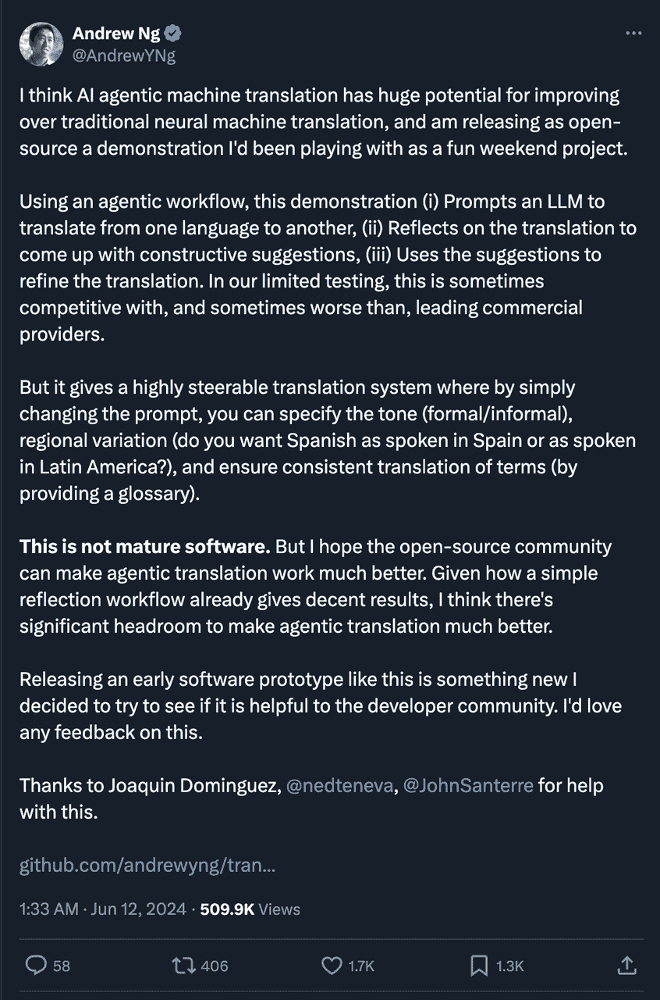
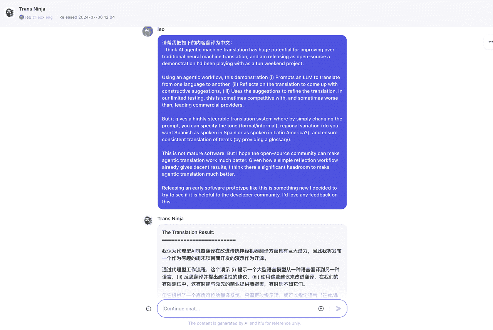
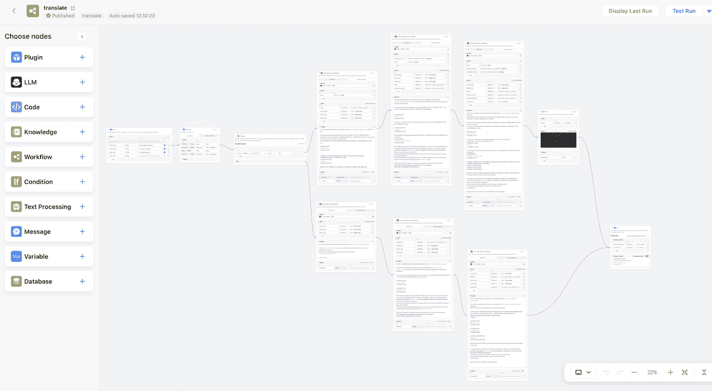
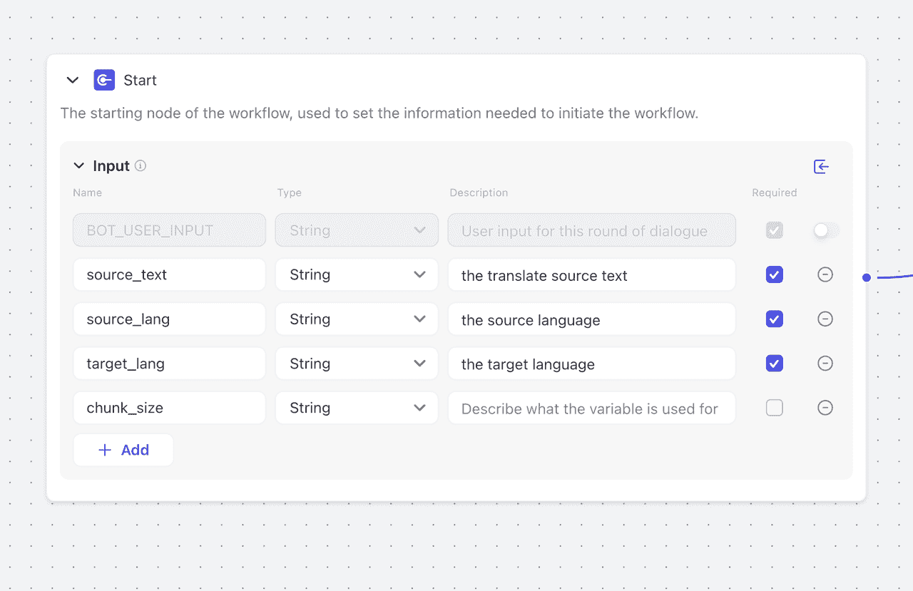
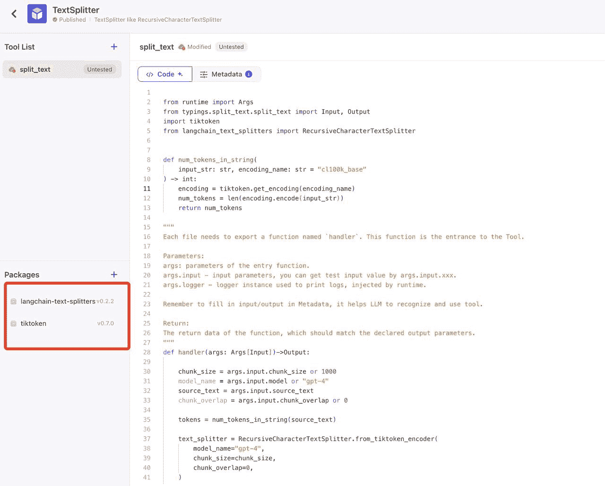
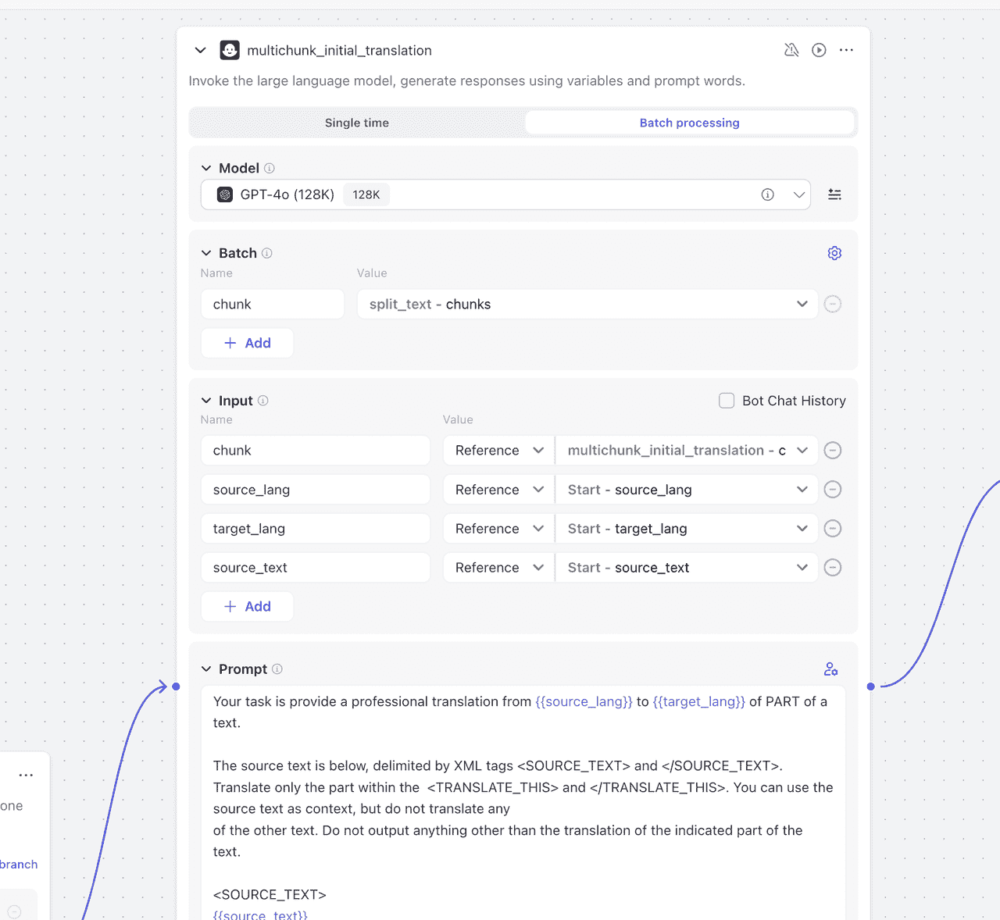
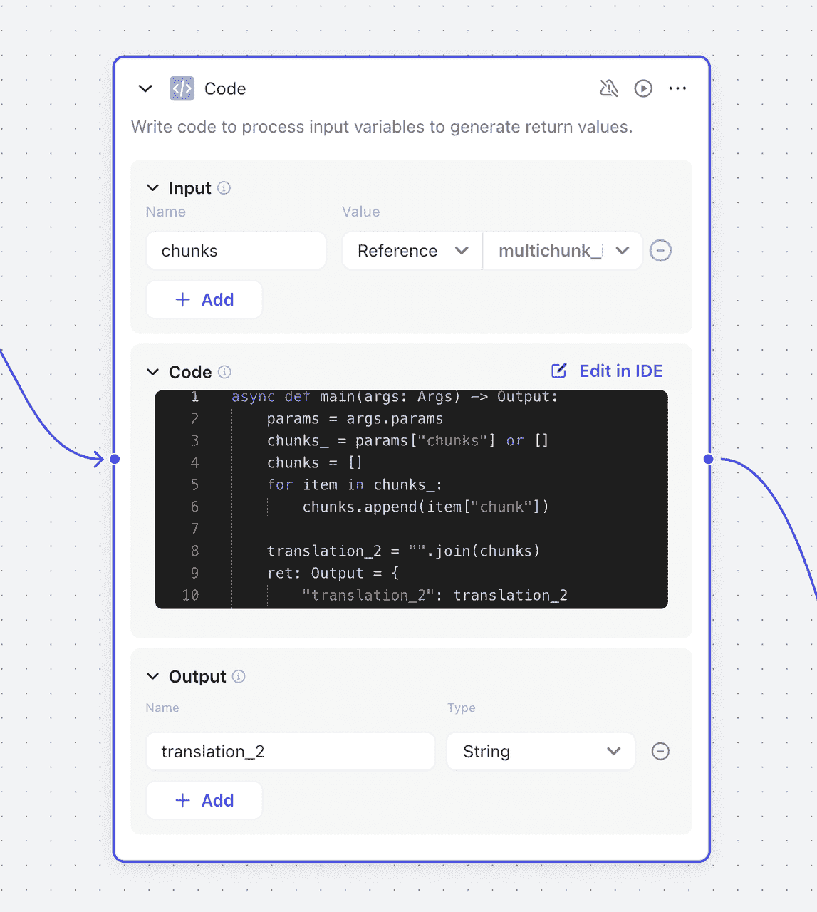

# Agent101 — 复现吴恩达老师 AI 翻译工作流

> 来源：[https://docs.feishu.cn/docx/Pr47dDQjcoDcP3xFBf3cKaM7nib](https://docs.feishu.cn/docx/Pr47dDQjcoDcP3xFBf3cKaM7nib)

吴恩达老师在 X/Twitter 上公开了他的 translation agent，基本思路是 (i) 提示一个LLM从一种语言翻译到另一种语言，(ii) 反思翻译以提出建设性的建议，(iii) 使用这些建议来完善翻译。根据测试这个翻译工作流翻译效果已经可以媲美商业的翻译服务。今天我们尝试来复现他。

吴恩达老师推文：`https://x.com/AndrewYNg/status/1800582171259982289`



> 【你能学到什么】

+ 如何写一个code plugin
+ 如何试用反思来提升大模型的表现
+ 如何在工作流中使用批处理

注意：吴恩达老师这个工作流会耗费比较多的 token，测试的时候请注意 token 消耗。

我们这个agent 就叫做 Trans Ninja，体验地址：

`https://www.coze.com/store/bot/7388361569362542608`



## 原理分析

吴恩达老师开源了这部分代码 `https://github.com/andrewyng/translation-agent`

我们看这部分代码的原理：

1. 初始翻译：`one_chunk_initial_translation`函数用于将整个文本作为一个块进行初始翻译。`multichunk_initial_translation`函数用于将文本分成多个块，并分别进行初始翻译。

2. 反思改进：`one_chunk_reflect_on_translation`和`multichunk_reflect_on_translation`函数用于对初始翻译进行反思，提供具体的建议来改进翻译的准确性、流畅性、风格和术语使用。

3. 改进翻译：`one_chunk_improve_translation`和`multichunk_improve_translation`函数根据反思中的建议，对初始翻译进行改进。

4. 完整翻译流程：`one_chunk_translate_text`和`multichunk_translation`函数提供了完整的翻译流程，包括初始翻译、反思改进以及最终翻译。

单块翻译相关函数：

+ `one_chunk_initial_translation`: 进行初步翻译。
+ `one_chunk_reflect_on_translation`: 对初步翻译进行反思和评价。
+ `one_chunk_improve_translation`: 基于反思改进翻译。
+ `one_chunk_translate_text`: 整合上述三个步骤,完成单块文本的翻译。

多块翻译相关函数：

+ `multichunk_initial_translation`: 对多个文本块进行初步翻译。
+ `multichunk_reflect_on_translation`: 对多个翻译块进行反思。
+ `multichunk_improve_translation`: 改进多个翻译块。
+ `multichunk_translation`: 整合多块翻译的整个过程。

因为采用了分块处理，可以翻译比较长的长文章，比如我们默认 1000 个 token 分成一段， 一个1M  token 的文章就可以被分为 1000 块来分别翻译，1M token 能翻译绝大多文章类的文字。

## 工作流介绍

我们创建了一个叫做 `translate` 的工作流，核心包括：1、`text_split`  2、条件判断  3、翻译/反思/二次翻译



工作流的输入参数：



+ `source_text`: 要翻译的内容
+ `source_lang`: 翻译内容的原语言
+ `target_lang`: 翻译内容的目标语言
+ `chunk_size`: 长内容分块翻译每块的大小，默认 1000 token

## 构建 TextSplitter Plugin

上面提到如果用户输入的是长内容，我们要对内容进行分块翻译，至于为什么要分块应该有两个原因：

1. 大模型输出上下文是 4k，是无法输出超过 4k token内容的文字。
2. 输入分块可以减少太长的输入导致的幻觉。

对于内容分块大家对 langchang 的 `RecursiveCharacterTextSplitter`，但如何在 coze 中完成呢？这里我们采用了 coze 提供的 `code plugin`。

我们创建了一个基于 python 代码的 `TextSplitter` plugin来完成这个，相关的代码和截图：

```
from runtime import Args
from typings.split_text.split_text import Input, Output
import tiktoken
from langchain_text_splitters import RecursiveCharacterTextSplitter

def num_tokens_in_string(
    input_str: str, encoding_name: str = "cl100k_base"
) -> int:
    encoding = tiktoken.get_encoding(encoding_name)
    num_tokens = len(encoding.encode(input_str))
    return num_tokens

"""
Each file needs to export a function named `handler`. This function is the entrance to the Tool.

Parameters:
args: parameters of the entry function.
args.input - input parameters, you can get test input value by args.input.xxx.
args.logger - logger instance used to print logs, injected by runtime.

Remember to fill in input/output in Metadata, it helps LLM to recognize and use tool.

Return:
The return data of the function, which should match the declared output parameters.
"""
def handler(args: Args[Input])->Output:

    chunk_size = args.input.chunk_size or 1000
    model_name = args.input.model or "gpt-4"
    source_text = args.input.source_text
    chunk_overlap = args.input.chunk_overlap or 0

    tokens = num_tokens_in_string(source_text)

    text_splitter = RecursiveCharacterTextSplitter.from_tiktoken_encoder(
        model_name="gpt-4",
        chunk_size=chunk_size,
        chunk_overlap=0,
    )

    source_text_chunks = text_splitter.split_text(source_text)

    return {
        "chunks": source_text_chunks,
        "tokens": tokens
        }
```

在这个`TextSplitter` plugin 中，我们需要安装依赖：`tiktoken` 和 `langchain_text_splitters`。`Tiktoken` 的作用是计算输入的文字的 token 大小，`langchain_text_splitters` 的作用是来帮助我们根据 token 来进行分块。



## 使用批处理来加快大模型处理

如果用户要翻译长内容，我们会拆分成很多个块来处理，如果一个块一个块的处理大模型的处理时间会非常长，如果解决这个问题呢？我们使用`Batch processing` 来解决并发调用的问题。

`Batch Processing` 要求输入必须是数组，本例子中就是拆分完成的翻译块，在 `Input` 中记得要把 `Batch` 环节中的变量设置为输入参数。



## 使用反思改进流程来优化翻译效果

翻译改进是本工作流最核心的部分，我们以更复杂的 mutli chunks 过程来讲解。

+ `multichunk_initial_translation`: 对多个文本块进行初步翻译。
+ `multichunk_reflect_on_translation`: 对多个翻译块进行反思。
+ `multichunk_improve_translation`: 改进多个翻译块。
+ `multichunk_translation`: 整合多块翻译的整个过程。

### 第一次翻译：`multichunk_initial_translation`

可以理解为第一次翻译，我们采用的 prompt 如下：

```
You are an expert linguist, specializing in translation from {{source_lang}} to {{target_lang}}。
 
Your task is provide a professional translation from {{source_lang}} to {{target_lang}} of PART of a text.
 
The source text is below, delimited by XML tags <SOURCE_TEXT> and </SOURCE_TEXT>.  Translate only the part within the <TRANSLATE_THIS> and </TRANSLATE_THIS>. You can use the  source text as context, but do not translate any
of the other text. Do not output anything other than the translation of the indicated part of the text.
 
<SOURCE_TEXT>
{{source_text}}
</SOURCE_TEXT>
 
 
To reiterate, you should translate only this part of the text, shown here  between <TRANSLATE_THIS> and </TRANSLATE_THIS>:
<TRANSLATE_THIS>
{{chunk}}
</TRANSLATE_THIS>
 
Output only the translation of the portion you are asked to translate, and nothing else.
```

这个 prompt 本身比较简单，基本作用就是先进行一次翻译。

### 反思：`multichunk_reflect_on_translation`

主要作用是对初步翻译进行反思和评价，Prompt 如下：

```
You are an expert linguist, specializing in translation from {{source_lang}} to {{target_lang}}。
 
Your task is to carefully read a source text and part of a translation of that text from  {{source_lang}} to {{target_lang}}, and then give constructive criticism and helpful suggestions for improving the translation.
 
The source text is below, delimited by XML tags <SOURCE_TEXT> and </SOURCE_TEXT>. You can use  the source text as context for critiquing the translated part.
 
 
<SOURCE_TEXT>
{{source_text}}
</SOURCE_TEXT>
 
To reiterate, only part of the text is being translated, shown here  between <TRANSLATE_THIS> and </TRANSLATE_THIS>:
 
<TRANSLATE_THIS>
{{chunk}}
</TRANSLATE_THIS>
 
The translation of the indicated part, delimited below by <TRANSLATION> and </TRANSLATION>, is as follows:
<TRANSLATION>
{{translation1_chunk.chunk}}
</TRANSLATION>
 
When writing suggestions, pay attention to whether there are ways to improve the translation's:
(i) accuracy (by correcting errors of addition, mistranslation, omission, or untranslated text),
(ii) fluency (by applying {{target_lang}} grammar, spelling and punctuation rules, and ensuring there are no unnecessary repetitions),
(iii) style (by ensuring the translations reflect the style of the source text and takes into account any cultural context),
(iv) terminology (by ensuring terminology use is consistent and reflects the source text domain; and by only ensuring you use equivalent idioms {{target_lang}}).
 
Write a list of specific, helpful and constructive suggestions for improving the translation.
Each suggestion should address one specific part of the translation.
Output only the suggestions and nothing else.
```

这个 prompt 的意思就是对初步翻译提出优化建议，并输出优化建议。

### 改进：`multichunk_improve_translation`

我们有了第一次的翻译和第二次的改进建议，第三步就是改进翻译，prompt 如下：


```
Your task is to carefully read, then improve, a translation from  {{source_lang}} to {{target_lang}}, taking into
account a set of expert suggestions and constructive criticisms. Below, the source text, initial translation, and expert suggestions are provided.

The source text is below, delimited by XML tags &lt;SOURCE_TEXT&gt; and &lt;/SOURCE_TEXT&gt; You can use the source text
as context, but need to provide a translation only of the part indicated by &lt;TRANSLATE_THIS&gt; and &lt;/TRANSLATE_THIS&gt;.

&lt;SOURCE_TEXT&gt;
{{source_text}}
&lt;/SOURCE_TEXT&gt;

To reiterate, only part of the text is being translated, shown here again between &lt;TRANSLATE_THIS&gt; and &lt;/TRANSLATE_THIS&gt;:
&lt;TRANSLATE_THIS&gt;
{{chunk}}
&lt;/TRANSLATE_THIS&gt;

The translation of the indicated part, delimited below by &lt;TRANSLATION&gt; and &lt;/TRANSLATION&gt;, is as follows:
&lt;TRANSLATION&gt;
{{translation1_chunk.chunk}}
&lt;/TRANSLATION&gt;

The expert translations of the indicated part, delimited below by &lt;EXPERT_SUGGESTIONS&gt; and &lt;/EXPERT_SUGGESTIONS&gt;, is as follows:
&lt;EXPERT_SUGGESTIONS&gt;
{{reflection_chunk.chunk}}
&lt;/EXPERT_SUGGESTIONS&gt;

Taking into account the expert suggestions rewrite the translation to improve it, paying attention
to whether there are ways to improve the translation&#x27;s

(i) accuracy (by correcting errors of addition, mistranslation, omission, or untranslated text),
(ii) fluency (by applying {{target_lang}} grammar, spelling and punctuation rules and ensuring there are no unnecessary repetitions), \
(iii) style (by ensuring the translations reflect the style of the source text)
(iv) terminology (inappropriate for context, inconsistent use), or
(v) other errors.

Output only the new translation of the indicated part and nothing else.
```

这个 prompt 的意思是结合第一次翻译 以及 第二次的改进意见进行第二次翻译。

## 最后合并多个翻译结果并返回

这里我们采用一个 code 节点对多个翻译结果进行合并，并输出。



## 最后

相应的 bot 和 workflow 代码我已经公开，你可以在这里查看完整的 Prompt 和 Workflow。希望能对你有所帮助。

加入 Agent101 Coze Team：

`https://www.coze.com/invite/VbogXxJTvUYU8wpxFoWh` (需要加入 team 才能看到完整的 prompt 和 workflow)

本 bot 地址：

`https://www.coze.com/store/bot/7388361569362542608`
