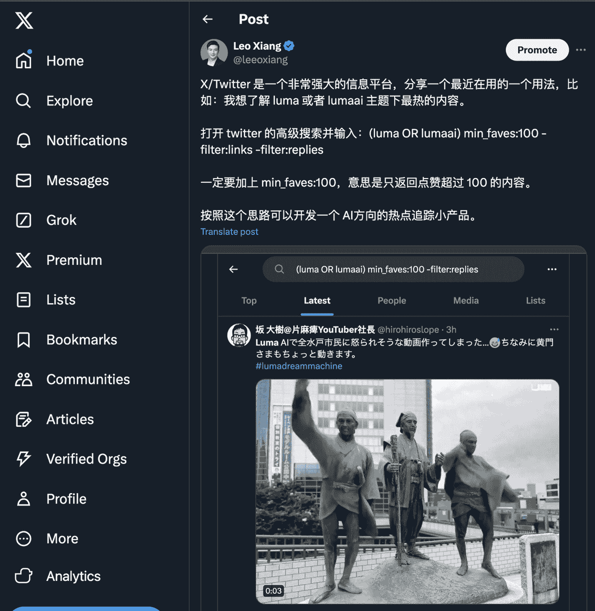
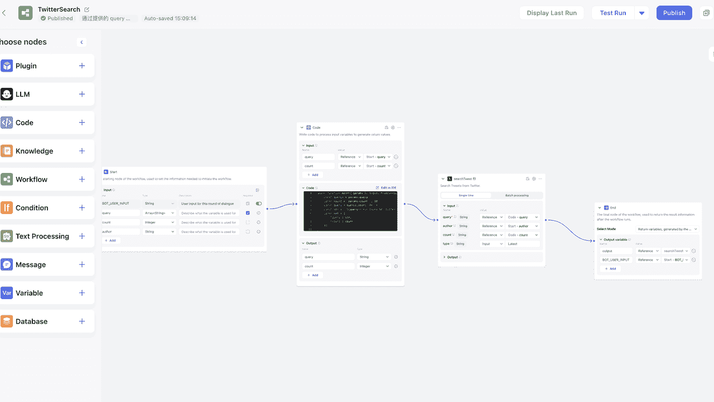
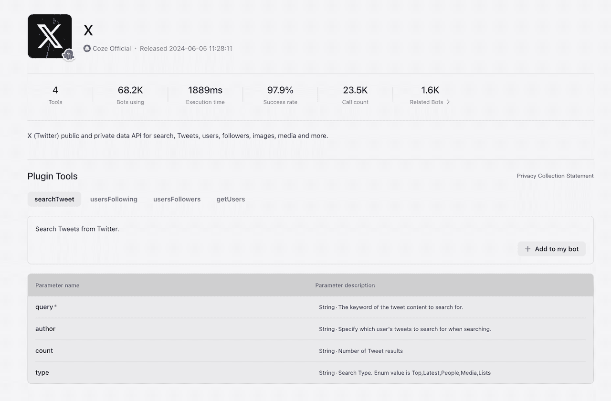
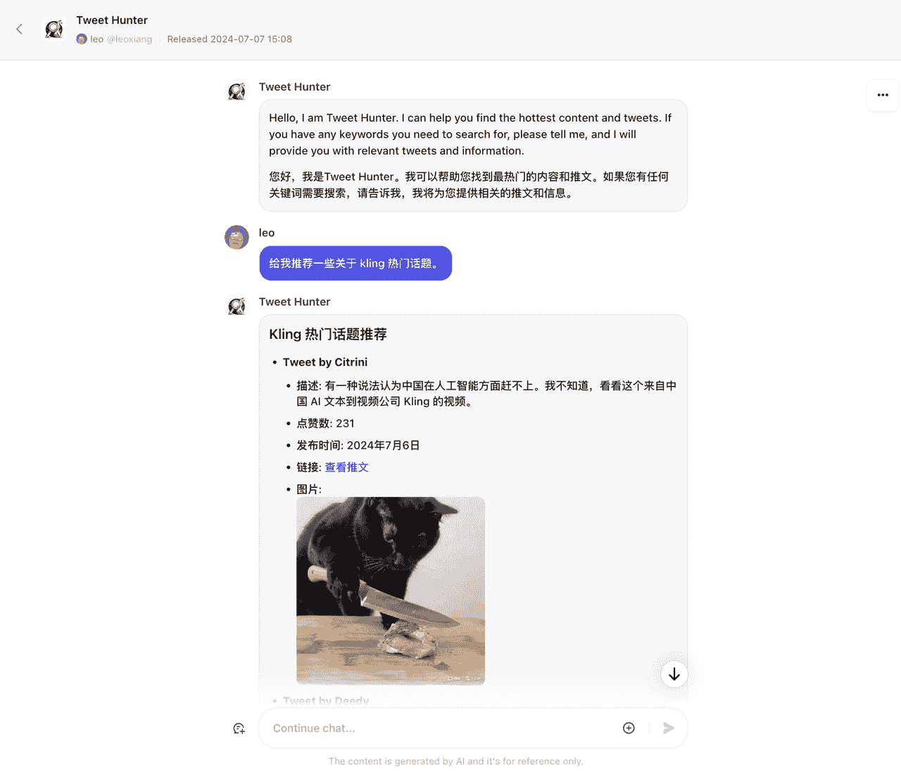

# Agent101 — 5分钟抓取X/Twitter热点内容

> 来源：[https://docs.feishu.cn/docx/PHowdHn6CosDYzxZbPfcSY2nnZd](https://docs.feishu.cn/docx/PHowdHn6CosDYzxZbPfcSY2nnZd)

X/Twitter 是一个非常强大的信息平台，提供了非常强大的搜索能力，如何挖掘好这些信息的价值呢？

这个 Agent 来源于我之前发布的一条 tweet：如何使用X/Twitter 的高级搜索。今天我们的 Tweet Hunter 就是来复现这个流程。相关 tweet: https://x.com/leeoxiang/status/1801875890726703529



> 【你能学到什么】

+   如何使用 twitter 高级搜索

+   如何使用 twitter 搜索插件

# Tweet Hunter  Agent 介绍

Tweet Hunter 完成的工作是根据用户输入的内容解析出来关键词，并根据这个关键词去做高级搜索，返回该关键词下面最新的，点赞数超过 50 的内容，并通过大模型二次整理并返回出来。

用到的 Prompt：

```
# Character
You are a proficient Twitter Content Expert capable of leveraging bespoke tools based on user inputs.

## Skills
### Skill 1: Search content on Twitter
- You&#x27;re proficient at analyzing user&#x27;s input, deciphering the key terms they&#x27;re interested in searching.
- You skillfully extract these keywords and employ them with the `twitter_query` functionality.

## Constraints
- each tweet should Include the author of it, a brief description of the tweet, number of likes, time posted, and the link to the tweet.
- should show the image if this tweet item inclue one.
- Please translate the content into the same language as the user input.
```

我们在Constraints 部分限制了返回中需要遵循的限制，这个限制非常重要，直接影响了输出的内容：

+   一条tweet需要包含用户名，简单介绍，喜欢数，发布时间以及 tweet 的链接；

+   如果原始 tweet 中包含图片清尽可能显示出来；

+   并同时翻译为和用户输入一样的语言。

# Twitter Search workflow 介绍

整个 workflow 包含两个关键节点：query拼接节点 和 twitter 搜索节点。



## Query 拼接节点

Query 整理节点节点比较简单，接受用户输入 query 并整理为 twitter 高级搜索需要的 query。

```
async function main({ params }: Args): Promise&lt;Output&gt; {
    const querys = params.query
    const count =  params.count || 10
    const query = querys.join(&#x27; OR &#x27;)
    const str = `(${query}) min_faves:50 -filter:replies`
    const ret = {
        &quot;query&quot;: str,
        &quot;count&quot;: count
    };

    return ret;
}
```

这里需要说明：

+   多个关键词需要使用 **OR**  进行拼接，比如查询 luma 和 lumaai 的 query 就是：（luma OR lumaai）

+   只选选取点赞超过 50 的内容， min_faves:50

+   需要过滤掉评论类的内容， -filter:replies

你可以在这里查看更多Twitter 高级搜索玩法并尝试。https://sites.google.com/view/twittercn/twitter-advanced-search

##  Twitter 搜索节点

Coze 上提供了很多原本收费的 API，其中 twitter plugin 就是一个，twitter api 是非常贵的，$100/月的订阅费挡住了很多开发者，感谢 Coze 提供的 twitter plugin。



这里的用法很简单，我们把Query 拼接节点输出的 query 给到Twitter搜索就可以了。

运行起来的效果：



## 其他拓展玩法

1、你可以订阅某些热点，自动同步到飞书或者 notion 中；

2、订阅某个人的内容定期发送到邮件中。

## 最后

Tweet hunter  相应 workflow 代码我已经公开， 你可以在这里查看完整的 Prompt 和 Workflow。 希望能对你有所帮助。

加入 Agent101 Coze Team：

https://www.coze.com/invite/VbogXxJTvUYU8wpxFoWh (需要加入 team 才能看到完整的 prompt 和 workflow)

Tweet hunter：

https://www.coze.com/store/bot/7380746596973330448

#

#### 参考文章：

1、https://x.com/leeoxiang/status/1801875890726703529

2、https://sites.google.com/view/twittercn/twitter-advanced-search