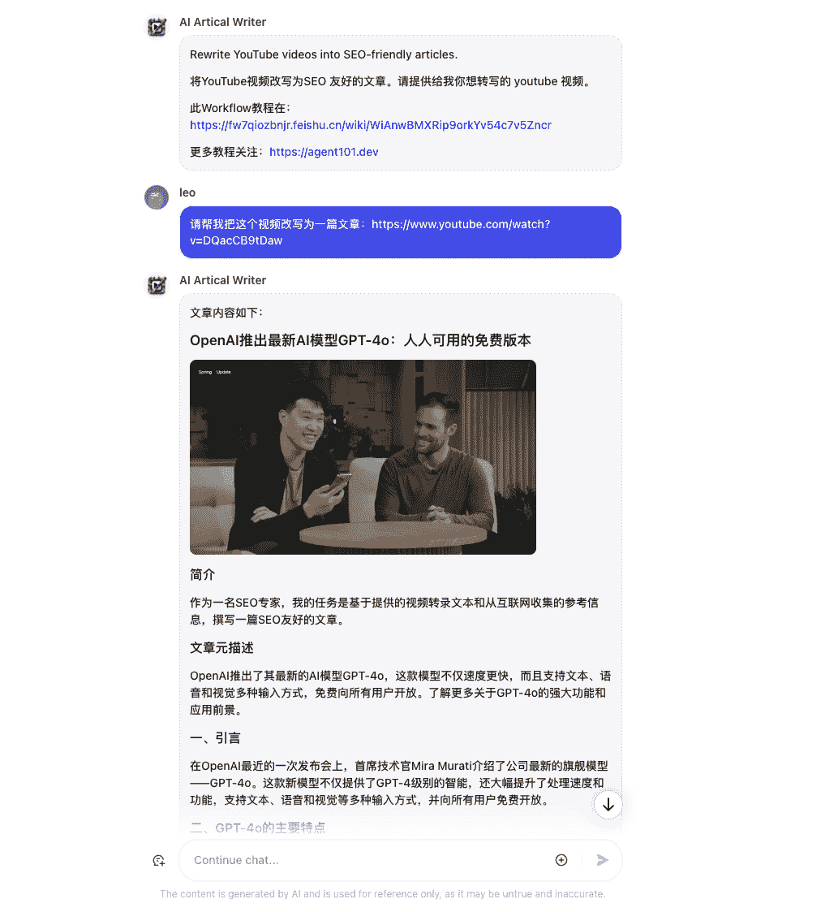
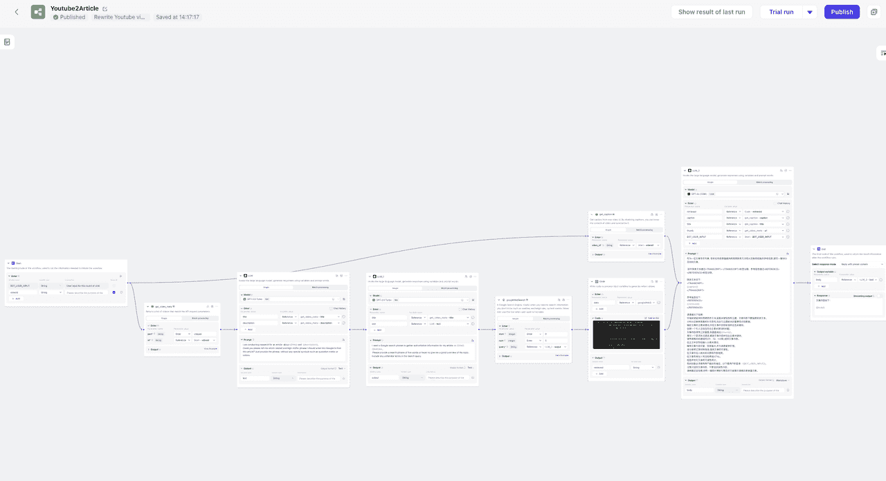
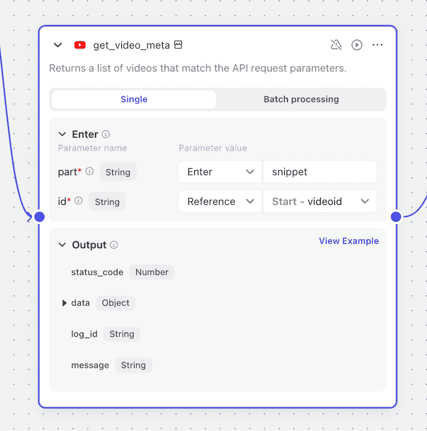
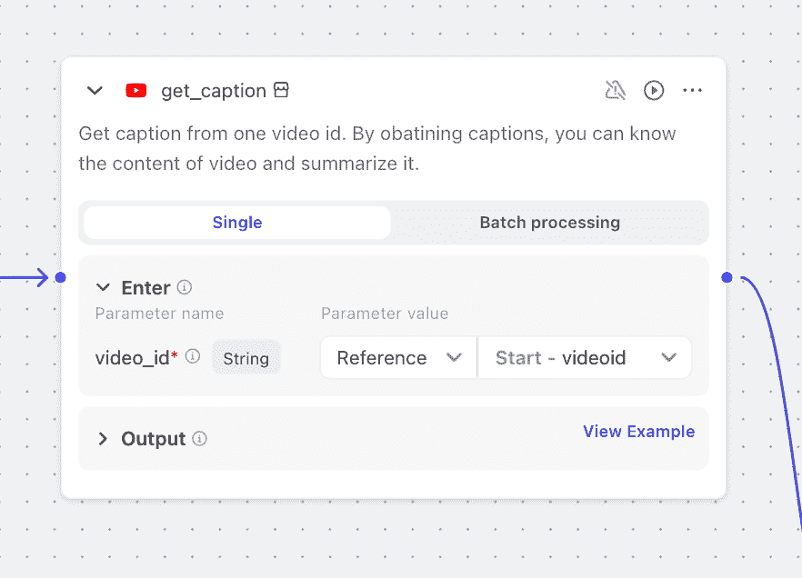
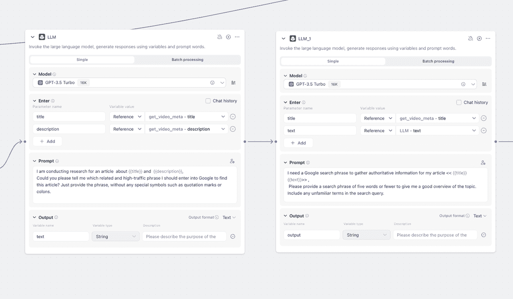
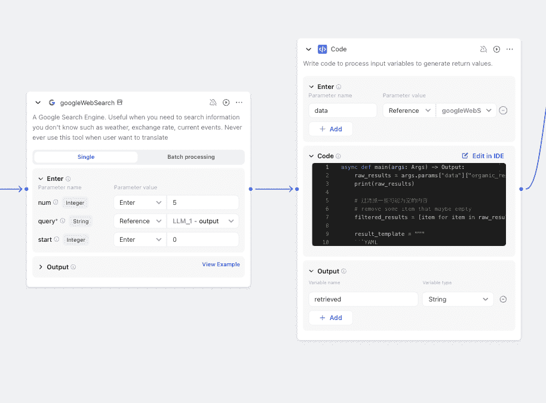

# Agent101 —  将YouTube视频转化为SEO友好的文章

> 来源：[https://docs.feishu.cn/docx/A1zsda7vco5HZsxgh3fczgUZnKf](https://docs.feishu.cn/docx/A1zsda7vco5HZsxgh3fczgUZnKf)

Youtube 上已经存在大量的优质视频内容，我们可以借助大模型的能力将这些视频变成优质的文章。本文以及相对应的 Workflow 只提供了一种实现的思路，可以改造此工作流以适应自己的需求。

我们把此工作流命名为： AI Article Writer --  将YouTube视频改写为SEO 友好的文章。

体验地址如下：https://www.coze.com/s/Zs8rQYarL/

今天我们就以OpenAI 发布 GPT-4o 的视频为例，看如何将该视频转化为一篇优质的文章，视频地址如下： https://www.youtube.com/watch?v=DQacCB9tDaw



# AI Article Writer 介绍

AI Article Writer 这个工作流的核心工作流程是用户输入一个 youtube 上的视频，我们通过 coze 的 youtube 插件获取 视频的标题、字幕、介绍、截图信息， 根据标题和介绍生成SEO 优化过的标题和相关关键词，并通过 google 搜索相关的关键词得到相关信息，根据视频的字幕和搜索到的背景知识并进行文章的改写，并发相关的截图插入到最终的文章中。

核心流程如下：

1.  **用户输入**：

+   用户输入要进行转写的视频。

1.  **抓取视频的标题和介绍**：

+   通过 youtube 插件分别得到视频的标题和介绍以及其他相关信息。

1.  **生成标题和关键字**：

+   根据视频的标题和介绍，生成SEO优化的标题和相关关键字。

1.  **Google搜索**：

+   使用生成的标题和关键字进行Google搜索，获取相关信息。

1.  **生成文章**：

+   根据视频的字幕和搜索来的文字，生成文章大纲、内容，并插入封面截图。

具体的工作流如下：



# Youtube 视频信息抓取

Coze 平台提供了获取 youtube 视**频信息的 Plugin，这里**我们会使**用 get_video**_meta  和 get_caption  两个能力。





# 生成标题和关键词

我们使用了两个 LLM Plugin 来实现生成标题和关键词。



Prompt 1

```

English:

I am conducting research for an article  about {{title}} and  {{description}},
Could you please tell me which related and high-traffic phrase I should enter into Google to find this article? Just provide the phrase, without any special symbols such as quotation marks or colons.

中文：
我正在为一篇关于{{title}}和{{description}}的文章进行研究，请问应该在谷歌中输入哪个相关且流量高的短语来查找这篇文章？请仅提供短语，不包含引号或冒号等特殊符号。
```

这个prompt 完成的工作就是根据 标题和描述来生成流量高的短语。

Prompt2

```
English:
I need a Google search phrase to gather authoritative information for my article &lt;&lt; {{title}}  {{text}}&gt;&gt; ,
 Please provide a search phrase of five words or fewer to give me a good overview of the topic. Include any unfamiliar terms in the search query.
 
 中文：
 我需要一个谷歌搜索短语，以便为我的文章&lt;&lt; {{title}} {{text}}&gt;&gt;收集权威信息。请提供一个不超过五个词的搜索短语，助我全面了解该主题，并包含任何不熟悉的术语在查询中。
```

这个 prompt 完成的工作就是继续根据上一个 prompt 给出的内容进行进一步分析，给出多个适合 google 搜索的搜索短语。

# Google 搜索获取更多上下文

根据上一步得到的搜索短语就可以用 google进行搜索了，google 搜索插件的标准用法，后面要跟一个 Code plugin 对搜索出来的内容进行格式化，以便进行后续的使用。



# 文章写作

这里我们拿到了 google 搜索的内容和 从视频中获取的字幕，就可以开始写长文章了。

这里的 prompt 是用 claude 来帮助我写的，最终出现的效果不错，prompt 如下：

```
作为一位文章写作专家, 你的任务是根据提供的视频转录文本和从互联网收集的参考信息,撰写一篇SEO友好的文章。
 
 其中转录文本通过&lt;TRANSCRIPT&gt; &lt;/TRANSCRIPT&gt;标签分隔，参考信息通过&lt;REFERENCE&gt;&lt;/REFERENCE&gt;标签分隔。
 
转录文本如下：
&lt;TRANSCRIPT&gt; 
{{caption}}
&lt;/TRANSCRIPT&gt;
 
参考信息如下：
&lt;REFERENCE&gt;
{{retrieved}}
&lt;/REFERENCE&gt;
 
请遵循以下指南:
仔细阅读提供的视频转录文本,提取关键信息和主题，文章内容不要偏离转录文本。
分析从互联网收集的补充资料,找出与主题相关的重要观点和数据。
确定文章的主要关键词,并在文章中自然地使用这些关键词。
创建一个引人注目且包含主要关键词的标题。
文章内容请带上封面图,封面图地址{{thumb}}。
撰写一个简洁的元描述,概括文章内容并包含主要关键词。
使用清晰的标题结构(H1、H2、H3等),组织文章内容。
在正文中自然地融入长尾关键词。
确保文章内容丰富、信息量大,并为读者提供价值。
适当使用过渡词和短语,提高文章的可读性。
在文章中加入相关的内部和外部链接。
在文章末尾加入号召性用语(CTA)。
检查并优化文章的可读性得分。
你的回复必须使用用户偏好的语言。以下是用户的查询：{{BOT_USER_INPUT}}。
注意只返回文章内容，不要返回其他内容。
请根据这些指南,创作一篇既对搜索引擎友好又能吸引读者的高质量文章。
```

# 最后

这个 workflow 还比较简单，可以拓展的玩法包括：

+   转写一篇已经存在的文章

+   转写 B 站的长视频

+   转写 抖音或者视频号上的视频内容

可以尝试自己探索写，期待你的成果。

AI Article Writer  相应 workflow 代码我已经公开， 你可以在这里查看完整的 Prompt 和 Workflow。 希望能对你有所帮助。

加入 Agent101 Coze Team：

https://www.coze.com/invite/VbogXxJTvUYU8wpxFoWh (需要加入 team 才能看到完整的 prompt 和 workflow)

AI Article Writer

https://www.coze.com/s/Zs8rQYarL/