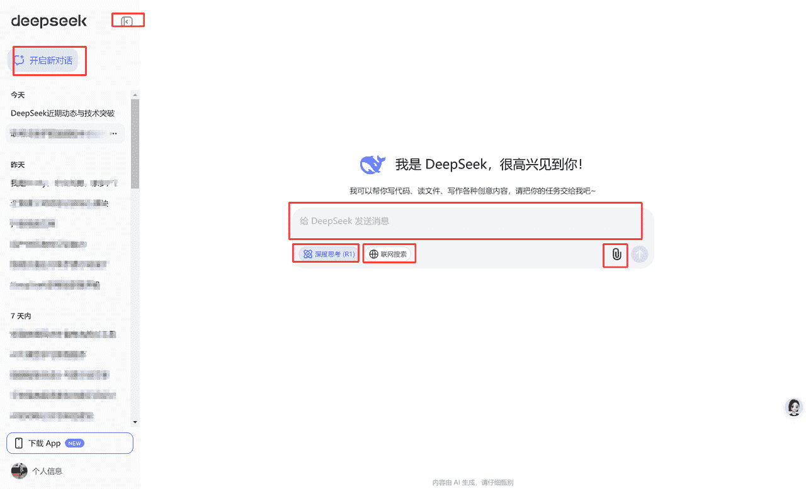
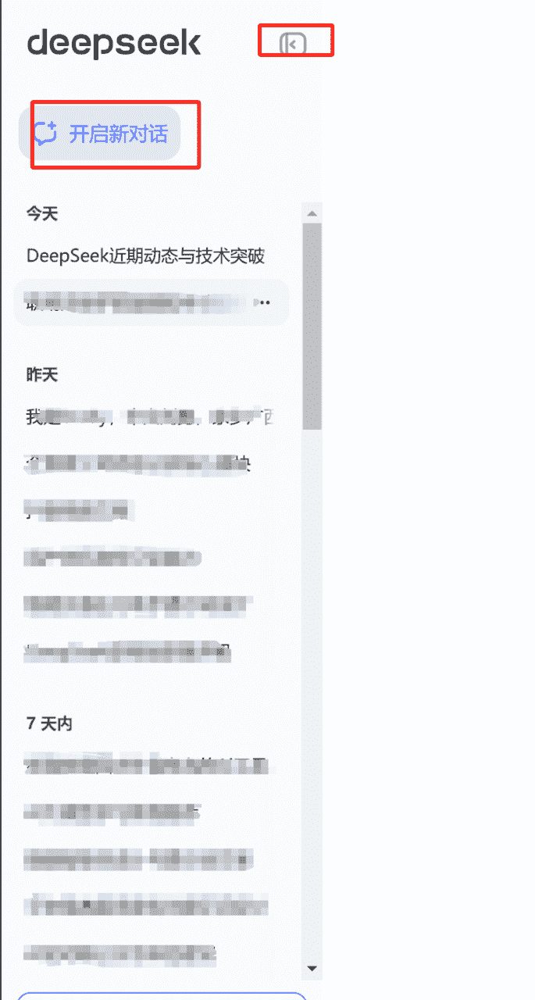
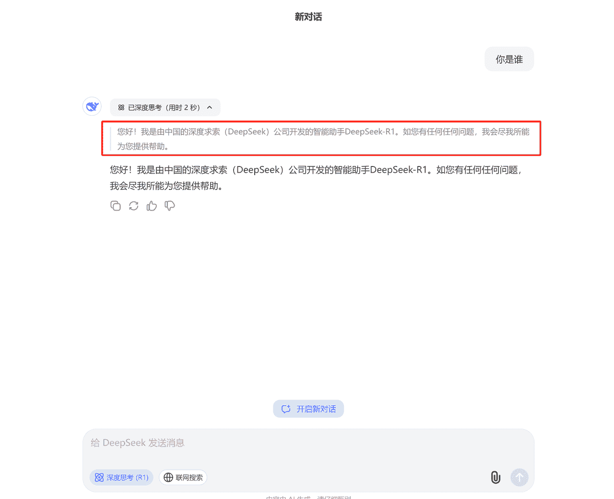
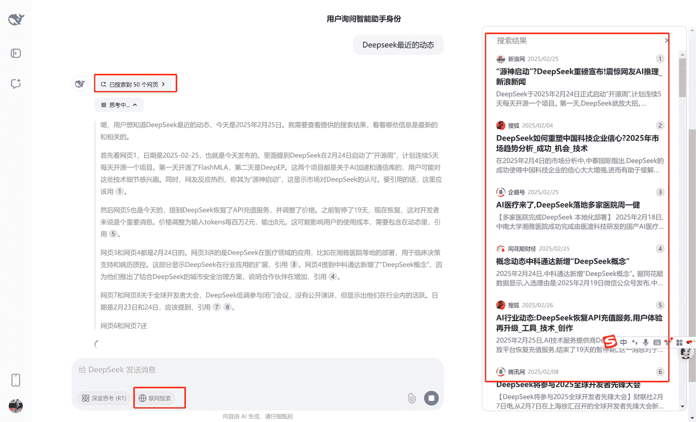
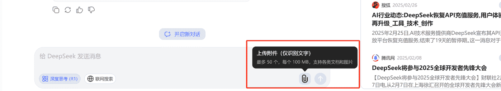

# Deepseek基础认知

> 来源：[https://vcn0zlxse9ua.feishu.cn/docx/BrXwdyOoiogNKfxFlW5cxWLlnze](https://vcn0zlxse9ua.feishu.cn/docx/BrXwdyOoiogNKfxFlW5cxWLlnze)

## 小白认知工具

官网：https://chat.deepseek.com/

界面如下：

### 对话输入框

像发微信一样打字，但记得按「Enter」发送或者点击箭头发送

### 新对话

类似两个人之间的对话，会记得刚刚提到的内容。

+   记得当前对话的内容

+   新对话不记得之前对话的内容

### 对话历史

包括你过往的内容的聊天记录

###

### 深度思考（R1）

会显示出推理思考的过程。

### 联网搜索

选择联网搜索后，会自动去网上搜索内容。

### 文件上传

可以上传文件进行提问，【联网搜索】下不能进行文件上传。

+   图片：可以解读图片的文字内容。

+   word/pdf等：解读文件中的文字内容。

## 小练习

你好，你是谁

【重命名】对话

## 使用技巧

推理模型和通用模型的区别

### 原则

+   当“人”沟通，提问巧？

+   它的优势，知识库，充分发挥

+   它的局限性

### 基础技巧

#### 明确需求（目标）

#### 提供更多的背景

#### 提供你的要求限制

格式

长度

不断调整

#### 提供示例

提供你想要的内容

### 进阶

分步骤多轮对话

逆向指引