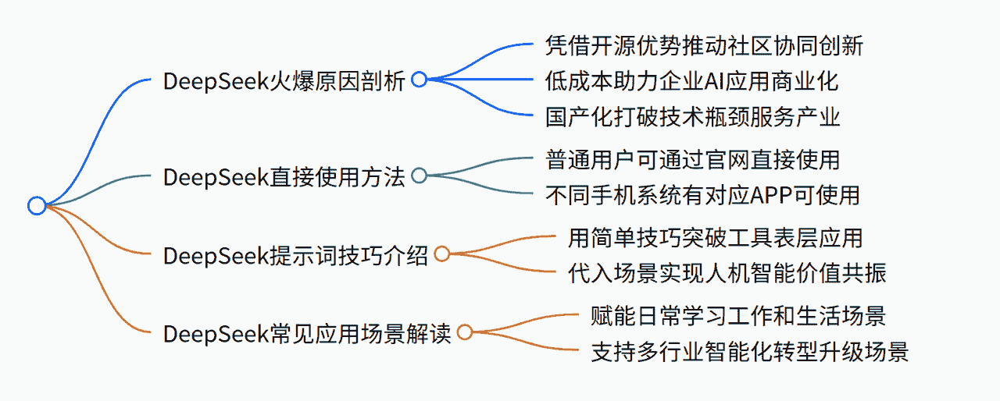
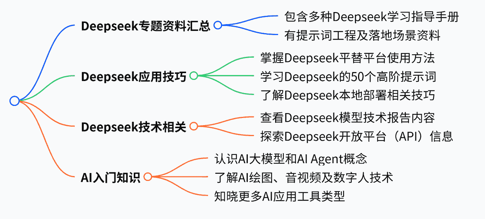
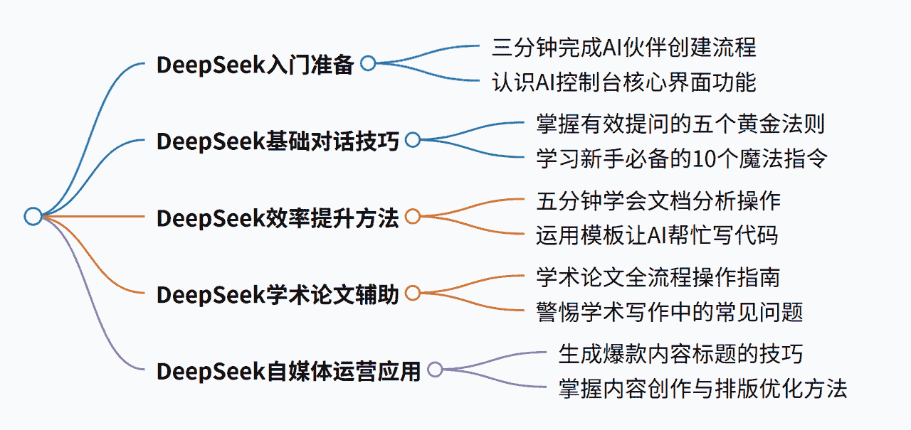

# Deepseek使用技巧

> 来源：[https://vcn0zlxse9ua.feishu.cn/docx/DeeodhVfroZL2FxHNoEcjbpinVc](https://vcn0zlxse9ua.feishu.cn/docx/DeeodhVfroZL2FxHNoEcjbpinVc)

模式

倾向性

逆向思维

总结技巧：

+   分点简单总结

+   根据网页内容生成脑图

## 文档概述导图

### 北京大学系列

#### DeepSeek系列-提示词工程和落地场景

+   讲座概况：2025 年 2 月 22 日举办，聚焦提示词工程与产业实践，帮助非技术人员掌握 AI 提效方法。

### 清华大学系列

#### DeepSeek从入门到精通

### DeepSeek 15天指导手册⸺从入门到精通

## 子页面