# Deepseek+WebUI (Docker本地部署)（二）

> 来源：[https://vcn0zlxse9ua.feishu.cn/docx/IbKUdZtyLoLPzixElrdcGE3ined](https://vcn0zlxse9ua.feishu.cn/docx/IbKUdZtyLoLPzixElrdcGE3ined)

本文档主要是介绍 docker 快速部署 Deepseek，搭配WebUI。

## 什么是 docker

Docker 是一个开源的应用容器引擎，它可以让开发者将应用程序及其依赖打包到一个可移植的容器中，然后发布到任何流行的 Linux 机器或 Windows 机器上，也可以实现虚拟化。容器是完全使用沙箱机制，相互之间不会有任何接口，更重要的是容器性能开销极低。

## 为什么用 docker 部署？

### 优点

+   缩短部署时间

+   环境隔离，不会收到其他软件的影响

+   方便扩展，可以快速安装其他开源项目

### 缺点

+   网络稳定问题

+   内存会多占一点

## 安装 docker（win）

中文网：https://docker.p2hp.com/

官网：https://www.docker.com/

下面通过官网演示（需要魔法！！)

### 前置要求和配置

硬件要求

+   处理器和内存：需要 64 位支持虚拟化技术处理器以及至少 4GB 系统内存，并支持二级地址转换（SLAT），且要在 BIOS 中开启硬件虚拟化功能。

+   存储：Docker 运行及容器安装至少需要 25GB 空间，如果要存储容器镜像和数据，则至少需要 35GB-40GB 空间。

+   网络：需要有网络连接，以便下载、推送和拉取镜像，维持容器镜像的更新和管理。

开启功能

+   虚拟化技术：需要开启 Hyper-V 或 WSL2（Windows Subsystem for Linux 2）虚拟化技术。若选择 WSL2 后端，还需 WSL 版本 1.1.3.0 或更高版本。

+   Windows 功能：需要在 “Windows 功能” 中勾选 Hyper-V。

#### BIOS 中开启虚拟化

如何查看是否开启了虚拟化技术：Ctrl+Alt+Delete，打开任务管理器，点击性能

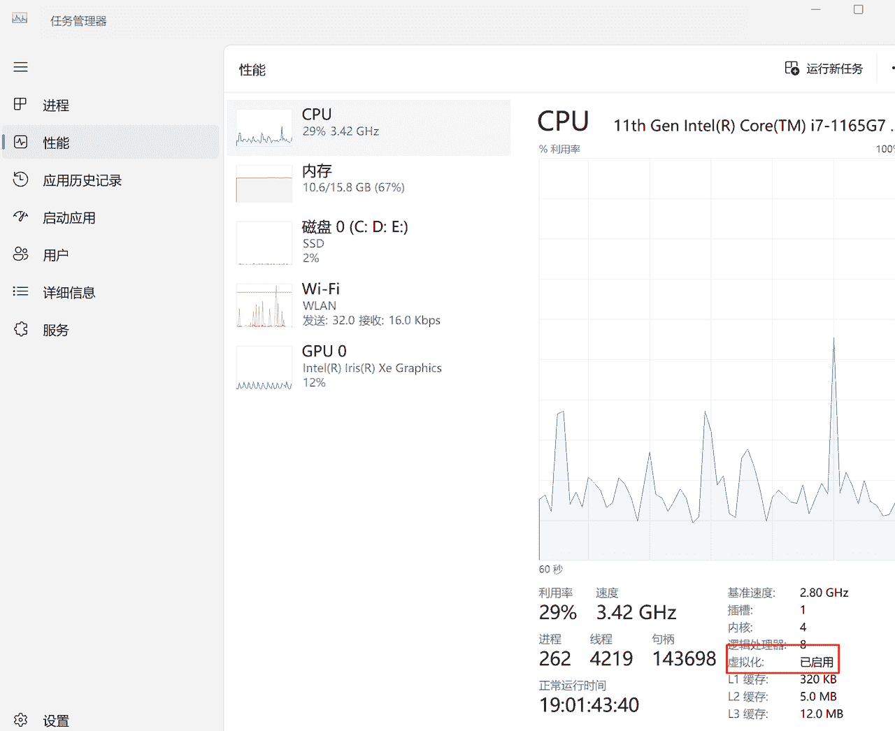

如果没有开启，在 BIOS 中开启虚拟化技术

+   首先开机进入 BIOS：一般机器是按 F2，自己可以上网查看自己电脑到底是按哪个。

+   选择 configuration 按回车键进入。

+   进行后选择蓝色的第三个 Secure Virtual Machine Mode。

+   按回车键进入后选择 Enabled 开启，然后再按回车键确认。

+   选定后，在键盘上按 F10 保存，弹出一个对话框，选择 OK，按回车键确认保存，然后电脑就会自动重启。

+   最后再查看是否开启成功。

#### 开启 Hyper-V

##### 开启

搜索：控制面板-卸载程序-启用或关闭 Windows 功能


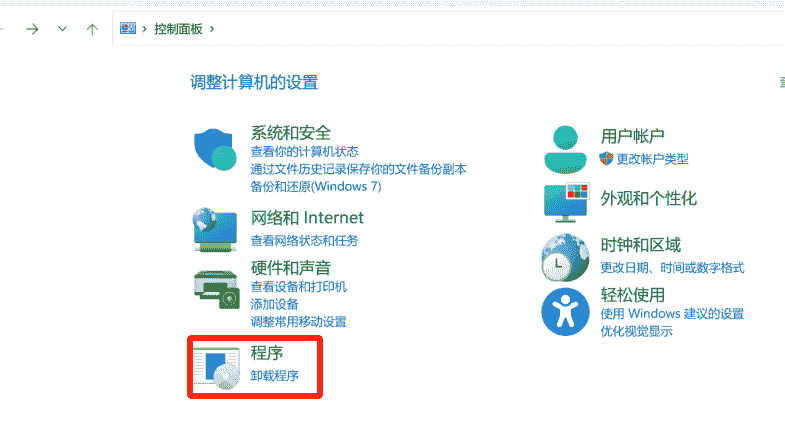

选中 Hyper-V，确定后【**重启**】电脑

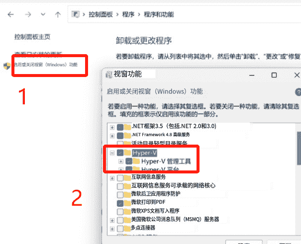

##### 如果 Hyper-V 的话

将下面命令复制到文本文档中，并将文档重命名 Hyper.cmd

```
pushd &quot;%~dp0&quot;dir /b %SystemRoot%\servicing\Packages\*Hyper-V*.mum  &gt;hyper-v.txtfor /f %%i in (&#x27;findstr /i . hyper-v.txt 2^&gt;nul&#x27;) do dism  /online /norestart  /add-package:&quot;%SystemRoot%\servicing\Packages\%%i&quot;
del hyper-v.txt
Dism /online /enable-feature /featurename:Microsoft-Hyper-V-All  /LimitAccess /ALL
```

**等待脚**本执行，最后输入 Y，进行电脑重启之后，再按照上一步操作一遍。

#### 安装 WSL 2

##### 查看是否安装了 wsl

快捷键 win+r，输入 cmd，按 enter 键，输入如下命令。

```
wsl -l
```

##### 没有安装则打开 powershell

```
dism.exe /online /enable-feature /featurename:Microsoft-Windows-Subsystem-Linux /all /norestart
```

启用虚拟化：以管理员打开 powershell 输入下列命令：

```
dism.exe /online /enable-feature /featurename:VirtualMachinePlatform /all /norestart
```

设置 WSL 默认版本：

```
wsl --set-default-version 2
```

### 访问官网下载

https://www.docker.com/


#### 选择 windows 版本


#### 下载后一直点击安装到最后

官网：https://www.docker.com/

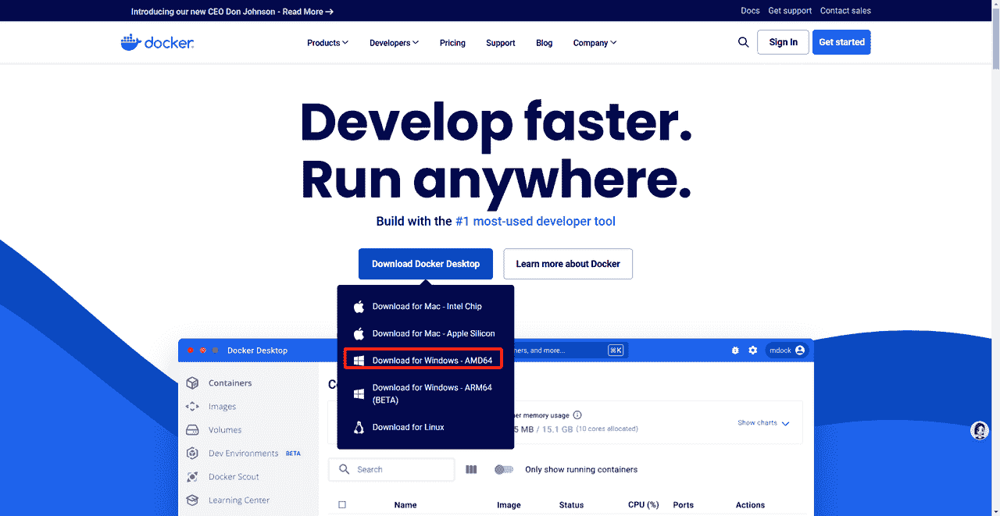

### 安装 docker

把下载下来的 docker 一直安装到最后。

### 启动查看 docker

windows 版本通过点击图标启动

### 配置镜像

打开 docker 软件，点击设置，点击 docker 引擎，配置下载镜像：

最后点击【apply】按钮

```
&quot;registry-mirrors&quot;:[   
&quot;https://docker.m.daocloud.io&quot;,   
&quot;https://docker.1panel.live&quot;,   
&quot;https://registry.docker-cn.com&quot;,   
&quot;https://cr.console.aliyun.com&quot;,   
&quot;https://mirror.ccs.tencentyun.com&quot;
]
```

## docker 部分命令解释

此命令启动一个 docker 容器

1.  **docker run**：这是 Docker 用于运行容器的基本命令，它会根据指定的镜像创建并启动一个新的容器实例。

1.  **-d**：表示以守护进程（detached）模式运行容器，即容器会在后台运行，不会占用当前命令行终端的输入输出流，方便执行其他命令。

1.  **-p 3000:8080**：端口映射参数，将容器内部的 8080 端口映射到主机的 3000 端口。这样，通过访问主机的 3000 端口，就可以访问到容器内运行在 8080 端口上的open-webui应用。

1.  **--add-host=host.docker.i**nternal:host-gateway：此参数用于向容器内的/etc/hosts文件中添加一条主机映射记录，将host.docker.internal映射到host-gateway。这在容器需要与主机进行通信时非常有用，特别是在一些特殊网络环境下，使得容器能够通过host.docker.internal这个域名访问到主机。

1.  **-v D:devopen-web**ui:/app/backend/data：这是卷挂载（volume mount）参数，将主机上的D:devopen-webui目录挂载到容器内的/app/backend/data目录。这意味着主机和容器可以共享这个目录下的文件，主机目录中的任何更改都会实时反映到容器内，反之亦然。常用于数据持久化或在容器和主机之间传递数据。

## ollama 安装

通过 win+r，输入 cmd 打开 cmd，执行一下命令等待即可

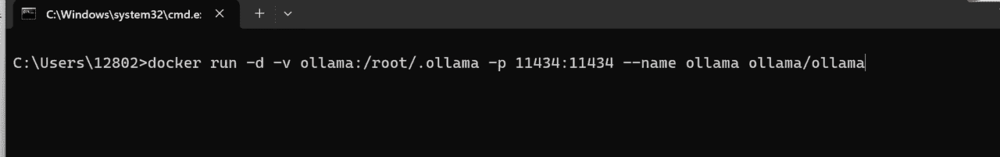

### 启动 ollama 容器

1.使用该命令启动 CPU 版运行本地 AI 模型

```
docker run -d -v ollama:/root/.ollama -p 11434:11434 --name ollama ollama/ollama
```

2.此命令用于启动 GPU 版本运行 AI 模型

前提是笔记本已配置 NVIDIA 的 GPU 驱动，可在 shell 中输入 nvidia-smi 查看详细情况

```
docker run -d --gpus=all -v ollama:/root/.ollama -p 11434:11434 --name ollama ollama/ollama
```

### 安装 Deepseek

参考上一篇文章

## Open **Webui 马甲**

docker 安装（官网推荐）：https://github.com/open-webui/open-webui

源代码安装文档：https://docs.openwebui.com/getting-started/

### 通过 docker 安装

ollama 在本地则执行一下操作

通过 win+r，输入 cmd 打开 cmd，执行一下命令等待即可

```
docker run -d -p 3000:8080 --add-host=host.docker.internal:host-gateway -v open-webui:/app/backend/data --name open-webui --restart always ghcr.io/open-webui/open-webui:main
```

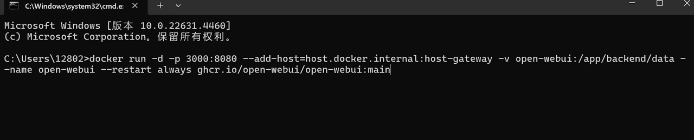

### 模型文件（自定义模型）

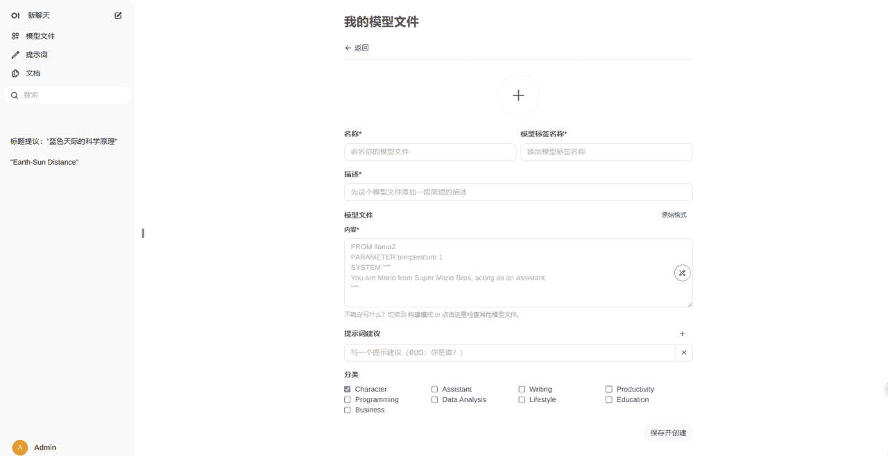

### 模型配置

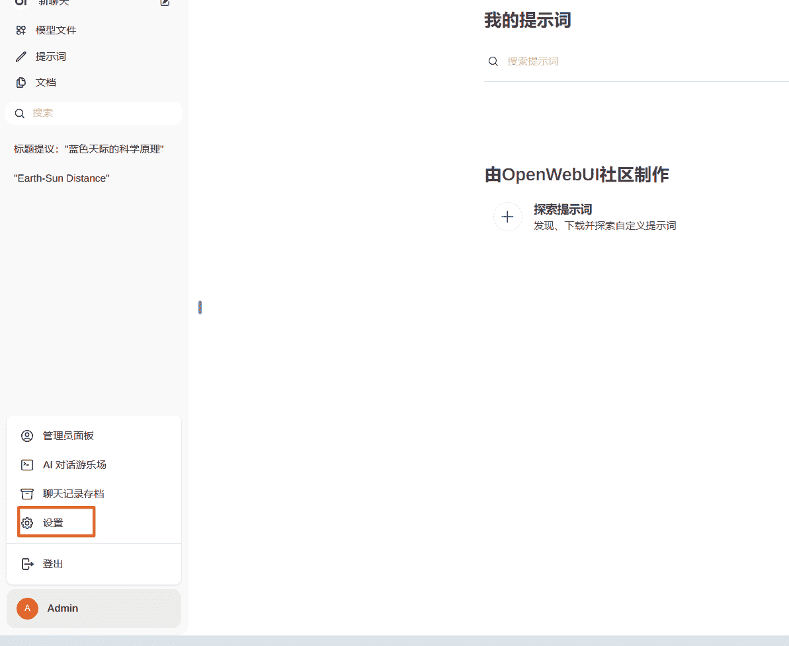

配置大模型

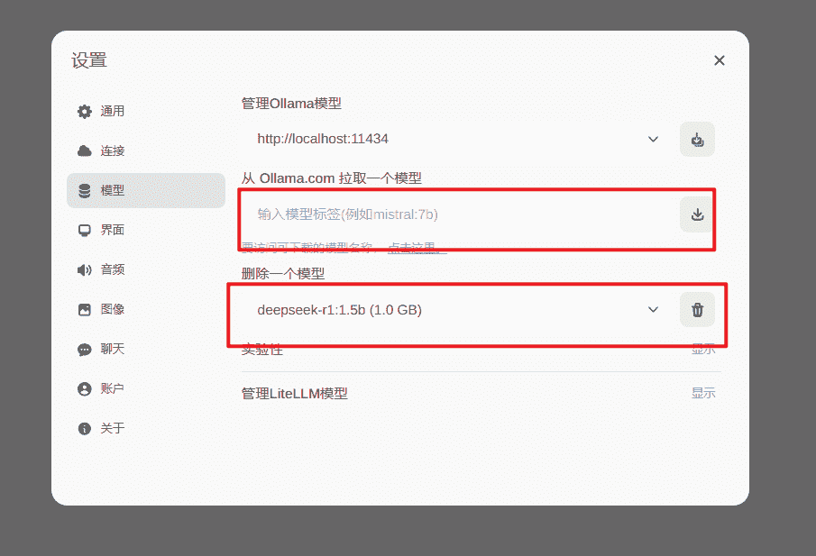

界面默认

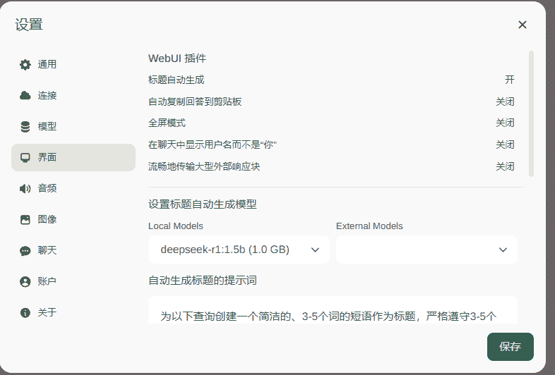

### 知识库

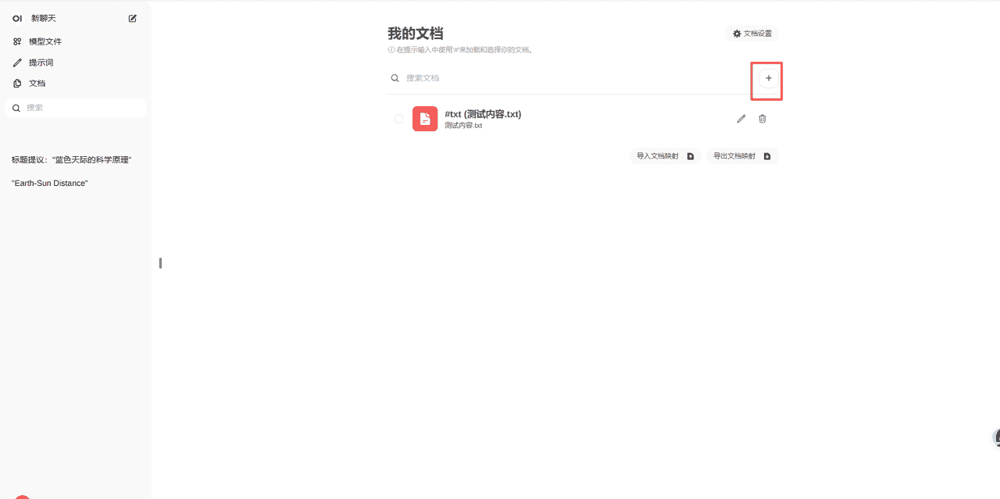

嵌入模型以及配置

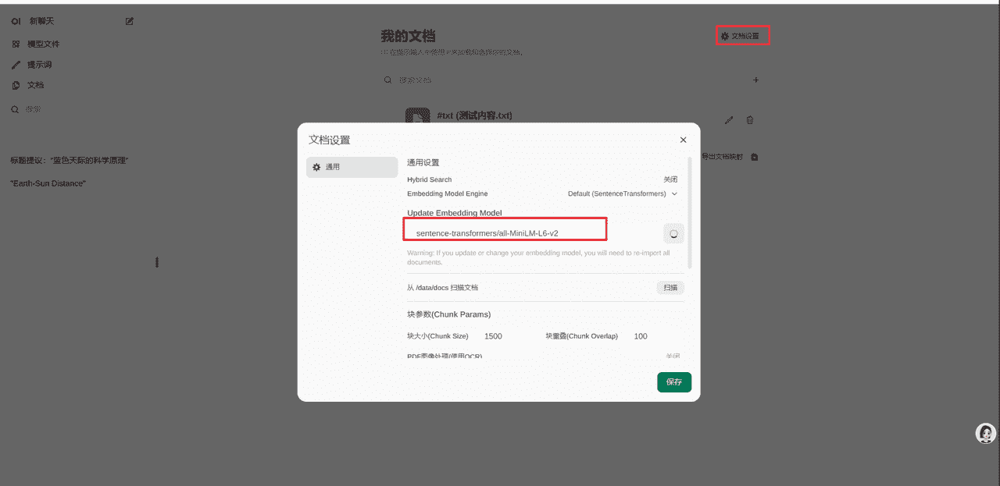

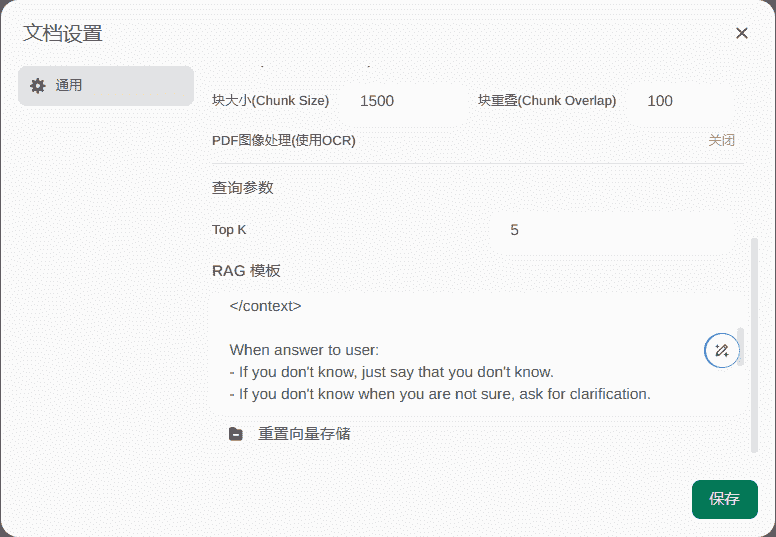

### 体验

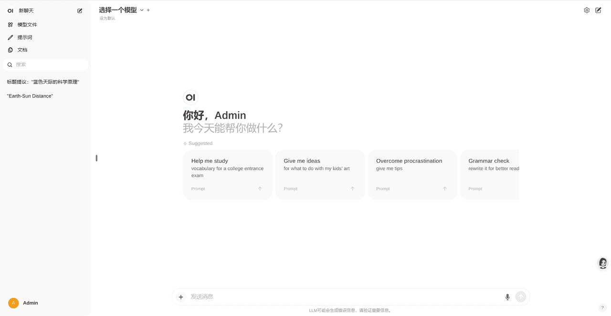

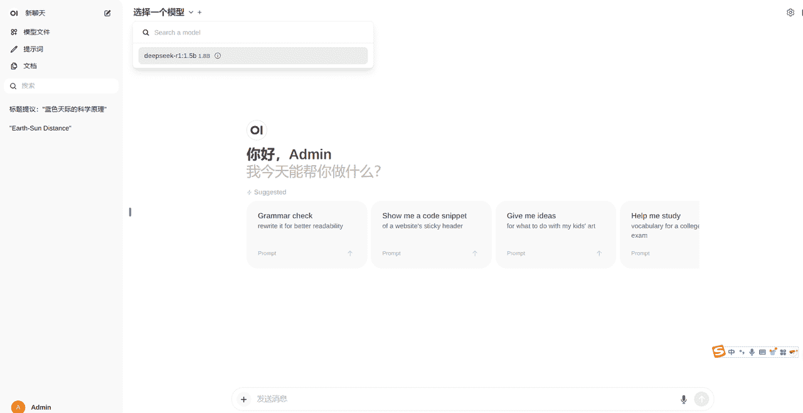

## 参考：

https://blog.csdn.net/baidu_36511315/article/details/108117826#21_Windows_7